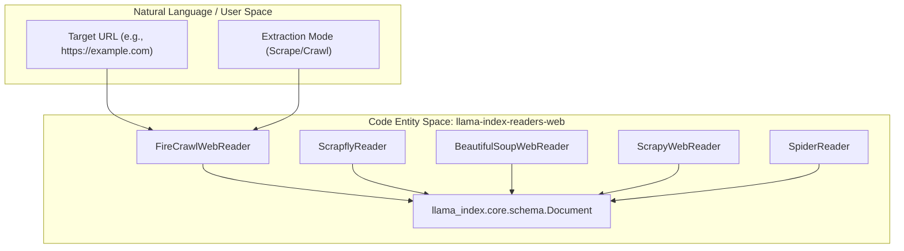
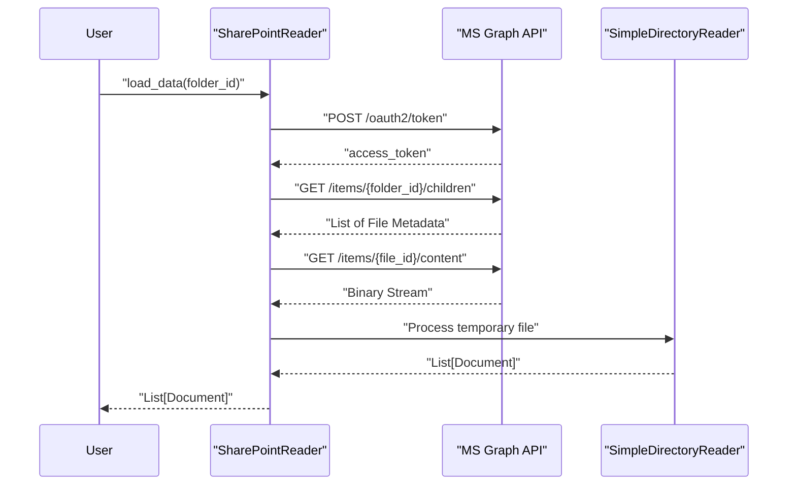
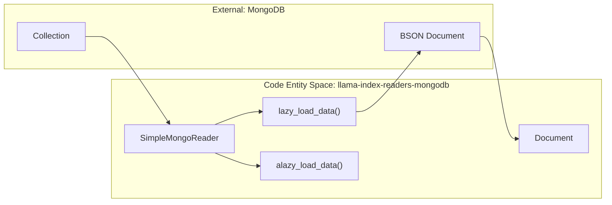

<!-- source: DeepWiki mcp.deepwiki.com · repo run-llama/llama_index · page 9.2 Web and Cloud Readers · fetched 2026-11-09 -->

# Web and Cloud Readers

Relevant source files

The following files were used as context for generating this wiki page:

- [docs/examples/data_connectors/GoogleSheetsDemo.ipynb](docs/examples/data_connectors/GoogleSheetsDemo.ipynb)
- [llama-index-integrations/program/llama-index-program-guidance/llama_index/program/guidance/base.py](llama-index-integrations/program/llama-index-program-guidance/llama_index/program/guidance/base.py)
- [llama-index-integrations/readers/llama-index-readers-awadb/pyproject.toml](llama-index-integrations/readers/llama-index-readers-awadb/pyproject.toml)
- [llama-index-integrations/readers/llama-index-readers-awadb/uv.lock](llama-index-integrations/readers/llama-index-readers-awadb/uv.lock)
- [llama-index-integrations/readers/llama-index-readers-azcognitive-search/pyproject.toml](llama-index-integrations/readers/llama-index-readers-azcognitive-search/pyproject.toml)
- [llama-index-integrations/readers/llama-index-readers-azcognitive-search/uv.lock](llama-index-integrations/readers/llama-index-readers-azcognitive-search/uv.lock)
- [llama-index-integrations/readers/llama-index-readers-azstorage-blob/CHANGELOG.md](llama-index-integrations/readers/llama-index-readers-azstorage-blob/CHANGELOG.md)
- [llama-index-integrations/readers/llama-index-readers-azstorage-blob/llama_index/readers/azstorage_blob/base.py](llama-index-integrations/readers/llama-index-readers-azstorage-blob/llama_index/readers/azstorage_blob/base.py)
- [llama-index-integrations/readers/llama-index-readers-azstorage-blob/pyproject.toml](llama-index-integrations/readers/llama-index-readers-azstorage-blob/pyproject.toml)
- [llama-index-integrations/readers/llama-index-readers-azstorage-blob/tests/test_readers_azstorage_blob.py](llama-index-integrations/readers/llama-index-readers-azstorage-blob/tests/test_readers_azstorage_blob.py)
- [llama-index-integrations/readers/llama-index-readers-azstorage-blob/uv.lock](llama-index-integrations/readers/llama-index-readers-azstorage-blob/uv.lock)
- [llama-index-integrations/readers/llama-index-readers-bagel/pyproject.toml](llama-index-integrations/readers/llama-index-readers-bagel/pyproject.toml)
- [llama-index-integrations/readers/llama-index-readers-bagel/uv.lock](llama-index-integrations/readers/llama-index-readers-bagel/uv.lock)
- [llama-index-integrations/readers/llama-index-readers-bilibili/pyproject.toml](llama-index-integrations/readers/llama-index-readers-bilibili/pyproject.toml)
- [llama-index-integrations/readers/llama-index-readers-bilibili/uv.lock](llama-index-integrations/readers/llama-index-readers-bilibili/uv.lock)
- [llama-index-integrations/readers/llama-index-readers-chatgpt-plugin/pyproject.toml](llama-index-integrations/readers/llama-index-readers-chatgpt-plugin/pyproject.toml)
- [llama-index-integrations/readers/llama-index-readers-chatgpt-plugin/uv.lock](llama-index-integrations/readers/llama-index-readers-chatgpt-plugin/uv.lock)
- [llama-index-integrations/readers/llama-index-readers-chroma/pyproject.toml](llama-index-integrations/readers/llama-index-readers-chroma/pyproject.toml)
- [llama-index-integrations/readers/llama-index-readers-chroma/uv.lock](llama-index-integrations/readers/llama-index-readers-chroma/uv.lock)
- [llama-index-integrations/readers/llama-index-readers-confluence/CHANGELOG.md](llama-index-integrations/readers/llama-index-readers-confluence/CHANGELOG.md)
- [llama-index-integrations/readers/llama-index-readers-confluence/LICENSE](llama-index-integrations/readers/llama-index-readers-confluence/LICENSE)
- [llama-index-integrations/readers/llama-index-readers-confluence/README.md](llama-index-integrations/readers/llama-index-readers-confluence/README.md)
- [llama-index-integrations/readers/llama-index-readers-confluence/llama_index/readers/confluence/base.py](llama-index-integrations/readers/llama-index-readers-confluence/llama_index/readers/confluence/base.py)
- [llama-index-integrations/readers/llama-index-readers-confluence/llama_index/readers/confluence/event.py](llama-index-integrations/readers/llama-index-readers-confluence/llama_index/readers/confluence/event.py)
- [llama-index-integrations/readers/llama-index-readers-confluence/llama_index/readers/confluence/html_parser.py](llama-index-integrations/readers/llama-index-readers-confluence/llama_index/readers/confluence/html_parser.py)
- [llama-index-integrations/readers/llama-index-readers-confluence/pyproject.toml](llama-index-integrations/readers/llama-index-readers-confluence/pyproject.toml)
- [llama-index-integrations/readers/llama-index-readers-confluence/tests/__init__.py](llama-index-integrations/readers/llama-index-readers-confluence/tests/__init__.py)
- [llama-index-integrations/readers/llama-index-readers-confluence/tests/run_basic_tests.py](llama-index-integrations/readers/llama-index-readers-confluence/tests/run_basic_tests.py)
- [llama-index-integrations/readers/llama-index-readers-confluence/tests/test_html_parser.py](llama-index-integrations/readers/llama-index-readers-confluence/tests/test_html_parser.py)
- [llama-index-integrations/readers/llama-index-readers-confluence/tests/test_integration.py](llama-index-integrations/readers/llama-index-readers-confluence/tests/test_integration.py)
- [llama-index-integrations/readers/llama-index-readers-confluence/tests/test_new_features.py](llama-index-integrations/readers/llama-index-readers-confluence/tests/test_new_features.py)
- [llama-index-integrations/readers/llama-index-readers-confluence/tests/test_readers_confluence.py](llama-index-integrations/readers/llama-index-readers-confluence/tests/test_readers_confluence.py)
- [llama-index-integrations/readers/llama-index-readers-confluence/uv.lock](llama-index-integrations/readers/llama-index-readers-confluence/uv.lock)
- [llama-index-integrations/readers/llama-index-readers-database/CHANGELOG.md](llama-index-integrations/readers/llama-index-readers-database/CHANGELOG.md)
- [llama-index-integrations/readers/llama-index-readers-database/README.md](llama-index-integrations/readers/llama-index-readers-database/README.md)
- [llama-index-integrations/readers/llama-index-readers-database/llama_index/readers/database/base.py](llama-index-integrations/readers/llama-index-readers-database/llama_index/readers/database/base.py)
- [llama-index-integrations/readers/llama-index-readers-database/tests/test_readers_database.py](llama-index-integrations/readers/llama-index-readers-database/tests/test_readers_database.py)
- [llama-index-integrations/readers/llama-index-readers-github/CHANGELOG.md](llama-index-integrations/readers/llama-index-readers-github/CHANGELOG.md)
- [llama-index-integrations/readers/llama-index-readers-github/GITHUB_APP_QUICKSTART.md](llama-index-integrations/readers/llama-index-readers-github/GITHUB_APP_QUICKSTART.md)
- [llama-index-integrations/readers/llama-index-readers-github/README.md](llama-index-integrations/readers/llama-index-readers-github/README.md)
- [llama-index-integrations/readers/llama-index-readers-github/examples/github_app_example.py](llama-index-integrations/readers/llama-index-readers-github/examples/github_app_example.py)
- [llama-index-integrations/readers/llama-index-readers-github/llama_index/readers/github/__init__.py](llama-index-integrations/readers/llama-index-readers-github/llama_index/readers/github/__init__.py)
- [llama-index-integrations/readers/llama-index-readers-github/llama_index/readers/github/collaborators/base.py](llama-index-integrations/readers/llama-index-readers-github/llama_index/readers/github/collaborators/base.py)
- [llama-index-integrations/readers/llama-index-readers-github/llama_index/readers/github/collaborators/github_client.py](llama-index-integrations/readers/llama-index-readers-github/llama_index/readers/github/collaborators/github_client.py)
- [llama-index-integrations/readers/llama-index-readers-github/llama_index/readers/github/github_app_auth.py](llama-index-integrations/readers/llama-index-readers-github/llama_index/readers/github/github_app_auth.py)
- [llama-index-integrations/readers/llama-index-readers-github/llama_index/readers/github/issues/base.py](llama-index-integrations/readers/llama-index-readers-github/llama_index/readers/github/issues/base.py)
- [llama-index-integrations/readers/llama-index-readers-github/llama_index/readers/github/issues/github_client.py](llama-index-integrations/readers/llama-index-readers-github/llama_index/readers/github/issues/github_client.py)
- [llama-index-integrations/readers/llama-index-readers-github/llama_index/readers/github/repository/base.py](llama-index-integrations/readers/llama-index-readers-github/llama_index/readers/github/repository/base.py)
- [llama-index-integrations/readers/llama-index-readers-github/llama_index/readers/github/repository/event.py](llama-index-integrations/readers/llama-index-readers-github/llama_index/readers/github/repository/event.py)
- [llama-index-integrations/readers/llama-index-readers-github/llama_index/readers/github/repository/github_client.py](llama-index-integrations/readers/llama-index-readers-github/llama_index/readers/github/repository/github_client.py)
- [llama-index-integrations/readers/llama-index-readers-github/llama_index/readers/github/repository/utils.py](llama-index-integrations/readers/llama-index-readers-github/llama_index/readers/github/repository/utils.py)
- [llama-index-integrations/readers/llama-index-readers-github/pyproject.toml](llama-index-integrations/readers/llama-index-readers-github/pyproject.toml)
- [llama-index-integrations/readers/llama-index-readers-github/tests/test_asyncio_run_in_running_loop.py](llama-index-integrations/readers/llama-index-readers-github/tests/test_asyncio_run_in_running_loop.py)
- [llama-index-integrations/readers/llama-index-readers-github/tests/test_gh_base_url.py](llama-index-integrations/readers/llama-index-readers-github/tests/test_gh_base_url.py)
- [llama-index-integrations/readers/llama-index-readers-github/tests/test_github_app_auth.py](llama-index-integrations/readers/llama-index-readers-github/tests/test_github_app_auth.py)
- [llama-index-integrations/readers/llama-index-readers-github/tests/test_github_repository_reader.py](llama-index-integrations/readers/llama-index-readers-github/tests/test_github_repository_reader.py)
- [llama-index-integrations/readers/llama-index-readers-github/tests/test_github_repository_reader_selective.py](llama-index-integrations/readers/llama-index-readers-github/tests/test_github_repository_reader_selective.py)
- [llama-index-integrations/readers/llama-index-readers-google/CHANGELOG.md](llama-index-integrations/readers/llama-index-readers-google/CHANGELOG.md)
- [llama-index-integrations/readers/llama-index-readers-google/README.md](llama-index-integrations/readers/llama-index-readers-google/README.md)
- [llama-index-integrations/readers/llama-index-readers-google/llama_index/readers/google/__init__.py](llama-index-integrations/readers/llama-index-readers-google/llama_index/readers/google/__init__.py)
- [llama-index-integrations/readers/llama-index-readers-google/llama_index/readers/google/calendar/README.md](llama-index-integrations/readers/llama-index-readers-google/llama_index/readers/google/calendar/README.md)
- [llama-index-integrations/readers/llama-index-readers-google/llama_index/readers/google/chat/README.md](llama-index-integrations/readers/llama-index-readers-google/llama_index/readers/google/chat/README.md)
- [llama-index-integrations/readers/llama-index-readers-google/llama_index/readers/google/chat/__init__.py](llama-index-integrations/readers/llama-index-readers-google/llama_index/readers/google/chat/__init__.py)
- [llama-index-integrations/readers/llama-index-readers-google/llama_index/readers/google/chat/base.py](llama-index-integrations/readers/llama-index-readers-google/llama_index/readers/google/chat/base.py)
- [llama-index-integrations/readers/llama-index-readers-google/llama_index/readers/google/docs/README.md](llama-index-integrations/readers/llama-index-readers-google/llama_index/readers/google/docs/README.md)
- [llama-index-integrations/readers/llama-index-readers-google/llama_index/readers/google/docs/base.py](llama-index-integrations/readers/llama-index-readers-google/llama_index/readers/google/docs/base.py)
- [llama-index-integrations/readers/llama-index-readers-google/llama_index/readers/google/drive/README.md](llama-index-integrations/readers/llama-index-readers-google/llama_index/readers/google/drive/README.md)
- [llama-index-integrations/readers/llama-index-readers-google/llama_index/readers/google/drive/base.py](llama-index-integrations/readers/llama-index-readers-google/llama_index/readers/google/drive/base.py)
- [llama-index-integrations/readers/llama-index-readers-google/llama_index/readers/google/gmail/README.md](llama-index-integrations/readers/llama-index-readers-google/llama_index/readers/google/gmail/README.md)
- [llama-index-integrations/readers/llama-index-readers-google/llama_index/readers/google/keep/README.md](llama-index-integrations/readers/llama-index-readers-google/llama_index/readers/google/keep/README.md)
- [llama-index-integrations/readers/llama-index-readers-google/llama_index/readers/google/maps/README.md](llama-index-integrations/readers/llama-index-readers-google/llama_index/readers/google/maps/README.md)
- [llama-index-integrations/readers/llama-index-readers-google/llama_index/readers/google/maps/__init__.py](llama-index-integrations/readers/llama-index-readers-google/llama_index/readers/google/maps/__init__.py)
- [llama-index-integrations/readers/llama-index-readers-google/llama_index/readers/google/maps/base.py](llama-index-integrations/readers/llama-index-readers-google/llama_index/readers/google/maps/base.py)
- [llama-index-integrations/readers/llama-index-readers-google/llama_index/readers/google/sheets/README.md](llama-index-integrations/readers/llama-index-readers-google/llama_index/readers/google/sheets/README.md)
- [llama-index-integrations/readers/llama-index-readers-google/llama_index/readers/google/sheets/base.py](llama-index-integrations/readers/llama-index-readers-google/llama_index/readers/google/sheets/base.py)
- [llama-index-integrations/readers/llama-index-readers-google/pyproject.toml](llama-index-integrations/readers/llama-index-readers-google/pyproject.toml)
- [llama-index-integrations/readers/llama-index-readers-google/tests/__init__.py](llama-index-integrations/readers/llama-index-readers-google/tests/__init__.py)
- [llama-index-integrations/readers/llama-index-readers-google/tests/test_readers_google_drive.py](llama-index-integrations/readers/llama-index-readers-google/tests/test_readers_google_drive.py)
- [llama-index-integrations/readers/llama-index-readers-google/tests/test_readers_google_maps.py](llama-index-integrations/readers/llama-index-readers-google/tests/test_readers_google_maps.py)
- [llama-index-integrations/readers/llama-index-readers-joplin/pyproject.toml](llama-index-integrations/readers/llama-index-readers-joplin/pyproject.toml)
- [llama-index-integrations/readers/llama-index-readers-mbox/pyproject.toml](llama-index-integrations/readers/llama-index-readers-mbox/pyproject.toml)
- [llama-index-integrations/readers/llama-index-readers-microsoft-onedrive/CHANGELOG.md](llama-index-integrations/readers/llama-index-readers-microsoft-onedrive/CHANGELOG.md)
- [llama-index-integrations/readers/llama-index-readers-microsoft-onedrive/llama_index/readers/microsoft_onedrive/base.py](llama-index-integrations/readers/llama-index-readers-microsoft-onedrive/llama_index/readers/microsoft_onedrive/base.py)
- [llama-index-integrations/readers/llama-index-readers-microsoft-onedrive/pyproject.toml](llama-index-integrations/readers/llama-index-readers-microsoft-onedrive/pyproject.toml)
- [llama-index-integrations/readers/llama-index-readers-microsoft-onedrive/tests/test_readers_microsoft_onedrive.py](llama-index-integrations/readers/llama-index-readers-microsoft-onedrive/tests/test_readers_microsoft_onedrive.py)
- [llama-index-integrations/readers/llama-index-readers-microsoft-sharepoint/CHANGELOG.md](llama-index-integrations/readers/llama-index-readers-microsoft-sharepoint/CHANGELOG.md)
- [llama-index-integrations/readers/llama-index-readers-microsoft-sharepoint/README.md](llama-index-integrations/readers/llama-index-readers-microsoft-sharepoint/README.md)
- [llama-index-integrations/readers/llama-index-readers-microsoft-sharepoint/llama_index/readers/microsoft_sharepoint/__init__.py](llama-index-integrations/readers/llama-index-readers-microsoft-sharepoint/llama_index/readers/microsoft_sharepoint/__init__.py)
- [llama-index-integrations/readers/llama-index-readers-microsoft-sharepoint/llama_index/readers/microsoft_sharepoint/base.py](llama-index-integrations/readers/llama-index-readers-microsoft-sharepoint/llama_index/readers/microsoft_sharepoint/base.py)
- [llama-index-integrations/readers/llama-index-readers-microsoft-sharepoint/llama_index/readers/microsoft_sharepoint/event.py](llama-index-integrations/readers/llama-index-readers-microsoft-sharepoint/llama_index/readers/microsoft_sharepoint/event.py)
- [llama-index-integrations/readers/llama-index-readers-microsoft-sharepoint/pyproject.toml](llama-index-integrations/readers/llama-index-readers-microsoft-sharepoint/pyproject.toml)
- [llama-index-integrations/readers/llama-index-readers-microsoft-sharepoint/tests/test_readers_microsoft_sharepoint.py](llama-index-integrations/readers/llama-index-readers-microsoft-sharepoint/tests/test_readers_microsoft_sharepoint.py)
- [llama-index-integrations/readers/llama-index-readers-microsoft-sharepoint/uv.lock](llama-index-integrations/readers/llama-index-readers-microsoft-sharepoint/uv.lock)
- [llama-index-integrations/readers/llama-index-readers-mongodb/README.md](llama-index-integrations/readers/llama-index-readers-mongodb/README.md)
- [llama-index-integrations/readers/llama-index-readers-mongodb/llama_index/readers/mongodb/base.py](llama-index-integrations/readers/llama-index-readers-mongodb/llama_index/readers/mongodb/base.py)
- [llama-index-integrations/readers/llama-index-readers-mongodb/pyproject.toml](llama-index-integrations/readers/llama-index-readers-mongodb/pyproject.toml)
- [llama-index-integrations/readers/llama-index-readers-mongodb/uv.lock](llama-index-integrations/readers/llama-index-readers-mongodb/uv.lock)
- [llama-index-integrations/readers/llama-index-readers-obsidian/README.md](llama-index-integrations/readers/llama-index-readers-obsidian/README.md)
- [llama-index-integrations/readers/llama-index-readers-obsidian/llama_index/readers/obsidian/base.py](llama-index-integrations/readers/llama-index-readers-obsidian/llama_index/readers/obsidian/base.py)
- [llama-index-integrations/readers/llama-index-readers-obsidian/pyproject.toml](llama-index-integrations/readers/llama-index-readers-obsidian/pyproject.toml)
- [llama-index-integrations/readers/llama-index-readers-obsidian/tests/test_readers_obsidian.py](llama-index-integrations/readers/llama-index-readers-obsidian/tests/test_readers_obsidian.py)
- [llama-index-integrations/readers/llama-index-readers-pebblo/pyproject.toml](llama-index-integrations/readers/llama-index-readers-pebblo/pyproject.toml)
- [llama-index-integrations/readers/llama-index-readers-pebblo/tests/test_readers_pebblo.py](llama-index-integrations/readers/llama-index-readers-pebblo/tests/test_readers_pebblo.py)
- [llama-index-integrations/readers/llama-index-readers-s3/CHANGELOG.md](llama-index-integrations/readers/llama-index-readers-s3/CHANGELOG.md)
- [llama-index-integrations/readers/llama-index-readers-s3/README.md](llama-index-integrations/readers/llama-index-readers-s3/README.md)
- [llama-index-integrations/readers/llama-index-readers-s3/llama_index/readers/s3/base.py](llama-index-integrations/readers/llama-index-readers-s3/llama_index/readers/s3/base.py)
- [llama-index-integrations/readers/llama-index-readers-s3/pyproject.toml](llama-index-integrations/readers/llama-index-readers-s3/pyproject.toml)
- [llama-index-integrations/readers/llama-index-readers-s3/requirements.txt](llama-index-integrations/readers/llama-index-readers-s3/requirements.txt)
- [llama-index-integrations/readers/llama-index-readers-s3/tests/test_readers_s3.py](llama-index-integrations/readers/llama-index-readers-s3/tests/test_readers_s3.py)
- [llama-index-integrations/readers/llama-index-readers-web/llama_index/readers/web/firecrawl_web/README.md](llama-index-integrations/readers/llama-index-readers-web/llama_index/readers/web/firecrawl_web/README.md)
- [llama-index-integrations/readers/llama-index-readers-web/llama_index/readers/web/firecrawl_web/__init__.py](llama-index-integrations/readers/llama-index-readers-web/llama_index/readers/web/firecrawl_web/__init__.py)
- [llama-index-integrations/readers/llama-index-readers-web/llama_index/readers/web/firecrawl_web/base.py](llama-index-integrations/readers/llama-index-readers-web/llama_index/readers/web/firecrawl_web/base.py)
- [llama-index-integrations/readers/llama-index-readers-web/llama_index/readers/web/firecrawl_web/requirements.txt](llama-index-integrations/readers/llama-index-readers-web/llama_index/readers/web/firecrawl_web/requirements.txt)
- [llama-index-integrations/readers/llama-index-readers-web/llama_index/readers/web/knowledge_base/base.py](llama-index-integrations/readers/llama-index-readers-web/llama_index/readers/web/knowledge_base/base.py)
- [llama-index-integrations/readers/llama-index-readers-web/llama_index/readers/web/scrapfly_web/README.md](llama-index-integrations/readers/llama-index-readers-web/llama_index/readers/web/scrapfly_web/README.md)
- [llama-index-integrations/readers/llama-index-readers-web/llama_index/readers/web/scrapfly_web/__init__.py](llama-index-integrations/readers/llama-index-readers-web/llama_index/readers/web/scrapfly_web/__init__.py)
- [llama-index-integrations/readers/llama-index-readers-web/llama_index/readers/web/scrapfly_web/base.py](llama-index-integrations/readers/llama-index-readers-web/llama_index/readers/web/scrapfly_web/base.py)
- [llama-index-integrations/readers/llama-index-readers-web/llama_index/readers/web/scrapfly_web/requirements.txt](llama-index-integrations/readers/llama-index-readers-web/llama_index/readers/web/scrapfly_web/requirements.txt)
- [llama-index-integrations/readers/llama-index-readers-web/pyproject.toml](llama-index-integrations/readers/llama-index-readers-web/pyproject.toml)
- [llama-index-integrations/readers/llama-index-readers-web/tests/conftest.py](llama-index-integrations/readers/llama-index-readers-web/tests/conftest.py)
- [llama-index-integrations/readers/llama-index-readers-web/tests/test_firecrawl_requests.py](llama-index-integrations/readers/llama-index-readers-web/tests/test_firecrawl_requests.py)
- [llama-index-integrations/readers/llama-index-readers-web/tests/test_firecrawl_web_reader.py](llama-index-integrations/readers/llama-index-readers-web/tests/test_firecrawl_web_reader.py)
- [llama-index-integrations/storage/chat_store/llama-index-storage-chat-store-mongo/.gitignore](llama-index-integrations/storage/chat_store/llama-index-storage-chat-store-mongo/.gitignore)
- [llama-index-integrations/storage/chat_store/llama-index-storage-chat-store-mongo/LICENSE](llama-index-integrations/storage/chat_store/llama-index-storage-chat-store-mongo/LICENSE)
- [llama-index-integrations/storage/chat_store/llama-index-storage-chat-store-mongo/Makefile](llama-index-integrations/storage/chat_store/llama-index-storage-chat-store-mongo/Makefile)
- [llama-index-integrations/storage/chat_store/llama-index-storage-chat-store-mongo/README.md](llama-index-integrations/storage/chat_store/llama-index-storage-chat-store-mongo/README.md)
- [llama-index-integrations/storage/chat_store/llama-index-storage-chat-store-mongo/llama_index/storage/chat_store/mongo/__init__.py](llama-index-integrations/storage/chat_store/llama-index-storage-chat-store-mongo/llama_index/storage/chat_store/mongo/__init__.py)
- [llama-index-integrations/storage/chat_store/llama-index-storage-chat-store-mongo/llama_index/storage/chat_store/mongo/base.py](llama-index-integrations/storage/chat_store/llama-index-storage-chat-store-mongo/llama_index/storage/chat_store/mongo/base.py)
- [llama-index-integrations/storage/chat_store/llama-index-storage-chat-store-mongo/pyproject.toml](llama-index-integrations/storage/chat_store/llama-index-storage-chat-store-mongo/pyproject.toml)
- [llama-index-integrations/storage/chat_store/llama-index-storage-chat-store-mongo/tests/__init__.py](llama-index-integrations/storage/chat_store/llama-index-storage-chat-store-mongo/tests/__init__.py)
- [llama-index-integrations/storage/chat_store/llama-index-storage-chat-store-mongo/tests/test_chat_store_mongo_chat_store.py](llama-index-integrations/storage/chat_store/llama-index-storage-chat-store-mongo/tests/test_chat_store_mongo_chat_store.py)
- [llama-index-integrations/storage/kvstore/llama-index-storage-kvstore-mongodb/llama_index/storage/kvstore/mongodb/base.py](llama-index-integrations/storage/kvstore/llama-index-storage-kvstore-mongodb/llama_index/storage/kvstore/mongodb/base.py)
- [llama-index-integrations/storage/kvstore/llama-index-storage-kvstore-mongodb/pyproject.toml](llama-index-integrations/storage/kvstore/llama-index-storage-kvstore-mongodb/pyproject.toml)

Web and Cloud readers in LlamaIndex are specialized data connectors designed to ingest unstructured data from internet sources and enterprise cloud platforms. These readers implement the `BaseReader` or `BasePydanticReader` interfaces, transforming remote resources (web pages, cloud documents, or repository files) into LlamaIndex `Document` objects.

## Web Scrapers and Crawlers

Web readers handle the complexities of HTTP requests, JavaScript rendering, and content extraction. They often integrate with third-party services to bypass anti-bot measures or to convert raw HTML into LLM-friendly Markdown.

### Firecrawl and Scrapfly
`FireCrawlWebReader` leverages the Firecrawl API to convert URLs into clean Markdown. It supports multiple operational modes: `scrape` (single URL), `crawl` (sub-pages), `map` (site mapping), and `extract` (structured data extraction) [llama-index-integrations/readers/llama-index-readers-web/pyproject.toml:89-89]().

`ScrapflyReader` provides similar functionality with a focus on bypassing scrap-protection and rendering heavy JavaScript [llama-index-integrations/readers/llama-index-readers-web/pyproject.toml:125-125]().

### Implementation Mapping: Web Space to Code Entities

The following diagram illustrates how web-based requests are processed through the reader abstractions.

**Web Ingestion Flow**

Sources: [llama-index-integrations/readers/llama-index-readers-web/pyproject.toml:111-133]()

## Google Cloud Readers

The `llama-index-readers-google` package provides connectors for the Google Workspace ecosystem.

### Google Drive, Docs, and Sheets
*   **GoogleDriveReader**: Supports reading files by `drive_id`, `folder_id`, or specific `file_ids`. It handles OAuth2 authentication via `credentials.json` or service account keys [llama-index-integrations/readers/llama-index-readers-google/llama_index/readers/google/drive/base.py:30-78]().
*   **MIME Type Handling**: The reader automatically maps Google-native formats (Docs, Slides, Sheets) to OpenXML formats (`.docx`, `.pptx`, `.xlsx`) for local processing [llama-index-integrations/readers/llama-index-readers-google/llama_index/readers/google/drive/base.py:142-157]().
*   **GoogleSheetsReader**: Specifically optimized for tabular data extraction from spreadsheets [llama-index-integrations/readers/llama-index-readers-google/pyproject.toml:87-87]().

Sources: [llama-index-integrations/readers/llama-index-readers-google/llama_index/readers/google/drive/base.py:30-157](), [llama-index-integrations/readers/llama-index-readers-google/pyproject.toml:80-88]()

## Microsoft 365 Readers

LlamaIndex supports major Microsoft enterprise tools through specialized readers that interface with the Microsoft Graph API.

### SharePoint and OneDrive
*   **SharePointReader**: A versatile reader that supports both `DRIVE` (files stored in document libraries) and `PAGE` (SharePoint Site Pages) content types [llama-index-integrations/readers/llama-index-readers-microsoft-sharepoint/llama_index/readers/microsoft_sharepoint/base.py:36-43]().
*   **OneDriveReader**: Focuses on personal or business OneDrive storage, utilizing `msal` for authentication [llama-index-integrations/readers/llama-index-readers-microsoft-onedrive/pyproject.toml:45-45]().

### SharePoint Implementation Detail
The `SharePointReader` uses a tenant-specific OAuth2 flow to acquire access tokens for the Microsoft Graph API [llama-index-integrations/readers/llama-index-readers-microsoft-sharepoint/llama_index/readers/microsoft_sharepoint/base.py:145-173](). It can recursively list resources in a folder and download them to temporary storage for parsing via `SimpleDirectoryReader` [llama-index-integrations/readers/llama-index-readers-microsoft-sharepoint/llama_index/readers/microsoft_sharepoint/base.py:15-17]().

**SharePoint Data Flow**

Sources: [llama-index-integrations/readers/llama-index-readers-microsoft-sharepoint/llama_index/readers/microsoft_sharepoint/base.py:43-173](), [llama-index-integrations/readers/llama-index-readers-microsoft-sharepoint/pyproject.toml:41-45]()

## GitHub Reader

The `GithubRepositoryReader` retrieves contents from GitHub repositories. It is highly configurable, allowing users to target specific branches, commits, or directories.

*   **Filtering**: Supports inclusive or exclusive filtering by directory, file extension, or file path [llama-index-integrations/readers/llama-index-readers-github/pyproject.toml:42-51]().
*   **Functionality**: Includes specialized readers for repository collaborators (`GitHubRepositoryCollaboratorsReader`) and issues (`GitHubRepositoryIssuesReader`) [llama-index-integrations/readers/llama-index-readers-github/pyproject.toml:81-83]().
*   **Dependencies**: Requires `httpx` for API communication and optionally `PyJWT` for GitHub App authentication [llama-index-integrations/readers/llama-index-readers-github/pyproject.toml:54-61]().

Sources: [llama-index-integrations/readers/llama-index-readers-github/pyproject.toml:29-83]()

## Confluence Reader

The `ConfluenceReader` ingests pages and attachments from Confluence Cloud or Data Center instances.

*   **Authentication**: Supports OAuth2, Personal Access Tokens (PAT), and Basic Auth (username/password) [llama-index-integrations/readers/llama-index-readers-confluence/llama_index/readers/confluence/base.py:85-93]().
*   **Attachment Parsing**: Includes a `CustomParserManager` to handle different attachment types (PDF, Images, etc.) using specific sub-readers [llama-index-integrations/readers/llama-index-readers-confluence/llama_index/readers/confluence/base.py:38-43]().
*   **Logic Flow**:
    1.  Fetches page content via the `atlassian-python-api`.
    2.  Converts HTML content to Markdown using `markdownify` [llama-index-integrations/readers/llama-index-readers-confluence/pyproject.toml:37-46]().
    3.  Iterates through attachments, downloading and parsing them if a `custom_parser` is provided [llama-index-integrations/readers/llama-index-readers-confluence/llama_index/readers/confluence/base.py:52-72]().

Sources: [llama-index-integrations/readers/llama-index-readers-confluence/llama_index/readers/confluence/base.py:75-149](), [llama-index-integrations/readers/llama-index-readers-confluence/pyproject.toml:28-47]()

## Additional Cloud Storage Readers

LlamaIndex provides specialized readers for major cloud object stores, enabling RAG pipelines to consume data directly from buckets.

### Amazon S3
`S3Reader` allows loading documents from AWS S3 buckets. It utilizes `s3fs` for filesystem abstraction and can process files using custom `file_extractor` mappings [llama-index-integrations/readers/llama-index-readers-s3/pyproject.toml:42-46]().

### Azure Blob Storage
`AzStorageBlobReader` interfaces with Azure Storage. It supports authentication via connection strings or `azure-identity` (Managed Identity, Service Principal) and can filter blobs within a container [llama-index-integrations/readers/llama-index-readers-azstorage-blob/pyproject.toml:42-46]().

### Database Readers (MongoDB)
`SimpleMongoReader` provides a way to ingest documents from MongoDB collections. It can concatenate multiple fields into the `Document` text and extract specific fields as metadata [llama-index-integrations/readers/llama-index-readers-mongodb/llama_index/readers/mongodb/base.py:11-21](). It supports both synchronous `lazy_load_data` and asynchronous `alazy_load_data` [llama-index-integrations/readers/llama-index-readers-mongodb/llama_index/readers/mongodb/base.py:58-130]().

**Database to Document Mapping**

Sources: [llama-index-integrations/readers/llama-index-readers-mongodb/llama_index/readers/mongodb/base.py:11-130]()

## Summary of Reader Capabilities

| Reader | Package | Key Features |
| :--- | :--- | :--- |
| `FireCrawlWebReader` | `llama-index-readers-web` | Markdown conversion, Crawling, JS rendering |
| `GoogleDriveReader` | `llama-index-readers-google` | OAuth2/Service Account, Google Doc conversion |
| `SharePointReader` | `llama-index-readers-microsoft-sharepoint` | Site Pages support, Folder recursion, Metadata |
| `GithubRepositoryReader` | `llama-index-readers-github` | Branch/Commit targeting, File filtering |
| `ConfluenceReader` | `llama-index-readers-confluence` | Space/Page targeting, Attachment parsing |
| `S3Reader` | `llama-index-readers-s3` | AWS S3 bucket integration, `s3fs` support |
| `SimpleMongoReader` | `llama-index-readers-mongodb` | Async loading, metadata field extraction |

Sources: [llama-index-integrations/readers/llama-index-readers-web/pyproject.toml](), [llama-index-integrations/readers/llama-index-readers-google/pyproject.toml](), [llama-index-integrations/readers/llama-index-readers-github/pyproject.toml](), [llama-index-integrations/readers/llama-index-readers-confluence/pyproject.toml](), [llama-index-integrations/readers/llama-index-readers-mongodb/pyproject.toml](), [llama-index-integrations/readers/llama-index-readers-s3/pyproject.toml]()

---

