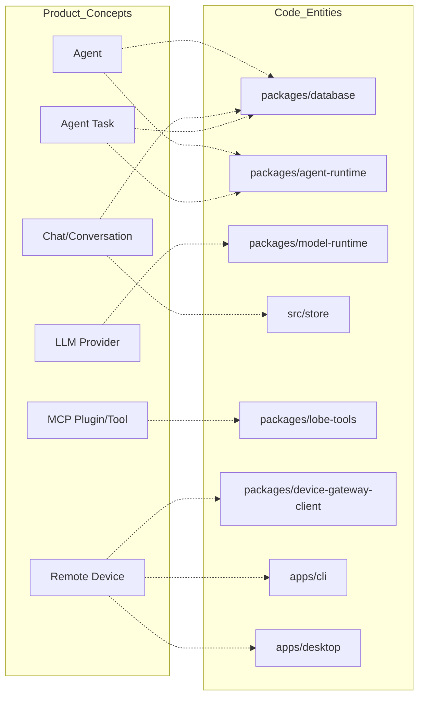

<!-- source: DeepWiki mcp.deepwiki.com · repo lobehub/lobehub · page 1 Overview · fetched 2026-10-29 -->

# Overview

<details>
<summary>Relevant source files</summary>

The following files were used as context for generating this wiki page:

- [.bunfig.toml](.bunfig.toml)
- [.github/scripts/create-failure-issue.js](.github/scripts/create-failure-issue.js)
- [.github/workflows/auto-i18n.yml](.github/workflows/auto-i18n.yml)
- [.github/workflows/auto-tag-release.yml](.github/workflows/auto-tag-release.yml)
- [.github/workflows/lighthouse.yml](.github/workflows/lighthouse.yml)
- [.github/workflows/release.yml](.github/workflows/release.yml)
- [.github/workflows/sync-database-schema.yml](.github/workflows/sync-database-schema.yml)
- [.github/workflows/sync-main-to-canary.yaml](.github/workflows/sync-main-to-canary.yaml)
- [.github/workflows/sync.yml](.github/workflows/sync.yml)
- [.github/workflows/test.yml](.github/workflows/test.yml)
- [.npmrc](.npmrc)
- [CHANGELOG.md](CHANGELOG.md)
- [README.md](README.md)
- [README.zh-CN.md](README.zh-CN.md)
- [apps/cli/.npmrc](apps/cli/.npmrc)
- [apps/cli/pnpm-workspace.yaml](apps/cli/pnpm-workspace.yaml)
- [apps/desktop/.npmrc](apps/desktop/.npmrc)
- [apps/desktop/package.json](apps/desktop/package.json)
- [apps/desktop/pnpm-lock.yaml](apps/desktop/pnpm-lock.yaml)
- [apps/desktop/pnpm-workspace.yaml](apps/desktop/pnpm-workspace.yaml)
- [apps/desktop/src/main/controllers/AuvCtr.ts](apps/desktop/src/main/controllers/AuvCtr.ts)
- [apps/desktop/src/main/services/__tests__/auvSrv.test.ts](apps/desktop/src/main/services/__tests__/auvSrv.test.ts)
- [apps/desktop/src/main/services/auvSrv.ts](apps/desktop/src/main/services/auvSrv.ts)
- [changelog/CHANGELOG.v0.md](changelog/CHANGELOG.v0.md)
- [changelog/CHANGELOG.v1.md](changelog/CHANGELOG.v1.md)
- [changelog/v0.json](changelog/v0.json)
- [changelog/v1.json](changelog/v1.json)
- [changelog/v2.json](changelog/v2.json)
- [codecov.yml](codecov.yml)
- [docs/changelog/2025-03-02-new-models.zh-CN.mdx](docs/changelog/2025-03-02-new-models.zh-CN.mdx)
- [docs/changelog/2025-06-08-claude-4.zh-CN.mdx](docs/changelog/2025-06-08-claude-4.zh-CN.mdx)
- [docs/changelog/2025-07-08-mcp-market.zh-CN.mdx](docs/changelog/2025-07-08-mcp-market.zh-CN.mdx)
- [docs/changelog/2025-09-08-gemini.zh-CN.mdx](docs/changelog/2025-09-08-gemini.zh-CN.mdx)
- [docs/changelog/2025-10-08-python.zh-CN.mdx](docs/changelog/2025-10-08-python.zh-CN.mdx)
- [docs/changelog/2025-12-20-mcp.zh-CN.mdx](docs/changelog/2025-12-20-mcp.zh-CN.mdx)
- [docs/changelog/schema.json](docs/changelog/schema.json)
- [next.config.ts](next.config.ts)
- [package.json](package.json)
- [patches/@upstash__qstash.patch](patches/@upstash__qstash.patch)
- [pnpm-workspace.yaml](pnpm-workspace.yaml)
- [renovate.json](renovate.json)
- [scripts/changelogWorkflow/const.ts](scripts/changelogWorkflow/const.ts)
- [scripts/changelogWorkflow/generateChangelog.ts](scripts/changelogWorkflow/generateChangelog.ts)
- [scripts/dbmlWorkflow/index.ts](scripts/dbmlWorkflow/index.ts)
- [scripts/releaseWorkflow/index.ts](scripts/releaseWorkflow/index.ts)
- [src/features/ShareModal/ShareImage/style.ts](src/features/ShareModal/ShareImage/style.ts)
- [src/libs/next/config/define-config.test.ts](src/libs/next/config/define-config.test.ts)
- [src/libs/next/config/define-config.ts](src/libs/next/config/define-config.ts)
- [vercel.json](vercel.json)

</details>


LobeHub is an open-source, high-performance AI Agent framework designed to organize agents into a structured, 7x24 operating AI team `[package.json:4-15]()`. It moves beyond isolated, task-driven chat interfaces by treating **Agents as the unit of work**, providing infrastructure for multi-model intelligence, extensible tool use via the Model Context Protocol (MCP), and persistent personal memory `[README.md:107-114]`.

### Purpose and Scope

The purpose of this documentation is to introduce the architectural foundation, core feature sets, deployment topologies, and high-level subsystem maps of the LobeHub repository. As a parent overview page, this document keeps details high-level and defers specific granular breakdowns to dedicated child pages.

### Core Feature Set

The framework provides a rich suite of enterprise-grade AI capabilities:

- **Multi-Model Support:** Unified adapter access to various LLM providers (OpenAI, Anthropic, Google Gemini, DeepSeek) and modalities including vision and reasoning `[README.md:135-140]`.
- **Extensible Tooling:** Integration with over 10,000 skills through a modular plugin architecture and complete support for the **Model Context Protocol (MCP)** `[README.md:138-142]`.
- **Personal Memory:** A transparent "white-box" memory extraction and storage system that allows agents to learn from user interaction contexts `[README.zh-CN.md:175-179]`.
- **Multi-Agent Collaboration:** Support for **Agent Groups**, automated background schedules via `agentCronJobs`, and project-based structuring `[README.zh-CN.md:152-160]`, `[changelog/v2.json:150-153]()`.
- **Knowledge Base (RAG):** Advanced file parsing, hierarchical chunking, vector embeddings, and search pipelines `[changelog/v2.json:165-168]()`, `[changelog/v1.json:61-64]()`.
- **TTS/STT:** Native integration for speech synthesis and voice recognition services `[package.json:14-15]()`.
- **Agent Tasks & Verification:** A structured task lifecycle system backed by automated delivery checks and verification rubrics `[changelog/v2.json:150-153]()`, `[changelog/v2.json:18-21]()`.

Sources: `[package.json:4-15]`, `[README.md:107-142]`, `[README.zh-CN.md:152-179]`, `[changelog/v1.json:61-64]`, `[changelog/v2.json:18-21, 150-153, 165-168]`

### Deployment Models

LobeHub supports multiple deployment topologies for diverse infrastructure requirements:

| Model | Description | Key Code Configuration / References |
| :--- | :--- | :--- |
| **Cloud / Serverless** | Optimized for Vercel, Zeabur, and Sealos via Next.js serverless outputs. | `[vercel.json:1-63]()`, `[next.config.ts:1-25]()` |
| **Docker** | Standalone containerized deployment for self-hosting with PostgreSQL and Redis. | `[package.json:50]()`, `[package.json:81-83]()` |
| **Desktop** | Cross-platform Electron app (Windows, macOS, Linux) for local-first operations and MCP stdio support. | `[package.json:70-75]()`, `[apps/desktop/package.json:1-143]()` |
| **PWA** | Progressive Web App entry points for mobile and desktop browser runtimes. | `[package.json:30-34]()`, `[package.json:55-60]()` |

Sources: `[package.json:30-34, 50, 55-60, 70-75, 81-83]`, `[vercel.json:1-63]`, `[next.config.ts:1-26]`, `[apps/desktop/package.json:1-143]`

### High-Level Subsystems Map

The following system diagram maps high-level user interface layers down to concrete persistence and execution packages in the repository.

```mermaid
graph TD
  subgraph "UserInterface"
    [UI_Library] --> ["@lobehub/ui"]
    [Web_Entry] --> ["src/spa/entry.web.tsx"]
    [Desktop_Shell] --> ["apps/desktop"]
    [CLI_Tool] --> ["apps/cli"]
  end

  subgraph "Core_Orchestration"
    [Chat_Service] --> ["src/services/chat.ts"]
    [Agent_Runtime] --> ["packages/agent-runtime"]
    [Tools_Engine] --> ["packages/lobe-tools"]
    [Task_System] --> ["packages/agent-operations"]
  end

  subgraph "Intelligence_Layer"
    [Model_Bank] --> ["packages/model-bank"]
    [Model_Runtime] --> ["packages/model-runtime"]
    [User_Memory] --> ["packages/memory-user-memory"]
    [Knowledge_Base] --> ["packages/rag"]
  end

  subgraph "Persistence_Layer"
    [Database] --> ["packages/database"]
    [Storage] --> ["S3/RustFS"]
  end

  [Web_Entry] --> [Chat_Service]
  [Chat_Service] --> [Agent_Runtime]
  [Agent_Runtime] --> [Model_Runtime]
  [Agent_Runtime] --> [Tools_Engine]
  [Model_Runtime] --> [Model_Bank]
  [Chat_Service] --> [User_Memory]
  [Chat_Service] --> [Database]
  [Agent_Runtime] --> [Knowledge_Base]
  [Knowledge_Base] --> [Database]
  [Task_System] --> [Agent_Runtime]
```
Sources: `[package.json:35-42]`, `[README.md:112-114]`, `[.github/workflows/test.yml:50]()`

### Navigation Guide

LobeHub is organized as a pnpm monorepo workspace `[package.json:35-42]()`. For granular technical details, navigate to the child pages:

- **Monorepo Package Structure:** For details on workspace layouts, package responsibilities under `packages/*` and `apps/*`, see [Monorepo Package Structure](#1.1).
- **Key Product Concepts and Mental Model:** For details on mapping high-level concepts (Agents, Topics, Threads, MCP plugins, Memory) to database schemas and Zustand stores, see [Key Product Concepts and Mental Model](#1.2).

### System Relationships: Natural Language to Code Entity


Sources: `[package.json:35-40]`, `[.github/workflows/test.yml:50]`

---

