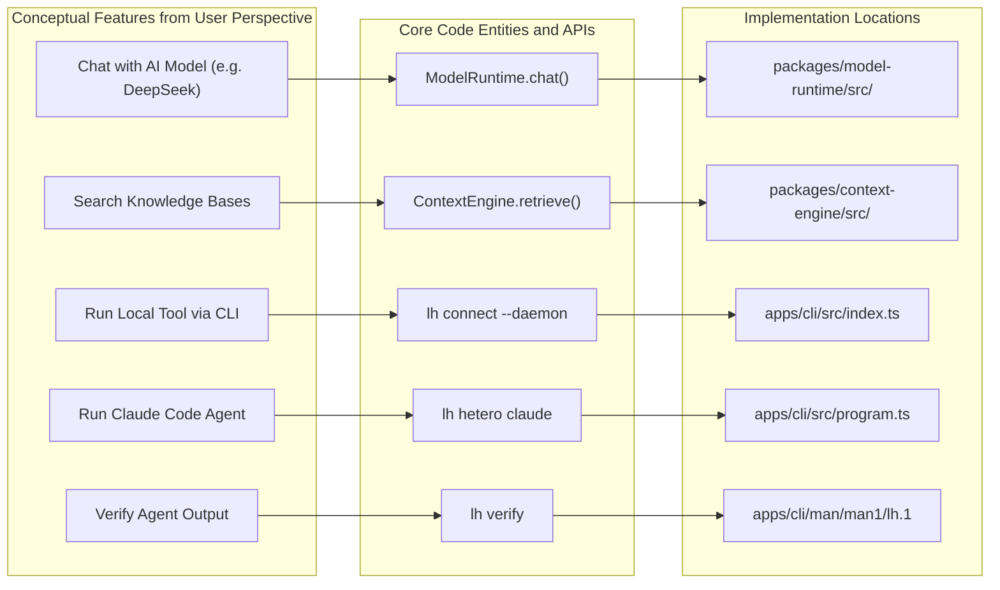
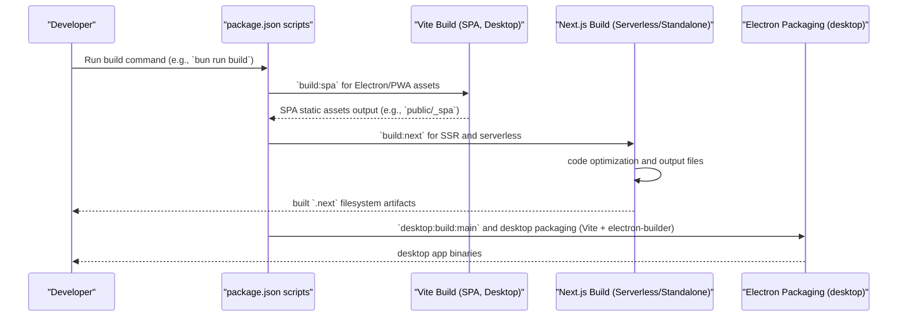

<!-- source: DeepWiki mcp.deepwiki.com · repo lobehub/lobehub · page 1.1 Monorepo Package Structure · fetched 2026-10-29 -->

# Monorepo Package Structure

<details>
<summary>Relevant source files</summary>

The following files were used as context for generating this wiki page:

- [.bunfig.toml](.bunfig.toml)
- [.github/scripts/create-failure-issue.js](.github/scripts/create-failure-issue.js)
- [.github/workflows/auto-i18n.yml](.github/workflows/auto-i18n.yml)
- [.github/workflows/auto-tag-release.yml](.github/workflows/auto-tag-release.yml)
- [.github/workflows/lighthouse.yml](.github/workflows/lighthouse.yml)
- [.github/workflows/release.yml](.github/workflows/release.yml)
- [.github/workflows/sync-database-schema.yml](.github/workflows/sync-database-schema.yml)
- [.github/workflows/sync-main-to-canary.yaml](.github/workflows/sync-main-to-canary.yaml)
- [.github/workflows/sync.yml](.github/workflows/sync.yml)
- [.github/workflows/test.yml](.github/workflows/test.yml)
- [.npmrc](.npmrc)
- [CHANGELOG.md](CHANGELOG.md)
- [README.md](README.md)
- [README.zh-CN.md](README.zh-CN.md)
- [apps/cli/.npmrc](apps/cli/.npmrc)
- [apps/cli/pnpm-workspace.yaml](apps/cli/pnpm-workspace.yaml)
- [apps/desktop/.npmrc](apps/desktop/.npmrc)
- [apps/desktop/package.json](apps/desktop/package.json)
- [apps/desktop/pnpm-lock.yaml](apps/desktop/pnpm-lock.yaml)
- [apps/desktop/pnpm-workspace.yaml](apps/desktop/pnpm-workspace.yaml)
- [apps/desktop/src/main/controllers/AuvCtr.ts](apps/desktop/src/main/controllers/AuvCtr.ts)
- [apps/desktop/src/main/services/__tests__/auvSrv.test.ts](apps/desktop/src/main/services/__tests__/auvSrv.test.ts)
- [apps/desktop/src/main/services/auvSrv.ts](apps/desktop/src/main/services/auvSrv.ts)
- [apps/server/src/routers/lambda/recent.ts](apps/server/src/routers/lambda/recent.ts)
- [apps/server/src/services/memory/userMemory/__tests__/extract.runtime.test.ts](apps/server/src/services/memory/userMemory/__tests__/extract.runtime.test.ts)
- [apps/server/src/services/memory/userMemory/embedding.ts](apps/server/src/services/memory/userMemory/embedding.ts)
- [changelog/CHANGELOG.v0.md](changelog/CHANGELOG.v0.md)
- [changelog/CHANGELOG.v1.md](changelog/CHANGELOG.v1.md)
- [changelog/v0.json](changelog/v0.json)
- [changelog/v1.json](changelog/v1.json)
- [changelog/v2.json](changelog/v2.json)
- [codecov.yml](codecov.yml)
- [docs/changelog/2025-03-02-new-models.zh-CN.mdx](docs/changelog/2025-03-02-new-models.zh-CN.mdx)
- [docs/changelog/2025-06-08-claude-4.zh-CN.mdx](docs/changelog/2025-06-08-claude-4.zh-CN.mdx)
- [docs/changelog/2025-07-08-mcp-market.zh-CN.mdx](docs/changelog/2025-07-08-mcp-market.zh-CN.mdx)
- [docs/changelog/2025-09-08-gemini.zh-CN.mdx](docs/changelog/2025-09-08-gemini.zh-CN.mdx)
- [docs/changelog/2025-10-08-python.zh-CN.mdx](docs/changelog/2025-10-08-python.zh-CN.mdx)
- [docs/changelog/2025-12-20-mcp.zh-CN.mdx](docs/changelog/2025-12-20-mcp.zh-CN.mdx)
- [docs/changelog/schema.json](docs/changelog/schema.json)
- [next.config.ts](next.config.ts)
- [package.json](package.json)
- [packages/database/package.json](packages/database/package.json)
- [packages/database/src/models/__tests__/recent.test.ts](packages/database/src/models/__tests__/recent.test.ts)
- [packages/database/src/models/recent.ts](packages/database/src/models/recent.ts)
- [packages/types/src/recent.ts](packages/types/src/recent.ts)
- [packages/utils/package.json](packages/utils/package.json)
- [packages/utils/src/tokenizer/embedding.test.ts](packages/utils/src/tokenizer/embedding.test.ts)
- [packages/utils/src/tokenizer/embedding.ts](packages/utils/src/tokenizer/embedding.ts)
- [patches/@upstash__qstash.patch](patches/@upstash__qstash.patch)
- [pnpm-workspace.yaml](pnpm-workspace.yaml)
- [renovate.json](renovate.json)
- [scripts/changelogWorkflow/const.ts](scripts/changelogWorkflow/const.ts)
- [scripts/changelogWorkflow/generateChangelog.ts](scripts/changelogWorkflow/generateChangelog.ts)
- [scripts/dbmlWorkflow/index.ts](scripts/dbmlWorkflow/index.ts)
- [scripts/releaseWorkflow/index.ts](scripts/releaseWorkflow/index.ts)
- [src/const/topic.ts](src/const/topic.ts)
- [src/features/Home/Recents/AllRecentsDrawer.tsx](src/features/Home/Recents/AllRecentsDrawer.tsx)
- [src/features/Home/Recents/ConnectedItem.tsx](src/features/Home/Recents/ConnectedItem.tsx)
- [src/features/Home/Recents/List.tsx](src/features/Home/Recents/List.tsx)
- [src/features/Home/Recents/useDropdownMenu.tsx](src/features/Home/Recents/useDropdownMenu.tsx)
- [src/features/ShareModal/ShareImage/style.ts](src/features/ShareModal/ShareImage/style.ts)
- [src/hooks/useSyncRecents.ts](src/hooks/useSyncRecents.ts)
- [src/libs/next/config/define-config.test.ts](src/libs/next/config/define-config.test.ts)
- [src/libs/next/config/define-config.ts](src/libs/next/config/define-config.ts)
- [src/services/recent/index.ts](src/services/recent/index.ts)
- [src/store/home/slices/recent/action.test.ts](src/store/home/slices/recent/action.test.ts)
- [src/store/home/slices/recent/action.ts](src/store/home/slices/recent/action.ts)
- [src/store/home/slices/recent/initialState.ts](src/store/home/slices/recent/initialState.ts)
- [src/store/home/slices/recent/projection.ts](src/store/home/slices/recent/projection.ts)
- [src/store/home/slices/recent/selectors.ts](src/store/home/slices/recent/selectors.ts)
- [vercel.json](vercel.json)

</details>


This document describes the **pnpm workspace monorepo layout** of the LobeHub repository. It lists every package under `packages/*` and `apps/*` and provides a concise description of each package’s responsibility and role in the overall system. The goal is to help engineers quickly navigate the modular structure of the codebase and understand the scope and dependencies of each package.

---

## Workspace Configuration and Layout

LobeHub is structured as a monorepo using **pnpm workspaces** for efficient dependency management and cross-package sharing. The workspace configuration is defined in the root `pnpm-workspace.yaml` and `package.json` files, which include:

| Directory | Purpose |
|---|---|
| `packages/*` | Core libraries, shared utility packages, and domain-specific business logic. |
| `packages/business/*` | High-level domain/business packages that orchestrate core packages. |
| `apps/desktop` | Electron desktop application and its related infrastructure and main process code. |
| `apps/cli` | LobeHub Command Line Interface tool (`lh`) with device gateway client and commands. |
| `apps/server` | Backend server modules, including agent runtime and LLM tooling router layers. |
| `apps/auth` | Authentication micro-app (Cloudflare Workers / Next.js SPA). |
| `apps/share` | Sharing micro-app, supporting sharing of chats and agents. |
| `apps/workbench` | Development sandbox micro-app for experimental features and UI components. |
| `e2e` | End-to-end testing infrastructure and tests (Playwright, Cucumber). |

These designations help segregate deployment targets, testing, and core logic to facilitate scalable development and consistent builds.

Sources: [`pnpm-workspace.yaml:20-28`](), [`package.json:35-42`](), [`apps/desktop/package.json:1-55`](), [`apps/cli/package.json:2-9`]()

---

## High-Level Package Dependency Flow

This diagram represents the high-level dependencies between the monorepo packages, showing how applications depend on core and business packages, and how utilities underpin core libraries.

### System Entity Dependency Diagram

```mermaid
graph TD
  subgraph Apps["apps/ (Applications)"]
    RootNext["Root Next.js app (web, PWA)"]
    DesktopApp["apps/desktop (Electron desktop client)"]
    CLIApp["apps/cli (CLI tool `lh`)"]
    ServerApp["apps/server (Backend services)"]
    ShareApp["apps/share (Sharing micro-app)"]
    WorkbenchApp["apps/workbench (Development sandbox)"]
  end

  subgraph Business["packages/business/ (Domain / AI Infra)"]
    AIInfra["@lobechat/ai-infra"]
    BusinessModelBank["@lobechat/business-model-bank"]
  end

  subgraph Core["packages/* (Shared Core Libraries)"]
    AgentRuntime["@lobechat/agent-runtime"]
    ModelRuntime["@lobechat/model-runtime"]
    Database["@lobechat/database"]
    ContextEngine["@lobechat/context-engine"]
    ToolRuntime["@lobechat/tool-runtime"]
    AgentTracing["@lobechat/agent-tracing"]
    HeteroAgents["@lobechat/heterogeneous-agents"]
    DeviceGatewayClient["@lobechat/device-gateway-client"]
    AgentGatewayClient["@lobechat/agent-gateway-client"]
  end

  subgraph Utils["packages/* (Utilities and Constants)"]
    Utils["@lobechat/utils"]
    Const["@lobechat/const"]
  end

  %% Dependency edges
  RootNext --> AgentRuntime
  RootNext --> Database
  RootNext --> AIInfra
  RootNext --> ContextEngine
  RootNext --> ModelRuntime
  DesktopApp --> CLIApp
  DesktopApp --> HeteroAgents
  CLIApp --> ToolRuntime
  CLIApp --> DeviceGatewayClient
  CLIApp --> AgentGatewayClient
  CLIApp --> AgentTracing
  AgentRuntime --> ModelRuntime
  AIInfra --> Database
  Core --> Utils
  Utils --> Const
```

Sources: [`package.json:35-42`](), [`apps/desktop/package.json:1-55`](), [`apps/cli/package.json:2-9`](), [`apps/cli/src/program.ts:1-20`]()

---

## Package Inventory and Responsibilities

### Applications (`apps/*`)

| Package | Description |
|---|---|
| Root (`/`) | The primary Next.js application delivering the web UI, PWA, chat system, API routes, and SSR. |
| `apps/desktop` | Electron desktop client. Contains main process code, native system integrations (`node-pty`, screenshots). Uses Vite for build. |
| `apps/cli` | Node.js command line interface (`lh`). Manages LobeHub services, device gateway, agent workflows, and heterogeneous agent CLI runners. |
| `apps/server` | Server-side backend modules including API routers, server agent runtime, and LLM tooling handlers. |
| `apps/auth` | Authentication micro-app, implemented as a separate SPA or Cloudflare worker for OAuth and session handling. |
| `apps/share` | Shareable chat and agent micro-app supporting public session sharing UX. |
| `apps/workbench` | Sandbox development environment app for prototyping new UI and workflows. |
| `e2e` | End-to-end test framework and test suites using Playwright/Cucumber for integration testing. |

Sources: [`apps/cli/package.json:2-9`](), [`apps/desktop/package.json:1-55`]()

---

### Core Packages (`packages/*`)

| Package | Responsibility |
|---|---|
| `@lobechat/agent-runtime` | Manages agent lifecycles, instruction handling, multi-step workflows, and orchestrates tool invocations. |
| `@lobechat/model-runtime` | Abstracts AI provider APIs, supporting OpenAI, Anthropic, DeepSeek, and internal error taxonomy for model calls. |
| `@lobechat/database` | Database layer: PostgreSQL schema definitions with Drizzle ORM, repository patterns, and data access utilities. |
| `@lobechat/context-engine` | Constructs rich context for prompts via retrieval-augmented generation (RAG), document injection, and prompt assembly. |
| `@lobechat/tool-runtime` | Execution environment for Model Context Protocol (MCP) tools and built-in tools used by agents and CLI plugins. |
| `@lobechat/heterogeneous-agents` | Bridges external agent CLI processes (e.g., Claude Code, Amp) into unified LobeHub agent framework. |
| `@lobechat/device-gateway-client` | Manages communication with device gateway service enabling remote agent tool invocation across enrolled devices. |
| `@lobechat/agent-gateway-client` | Handles communication with cloud agent gateway for server-agent remote messaging and orchestration. |
| `@lobechat/agent-tracing` | Records execution snapshots for agent runs, supports trace replay, debugging, and inspection tooling. |
| `@lobechat/utils` | TypeScript utility functions used throughout the monorepo for various common tasks. |
| `@lobechat/const` | Centralized constants including app configuration keys, action types, and default values. |

Sources: [`apps/cli/package.json:30-45`](), [`apps/desktop/package.json:57-79`]()

---

### Business Packages (`packages/business/*`)

| Package | Responsibility |
|---|---|
| `@lobechat/ai-infra` | Contains the AI model bank definitions, provider configurations, pricing models, and runtime model selection logic. |

Sources: [`package.json:35-42`]()

---

## Natural Language Concepts to Code Entities Mapping

To assist onboarding and navigation, below is a mapping of common user-facing conceptual actions or features to their main code implementations and file paths.

### Feature-to-Code Entity Mapping



Sources: [`apps/cli/src/program.ts:1-20`](), [`apps/cli/man/man1/lh.1:44-46`](), [`apps/cli/man/man1/lh.1:89-91`](), [`apps/cli/man/man1/lh.1:131-132`]()

---

## Build and Deployment Pipelines

The monorepo supports multiple build modes, targeting different deployment platforms and usage scenarios.

### Build Modes and Scripts

- **Next.js Serverless / Standalone Build**: Builds the main web app with full server-side rendering, API routes, and static generation [package.json:43-56](). The `build:next` script is responsible for this [package.json:53]().
- **SPA Build for Desktop / PWA**: Produces static asset deployment for embedding in Electron or SPA usage [package.json:43-56](). The `build:spa` script handles this [package.json:54]().
- **Desktop Build**: Builds CLI and main/preload/renderer processes using Vite, then packages Electron application [apps/desktop/package.json:14-17](). The `desktop:build:main` script initiates this [package.json:70]().
- **Docker Deployment**: Builds container assets and bundles static SPA components for deployment [package.json:46](). The `build:docker` script is used for this [package.json:50]().

### Build Pipeline Sequence



### Advanced Build Optimizations

The Next.js configuration selectively excludes heavy, unnecessary binaries like musl-variant `sharp` packages and desktop-only files from serverless function bundles to optimize deployment size by about 16MB per function [next.config.ts:5-20](). This is particularly relevant for Vercel deployments, which use Amazon Linux (glibc) rather than Alpine Linux (musl) [next.config.ts:6-7]().

Sources: [`package.json:43-56`](), [`apps/desktop/package.json:14-17`](), [`next.config.ts:5-20`]()

---

# Summary Table: Monorepo Layout

| Category | Directory/Package | Description |
|---|---|
| Applications| `/` (root) | Next.js app for web UI, chat, and backend API |
| | `apps/desktop` | Electron desktop UI and native integrations implementing main/preload/renderer builds |
| | `apps/cli` | CLI tool packages and device gateway client, agent task/trace commands |
| | `apps/server` | Backend server API and runtime for agents and LLM |
| | `apps/auth` | Auth micro-app SPA/worker |
| | `apps/share` | Sharing micro-app SPA |
| | `apps/workbench` | Developer sandbox micro-app |
| | `e2e` | End-to-end test infrastructure |
| Core | `@lobechat/agent-runtime` | Agent lifecycle and execution handler |
| | `@lobechat/model-runtime` | AI provider abstraction layer |
| | `@lobechat/database` | Database schema and repository patterns |
| | `@lobechat/context-engine` | Context retrieval and prompt engineering |
| | `@lobechat/tool-runtime` | MCP and builtin tool execution environment |
| | `@lobechat/heterogeneous-agents` | Bridges external agent CLI and runtimes |
| | `@lobechat/device-gateway-client` | Remote device agent execution gateway client |
| | `@lobechat/agent-gateway-client` | Cloud agent remote messaging client |
| | `@lobechat/agent-tracing` | Agent execution trace recording and replay |
| | `@lobechat/utils` | Shared utility functions |
| | `@lobechat/const` | Global constants and app config keys |
| Business | `@lobechat/ai-infra` | AI provider configuration, model bank, pricing |

---

By organizing the monorepo with clear boundaries between applications, core packages, business logic, and utilities—and leveraging pnpm workspaces—LobeHub supports scalable development across multiple platforms (Web, Desktop, CLI) and complex AI workflows.

# End of "Monorepo Package Structure"

---

Sources:
- [`package.json:35-42`]()
- [`apps/cli/package.json:2-9`]()
- [`apps/cli/man/man1/lh.1:18-199`]()
- [`apps/desktop/package.json:1-55`]()
- [`pnpm-workspace.yaml:20-28`]()
- [`apps/cli/src/program.ts:1-20`]()
- [`next.config.ts:5-20`]()

---

