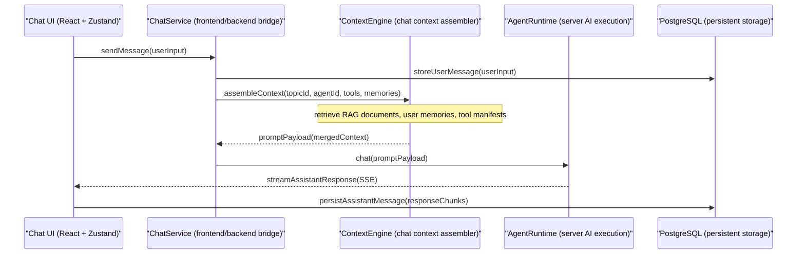

<!-- source: DeepWiki mcp.deepwiki.com · repo lobehub/lobehub · page 1.2 Key Product Concepts and Mental Model · fetched 2026-10-29 -->

# Key Product Concepts and Mental Model

Relevant source files

The following files were used as context for generating this wiki page:

- [apps/server/src/services/document/__tests__/index.test.ts](apps/server/src/services/document/__tests__/index.test.ts)
- [apps/server/src/services/document/index.ts](apps/server/src/services/document/index.ts)
- [docs/development/database-schema.dbml](docs/development/database-schema.dbml)
- [locales/en-US/setting.json](locales/en-US/setting.json)
- [locales/zh-CN/setting.json](locales/zh-CN/setting.json)
- [packages/database/migrations/0086_video_generation_schema.sql](packages/database/migrations/0086_video_generation_schema.sql)
- [packages/database/migrations/0177_agent_accounts_live_unique_and_goal_subscriptions.sql](packages/database/migrations/0177_agent_accounts_live_unique_and_goal_subscriptions.sql)
- [packages/database/migrations/0180_task_archived_at.sql](packages/database/migrations/0180_task_archived_at.sql)
- [packages/database/migrations/meta/0086_snapshot.json](packages/database/migrations/meta/0086_snapshot.json)
- [packages/database/migrations/meta/0177_snapshot.json](packages/database/migrations/meta/0177_snapshot.json)
- [packages/database/migrations/meta/0180_snapshot.json](packages/database/migrations/meta/0180_snapshot.json)
- [packages/database/migrations/meta/_journal.json](packages/database/migrations/meta/_journal.json)
- [packages/database/src/models/__tests__/agentAccount.test.ts](packages/database/src/models/__tests__/agentAccount.test.ts)
- [packages/database/src/models/__tests__/document.test.ts](packages/database/src/models/__tests__/document.test.ts)
- [packages/database/src/models/__tests__/drizzleMigration.test.ts](packages/database/src/models/__tests__/drizzleMigration.test.ts)
- [packages/database/src/models/__tests__/topics/topic.create.test.ts](packages/database/src/models/__tests__/topics/topic.create.test.ts)
- [packages/database/src/models/agentAccount.ts](packages/database/src/models/agentAccount.ts)
- [packages/database/src/models/document.ts](packages/database/src/models/document.ts)
- [packages/database/src/schemas/agent.ts](packages/database/src/schemas/agent.ts)
- [packages/database/src/schemas/agentAccount.ts](packages/database/src/schemas/agentAccount.ts)
- [packages/database/src/schemas/agentCronJob.ts](packages/database/src/schemas/agentCronJob.ts)
- [packages/database/src/schemas/apiKey.ts](packages/database/src/schemas/apiKey.ts)
- [packages/database/src/schemas/asyncTask.ts](packages/database/src/schemas/asyncTask.ts)
- [packages/database/src/schemas/chatGroup.ts](packages/database/src/schemas/chatGroup.ts)
- [packages/database/src/schemas/file.ts](packages/database/src/schemas/file.ts)
- [packages/database/src/schemas/generation.ts](packages/database/src/schemas/generation.ts)
- [packages/database/src/schemas/goalSubscription.ts](packages/database/src/schemas/goalSubscription.ts)
- [packages/database/src/schemas/index.ts](packages/database/src/schemas/index.ts)
- [packages/database/src/schemas/message.ts](packages/database/src/schemas/message.ts)
- [packages/database/src/schemas/rag.ts](packages/database/src/schemas/rag.ts)
- [packages/database/src/schemas/relations.ts](packages/database/src/schemas/relations.ts)
- [packages/database/src/schemas/session.ts](packages/database/src/schemas/session.ts)
- [packages/database/src/schemas/task.ts](packages/database/src/schemas/task.ts)
- [packages/database/src/schemas/topic.ts](packages/database/src/schemas/topic.ts)
- [packages/database/src/utils/idGenerator.ts](packages/database/src/utils/idGenerator.ts)
- [packages/locales/src/default/setting.ts](packages/locales/src/default/setting.ts)
- [packages/types/src/goalSubscription.ts](packages/types/src/goalSubscription.ts)
- [packages/types/src/index.ts](packages/types/src/index.ts)

This page defines the core product concepts of LobeHub and explains how these abstractions map to the technical implementation within the codebase. It serves as a mental model for engineering onboarding, bridging natural language product features with specific code entities and data flows.

## Core Concepts and Abstractions

LobeHub operates on a hierarchical structure designed to support both simple chat interactions and complex multi-agent orchestration.

### 1. Agent

The **Agent** is the fundamental unit of work in LobeHub. An agent represents a configured AI persona with specific characteristics such as system-level role instructions, model provider details, parameters, and extensions including installed tools/plugins.

- **Implementation**: Agents are persisted in the `agents` table in the database, which stores identity, profile, configuration, knowledge base associations, and plugin metadata. This table is defined in `packages/database/src/schemas/agent.ts` [packages/database/src/schemas/agent.ts:37-114]().
- **Type Definition**: The TypeScript type `LobeAgentConfig` describes the agent's configuration shape in `@lobechat/types` [packages/types/src/index.ts:1]().
- **Execution**: The runtime execution of agents is orchestrated by the `AgentRuntime` class in `packages/agent-runtime`, handling instruction parsing, multi-step workflows, and integration with external AI providers.
- **Agent Builder**: The system includes a specialized "Agent Builder" agent that uses natural language instructions to auto-configure new agents from text prompts [locales/zh-CN/setting.json:132-133]().
- **Agent State Management**: The React state for agents is managed in the frontend via the Zustand store slice `src/store/agent`.

Sources:
- [packages/database/src/schemas/agent.ts:37-114]()
- [packages/types/src/index.ts:1]()
- [locales/zh-CN/setting.json:132-133]()

### 2. Conversation Hierarchy (Session > Topic > Thread > Message)

LobeHub structures conversations into a four-level hierarchy for flexibility and clean data organization:

- **Session**: The broadest container, often representing a chat session tied to a particular agent or user context (`sessions` table) [packages/database/src/schemas/session.ts:1-1]().
- **Topic**: Represents a focused conversation context or subject within a session, stored in the `topics` table. It associates metadata like project, agent, and workspace. Topics can aggregate usage/tokens/cost statistics [packages/database/src/schemas/topic.ts:27-121]().
- **Thread**: Enables branching conversations or "sub-chats" within a topic, allowing multiple parallel or sequential chat streams. Threads have types (e.g., continuation, standalone) which directly affect routing and execution behavior [packages/database/src/schemas/topic.ts:126-176]().
- **Message**: The atomic communication unit, including user messages, AI assistant replies, tool outputs, and reasoning metadata, stored in the `messages` table [packages/database/src/schemas/message.ts:1-1]().

This hierarchy provides the foundation for storing, indexing, and retrieving conversation data in the PostgreSQL database and drives the UI navigation and threading logic.

Sources:
- [packages/database/src/schemas/session.ts:1-1]()
- [packages/database/src/schemas/topic.ts:27-121]()
- [packages/database/src/schemas/topic.ts:126-176]()
- [packages/database/src/schemas/message.ts:1-1]()

### 3. Tool and MCP Plugin

**Tools** extend agent capabilities by enabling specific skills or external integrations, such as calculators, file access, and agent document handling.

- **MCP (Model Context Protocol) Plugins**: MCP enables one-click installation and communication with external model context plugins over stdio or HTTP, providing standardized interfaces to third-party tools [packages/types/src/index.ts:49]().
- **ToolsEngine**: The aggregation and resolution engine for tools. It combines manifests from installed MCP plugins, built-in tools, and skill manifests, generating the effective toolset delivered to the AI runtime for function calling.
- **Authentication and Credential Handling**: User connectors and credentials are securely managed in `user_connectors`, with encryption via `KeyVaultsGateKeeper`.
- **Implementation Areas**: Tool manifests live across `packages/builtin-tool-*`, `packages/builtin-skills`, and MCP clients in `src/libs/mcp`.

Sources:
- [packages/types/src/index.ts:49]()

### 4. Knowledge Base and RAG (Retrieval-Augmented Generation)

LobeHub features a layered knowledge base system empowering retrieval-augmented generation to ground chats in external data.

- **File and Document Storage**: Uploaded files are parsed into documents and split into chunks for semantic retrieval. Documents can link back to files or be standalone.
- **Database Tables**: 
  - `files` [packages/database/src/schemas/file.ts:69-84](), `documents` [packages/database/src/schemas/file.ts:92-172](), and `chunks` tables store input data.
  - `chunk_embeddings` holds vector embeddings for similarity search [packages/database/src/schemas/rag.ts:1-1]().
- **Vector Search**: Uses PostgreSQL `pgvector` extension or `paradedb` for approximate nearest neighbor search during chat context crafting [packages/database/migrations/_journal.json:43-45]().
- **Agent Binding**: Agents can be bound to multiple knowledge bases. The binding is stored in the `agents_knowledge_bases` join table, allowing context retrieval during agent execution [packages/database/src/schemas/agent.ts:145-169](), [packages/database/src/schemas/file.ts:54-176]().

Sources:
- [packages/database/src/schemas/file.ts:69-84]()
- [packages/database/src/schemas/file.ts:92-172]()
- [packages/database/src/schemas/rag.ts:1-1]()
- [packages/database/migrations/_journal.json:43-45]()
- [packages/database/src/schemas/agent.ts:145-169]()

### 5. User Memory

The user memory system extracts and persists structured long-term knowledge from chat history to personalize agent behavior dynamically.

- **Memory Layers**: Structured into Identity, Preference, Experience, Context, and Activity layers based on conversation data.
- **Extraction Pipeline**: Uses the `MemoryExtractionExecutor` component, typically run as an async workflow, to synthesize memory entries.
- **Persistence**: Memory entries are saved to dedicated `userMemories` table [packages/database/src/schemas/userMemories.ts:1-1]() for retrieval during chat context generation.
- **Configuration**: Memory usage can be enabled or disabled per agent and exposes a settings UI in the frontend [locales/zh-CN/setting.json:267-268]().

Sources:
- [packages/database/src/schemas/userMemories.ts:1-1]()
- [locales/zh-CN/setting.json:267-268]()

### 6. Task and Workspace

- **Task**: Represents a unit of work or goal tied to agents and conversations. Managed in the `tasks` table [packages/database/src/schemas/task.ts:1-1]() with lifecycle automation and topic handoff integration.
- **Workspace**: The multi-tenant environment where users can collaborate, share agents, knowledge bases, and resources.
  - Workspaces have members with RBAC roles.
  - Data isolation and sharing policies are enforced per workspace.
  - Workspaces are stored in the `workspaces` table [packages/database/src/schemas/workspace.ts:1-1](), with dedicated membership and user association tables.
- **Subscription**: Handles billing plans, credit balances, and payment history associated with workspaces and users. The logic is reflected in locale strings [locales/en-US/setting.json:40-44]() and billing backend routers.

Sources:
- [packages/database/src/schemas/task.ts:1-1]()
- [packages/database/src/schemas/workspace.ts:1-1]()
- [locales/en-US/setting.json:40-44]()

---

## Mental Model: Natural Language to Code Entity Mapping

The following diagram maps high-level product features ("Natural Language Concept") to key code entities representing the concrete implementation, helping engineers quickly locate relevant code.

### Concept to Code Entities Mapping

```mermaid
graph TD
    subgraph "Product Concepts"
        AGT["Agent"]
        TPL["Tool / MCP Plugin"]
        KBASE["Knowledge Base"]
        MEM["User Memory"]
        TASK["Task"]
        WS["Workspace"]
        SUBS["Subscription"]
        CONV["Conversation (Session, Topic, Thread, Message)"]
    end

    subgraph "Code Entities"
        AGT_DB["agents (DB schema)"]
        AGT_RT["AgentRuntime (runtime)"]
        AGT_STORE["src/store/agent (Zustand store)"]

        TPL_PLG["user_connectors / plugins (DB)"]
        TPL_ENG["ToolsEngine (tool aggregator)"]

        KBASE_DB["files, documents, chunks, chunk_embeddings (DB)"]
        KBASE_MOD["DocumentModel (API)"]

        MEM_DB["userMemories (DB)"]
        MEM_EXE["MemoryExtractionExecutor (pipeline)"]

        TASK_DB["tasks (DB)"]
        TASK_SVC["TaskService (CRUD, lifecycle)"]

        WS_DB["workspaces, workspace_members (DB)"]
        WS_SVC["WorkspaceModel (management)"]

        SUBS_STR["Locale Strings (setting.json)"]
        SUBS_SRV["Subscription Router (server)"]

        SESS_DB["sessions (DB)"]
        TOPIC_DB["topics (DB)"]
        THREAD_DB["threads (DB)"]
        MSG_DB["messages (DB)"]
        CHAT_STORE["src/store/chat (Zustand store)"]
    end

    AGT -->|stored in| AGT_DB
    AGT -->|runtime in| AGT_RT
    AGT -->|state in| AGT_STORE

    TPL -->|metadata in| TPL_PLG
    TPL -->|resolved by| TPL_ENG

    KBASE -->|stored in| KBASE_DB
    KBASE -->|accessed via| KBASE_MOD

    MEM -->|stored in| MEM_DB
    MEM -->|managed by| MEM_EXE

    TASK -->|stored in| TASK_DB
    TASK -->|managed by| TASK_SVC

    WS -->|stored in| WS_DB
    WS -->|managed by| WS_SVC

    SUBS -->|text from| SUBS_STR
    SUBS -->|backend logic in| SUBS_SRV

    CONV -->|sessions table| SESS_DB
    CONV -->|topics table| TOPIC_DB
    CONV -->|threads table| THREAD_DB
    CONV -->|messages table| MSG_DB
    CONV -->|state in| CHAT_STORE
```

Sources:
- [packages/database/src/schemas/agent.ts:37-114]()
- [packages/database/src/schemas/topic.ts:27-176]()
- [packages/database/src/schemas/file.ts:92-172]()
- [packages/database/src/schemas/rag.ts:1-1]()
- [packages/database/src/schemas/userMemories.ts:1-1]()
- [packages/database/src/schemas/task.ts:1-1]()
- [packages/database/src/schemas/workspace.ts:1-1]()
- [locales/en-US/setting.json:40-44]()

---

## Data Flow: The Chat Pipeline

This diagram traces the typical data flow of a user chat turn, illustrating how raw user input progresses through multiple processing layers before yielding the final AI-generated response.

### Chat Execution Flow

This pipeline integrates knowledge base retrieval, user memory, and active tool manifests to augment the AI prompt, then routes execution through the agent runtime which streams incremental results back to the UI. Messages are persisted in the database to maintain full conversational history.

Sources:
- [packages/database/src/schemas/topic.ts:27-121]()
- [locales/en-US/setting.json:219-219]()

---

## Navigation Guide for Engineers

The following table maps major product features to their primary code locations and key files/classes, aiding developers in finding relevant code during onboarding.

| Product Concept | Primary Repository Location | Key Files / Classes / Modules |
|---|---|---|
| **Agent** | `packages/database/src/schemas` | `agent.ts` [packages/database/src/schemas/agent.ts:37-114]() (DB schema), `AgentRuntime` (runtime) |
| | `src/store/agent` | Agent Zustand store slice |
| **Conversation (Chat)** | `packages/database/src/schemas` | `session.ts` [packages/database/src/schemas/session.ts:1-1](), `topic.ts` [packages/database/src/schemas/topic.ts:27-121](), `message.ts` [packages/database/src/schemas/message.ts:1-1]() |
| | `src/store/chat` | Chat Zustand store slice |
| **Tool / MCP Plugin** | `src/libs/mcp` | MCP client, Plugin registries |
| | `packages/builtin-tool-*` | Built-in tools and skill packages |
| | `packages/agent-tools-engine` | `ToolsEngine` for manifest aggregation |
| **Knowledge Base & RAG** | `packages/database/src/schemas` | `file.ts` [packages/database/src/schemas/file.ts:92-172](), `document.ts` [packages/database/src/schemas/index.ts:7](), `rag.ts` [packages/database/src/schemas/rag.ts:1-1]() |
| | `packages/database/src/models` | `DocumentModel.ts` [packages/database/src/models/document.ts:65-93]() (API) |
| **User Memory** | `packages/database/src/schemas` | `userMemories.ts` [packages/database/src/schemas/userMemories.ts:1-1]() |
| | `packages/user-memory` | `MemoryExtractionExecutor` |
| **Task System** | `packages/database/src/schemas` | `task.ts` [packages/database/src/schemas/task.ts:1-1]() |
| | `packages/task-service` | `TaskService` |
| **Workspace** | `packages/database/src/schemas` | `workspace.ts` [packages/database/src/schemas/workspace.ts:1-1](), `workspaceMember.ts` [packages/database/src/schemas/index.ts:68]() |
| | `packages/workspace-service` | `WorkspaceModel` |
| **Subscription & Billing** | `locales/` | `setting.json` [locales/en-US/setting.json:40-44]() (text strings) |
| | `apps/server/src/routers` | Subscription related routes |

### Key Development Entry Points

- **Database Migrations**: Use migration scripts under `packages/database/migrations/`, orchestrated by Drizzle ORM utilities [packages/database/migrations/_journal.json:1-1273]() and id generation via `idGenerator()` [packages/database/src/utils/idGenerator.ts:50-56]().

- **Frontend State**: Zustand stores in `src/store`, partitioned by feature.

- **Agent Execution**: `packages/agent-runtime/AgentRuntime.ts` handles agent chat lifecycle and multi-step execution flow.

- **Tools & Plugins**: Register and resolve tools via MCP client libraries and `ToolsEngine`.

- **Electron Desktop Shell**: Under `apps/desktop`, coordinate UI hosting and IPC with `BrowserManager`.

This guide provides a solid foundation for locating and understanding core product features within the LobeHub source code.

---

Sources:  
- [packages/database/src/schemas/agent.ts:37-114]()  
- [packages/database/src/schemas/topic.ts:27-176]()  
- [packages/database/src/schemas/file.ts:92-172]()  
- [packages/database/src/utils/idGenerator.ts:50-56]()  
- [locales/en-US/setting.json:40-44]()
- [packages/database/src/schemas/session.ts:1-1]()
- [packages/database/src/schemas/message.ts:1-1]()
- [packages/database/src/schemas/rag.ts:1-1]()
- [packages/database/migrations/_journal.json:1-1273]()
- [packages/database/src/schemas/userMemories.ts:1-1]()
- [packages/database/src/schemas/task.ts:1-1]()
- [packages/database/src/schemas/workspace.ts:1-1]()
- [packages/database/src/schemas/index.ts:7]()
- [packages/database/src/schemas/index.ts:68]()
- [packages/database/src/models/document.ts:65-93]()

---

