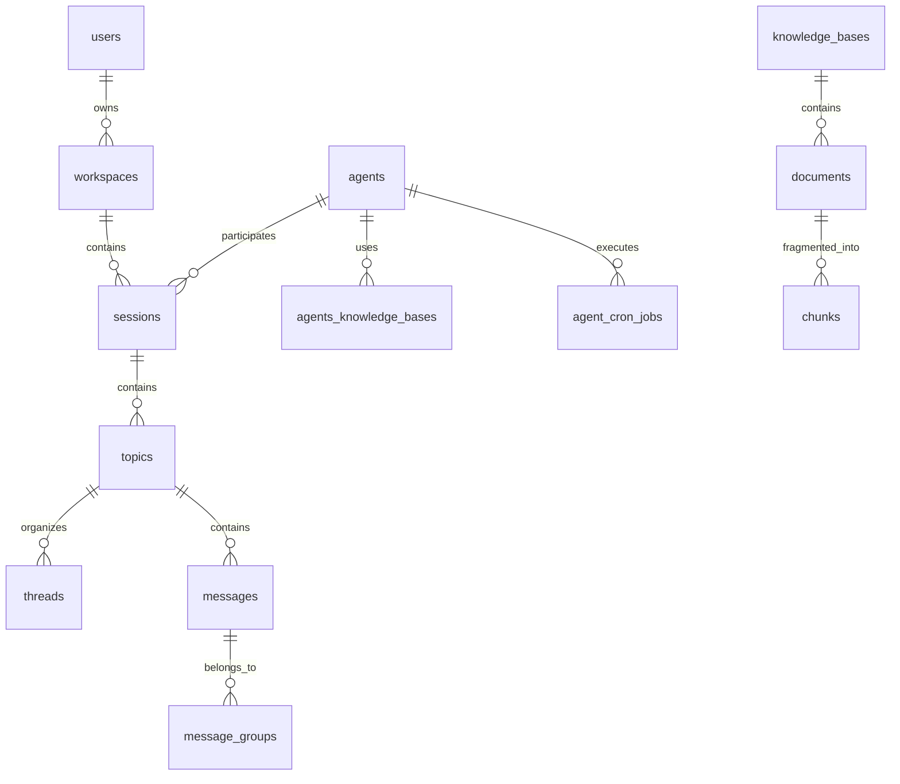
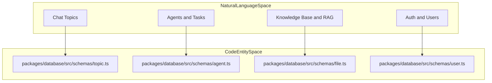

<!-- source: DeepWiki mcp.deepwiki.com · repo lobehub/lobehub · page 10 Database Schema · fetched 2026-10-29 -->

# Database Schema

Relevant source files

The following files were used as context for generating this wiki page:

- [apps/server/src/services/document/__tests__/index.test.ts](apps/server/src/services/document/__tests__/index.test.ts)
- [apps/server/src/services/document/index.ts](apps/server/src/services/document/index.ts)
- [docs/development/database-schema.dbml](docs/development/database-schema.dbml)
- [packages/database/migrations/0086_video_generation_schema.sql](packages/database/migrations/0086_video_generation_schema.sql)
- [packages/database/migrations/0177_agent_accounts_live_unique_and_goal_subscriptions.sql](packages/database/migrations/0177_agent_accounts_live_unique_and_goal_subscriptions.sql)
- [packages/database/migrations/0180_task_archived_at.sql](packages/database/migrations/0180_task_archived_at.sql)
- [packages/database/migrations/meta/0086_snapshot.json](packages/database/migrations/meta/0086_snapshot.json)
- [packages/database/migrations/meta/0177_snapshot.json](packages/database/migrations/meta/0177_snapshot.json)
- [packages/database/migrations/meta/0180_snapshot.json](packages/database/migrations/meta/0180_snapshot.json)
- [packages/database/migrations/meta/_journal.json](packages/database/migrations/meta/_journal.json)
- [packages/database/src/models/__tests__/agentAccount.test.ts](packages/database/src/models/__tests__/agentAccount.test.ts)
- [packages/database/src/models/__tests__/document.test.ts](packages/database/src/models/__tests__/document.test.ts)
- [packages/database/src/models/__tests__/drizzleMigration.test.ts](packages/database/src/models/__tests__/drizzleMigration.test.ts)
- [packages/database/src/models/__tests__/topics/topic.create.test.ts](packages/database/src/models/__tests__/topics/topic.create.test.ts)
- [packages/database/src/models/agentAccount.ts](packages/database/src/models/agentAccount.ts)
- [packages/database/src/models/document.ts](packages/database/src/models/document.ts)
- [packages/database/src/schemas/agent.ts](packages/database/src/schemas/agent.ts)
- [packages/database/src/schemas/agentAccount.ts](packages/database/src/schemas/agentAccount.ts)
- [packages/database/src/schemas/agentCronJob.ts](packages/database/src/schemas/agentCronJob.ts)
- [packages/database/src/schemas/apiKey.ts](packages/database/src/schemas/apiKey.ts)
- [packages/database/src/schemas/asyncTask.ts](packages/database/src/schemas/asyncTask.ts)
- [packages/database/src/schemas/chatGroup.ts](packages/database/src/schemas/chatGroup.ts)
- [packages/database/src/schemas/file.ts](packages/database/src/schemas/file.ts)
- [packages/database/src/schemas/generation.ts](packages/database/src/schemas/generation.ts)
- [packages/database/src/schemas/goalSubscription.ts](packages/database/src/schemas/goalSubscription.ts)
- [packages/database/src/schemas/index.ts](packages/database/src/schemas/index.ts)
- [packages/database/src/schemas/message.ts](packages/database/src/schemas/message.ts)
- [packages/database/src/schemas/rag.ts](packages/database/src/schemas/rag.ts)
- [packages/database/src/schemas/relations.ts](packages/database/src/schemas/relations.ts)
- [packages/database/src/schemas/session.ts](packages/database/src/schemas/session.ts)
- [packages/database/src/schemas/task.ts](packages/database/src/schemas/task.ts)
- [packages/database/src/schemas/topic.ts](packages/database/src/schemas/topic.ts)
- [packages/database/src/utils/idGenerator.ts](packages/database/src/utils/idGenerator.ts)
- [packages/types/src/goalSubscription.ts](packages/types/src/goalSubscription.ts)
- [packages/types/src/index.ts](packages/types/src/index.ts)

LobeHub uses a PostgreSQL database managed with **Drizzle ORM** to store persistent data related to conversations, agents, files, user management, and workflows. The schema is designed for multi-tenant workspace support, scalable AI interaction tracking, multi-model conversations, and a sophisticated Retrieval-Augmented Generation (RAG) pipeline.

## Architecture Overview

The database is centralized within the `packages/database` package. It contains comprehensive schema definitions, entity relationships, and model layer implementations [packages/database/src/schemas/index.ts:1-56]().

The schema is logically partitioned into the following domains:

- **Conversation Management**: Hierarchical conversation entities from Sessions to Messages, supporting threads, multi-model message groups, and conversation flow.
- **Agent and Group System**: Storing AI agents' configuration, profiles, multi-agent chat groups, and scheduled cron jobs.
- **File and Knowledge Base Management**: Handling files metadata, parsed documents, chunking, embeddings, and knowledge base groupings for RAG.
- **Verification, Evaluation and Tasks**: Tables for criteria, rubrics, evaluation runs, async background tasks, and user acceptance tracking.
- **Authentication and User Management**: User profiles, external authentication providers, role-based access control (RBAC), API keys, and user-specific settings.
- **Database Migrations Tooling**: Versioned SQL migrations managed by Drizzle Kit, including a migration journal and DBML schema visualizations.

### High-Level Entity Relationship Diagram

This diagram highlights core relations such as users owning workspaces, which contain sessions and conversation topics; agents linked to sessions; topic organization into threads and messages; files organized into documents and chunks for knowledge bases; and agents managing scheduled cron jobs.

Sources: [packages/database/src/schemas/relations.ts:1-43](), [docs/development/database-schema.dbml:1-190]()

### Subsystem to Code Entity Mapping

Sources: [packages/database/src/schemas/index.ts:1-68](), [packages/database/src/schemas/topic.ts:27-121]()

---

## Core Conversation Tables

LobeHub structures conversations hierarchically to manage context and history efficiently:

- **sessions**: Top-level containers representing distinct interaction contexts, such as a conversation session with one or more agents [packages/database/src/schemas/session.ts]().
- **topics**: Sub-conversations within sessions, with metadata, cost aggregates, and usage statistics [packages/database/src/schemas/topic.ts:27-94]().
- **threads**: Supports branching and parallel conversation flows with types like `continuation` or `eval` [packages/database/src/schemas/topic.ts:141-176]().
- **messages**: Individual chat turns including AI/user roles, message content, token usage, reasoning metadata, error states, and references to conversations [packages/database/src/schemas/message.ts:95-177]().
- **messageGroups**: Enables multi-model parallel conversations where multiple AI models respond simultaneously to the same input message [packages/database/src/schemas/message.ts:37-87]().

For detailed schema, columns, constraints, and relations, see [Core Conversation Tables](#10.1).

Sources: [packages/database/src/schemas/topic.ts:27-176](), [packages/database/src/schemas/message.ts:37-177]()

---

## Agent, Task and Operation Tables

The Agent subsystem manages AI assistants, multi-agent chat groups, tasks, and operational metadata:

- **agents**: The primary AI assistant entity containing configuration JSON, profile data, model/provider references, visibility settings, and ownership information [packages/database/src/schemas/agent.ts:36-129]().
- **chatGroups**: Supports orchestrating multiple agents into group conversations for collaboration [packages/database/src/schemas/chatGroup.ts]().
- **agentCronJobs**: Stores scheduled tasks for agents, defined with cron patterns and execution context [packages/database/src/schemas/agentCronJob.ts:95]().

For full details, see [Agent, Task and Operation Tables](#10.2).

Sources: [packages/database/src/schemas/agent.ts:36-129](), [packages/database/src/schemas/agentCronJob.ts:1-95]()

---

## File and Knowledge Base Tables

The persistent knowledge management and RAG pipeline revolve around:

- **files**: Metadata for uploaded binary files with mime types, size, URLs, and ownership [packages/database/src/schemas/file.ts:180-198]() and linked `global_files`.
- **documents**: Parsed text content from files or external sources, supporting folder hierarchies, visibility, and metadata [packages/database/src/schemas/file.ts:70-176]().
- **knowledgeBases**: Logical groupings for collections of documents and their associated files to scope retrieval [packages/database/src/schemas/file.ts:206-235]().
- **chunks** and **embeddings**: Chunked and vectorized pieces of documents to enable similarity search for AI generation [packages/database/src/schemas/rag.ts]().

See [File and Knowledge Base Tables](#10.3) for column definitions and relationships.

Sources: [packages/database/src/schemas/file.ts:70-235](), [packages/database/src/schemas/rag.ts:1-100]()

---

## Verification and Evaluation Tables

Tables supporting quality assurance, acceptance testing, and background evaluation include:

- **verify_criteria, verify_rubrics, verify_runs** etc.: Structured to store evaluation criteria, rubric definitions, and individual evaluation runs [docs/development/database-schema.dbml:1-190]().
- **acceptances** and **acceptance_comments**: User and agent feedback tracking with threaded comments and resolution states.
- **agentEvals**: Stores agent evaluation data and linking to benchmarks and datasets.
- **asyncTasks**: Tracks progress, status, and results of background processing tasks like indexing or memory extraction [packages/database/src/schemas/asyncTask.ts]().

Please refer to [Verification and Evaluation Tables](#10.4) for details.

Sources: [packages/database/src/schemas/asyncTask.ts:1-39](), [docs/development/database-schema.dbml:1-190]()

---

## Authentication and User Management

User accounts and workspace membership are managed through:

- **users** and **user_settings**: Core user profiles, preferences, and authentication metadata.
- **accounts** and **apiKey**: External accounts and API key management.
- **oidc**: OpenID Connect provider configuration.
- **rbac**: Role-Based Access Control tables defining permissions and workspace roles.

Integration includes the Better Auth system and middleware for route protection. Documentation is in [Authentication and User Management](#10.5).

Sources: [packages/database/src/schemas/user.ts:1-50](), [packages/database/src/schemas/apiKey.ts:1-42]()

---

## Database Migrations and Tooling

Schema evolution is handled by Drizzle Kit with the following:

- **Migration Journal (`_journal.json`)**: Tracks migration versions and tags chronologically [packages/database/migrations/meta/_journal.json:1-287]() and subsequent versions.
- **DBML Visualizations**: The schema is documented and visualized in DBML format for developer reference [docs/development/database-schema.dbml:1-190]().
- **ID Generation Conventions**: Custom ID prefixes and random slug generators help maintain unique, meaningful keys [packages/database/src/utils/idGenerator.ts:1-59]().

For a full overview, see [Database Migrations and Tooling](#10.6).

Sources: [packages/database/migrations/meta/_journal.json:1-287](), [packages/database/src/utils/idGenerator.ts:1-59]()

---

## Natural Language to Code Entity Mapping

This table aligns user-facing concepts with the database tables and primary schema files for easier code navigation.

| Natural Language Concept | Drizzle Table Name | Primary Schema File Path |
|---|---|---|
| Agent | `agents` | [packages/database/src/schemas/agent.ts:36-129]() |
| Chat Topic | `topics` | [packages/database/src/schemas/topic.ts:27-94]() |
| Thread | `threads` | [packages/database/src/schemas/topic.ts:141-176]() |
| AI Message | `messages` | [packages/database/src/schemas/message.ts:95-177]() |
| Message Group | `messageGroups` | [packages/database/src/schemas/message.ts:37-87]() |
| Knowledge Base | `knowledgeBases` | [packages/database/src/schemas/file.ts:206-235]() |
| File | `files` | [packages/database/src/schemas/file.ts:180-198]() |
| Document | `documents` | [packages/database/src/schemas/file.ts:70-176]() |
| Background Job | `asyncTasks` | [packages/database/src/schemas/asyncTask.ts]() |
| Workspace | `workspaces` | [packages/database/src/schemas/workspace.ts]() |
| User Memory | `userMemories` | [packages/database/src/schemas/userMemories.ts]() |
| Scheduled Task | `agentCronJobs` | [packages/database/src/schemas/agentCronJob.ts:95]() |

Sources:
- [packages/database/src/schemas/index.ts:1-56]()
- [packages/database/src/schemas/agent.ts:36-129]()
- [packages/database/src/schemas/topic.ts:27-176]()
- [packages/database/src/schemas/message.ts:37-177]()
- [packages/database/src/schemas/file.ts:70-235]()
- [packages/database/migrations/meta/_journal.json:1-287]()
- [docs/development/database-schema.dbml:1-190]()
- [packages/database/src/utils/idGenerator.ts:1-59]()

---

This page provides a high-level map of the PostgreSQL schema managed by Drizzle ORM for LobeHub. Detailed information on each table's columns, indexes, relationships, and internal model uses are covered in child pages:

- See [Core Conversation Tables](#10.1) for conversation-related tables.
- See [Agent, Task and Operation Tables](#10.2) for agent and operation data.
- See [File and Knowledge Base Tables](#10.3) for content storage and RAG.
- See [Verification and Evaluation Tables](#10.4) for QA and benchmarking.
- See [Authentication and User Management](#10.5) for user access control.
- See [Database Migrations and Tooling](#10.6) for migration workflows.

---

