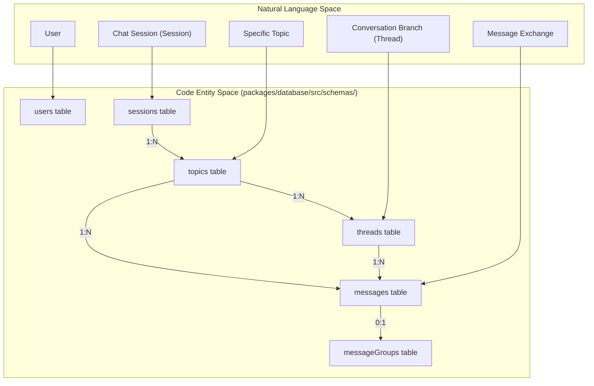
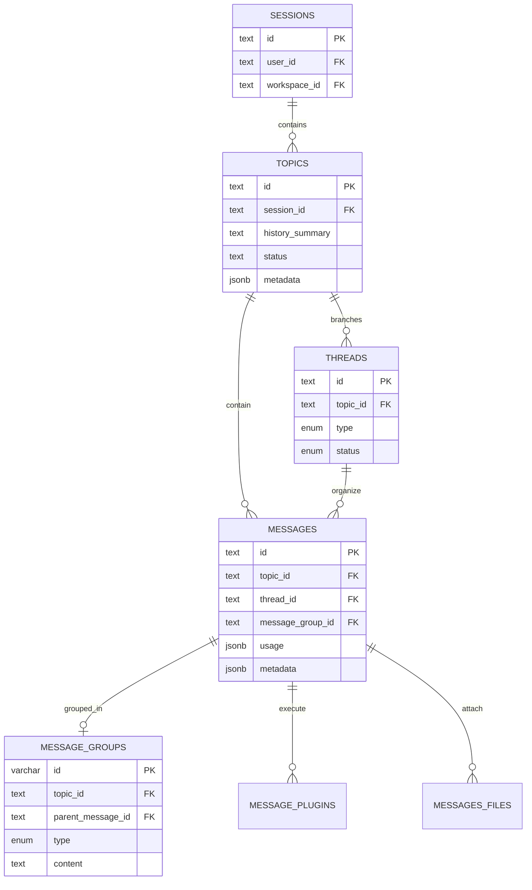

<!-- source: DeepWiki mcp.deepwiki.com · repo lobehub/lobehub · page 10.1 Core Conversation Tables · fetched 2026-10-29 -->

# Core Conversation Tables

Relevant source files

The following files were used as context for generating this wiki page:

- [apps/server/src/routers/lambda/message.ts](apps/server/src/routers/lambda/message.ts)
- [apps/server/src/routers/lambda/topic.ts](apps/server/src/routers/lambda/topic.ts)
- [apps/server/src/services/aiAgent/__tests__/execAgent.files.test.ts](apps/server/src/services/aiAgent/__tests__/execAgent.files.test.ts)
- [apps/server/src/services/file/resolveAttachments.test.ts](apps/server/src/services/file/resolveAttachments.test.ts)
- [apps/server/src/services/file/resolveAttachments.ts](apps/server/src/services/file/resolveAttachments.ts)
- [apps/server/src/services/message/__tests__/index.test.ts](apps/server/src/services/message/__tests__/index.test.ts)
- [apps/server/src/services/message/index.ts](apps/server/src/services/message/index.ts)
- [locales/en-US/topic.json](locales/en-US/topic.json)
- [locales/zh-CN/topic.json](locales/zh-CN/topic.json)
- [packages/context-engine/src/engine/index.ts](packages/context-engine/src/engine/index.ts)
- [packages/context-engine/src/engine/messages/index.ts](packages/context-engine/src/engine/messages/index.ts)
- [packages/context-engine/src/engine/topicReference/__tests__/resolveTopicReferences.test.ts](packages/context-engine/src/engine/topicReference/__tests__/resolveTopicReferences.test.ts)
- [packages/context-engine/src/engine/topicReference/index.ts](packages/context-engine/src/engine/topicReference/index.ts)
- [packages/context-engine/src/engine/topicReference/resolveTopicReferences.ts](packages/context-engine/src/engine/topicReference/resolveTopicReferences.ts)
- [packages/context-engine/src/processors/MessageContent.ts](packages/context-engine/src/processors/MessageContent.ts)
- [packages/context-engine/src/processors/__tests__/MessageContent.test.ts](packages/context-engine/src/processors/__tests__/MessageContent.test.ts)
- [packages/context-engine/src/processors/__tests__/MessageContent.unsupportedImageFormat.test.ts](packages/context-engine/src/processors/__tests__/MessageContent.unsupportedImageFormat.test.ts)
- [packages/context-engine/src/providers/TopicReferenceContextInjector.ts](packages/context-engine/src/providers/TopicReferenceContextInjector.ts)
- [packages/context-engine/src/providers/__tests__/TopicReferenceContextInjector.test.ts](packages/context-engine/src/providers/__tests__/TopicReferenceContextInjector.test.ts)
- [packages/database/src/models/__tests__/messages/message.create.test.ts](packages/database/src/models/__tests__/messages/message.create.test.ts)
- [packages/database/src/models/__tests__/messages/message.delete.test.ts](packages/database/src/models/__tests__/messages/message.delete.test.ts)
- [packages/database/src/models/__tests__/messages/message.query.test.ts](packages/database/src/models/__tests__/messages/message.query.test.ts)
- [packages/database/src/models/__tests__/messages/message.stats.test.ts](packages/database/src/models/__tests__/messages/message.stats.test.ts)
- [packages/database/src/models/__tests__/messages/message.update.test.ts](packages/database/src/models/__tests__/messages/message.update.test.ts)
- [packages/database/src/models/__tests__/messages/messageWithTask.test.ts](packages/database/src/models/__tests__/messages/messageWithTask.test.ts)
- [packages/database/src/models/__tests__/messages/queryWithMessageGroup.test.ts](packages/database/src/models/__tests__/messages/queryWithMessageGroup.test.ts)
- [packages/database/src/models/__tests__/thread.test.ts](packages/database/src/models/__tests__/thread.test.ts)
- [packages/database/src/models/__tests__/topic.test.ts](packages/database/src/models/__tests__/topic.test.ts)
- [packages/database/src/models/__tests__/topicCreator.test.ts](packages/database/src/models/__tests__/topicCreator.test.ts)
- [packages/database/src/models/__tests__/topics/topic.delete.test.ts](packages/database/src/models/__tests__/topics/topic.delete.test.ts)
- [packages/database/src/models/__tests__/topics/topic.query.test.ts](packages/database/src/models/__tests__/topics/topic.query.test.ts)
- [packages/database/src/models/__tests__/topics/topic.stats.test.ts](packages/database/src/models/__tests__/topics/topic.stats.test.ts)
- [packages/database/src/models/__tests__/topics/topicUsage.race.test.ts](packages/database/src/models/__tests__/topics/topicUsage.race.test.ts)
- [packages/database/src/models/__tests__/topics/topicUsage.test.ts](packages/database/src/models/__tests__/topics/topicUsage.test.ts)
- [packages/database/src/models/message.ts](packages/database/src/models/message.ts)
- [packages/database/src/models/thread.ts](packages/database/src/models/thread.ts)
- [packages/database/src/models/topic.ts](packages/database/src/models/topic.ts)
- [packages/database/src/models/topicCreator.ts](packages/database/src/models/topicCreator.ts)
- [packages/database/src/models/topicUsage.ts](packages/database/src/models/topicUsage.ts)
- [packages/locales/src/default/topic.ts](packages/locales/src/default/topic.ts)
- [packages/types/src/message/common/image.ts](packages/types/src/message/common/image.ts)
- [packages/types/src/message/ui/audio.ts](packages/types/src/message/ui/audio.ts)
- [packages/types/src/topic/thread.ts](packages/types/src/topic/thread.ts)
- [packages/types/src/topic/topic.ts](packages/types/src/topic/topic.ts)
- [packages/utils/src/client/topic.test.ts](packages/utils/src/client/topic.test.ts)
- [packages/utils/src/client/topic.ts](packages/utils/src/client/topic.ts)
- [src/features/AgentSidebar/Topic/List/Item/MetaHoverCard.tsx](src/features/AgentSidebar/Topic/List/Item/MetaHoverCard.tsx)
- [src/features/AgentSidebar/Topic/List/Item/index.test.tsx](src/features/AgentSidebar/Topic/List/Item/index.test.tsx)
- [src/features/AgentSidebar/Topic/List/Item/index.tsx](src/features/AgentSidebar/Topic/List/Item/index.tsx)
- [src/features/AgentSidebar/Topic/List/Item/metaCardData.ts](src/features/AgentSidebar/Topic/List/Item/metaCardData.ts)
- [src/features/TopicCreatorAvatar/index.test.tsx](src/features/TopicCreatorAvatar/index.test.tsx)
- [src/features/TopicCreatorAvatar/index.tsx](src/features/TopicCreatorAvatar/index.tsx)
- [src/routes/(main)/group/_layout/Sidebar/Topic/List/Item/index.tsx](src/routes/(main)/group/_layout/Sidebar/Topic/List/Item/index.tsx)
- [src/routes/(main)/group/_layout/Sidebar/Topic/TopicListContent/ByTimeMode/index.tsx](src/routes/(main)/group/_layout/Sidebar/Topic/TopicListContent/ByTimeMode/index.tsx)
- [src/routes/(main)/group/_layout/Sidebar/Topic/TopicListContent/FlatMode/index.tsx](src/routes/(main)/group/_layout/Sidebar/Topic/TopicListContent/FlatMode/index.tsx)
- [src/services/message/__tests__/hydrateProjectedTools.test.ts](src/services/message/__tests__/hydrateProjectedTools.test.ts)
- [src/services/message/hydrateProjectedTools.ts](src/services/message/hydrateProjectedTools.ts)
- [src/services/message/index.ts](src/services/message/index.ts)
- [src/services/topic/index.ts](src/services/topic/index.ts)
- [src/store/chat/initialState.ts](src/store/chat/initialState.ts)
- [src/store/chat/slices/topic/action.test.ts](src/store/chat/slices/topic/action.test.ts)
- [src/store/chat/slices/topic/action.ts](src/store/chat/slices/topic/action.ts)
- [src/store/chat/slices/topic/initialState.ts](src/store/chat/slices/topic/initialState.ts)
- [src/store/chat/slices/topic/justArchived.test.ts](src/store/chat/slices/topic/justArchived.test.ts)
- [src/store/chat/slices/topic/justArchived.ts](src/store/chat/slices/topic/justArchived.ts)
- [src/store/chat/slices/topic/reducer.test.ts](src/store/chat/slices/topic/reducer.test.ts)
- [src/store/chat/slices/topic/reducer.ts](src/store/chat/slices/topic/reducer.ts)
- [src/store/chat/slices/topic/selectors.test.ts](src/store/chat/slices/topic/selectors.test.ts)
- [src/store/chat/slices/topic/selectors.ts](src/store/chat/slices/topic/selectors.ts)
- [src/store/chat/slices/topic/topicListCache.integration.test.ts](src/store/chat/slices/topic/topicListCache.integration.test.ts)
- [src/store/chat/store.ts](src/store/chat/store.ts)

This page documents the core database tables that underpin the conversation hierarchy in LobeHub. The conversation system is organized with four main hierarchical entities: **Sessions**, **Topics**, **Threads**, and **Messages**, augmented by **Message Groups** to support multi-model parallelism and conversation history management.

These tables form the foundation for organizing AI interactions, tracking conversation state, and supporting advanced features like branching, multi-threading, and parallel responses.

---

## Data Model Overview

LobeHub's conversation system is based on a relational schema managed via Drizzle ORM. Each entity is scoped by `userId` and optionally `workspaceId` to provide user and tenant isolation in multi-user environments.

The system arranges conversation data in the following hierarchy:

1. **Sessions** – top-level containers that correspond roughly to a "chat session" or an interaction context.
2. **Topics** – sub-conversations within sessions, used to manage branching discussions or focused threads of interaction.
3. **Threads** – conversation branches or isolated execution contexts within a topic, such as evaluations, standalone branches, or isolated runs.
4. **Messages** – individual user or assistant exchanges, including rich content, tools, and extended metadata.
5. **Message Groups** – logical grouping of messages to support Multi-Model Parallel (MMP) responses for a single user prompt.

### Conceptual Mapping Diagram

Sources:  
- [packages/database/src/schemas/message.ts:1-154]()  
- [packages/database/src/schemas/topic.ts:1-174]()  
- [packages/database/src/schemas/index.ts:30-60]()

---

## Sessions Table

The `sessions` table represents a top-level container for conversations. Sessions are typically tied to an Agent or a particular functional grouping such as the "Inbox". They serve to separate distinct chat contexts and scope topics within them.

| Column        | Type      | Description                                                   |
|---------------|-----------|---------------------------------------------------------------|
| `id`          | `text`    | Primary key, generated with `idGenerator('sessions')`.        |
| `userId`      | `text`    | Foreign key to `users.id`, identifying the owner.             |
| `workspaceId` | `text`    | Foreign key to the `workspaces` table for multi-tenant setup. |
| `clientId`    | `text`    | Client-generated ID used for syncing and matching sessions.   |
| `pinned`      | `boolean` | Whether this session is pinned for quick UI access.           |

Sessions enable scope partitioning of conversations and provide the base level for organizing further conversation topics.

Sources:  
- [packages/database/src/schemas/session.ts:1-35]()  
- [packages/database/src/utils/idGenerator.ts:30-40]()

---

## Topics Table

Topics represent focused conversation subspaces within sessions. They allow users to organize conversations logically and branch specific discussions. Topics carry metadata about their state and are linked to sessions or groups.

| Column           | Type      | Description                                                                                          |
|------------------|-----------|----------------------------------------------------------------------------------------------------|
| `id`             | `text`    | Primary key identifying the topic.                                                                 |
| `sessionId`      | `text`    | Foreign key referencing `sessions.id`. Topics belong to sessions.                                  |
| `title`          | `text`    | User or AI-generated title for this conversation topic.                                             |
| `historySummary` | `text`    | AI-generated summary of the topic history, used for contextual compression and display.             |
| `totalTokens`    | `integer` | Aggregated token usage of all messages in the topic for efficient cost and usage reporting.          |
| `metadata`       | `jsonb`   | JSON metadata including UI state, onboarding info, heterogeneous agent settings, and bot context.   |
| `status`         | `enum`    | Lifecycle status (e.g., `active`, `running`, `waitingForHuman`, `completed`, `archived`).           |
| `trigger`        | `text`    | Origin of the topic creation (`cron`, `chat`, `api`, `eval`, `share`, etc.).                          |

### Usage Aggregation Detail

To optimize analytics and cost calculations, LobeHub denormalizes usage data by aggregating token counts and cost at the topic level (`totalTokens`). This avoids expensive full scans of all messages for reporting and summarization. This count updates incrementally as messages are inserted or modified.

Sources:  
- [packages/database/src/schemas/topic.ts:1-174]()  
- [packages/database/src/models/message.ts:70-90]()

---

## Threads Table

Threads provide a structure for branching conversations or parallel logical paths inside a topic. This allows isolating complex workflows like model evaluations, task executions, or conversation branches.

| Column          | Type      | Description                                                                                           |
|-----------------|-----------|-----------------------------------------------------------------------------------------------------|
| `id`            | `text`    | Primary key generated via `idGenerator('threads', 16)`, typically a 16-character unique ID.          |
| `topicId`       | `text`    | Foreign key to `topics.id`. The thread belongs to a topic.                                           |
| `type`          | `enum`    | Thread execution mode: `continuation`, `standalone`, `isolation`, or `eval`.                         |
| `status`        | `enum`    | Lifecycle status such as `active`, `processing`, `pending`, `inReview`, `completed`, etc.           |
| `sourceMessageId`| `text`    | The message that spawned or triggered this thread (enabling branching or continuation tracing).      |
| `parentThreadId` | `text`    | Optional self-referencing column allowing nested threads (e.g., sub-branches).                       |

Threads help manage conversation branching, sub-flows, and isolated task execution within the topic context.

Sources:  
- [packages/database/src/schemas/thread.ts:1-150]()  
- [packages/database/src/models/message.ts:60-90]()

---

## Messages Table

The `messages` table stores all user and assistant messages in the conversation system. It supports rich content, tool invocation, chain-of-thought reasoning, usage stats, and links to threads and message groups.

| Column           | Type        | Description                                                                                      |
|------------------|-------------|------------------------------------------------------------------------------------------------|
| `id`             | `text`      | Primary key message identifier.                                                                |
| `userId`         | `text`      | Owner of the message.                                                                           |
| `role`           | `varchar`   | Message sender role: `user`, `assistant`, `system`, or `tool`.                                 |
| `content`        | `text`      | Raw text or markdown content of the message.                                                  |
| `reasoning`      | `jsonb`     | Chain-of-Thought (CoT) reasoning data attached to this message.                                |
| `usage`          | `jsonb`     | Promoted usage stats for tokens/cost extracted from metadata for analytics.                    |
| `topicId`        | `text`      | Foreign key to `topics.id`, associating the message with a conversation topic.                  |
| `threadId`       | `text`      | Foreign key to `threads.id` optional, allowing message threading and branching.                 |
| `messageGroupId` | `text`      | Foreign key to the `messageGroups.id` grouping parallel AI model assistant responses.           |
| `metadata`       | `jsonb`     | Extensible metadata including error info, plugin state, human approval, plugin error tracking.  |
| `search`         | `jsonb`     | Metadata for search groundings or retrieval augmented generation (RAG).                         |
| `tools`          | `jsonb`     | Optional tool call payloads embedded in the message content for invocation or inspection.       |

### Message Metadata

The `metadata` and `search` columns provide flexible extensibility for advanced feature support, including tool execution callbacks, human approvals, error tracking, translation, and audio/video attachments.

Sources:  
- [packages/database/src/schemas/message.ts:1-180]()  
- [packages/database/src/models/message.ts:1-212]()  
- [packages/database/src/models/message.ts:180-270]()

---

## Message Groups Table

`messageGroups` organize multiple assistant messages that respond to the same user input, enabling Multi-Model Parallel (MMP) features where multiple AI models or configurations generate answers simultaneously.

| Column            | Type      | Description                                                                            |
|-------------------|-----------|----------------------------------------------------------------------------------------|
| `id`              | `varchar` | Primary key ID of the message group.                                                  |
| `topicId`         | `text`    | Foreign key to the topic that the group belongs to.                                   |
| `parentMessageId` | `text`    | The original user message ID that triggered this group of parallel assistant messages.|
| `type`            | `enum`    | Group type: `parallel` (MMP response set) or `compression` (chunking for summaries).  |
| `content`         | `text`    | Aggregate summary or representative content of the grouped messages (used in compression).|

This grouping supports displaying alternative or parallel responses and summarizing branched conversation history for compact context injection.

Sources:  
- [packages/database/src/schemas/message.ts:37-100]()  
- [packages/database/src/models/message.ts:70-120]()

---

## Relationships and Indexing Strategy

Efficient querying and relational integrity are enforced via foreign keys, indexes, and cascade rules.

### Entity Relationship Diagram

### Important Indexes

- **Ownership Uniqueness**: Tables typically have a composite unique index on `(clientId, userId)` to facilitate client-server sync without conflict and to enable fast user-scoped queries.  
- **Date/Time Index**: Messages have indexes on `createdAt` and `updatedAt` for chronological pagination.  
- **Foreign Key Indexes**: Foreign key columns (`topicId`, `threadId`, `sessionId`, `messageGroupId`) are indexed for efficient joins and cascades.  
- **JSONB Expression Indexes**: Some metadata and usage columns have specific expression indexes for filtering on message status or error conditions.

Sources:  
- [packages/database/src/schemas/message.ts:150-180]()  
- [packages/database/src/schemas/topic.ts:80-110]()  

---

# Summary

These core tables and their associated models provide a powerful, flexible structure to manage conversation data in LobeHub. The design supports multi-way branching, rich message metadata, multi-agent parallelism, robust tenant scoping, and efficient analytics queries.

Key classes encapsulate these schemas and provide higher-level abstractions:

- **`MessageModel`** handles CRUD and complex querying over messages, including usage aggregation, plugin state management, and thread associations.  
- **`TopicModel`** manages topic creation, updates, scheduled runs, and usage analytics.  
- **`ThreadModel`** controls conversation branches and tracks thread statuses.  

The interplay between these tables ensures consistency, history integrity, and rich interaction capabilities.

Sources:  
- [packages/database/src/models/message.ts:1-240]()  
- [packages/database/src/models/topic.ts:1-174]()  
- [packages/database/src/models/__tests__/messages/message.query.test.ts:1-216]()  
- [packages/database/src/models/__tests__/topic.test.ts:1-190]()

---

This concludes the detailed technical documentation of the Core Conversation Tables in the LobeHub codebase.

---

