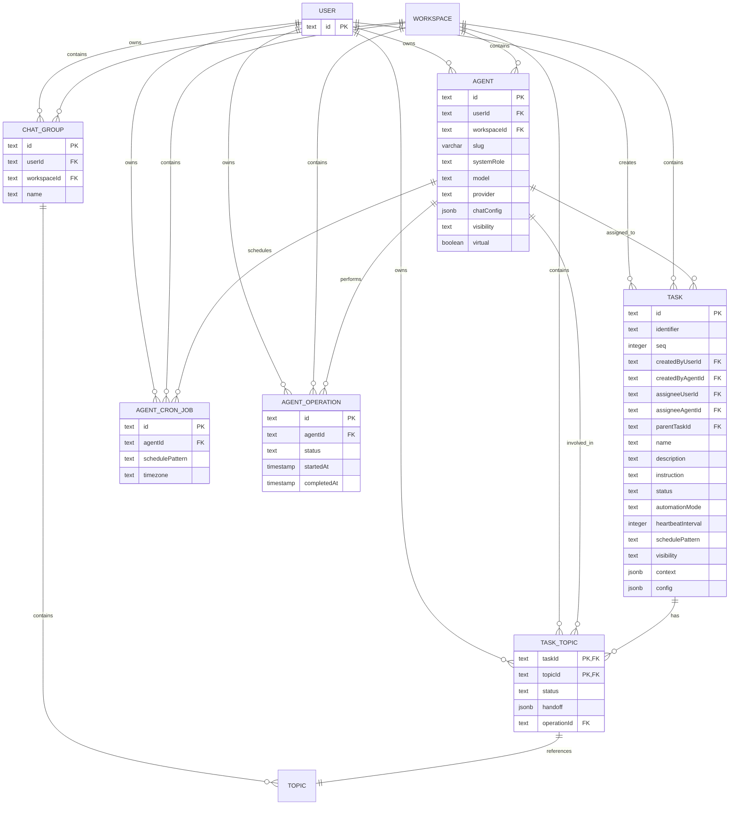
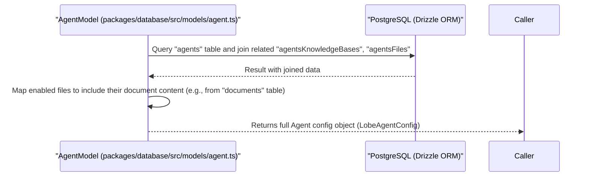
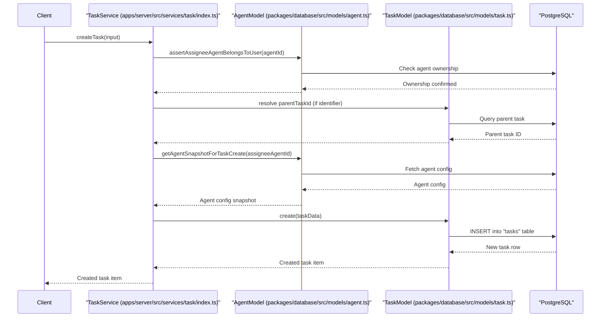

<!-- source: DeepWiki mcp.deepwiki.com · repo lobehub/lobehub · page 10.2 Agent, Task and Operation Tables · fetched 2026-10-29 -->

# Agent, Task and Operation Tables

Relevant source files

The following files were used as context for generating this wiki page:

- [apps/cli/src/commands/task.test.ts](apps/cli/src/commands/task.test.ts)
- [apps/cli/src/commands/task/assignee.test.ts](apps/cli/src/commands/task/assignee.test.ts)
- [apps/cli/src/commands/task/assignee.ts](apps/cli/src/commands/task/assignee.ts)
- [apps/cli/src/commands/task/index.ts](apps/cli/src/commands/task/index.ts)
- [apps/cli/src/commands/task/url.ts](apps/cli/src/commands/task/url.ts)
- [apps/server/src/routers/lambda/__tests__/agent.test.ts](apps/server/src/routers/lambda/__tests__/agent.test.ts)
- [apps/server/src/routers/lambda/__tests__/integration/task.integration.test.ts](apps/server/src/routers/lambda/__tests__/integration/task.integration.test.ts)
- [apps/server/src/routers/lambda/agent.ts](apps/server/src/routers/lambda/agent.ts)
- [apps/server/src/routers/lambda/task.ts](apps/server/src/routers/lambda/task.ts)
- [apps/server/src/services/agent/index.test.ts](apps/server/src/services/agent/index.test.ts)
- [apps/server/src/services/agent/index.ts](apps/server/src/services/agent/index.ts)
- [apps/server/src/services/task/index.test.ts](apps/server/src/services/task/index.test.ts)
- [apps/server/src/services/task/index.ts](apps/server/src/services/task/index.ts)
- [apps/server/src/services/taskLifecycle/index.ts](apps/server/src/services/taskLifecycle/index.ts)
- [apps/server/src/services/taskLifecycle/onTopicComplete.test.ts](apps/server/src/services/taskLifecycle/onTopicComplete.test.ts)
- [apps/server/src/services/taskRunner/index.ts](apps/server/src/services/taskRunner/index.ts)
- [apps/server/src/services/taskRunner/runTask.deleteRace.test.ts](apps/server/src/services/taskRunner/runTask.deleteRace.test.ts)
- [locales/en-US/suggestQuestions.json](locales/en-US/suggestQuestions.json)
- [locales/zh-CN/suggestQuestions.json](locales/zh-CN/suggestQuestions.json)
- [packages/database/src/models/__tests__/agent.test.ts](packages/database/src/models/__tests__/agent.test.ts)
- [packages/database/src/models/__tests__/task.test.ts](packages/database/src/models/__tests__/task.test.ts)
- [packages/database/src/models/__tests__/taskTopic.test.ts](packages/database/src/models/__tests__/taskTopic.test.ts)
- [packages/database/src/models/agent.ts](packages/database/src/models/agent.ts)
- [packages/database/src/models/task.ts](packages/database/src/models/task.ts)
- [packages/database/src/models/taskTopic.ts](packages/database/src/models/taskTopic.ts)
- [packages/database/src/utils/agencyConfigDevices.ts](packages/database/src/utils/agencyConfigDevices.ts)
- [packages/locales/src/default/suggestQuestions.ts](packages/locales/src/default/suggestQuestions.ts)
- [packages/prompts/src/chains/builderSuggestion.test.ts](packages/prompts/src/chains/builderSuggestion.test.ts)
- [packages/prompts/src/chains/builderSuggestion.ts](packages/prompts/src/chains/builderSuggestion.ts)
- [packages/types/src/agent/index.ts](packages/types/src/agent/index.ts)
- [packages/types/src/agent/item.ts](packages/types/src/agent/item.ts)
- [packages/types/src/task/index.ts](packages/types/src/task/index.ts)
- [src/features/AgentBuilder/AgentBuilderWelcome.tsx](src/features/AgentBuilder/AgentBuilderWelcome.tsx)
- [src/features/AgentBuilder/SuggestionChips/feedbackStore.test.ts](src/features/AgentBuilder/SuggestionChips/feedbackStore.test.ts)
- [src/features/ChatInput/ControlBar/__tests__/useCommitWorkingDirectory.test.tsx](src/features/ChatInput/ControlBar/__tests__/useCommitWorkingDirectory.test.tsx)
- [src/features/ChatInput/ControlBar/useCommitWorkingDirectory.ts](src/features/ChatInput/ControlBar/useCommitWorkingDirectory.ts)
- [src/features/SuggestQuestions/useRandomQuestions.ts](src/features/SuggestQuestions/useRandomQuestions.ts)
- [src/services/agent.test.ts](src/services/agent.test.ts)
- [src/services/agent.ts](src/services/agent.ts)
- [src/services/task.ts](src/services/task.ts)
- [src/store/agent/slices/agent/action.test.ts](src/store/agent/slices/agent/action.test.ts)
- [src/store/agent/slices/agent/action.ts](src/store/agent/slices/agent/action.ts)
- [src/store/agent/slices/builtin/action.ts](src/store/agent/slices/builtin/action.ts)
- [src/store/agent/slices/builtin/index.ts](src/store/agent/slices/builtin/index.ts)
- [src/store/agent/slices/builtin/initialState.ts](src/store/agent/slices/builtin/initialState.ts)
- [src/store/agent/slices/builtin/projection.ts](src/store/agent/slices/builtin/projection.ts)
- [src/store/agent/slices/builtin/replica.test.ts](src/store/agent/slices/builtin/replica.test.ts)
- [src/store/task/selectors/detailSelectors.ts](src/store/task/selectors/detailSelectors.ts)
- [src/store/task/slices/detail/action.test.ts](src/store/task/slices/detail/action.test.ts)
- [src/store/task/slices/detail/action.ts](src/store/task/slices/detail/action.ts)
- [src/store/task/slices/detail/initialState.ts](src/store/task/slices/detail/initialState.ts)

This page documents the database tables central to the AI Agent and Task management system in LobeHub, specifically the `agents`, `chatGroups`, `tasks`, `taskTopics`, `agentOperation`, and `agentCronJob` tables. We cover columns, indexes, foreign keys, unique constraints, and key implementation details including data flow, critical methods, and access control mechanisms.

---

## 1. Overview

The agent and task tables are pivotal for defining autonomous AI agents, groups of collaborating agents, and tasks that agents or users manage and execute. The system supports multi-tenant workspaces and personal modes, with rich metadata, lifecycle state, scheduling, and operational tracking.

- **Agents** represent configurable AI assistants recorded in the `agents` table.
- **Chat Groups** (`chatGroups` table) enable multi-agent collaborative conversations.
- **Tasks** (`tasks` table) represent work items with subtasks, assignees, priorities, and automation settings.
- **Task Topics** (`taskTopics` table) associate conversation topics with tasks and track status and handoff data.
- **Agent Operations** and **Agent Cron Jobs** track executions and scheduled tasks of agents respectively.

All tables support scoped ownership and visibility within users and workspaces. Access control and referential integrity follow through strict FK and index constraints.

---

## 2. Entity Relationship Diagram

### Core Entities and Relations

Sources:
- [packages/database/src/schemas/agent.ts]()
- [packages/database/src/schemas/task.ts]()
- [packages/database/src/schemas/agentOperations.ts]()
- [packages/database/src/schemas/agentCronJob.ts]()
- [packages/database/src/schemas/topic.ts]()
- [packages/database/src/schemas/chatGroup.ts]()

---

## 3. Agents Table

### Description

The `agents` table defines each AI agent’s persistent identity, configuration, ownership, and provision status. It supports:

- Agent metadata (title, description, avatar)
- Model backend information (model, provider)
- Chat configuration (`chat_config` JSONB)
- User and workspace ownership linking
- Visibility controls (`public` or `private`)
- Support for built-in vs custom agents via slugs and virtual flag

### Key Columns

|Column|Type|Description|
|-|-|-|
|`id`|`text`|Primary key, id with `agt_` prefix generated by `idGenerator` [packages/database/src/utils/idGenerator.ts:8-55]()|
|`slug`|`varchar(100)`|URL-safe unique handle per user or workspace|
|`user_id`|`text`|FK to `users.id` (agent owner)|
|`workspace_id`|`text`|FK to `workspaces.id` for multi-tenant isolation, nullable|
|`system_role`|`text`|Core system prompt/instruction string for agent LLM|
|`model`|`text`|AI model identifier (e.g. `gpt-4`)|
|`provider`|`text`|AI model provider (e.g. `openai`)|
|`chat_config`|`jsonb`|Agent chat settings, tool enablement, agent memory config|
|`visibility`|`text` enum (`public`, `private`)|Scoped visibility within workspace|
|`virtual`|`boolean`|Marks built-in system agents (non-editable)|

Sources:
- [packages/database/src/schemas/agent.ts]()

### Unique Constraints and Indexes

- Unique index on `(slug, user_id)` when no workspace: ensure user-personal slug uniqueness.
- Unique index on `(slug, workspace_id)` when workspace present: workspace-scoped uniqueness.
- Indexes on user/workspace/visibility for efficient filtering and ownership lookup.
- Reserved slugs prevent user assignment of special system agent slugs.

### Access Control and Immutable Fields

Certain fields are immutable to avoid unauthorized changes or rehoming during update calls. These include `createdAt`, `id`, `sessionGroupId`, `slug`, `userId`, `virtual`, `visibility`, and `workspaceId` [packages/database/src/models/agent.ts:180-191]().

Agents with slug `agentBuilder` have extra protected fields that never get stored to avoid self-overwrite bugs. These fields include `title`, `name`, `description`, `avatar`, `backgroundColor`, `tags`, `marketIdentifier`, and `systemRole` [packages/database/src/models/agent.ts:145-154](). Attempts to update these fields for the `agentBuilder` will result in a `TRPCError` with code `'FORBIDDEN'` [packages/database/src/models/agent.ts:160-165]().

### Agent Configuration Retrieval Flow

The `AgentModel.getAgentConfigById(agentId)` method is key to retrieving an agent’s full config including linked knowledge bases and files. It performs joined SQL queries and post-processing, returning the assembled `AgentItem` representation.

Sources:
- [packages/database/src/models/agent.ts:1-182]()
- [packages/database/src/models/__tests__/agent.test.ts:112-151]()
- [packages/database/src/schemas/agent.ts]()

---

## 4. ChatGroups Table

### Description

The `chatGroups` table supports multi-agent collaboration by grouping agents into shared conversational contexts. Each group has ownership and optional workspace scoping.

### Columns Summary

|Column|Type|Description|
|-|-|-
|`id`|`text`|Primary key with `cg_` prefix from `idGenerator` [packages/database/src/utils/idGenerator.ts:8-55]()|
|`user_id`|`text`|FK to user who created the group|
|`workspace_id`|`text`|Optional FK to workspace for team groups|
|`name`|`text`|Name of the chat group|
|`topic_id`|`text`|FK to `topics.id` for the group's main topic|

Sources:
- [packages/database/src/schemas/chatGroup.ts]()

### Relationships

- Groups own multiple `topics`.
- Agents can belong to groups (via `chatGroupsAgents` join table) [packages/database/src/schemas/chatGroup.ts:31-35]().
- Topics within groups route messages to multiple agents for collaboration.

---

## 5. Tasks Table

### Description

The `tasks` table represents atomic units of work that agents or users manage and execute. Tasks have lifecycle states, assignees (agents or users), priorities, and support automation via heartbeat or schedule modes.

### Key Columns

|Column|Type|Description|
|-|-|-|
|`id`|`text`|Primary key, `task_` prefix [packages/database/src/utils/idGenerator.ts:8-55]()|
|`identifier`|`text`|Human-readable task id such as `T-1` or a project-scoped prefix|
|`seq`|`integer`|Sequence number to generate new `identifier`s per user or workspace|
|`createdByUserId`|`text`|FK to `users.id` (creator user)|
|`createdByAgentId`|`text`|FK nullable to `agents.id` (if task created by agent)|
|`assigneeUserId`|`text`|FK nullable to assigned user|
|`assigneeAgentId`|`text`|FK nullable to assigned agent|
|`parentTaskId`|`text`|Self-referential FK for subtask hierarchy|
|`name`|`text`|Short descriptive name|
|`description`|`varchar(255)`|Optional description|
|`instruction`|`text`|Rich task instruction, required|
|`status`|`text` enum|Task lifecycle status (`backlog`, `running`, `paused`, `completed`, `failed`, `canceled`) [packages/types/src/task/index.ts:9-10]()|
|`automationMode`|`text` enum (`heartbeat` or `schedule`)|Type of automation enabled [packages/types/src/task/index.ts:64]()|
|`heartbeatInterval`|`integer`|Seconds, how often heartbeat automation triggers|
|`schedulePattern`|`text`|Cron pattern string for scheduled tasks|
|`visibility`|`text` enum (`private`, `public`)|Mirrors agent visibility, controls access within workspace|
|`context`|`jsonb`|Runtime task context JSON|
|`config`|`jsonb`|Task config such as checkpoints, reviews, verify rules|

Sources:
- [packages/database/src/schemas/task.ts]()
- [packages/types/src/task/index.ts]()

### Unique Constraints

- `(identifier, createdByUserId)` unique for personal tasks (`workspaceId IS NULL`).
- `(identifier, workspaceId)` unique index for workspace-scoped tasks.

### Important Indexes

- `status`, `priority`, `assignee_agent_id`, `assignee_user_id`, `workspace_id` for efficient filtering and queries.
- `project_id` for project-scoped tasks.

### Seq Allocation and Identifier Generation

The task model generates unique incremental identifiers per user or workspace for new tasks (`T-1`, `PROJ-42`). This eliminates collisions and supports multi-tenant isolation in concurrent environments [packages/database/src/models/task.ts:72-72]().

### Automation and Lifecycle

Tasks with automation modes `heartbeat` or `schedule` can trigger agent runs at intervals or cron times, controlled by `heartbeatInterval` or `schedulePattern`.

### Access Control and Ownership

Task visibility follows agent-like `public` or `private` semantics in workspace mode. Ownership predicates and filters enforce read/update access.

Sources:
- [packages/database/src/models/task.ts]()
- [packages/database/src/models/__tests__/task.test.ts:87-116]()
- [apps/server/src/services/task/index.ts:150-179]()

---

## 6. TaskTopics Table

### Description

The `taskTopics` table tracks associations between a `task` and one or more conversation `topics`. It records the execution status of the task’s conversation, operation IDs for runs, and lifecycle handoff data.

### Key Columns

|Column|Type|Description|
|-|-|-|
|`taskId`|`text`|FK referencing `tasks.id`|
|`topicId`|`text`|FK referencing `topics.id`|
|`status`|`text`|Execution state of the task on the topic|
|`handoff`|`jsonb`|Metadata for handoff summaries, captured outputs, brief decisions|
|`operationId`|`text`|FK to the associated `agentOperation` execution|

Sources:
- [packages/database/src/schemas/task.ts]()

### Lifecycle Operations

- Methods like `cancelIfRunning` [packages/database/src/models/taskTopic.ts:116-133]() allow cancelling running topics atomically.
- Statuses follow terminal states such as `completed`, `canceled`, `failed` [packages/database/src/models/taskTopic.ts:15-23]().
- The `handoff` field can be updated incrementally with JSONB operations to store partial LLM synthesis results, for example, `updateBriefDecision` [packages/database/src/models/taskTopic.ts:183-194]() and `updateHandoffContent` [packages/database/src/models/taskTopic.ts:203-203]().

Sources:
- [packages/database/src/models/taskTopic.ts]()
- [packages/database/src/models/__tests__/taskTopic.test.ts]()

---

## 7. AgentOperation and AgentCronJob Tables

### AgentOperation

The `agentOperations` table records execution instances of an agent performing a task or job. Columns track start and end times, status, and outputs, supporting observability and auditing.

|Column|Type|Description|
|-|-|-|
|`id`|`text`|Primary key, `op_` prefix|
|`agentId`|`text`|FK to `agents.id`|
|`status`|`text` enum|Current status of the operation (e.g., `running`, `completed`, `error`)|
|`startedAt`|`timestamp`|Timestamp when the operation started|
|`completedAt`|`timestamp`|Timestamp when the operation completed|
|`error`|`jsonb`|Error details if the operation failed|
|`state`|`jsonb`|Internal state of the operation|
|`trigger`|`text` enum|How the operation was triggered (e.g., `manual`, `schedule`, `heartbeat`, `goal`)|

Sources:
- [packages/database/src/schemas/agentOperations.ts]()
- [packages/database/src/models/task.ts:43-44]()

### AgentCronJob

The `agentCronJobs` table stores scheduled jobs linked to agents, defined by cron expressions and time zones. These jobs drive periodic task or agent execution.

|Column|Type|Description|
|-|-|-|
|`id`|`text`|Primary key, `acj_` prefix|
|`agentId`|`text`|FK to `agents.id`|
|`schedulePattern`|`text`|Cron expression for scheduling|
|`timezone`|`text`|Timezone for the cron schedule|
|`enabled`|`boolean`|Whether the cron job is active|
|`lastRunAt`|`timestamp`|Timestamp of the last successful run|
|`nextRunAt`|`timestamp`|Timestamp of the next scheduled run|

Sources:
- [packages/database/src/schemas/agentCronJob.ts]()
- [packages/database/src/models/agent.ts:43-43]()

---

## 8. Data Flow: Task Creation and Scheduling

When a task is created (`TaskService.createTask`):

1.  Verify that any assigned agent belongs to the user by calling `assertAssigneeAgentBelongsToUser` [apps/server/src/services/task/index.ts:156]().
2.  If `parentTaskId` is provided as an identifier (friendly string), resolve it to a database ID [apps/server/src/services/task/index.ts:164-167]().
3.  Assign `projectId` and identifier prefix based on project membership [apps/server/src/services/task/index.ts:175]().
4.  Snapshot the assigned agent’s current model and provider config into the task to shield from agent changes [apps/server/src/services/task/index.test.ts:197-203]().
5.  Insert the task with generated identifier and sequence number [packages/database/src/models/task.ts:90-96]().
6.  If task is automated (`heartbeat`/`schedule`), it becomes runnable under the automation lifecycle.
7.  Insert task-topic relationships for conversations started.

Sources:
- [apps/server/src/services/task/index.ts:121-181]()
- [packages/database/src/models/task.ts:90-96]()
- [apps/server/src/services/task/index.test.ts:197-203]()

---

## 9. Summary Table of Schemas and Keys

| Table Name       | Key Columns / Important Columns                      | Foreign Keys                      | Unique Constraints                                   | Notes                                   |
|------------------|-----------------------------------------------------|---------------------------------|----------------------------------------------------|-----------------------------------------|
| `agents`         | `id`, `slug`, `userId`, `workspaceId`               | `userId` → `users.id`, `workspaceId` → `workspaces.id` | Unique on `(slug,userId)` or `(slug,workspaceId)`   | Agent config and chat tool settings    |
| `chatGroups`     | `id`, `userId`, `workspaceId`, `name`, `topicId`    | `userId` → `users.id`, `workspaceId` → `workspaces.id`, `topicId` → `topics.id` | Primary key on `id`                       | Multi-agent conversation groups        |
| `tasks`          | `id`, `identifier`, `createdByUserId`, `workspaceId`, `assigneeAgentId`, `assigneeUserId` | Multiple FKs to `users`, `agents`, `workspace`, `projects`, `topics` | Unique on `(identifier,createdByUserId)` or `(identifier,workspaceId)` | Task lifecycle, automation, assignment |
| `taskTopics`     | Composite key via `taskId`, `topicId`                | `taskId` → `tasks.id`, `topicId` → `topics.id`          | None unique specified                             | Tracks task-to-topic exec & handoff    |
| `agentOperations` | `id`, `agentId`, `status`, `startedAt`, `completedAt` | `agentId` → `agents.id`          | Primary `id`                                        | Tracks agent execution runs             |
| `agentCronJobs`   | `id`, `agentId`, `schedulePattern`, `timezone`       | `agentId` → `agents.id`          | Primary `id`                                        | Scheduled agent jobs                    |

---

# Summary

This section detailed the core database tables and relationships that support LobeHub’s agent framework, task management, and operational tracking. The design supports flexible user and workspace scoped AI agents, group chat orchestration, granular task definition with subtasks and scheduling, and fine-grained visibility and ownership enforcement. Critical server-side service methods enforce integrity, snapshot agent versions on task creation, and coordinate lifecycle transitions.

# Appendix: Important Classes and Methods

| Class / Method               | File                                            | Description                                                 |
|-----------------------------|-------------------------------------------------|-------------------------------------------------------------|
| `AgentModel`                | `packages/database/src/models/agent.ts`         | Models `agents` table, config retrieval, ownership, ACLs    |
| `TaskModel`                 | `packages/database/src/models/task.ts`          | Models `tasks` table, handles task lifecycle and sequencing  |
| `TaskService.createTask`    | `apps/server/src/services/task/index.ts`        | Creates tasks, validates assignees, snapshots agent config  |
| `TaskTopicModel`            | `packages/database/src/models/taskTopic.ts`     | Manages associations between tasks and chat topics          |
| `TaskLifecycleService`      | `apps/server/src/services/taskLifecycle/index.ts` | Manages lifecycle transitions from topic completion          |

---

# References and Sources

- [packages/database/src/schemas/agent.ts]()
- [packages/database/src/models/agent.ts]()
- [packages/database/src/schemas/task.ts]()
- [packages/database/src/models/task.ts]()
- [packages/database/src/models/taskTopic.ts]()
- [apps/server/src/services/task/index.ts]()
- [apps/server/src/services/taskLifecycle/index.ts]()
- [packages/database/src/utils/idGenerator.ts]()
- [packages/database/src/schemas/chatGroup.ts]()
- [packages/database/src/schemas/agentOperations.ts]()
- [packages/database/src/schemas/agentCronJob.ts]()
- [packages/types/src/task/index.ts]()
- [packages/database/src/models/__tests__/agent.test.ts]()
- [packages/database/src/models/__tests__/task.test.ts]()
- [packages/database/src/models/__tests__/taskTopic.test.ts]()
- [apps/server/src/services/task/index.test.ts]()

---

