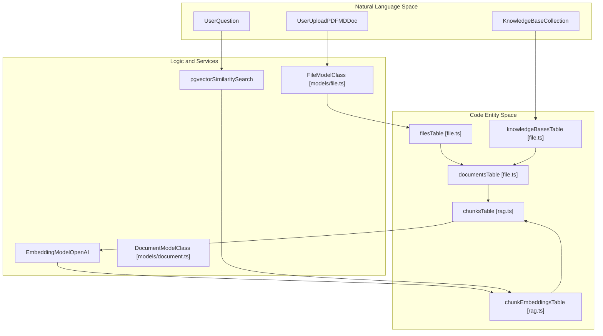
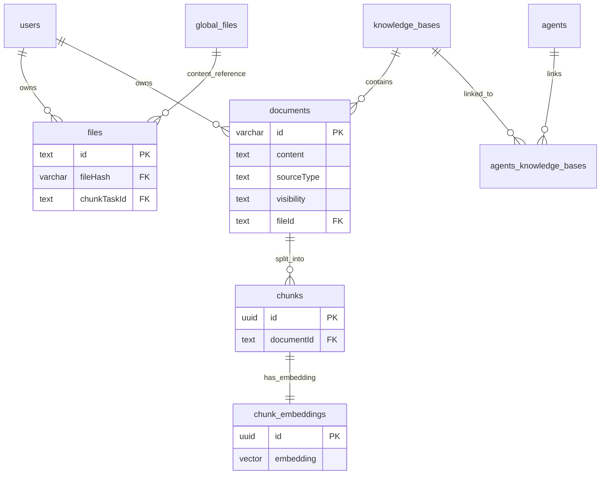

<!-- source: DeepWiki mcp.deepwiki.com · repo lobehub/lobehub · page 10.3 File and Knowledge Base Tables · fetched 2026-10-29 -->

# File and Knowledge Base Tables

Relevant source files

The following files were used as context for generating this wiki page:

- [apps/server/src/services/document/__tests__/index.test.ts](apps/server/src/services/document/__tests__/index.test.ts)
- [apps/server/src/services/document/index.ts](apps/server/src/services/document/index.ts)
- [docs/development/database-schema.dbml](docs/development/database-schema.dbml)
- [packages/database/migrations/0086_video_generation_schema.sql](packages/database/migrations/0086_video_generation_schema.sql)
- [packages/database/migrations/0177_agent_accounts_live_unique_and_goal_subscriptions.sql](packages/database/migrations/0177_agent_accounts_live_unique_and_goal_subscriptions.sql)
- [packages/database/migrations/0180_task_archived_at.sql](packages/database/migrations/0180_task_archived_at.sql)
- [packages/database/migrations/meta/0086_snapshot.json](packages/database/migrations/meta/0086_snapshot.json)
- [packages/database/migrations/meta/0177_snapshot.json](packages/database/migrations/meta/0177_snapshot.json)
- [packages/database/migrations/meta/0180_snapshot.json](packages/database/migrations/meta/0180_snapshot.json)
- [packages/database/migrations/meta/_journal.json](packages/database/migrations/meta/_journal.json)
- [packages/database/src/models/__tests__/agentAccount.test.ts](packages/database/src/models/__tests__/agentAccount.test.ts)
- [packages/database/src/models/__tests__/document.test.ts](packages/database/src/models/__tests__/document.test.ts)
- [packages/database/src/models/__tests__/drizzleMigration.test.ts](packages/database/src/models/__tests__/drizzleMigration.test.ts)
- [packages/database/src/models/__tests__/topics/topic.create.test.ts](packages/database/src/models/__tests__/topics/topic.create.test.ts)
- [packages/database/src/models/agentAccount.ts](packages/database/src/models/agentAccount.ts)
- [packages/database/src/models/document.ts](packages/database/src/models/document.ts)
- [packages/database/src/schemas/agent.ts](packages/database/src/schemas/agent.ts)
- [packages/database/src/schemas/agentAccount.ts](packages/database/src/schemas/agentAccount.ts)
- [packages/database/src/schemas/agentCronJob.ts](packages/database/src/schemas/agentCronJob.ts)
- [packages/database/src/schemas/apiKey.ts](packages/database/src/schemas/apiKey.ts)
- [packages/database/src/schemas/asyncTask.ts](packages/database/src/schemas/asyncTask.ts)
- [packages/database/src/schemas/chatGroup.ts](packages/database/src/schemas/chatGroup.ts)
- [packages/database/src/schemas/file.ts](packages/database/src/schemas/file.ts)
- [packages/database/src/schemas/generation.ts](packages/database/src/schemas/generation.ts)
- [packages/database/src/schemas/goalSubscription.ts](packages/database/src/schemas/goalSubscription.ts)
- [packages/database/src/schemas/index.ts](packages/database/src/schemas/index.ts)
- [packages/database/src/schemas/message.ts](packages/database/src/schemas/message.ts)
- [packages/database/src/schemas/rag.ts](packages/database/src/schemas/rag.ts)
- [packages/database/src/schemas/relations.ts](packages/database/src/schemas/relations.ts)
- [packages/database/src/schemas/session.ts](packages/database/src/schemas/session.ts)
- [packages/database/src/schemas/task.ts](packages/database/src/schemas/task.ts)
- [packages/database/src/schemas/topic.ts](packages/database/src/schemas/topic.ts)
- [packages/database/src/utils/idGenerator.ts](packages/database/src/utils/idGenerator.ts)
- [packages/types/src/goalSubscription.ts](packages/types/src/goalSubscription.ts)
- [packages/types/src/index.ts](packages/types/src/index.ts)

This page documents the database schema and technical implementation for LobeHub's Retrieval-Augmented Generation (RAG) pipeline, file management system, generation tracking, and metric schemas. The system relies on a PostgreSQL database utilizing the `pgvector` extension for embedding storage and similarity search, modeled and managed through Drizzle ORM.

Sources: 
[packages/database/src/schemas/file.ts:1-230](), [packages/database/src/schemas/rag.ts:1-93](), [packages/database/src/schemas/generation.ts:1-50](), [packages/database/src/schemas/metric.ts:1-40]()

---

## 1. Overview of RAG Data Flow

The RAG pipeline captures the flow from user-uploaded files through document parsing, chunk embedding, similarity search, and knowledge retrieval during AI query execution.

### Conceptual Workflow and Code Entity Mapping

The diagram below bridges the **Natural Language Space** (user actions and inputs) with the **Code Entity Space** (tables and models) highlighting relational tables, data processing services, and embedding indexing components.

Sources: 
[packages/database/src/schemas/file.ts:54-176](), [packages/database/src/schemas/rag.ts:1-93](), [packages/database/src/models/file.ts:40-85](), [packages/database/src/models/document.ts:30-93]()

---

## 2. Database Schema Detail

The core tables supporting the RAG pipeline, file management, generation tracking, and metrics include the following.

### 2.1 Files and Global Files

LobeHub separates content-addressed deduplicated file metadata (`global_files`) from user-specific references (`files`).

| Table | Description | Key Columns |
|-------|-------------|-------------|
| `global_files` | Content-addressed deduplicated file metadata | `hash_id` (PK), `file_type`, `size`, `url`, `creator` |
| `files` | User-owned file references pointing to global storage | `id` (PK), `fileHash` (FK), `userId`, `size`, `chunkTaskId` |

Sources: 
[packages/database/src/schemas/file.ts:69-84](), [packages/database/src/models/file.ts:70-120]()

### 2.2 Documents

Documents hold parsed structured content extracted from files or external sources.

- **Table:** `documents`
- **Data:** `title`, `description`, `content`, `fileType`, `sourceType` (`file`, `web`, `api`, `topic`, `agent`, `agent-signal`), `pages`, character and line counts.
- **Hierarchy:** Folder and page structures organized via `parentId`.
- **Visibility:** `public` or `private` within workspaces.

Sources: 
[packages/database/src/schemas/file.ts:92-172](), [packages/database/src/models/document.ts:30-125]()

### 2.3 Knowledge Bases

Knowledge bases organize documents into collections scoped per user and workspace, linked to agents for contextual prompt generation.

- **Table:** `knowledge_bases`
- **Agent Link:** `agents_knowledge_bases` establishes many-to-many associations between agents and knowledge bases.
- **Columns:** `id`, `title`, `description`, `userId`, `workspaceId`, `visibility`.

Sources: 
[packages/database/src/schemas/file.ts:225-250](), [packages/database/src/schemas/agent.ts:145-170]()

### 2.4 Chunks and Chunk Embeddings

Documents are segmented into smaller units for retrieval.

- **Chunks Table:** `chunks` stores chunk text content, document references, and metadata.
- **Embeddings Table:** `chunk_embeddings` stores dense vector embeddings using `pgvector`.
- **Async Tasks:** Processing tracked via asynchronous task identifiers.

Sources: 
[packages/database/src/schemas/rag.ts:1-93]()

### 2.5 Generation and Metric Schemas

Tracking LLM generations, batches, and system performance metrics.

- **Table:** `generations` / `generationBatches` - Records text, image, or completion generations and batch runs.
- **Table:** `metrics` - Records numerical metrics, execution timings, and token telemetry.

Sources: 
[packages/database/src/schemas/generation.ts:1-50](), [packages/database/src/schemas/metric.ts:1-40]()

---

## 3. Entity Relationships

Sources: 
[packages/database/src/schemas/file.ts:54-230](), [packages/database/src/schemas/agent.ts:145-180](), [docs/development/database-schema.dbml:150-180]()

---

## 4. Implementation Details

### ID Generation

Tables utilize NanoID-based generators with namespace prefixes. UUIDs are used for chunks and embeddings to support vector indices.

Sources: 
[packages/database/src/utils/idGenerator.ts:8-56](), [packages/database/src/schemas/rag.ts:14-18]()

### Multi-Tenancy and Workspace Awareness

All RAG tables include `userId` and optional `workspaceId` for scoping and team sharing.

Sources: 
[packages/database/src/schemas/file.ts:117-134](), [packages/database/src/schemas/agent.ts:77-81]()

### Visibility Constraints

`visibility` columns (`private` or `public`) regulate access controls across workspace documents and knowledge bases.

Sources: 
[packages/database/src/schemas/file.ts:130-170](), [packages/database/src/models/document.ts:96-110]()

---

## 5. Tables Summary and Their Roles

| Table | Role in Pipeline | Source File Path |
|-------|------------------|------------------|
| `files` | User-managed file metadata | `packages/database/src/schemas/file.ts` |
| `global_files` | Content-addressed storage | `packages/database/src/schemas/file.ts` |
| `documents` | Parsed content storage | `packages/database/src/schemas/file.ts` |
| `knowledge_bases` | Document collections linked to agents | `packages/database/src/schemas/file.ts` |
| `chunks` | Document text segments | `packages/database/src/schemas/rag.ts` |
| `chunk_embeddings` | Vector embeddings for similarity search | `packages/database/src/schemas/rag.ts` |
| `generations` | LLM generation tracking | `packages/database/src/schemas/generation.ts` |
| `metrics` | Performance and telemetry metrics | `packages/database/src/schemas/metric.ts` |

Sources: 
[packages/database/src/schemas/index.ts:1-68]()

---

## 6. Code Entities and Key Classes

- `FileModel` (`packages/database/src/models/file.ts`): Manages file lifecycles, deduplication via hash checks, and chunking task initialization.
- `DocumentModel` (`packages/database/src/models/document.ts`): Handles document CRUD operations, folder hierarchies (`findOrCreateFolder`), and workspace visibility enforcement.

Sources: 
[packages/database/src/models/file.ts:40-120](), [packages/database/src/models/document.ts:65-125]()

---

