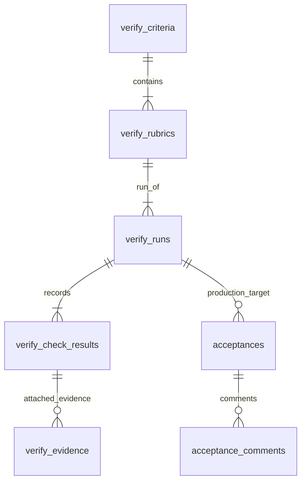
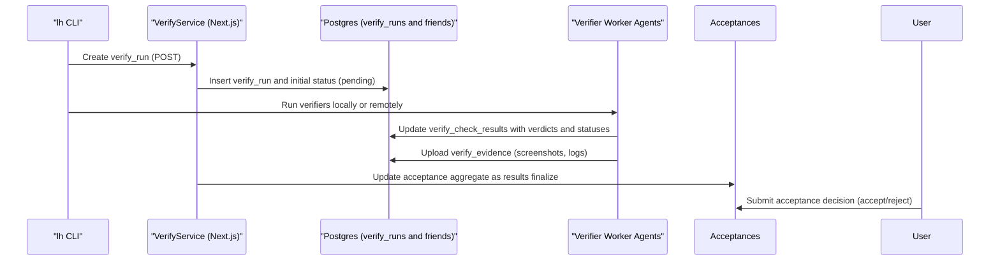
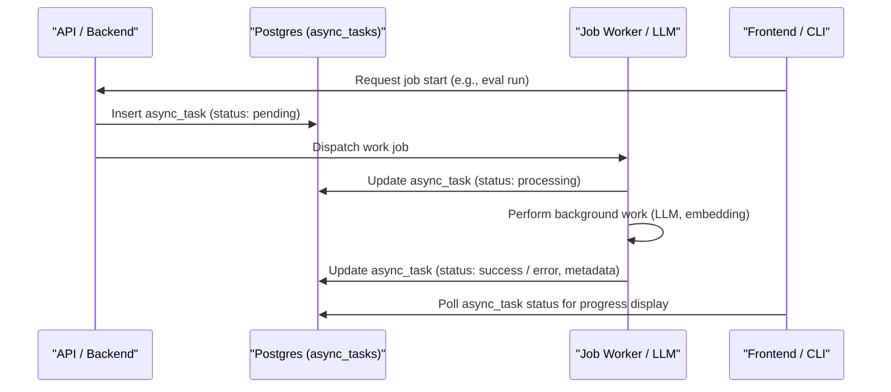
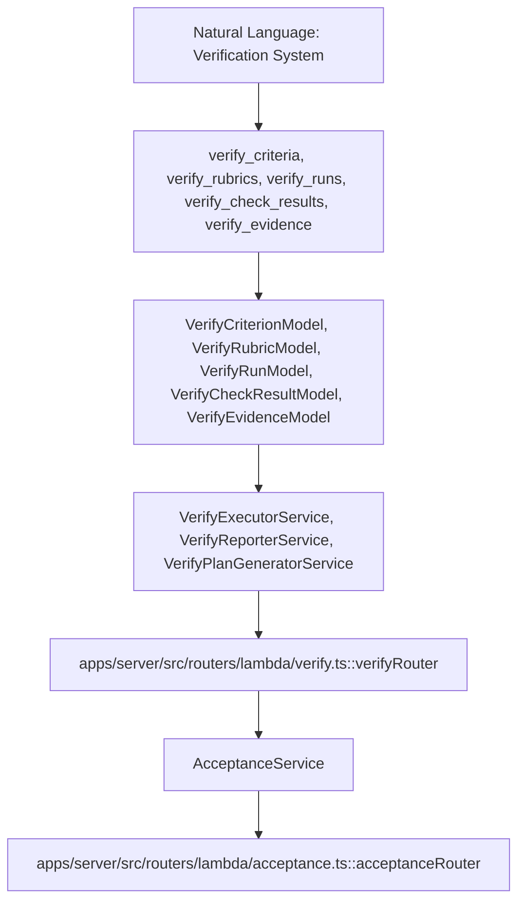
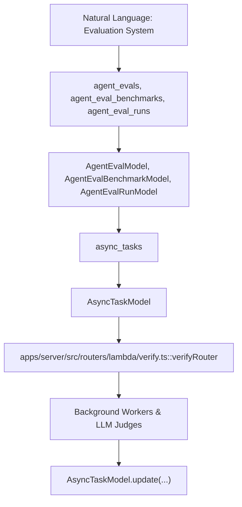

<!-- source: DeepWiki mcp.deepwiki.com · repo lobehub/lobehub · page 10.4 Verification and Evaluation Tables · fetched 2026-10-29 -->

# Verification and Evaluation Tables

<details>
<summary>Relevant source files</summary>

The following files were used as context for generating this wiki page:

- [apps/cli/src/commands/acceptanceEvidence.ts](apps/cli/src/commands/acceptanceEvidence.ts)
- [apps/cli/src/commands/acceptanceFlow.test.ts](apps/cli/src/commands/acceptanceFlow.test.ts)
- [apps/cli/src/commands/acceptanceFlow.ts](apps/cli/src/commands/acceptanceFlow.ts)
- [apps/cli/src/commands/acceptanceFlowFeedback.test.ts](apps/cli/src/commands/acceptanceFlowFeedback.test.ts)
- [apps/cli/src/commands/acceptanceInstall.test.ts](apps/cli/src/commands/acceptanceInstall.test.ts)
- [apps/cli/src/commands/acceptanceLanguage.test.ts](apps/cli/src/commands/acceptanceLanguage.test.ts)
- [apps/cli/src/commands/acceptanceLanguage.ts](apps/cli/src/commands/acceptanceLanguage.ts)
- [apps/cli/src/commands/acceptanceRun.test.ts](apps/cli/src/commands/acceptanceRun.test.ts)
- [apps/cli/src/commands/acceptanceRun.ts](apps/cli/src/commands/acceptanceRun.ts)
- [apps/cli/src/commands/verify.test.ts](apps/cli/src/commands/verify.test.ts)
- [apps/cli/src/commands/verify.ts](apps/cli/src/commands/verify.ts)
- [apps/cli/src/commands/verifyAcceptance.create.test.ts](apps/cli/src/commands/verifyAcceptance.create.test.ts)
- [apps/cli/src/commands/verifyAcceptance.ts](apps/cli/src/commands/verifyAcceptance.ts)
- [apps/cli/src/commands/verifyHelpers.ts](apps/cli/src/commands/verifyHelpers.ts)
- [apps/cli/src/utils/skillWiring.test.ts](apps/cli/src/utils/skillWiring.test.ts)
- [apps/cli/src/utils/skillWiring.ts](apps/cli/src/utils/skillWiring.ts)
- [apps/server/src/routers/lambda/__tests__/verify.test.ts](apps/server/src/routers/lambda/__tests__/verify.test.ts)
- [apps/server/src/routers/lambda/acceptance.ts](apps/server/src/routers/lambda/acceptance.ts)
- [apps/server/src/routers/lambda/verify.ts](apps/server/src/routers/lambda/verify.ts)
- [apps/server/src/services/verify/__tests__/acceptanceDecision.test.ts](apps/server/src/services/verify/__tests__/acceptanceDecision.test.ts)
- [apps/server/src/services/verify/__tests__/acceptanceMerge.test.ts](apps/server/src/services/verify/__tests__/acceptanceMerge.test.ts)
- [apps/server/src/services/verify/__tests__/acceptanceSettledCheck.test.ts](apps/server/src/services/verify/__tests__/acceptanceSettledCheck.test.ts)
- [apps/server/src/services/verify/__tests__/acceptanceUnion.test.ts](apps/server/src/services/verify/__tests__/acceptanceUnion.test.ts)
- [apps/server/src/services/verify/__tests__/taskAcceptance.test.ts](apps/server/src/services/verify/__tests__/taskAcceptance.test.ts)
- [apps/server/src/services/verify/acceptanceMerge.ts](apps/server/src/services/verify/acceptanceMerge.ts)
- [apps/server/src/services/verify/acceptanceService.ts](apps/server/src/services/verify/acceptanceService.ts)
- [apps/server/src/services/verify/taskAcceptance.ts](apps/server/src/services/verify/taskAcceptance.ts)
- [locales/en-US/verify.json](locales/en-US/verify.json)
- [locales/zh-CN/verify.json](locales/zh-CN/verify.json)
- [packages/const/src/verify.test.ts](packages/const/src/verify.test.ts)
- [packages/const/src/verify.ts](packages/const/src/verify.ts)
- [packages/database/migrations/0119_add_acceptances.sql](packages/database/migrations/0119_add_acceptances.sql)
- [packages/database/migrations/meta/0119_snapshot.json](packages/database/migrations/meta/0119_snapshot.json)
- [packages/database/src/models/__tests__/acceptance.test.ts](packages/database/src/models/__tests__/acceptance.test.ts)
- [packages/database/src/models/__tests__/verifyRun.test.ts](packages/database/src/models/__tests__/verifyRun.test.ts)
- [packages/database/src/models/acceptance.ts](packages/database/src/models/acceptance.ts)
- [packages/database/src/models/verifyRun.ts](packages/database/src/models/verifyRun.ts)
- [packages/database/src/schemas/verify.ts](packages/database/src/schemas/verify.ts)
- [packages/locales/src/default/verify.ts](packages/locales/src/default/verify.ts)
- [packages/types/src/verify.ts](packages/types/src/verify.ts)
- [src/services/verify.ts](src/services/verify.ts)

</details>


This page documents the database tables, status enums, and progress tracking mechanisms used by the Verification and Evaluation subsystem in LobeHub. It covers the schema and key service interactions for verifying AI agent outputs and tracking evaluation runs, acceptance decisions, and associated asynchronous tasks.

These tables enable robust criteria-based verification, acceptance workflows, scoring and rubric evaluation, as well as background processing of verification and evaluation runs.

---

## 1. Overview

LobeHub's verification system (`verify`) and evaluation system (`eval`) serve complementary roles:

- **Verification**: Focuses on delivery quality assurance for AI agent tasks, implemented through check criteria, rubrics, verification runs, delivery acceptances, and user feedback.
- **Evaluation**: Measures AI agents' performance on benchmarks and datasets via dedicated evaluation runs and score reporting.

Both systems rely on a generalized **asynchronous task** system (`async_tasks`) to manage lifecycle and progress for long-running operations such as LLM judgement, media generation, and embeddings.

---

## 2. Verification Tables and Concepts

The Verification system centers around these key tables:

| Table | Purpose |
| ---- | ------------- |
| `verify_criteria` | Defines atomic verification criteria/check definitions. |
| `verify_rubrics` | Groups of criteria forming a rubric for runs. |
| `verify_runs` | Individual execution logs of verification suites. |
| `verify_check_results` | Results for each criteria in a run, including status, verdict, and verdict metadata. |
| `verify_evidence` | Stores evidence artifacts supporting check results (screenshots, text, media). |
| `acceptances` | Aggregate business-level delivery acceptance status for verification outcomes. |
| `acceptance_comments` | Comments, feedback, and annotations on acceptance deliveries. |

### Verification Status Enums

- `VerifyCheckResultStatus` tracks the lifecycle of each criteria's check result: [packages/types/src/verify.ts:35-37]()

  ```
  pending → running → {passed | failed | errored | skipped}
  ```

  - `errored`: Verifier infrastructure failure, distinct from logical failure. [packages/types/src/verify.ts:35-37]()
  - `skipped`: A check that was omitted or superseded. [packages/types/src/verify.ts:35-37]()

- `VerifyVerdict` reflects the Toulmin claim from verifiers with these values: [packages/types/src/verify.ts:39]()

  - `passed`
  - `failed`
  - `uncertain`

- `AcceptanceStatus` models the business-level acceptance lifecycle: [packages/types/src/verify.ts:66-76]()

  ```
  pending → planned → verifying → repairing → delivered → {accepted | closed | rejected | errored}
  ```

Sources: [apps/server/src/routers/lambda/verify.ts:20-55](), [packages/types/src/verify.ts:30-75](), [packages/database/migrations/0119_add_acceptances.sql](), [packages/database/src/schemas/verify.ts:1-200]()

### Key Verification Entities and Relationships


Sources: [packages/database/migrations/0119_add_acceptances.sql]()

### Data Flow for a Verification Run


Sources: [apps/cli/src/commands/acceptanceRun.ts:61-64](), [apps/server/src/routers/lambda/verify.ts:35-36](), [apps/server/src/services/verify/acceptanceService.ts:50-53]()

---

## 3. Evaluation Tables

LobeHub supports AI agent performance evaluation using benchmark datasets and scoring rubrics.

Key evaluation tables:

| Table | Details |
| --- | ---- |
| `agent_evals` | Evaluation datasets containing input-output pairs. |
| `agent_eval_benchmarks` | Score rubrics and criteria for grading runs. |
| `agent_eval_runs` | Execution logs of evaluation runs linking agents to evals with results. |

### Evaluation Status and Error Tracking

Evaluation runs are associated with asynchronous tasks (below) for background processing. Run status is tracked similarly to verification with enums like:

- `pending`
- `processing`
- `success`
- `error`

The `async_tasks` table is heavily used to track progress, errors, metadata, and webhook tokens.

Sources: [packages/database/migrations/meta/0119_snapshot.json](), [packages/database/src/schemas/verify.ts:1-200]()

---

## 4. Asynchronous Task System (`async_tasks` Table)

Verification and evaluation workflows rely on a unified async task system to manage background work. This includes check execution, evidence capture, embedding generation, media creation, and user memory extraction.

### `async_tasks` Table Fields and Status

| Column | Description |
| --- | --- |
| `id` | Primary UUID key for the task. |
| `type` | Task kind (e.g., `chunk`, `embedding`, `image_generation`, `video_generation`, `user_memory_extraction`, `agent_eval`, etc.). |
| `status` | Task lifecycle state enum: `pending`, `processing`, `success`, `error`. |
| `error` | JSON error object if failed, including error name and details. |
| `metadata` | JSON metadata bag for task-specific context, including tracking tokens or usage info. |
| `inference_id` | External provider async request ID, enabling callbacks to correlate results. |

### Status Enums as per `packages/types/src/asyncTask.ts`

```ts
type AsyncTaskStatus = 'pending' | 'processing' | 'success' | 'error';
type AsyncTaskType =
  | 'chunk'
  | 'embedding'
  | 'image_generation'
  | 'video_generation'
  | 'user_memory_extraction'
  | 'agent_eval';
```

### Async Task Lifecycle Diagram


Sources: [packages/database/migrations/meta/0119_snapshot.json]()

---

## 5. Acceptance and Review Tables

LobeHub's Acceptance subsystem aggregates verification outcomes into business decisions on delivery acceptability. Acceptance entities include:

| Table | Purpose |
| ------ | ------ |
| `acceptances` | Aggregate delivery acceptance records with lifecycle status and application context. |
| `acceptance_comments` | User and agent comments, feedback, and annotations linked to acceptances. |

### Acceptance Status Enum (`AcceptanceStatus`)

- `pending`: No acceptance action yet. [packages/types/src/verify.ts:66-76]()
- `planned`: Acceptance configured. [packages/types/src/verify.ts:66-76]()
- `verifying`: Verification checks running. [packages/types/src/verify.ts:66-76]()
- `repairing`: Repair workflow initiated. [packages/types/src/verify.ts:66-76]()
- `delivered`: Verification settled, awaiting human decision. [packages/types/src/verify.ts:66-76]()
- `accepted`: Delivery accepted by user. [packages/types/src/verify.ts:66-76]()
- `closed`: Acceptance archived, no positive verdict. [packages/types/src/verify.ts:66-76]()
- `rejected`: Delivery rejected, next verification round expected. [packages/types/src/verify.ts:66-76]()
- `errored`: Acceptance or verification failed unexpectedly. [packages/types/src/verify.ts:66-76]()

### Data Flow: Acceptance Review Lifecycle

```mermaid
sequenceDiagram
    participant User as "User/Reviewer"
    participant AcceptanceSvc as "AcceptanceService"
    participant DB as "Postgres (acceptances, comments, verify_runs, check_results)"

    ref over AcceptanceSvc, DB
    AcceptanceSvc->>DB: Load acceptance and related verify_runs
    AcceptanceSvc->>DB: Aggregate check results, verdicts, exceptions
    AcceptanceSvc->>User: Present acceptance summary & evidence
    User->>AcceptanceSvc: Add acceptance comments
    User->>AcceptanceSvc: Accept or Reject delivery
    AcceptanceSvc->>DB: Update acceptance status & round info
    AcceptanceSvc->>VerifyRunModel: Trigger new verification round if rejected
```
Sources: [apps/server/src/services/verify/acceptanceService.ts:1-1853](), [apps/server/src/routers/lambda/acceptance.ts:1-182]()

### Acceptance Comment Structure Highlights

- Comments link to acceptance, optional evidence id, and optionally anchor regions (spatial annotations). [apps/server/src/routers/lambda/acceptance.ts:69-97]()
- Support rich content with embedded attachments and editor data. [packages/types/src/verify.ts:128-134]()
- Allow threading via parent comment id. [packages/database/migrations/0119_add_acceptances.sql]()
- Provide audit info: author id (user or agent), timestamps, resolution flags. [locales/zh-CN/verify.json:96-98]()

Sources: [packages/types/src/verify.ts:40-140](), [apps/server/src/routers/lambda/acceptance.ts:1-150]()

---

## 6. Detailed Table Descriptions

### `verify_criteria` Table

- Defines individual verification criteria or check items. [packages/types/src/verify.ts:103-107]()
- Includes verifier type (`program`, `agent`, `llm`), title, description, on-fail strategy (`manual`/`auto_repair`), required flag. [packages/types/src/verify.ts:24-28](), [packages/types/src/verify.ts:29]()
- Criteria are reusable by multiple rubrics and runs. [packages/database/src/schemas/verify.ts:1-200]()

### `verify_rubrics` Table

- Groups criteria into rubrics representing verification suites. [packages/database/src/schemas/verify.ts:1-200]()
- Stores run-policy config such as max repair rounds. [apps/server/src/routers/lambda/verify.ts:101-104]()

### `verify_runs` Table

- Represents a single execution of a verification process on a subject. [packages/database/src/schemas/verify.ts:1-200]()
- Tracks run status (`pending`, `running`, `complete`), source scenario and context, and referencing a rubric. [packages/database/src/schemas/verify.ts:1-200]()
- Linked to async_tasks via a task id for background execution tracking. [packages/database/src/schemas/verify.ts:1-200]()

### `verify_check_results` Table

- Holds result status and verdict for each criterion executed during a run. [packages/database/src/schemas/verify.ts:1-200]()
- Includes Toulmin narrative details (reasoning, evidence, counter-evidence), as well as metadata and LLM tracing ids. [apps/server/src/routers/lambda/verify.ts:90-95]()
- Captures final outcome per check. [packages/database/src/schemas/verify.ts:1-200]()

### `verify_evidence` Table

- Evidence artifacts that verify check results. [packages/database/src/schemas/verify.ts:1-200]()
- Types include screenshots, gifs, video, audio, text, DOM snapshots, transcripts. [apps/server/src/routers/lambda/verify.ts:79-88]()
- Metadata indicates capture method (browser agent, CDP, CLI, program). [apps/server/src/routers/lambda/verify.ts:89]()
- Linked to both runs and individual check results. [packages/database/src/schemas/verify.ts:1-200]()

### `acceptances` Table

- Business-level aggregates summarizing verification results for delivery acceptance. [packages/types/src/verify.ts:45-53]()
- Contains acceptance lifecycle status, visual AI-generated reporting renders, and policy config snapshots. [packages/types/src/verify.ts:66-76](), [packages/types/src/verify.ts:84-91]()
- Tracks the user who made the acceptance decision and timeline. [packages/database/src/schemas/verify.ts:1-200]()

### `acceptance_comments` Table

- Stores user/agent comments and annotations on acceptance deliveries. [packages/database/migrations/0119_add_acceptances.sql]()
- Supports rich JSON editor data and spatial annotation regions for image evidence. [apps/server/src/routers/lambda/acceptance.ts:69-97]()
- Linked to acceptance and optionally to specific evidence or check results. [packages/database/migrations/0119_add_acceptances.sql]()

### `agent_evals` Table

- Represents evaluation datasets with prompt-response test pairs. [packages/database/migrations/meta/0119_snapshot.json]()
- Connected to agent configurations for benchmarking. [packages/database/migrations/meta/0119_snapshot.json]()

### `agent_eval_benchmarks` Table

- Stores rubric definitions for scoring AI agent responses. [packages/database/migrations/meta/0119_snapshot.json]()
- Can be system-provided or user-defined. [packages/database/migrations/meta/0119_snapshot.json]()

### `agent_eval_runs` Table

- Tracks executions of evaluations, linking agents and evals. [packages/database/migrations/meta/0119_snapshot.json]()
- Stores overall scores and results JSON. [packages/database/migrations/meta/0119_snapshot.json]()
- Also linked to async_tasks for execution lifecycle. [packages/database/migrations/meta/0119_snapshot.json]()

### `async_tasks` Table

- Unified store for all asynchronous background jobs in verification, evaluation and other subsystems. [packages/database/migrations/meta/0119_snapshot.json]()
- Tracks status, error state, type, inference_id (external provider reference), metadata and progress. [packages/database/migrations/meta/0119_snapshot.json]()

---

## 7. Key Classes and Functions

- **`AcceptanceService`**: Central service managing acceptance aggregates, status transitions, review workflows, and comment operations. Used in API handlers. [apps/server/src/services/verify/acceptanceService.ts:50-53]()

- **`VerifyRunModel` & `VerifyCheckResultModel`**: ORM models encapsulating read/write logic for verify runs and check results. Offer retrieval with linked criteria and evidence. [packages/database/src/models/verifyRun.ts](), [packages/database/src/models/verifyCheckResult.ts]()

- **`AsyncTaskModel`**: Manages `async_tasks` table operations such as task creation, update, status transitions, and lookup by external `inference_id`. Supports progress tracking for long-running work. [packages/database/migrations/meta/0119_snapshot.json]()

- **`verifyRouter`**: TRPC API exposing creation and updating of verify runs, evidence upload, and reporting. Coordinates verification lifecycle via `VerifyExecutorService` and `AcceptanceService`. [apps/server/src/routers/lambda/verify.ts:7]()

- **`acceptanceRouter`**: API routing acceptance reads, status updates, review overlay computations, and bulk actions. Uses `AcceptanceService` internally. [apps/server/src/routers/lambda/acceptance.ts:161]()

- **`AcceptanceSkill`**: Builtin skill implemented as a reusable acceptance workflow agent, referenced as `verify` skill. Plugged into agent runtime for verification tasks. [packages/builtin-skills/acceptance/SKILL.md]()

---

## 8. Natural Language to Code Entity Mapping


### Verification System Entities


Sources: [apps/server/src/routers/lambda/verify.ts:31-35](), [apps/server/src/routers/lambda/verify.ts:7](), [apps/server/src/services/verify/acceptanceService.ts:50-53](), [apps/server/src/routers/lambda/acceptance.ts:161]()

### Evaluation and Async Tasks Entities


Sources: [packages/database/migrations/meta/0119_snapshot.json](), [apps/server/src/routers/lambda/verify.ts:7]()

---

## 9. Summary

- The **Verification subsystem** provides detailed criteria-based checks and user acceptance workflows to evaluate delivery quality.
- The **Evaluation subsystem** measures AI agent performance against benchmark datasets and rubrics.
- Both rely on the **`async_tasks`** table for asynchronous background job management.
- Key entities are accessed and manipulated via robust service layers, exposed through API routers.
- Status enums and progress tracking allow clear lifecycle management with well-understood terminal states.
- User feedback and acceptance comments facilitate human-in-the-loop quality control.

---

## References

- Verification API routes: [apps/server/src/routers/lambda/verify.ts:1-1293]()
- Acceptance API routes: [apps/server/src/routers/lambda/acceptance.ts:1-1678]()
- AcceptanceService: [apps/server/src/services/verify/acceptanceService.ts:1-1853]()
- Verification Types and Enums: [packages/types/src/verify.ts:1-994]()
- `verify.json` localization: [locales/en-US/verify.json:1-99]()
- `verify.ts` localization: [packages/locales/src/default/verify.ts:1-139]()

---

