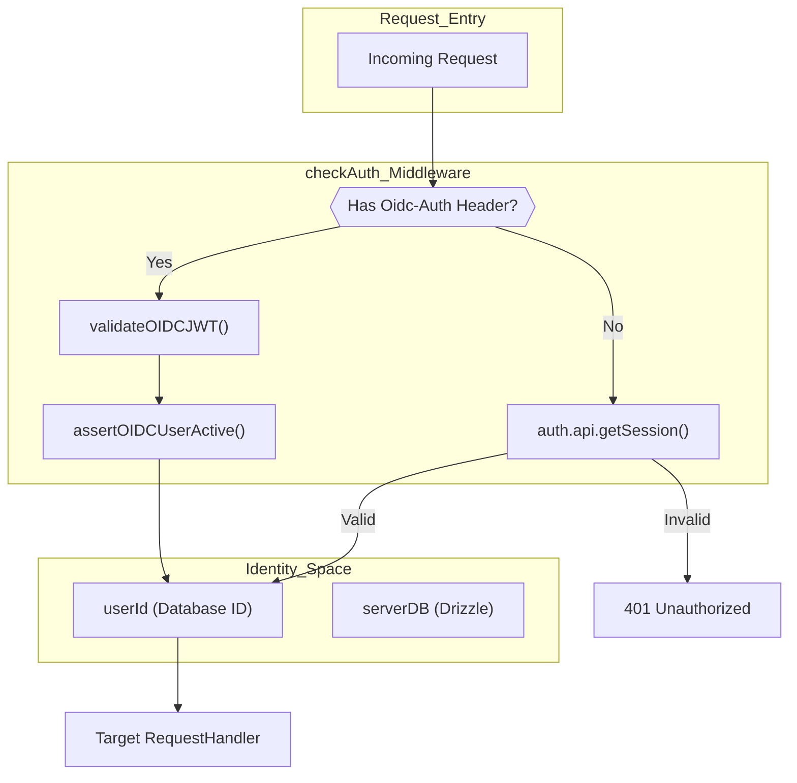
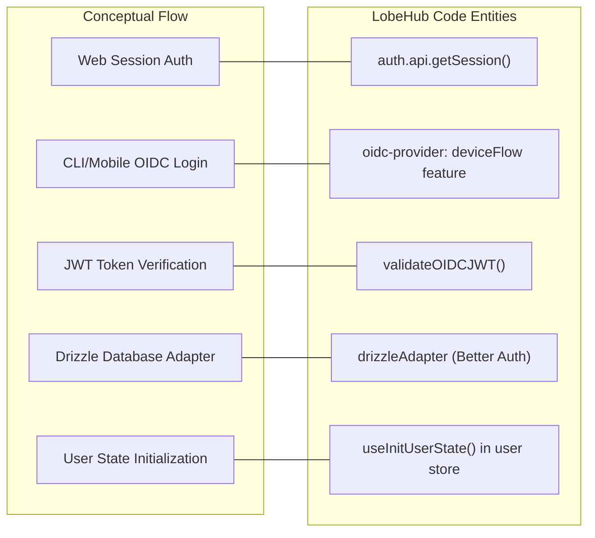

<!-- source: DeepWiki mcp.deepwiki.com · repo lobehub/lobehub · page 10.5 Authentication and User Management · fetched 2026-10-29 -->

# Authentication and User Management

<details>
<summary>Relevant source files</summary>

The following files were used as context for generating this wiki page:

- [docs/self-hosting/auth.mdx](docs/self-hosting/auth.mdx)
- [docs/self-hosting/auth.zh-CN.mdx](docs/self-hosting/auth.zh-CN.mdx)
- [docs/self-hosting/auth/providers/microsoft.mdx](docs/self-hosting/auth/providers/microsoft.mdx)
- [docs/self-hosting/auth/providers/microsoft.zh-CN.mdx](docs/self-hosting/auth/providers/microsoft.zh-CN.mdx)
- [docs/self-hosting/environment-variables/auth.mdx](docs/self-hosting/environment-variables/auth.mdx)
- [docs/self-hosting/environment-variables/auth.zh-CN.mdx](docs/self-hosting/environment-variables/auth.zh-CN.mdx)
- [docs/self-hosting/migration/v2/auth/nextauth-to-betterauth.mdx](docs/self-hosting/migration/v2/auth/nextauth-to-betterauth.mdx)
- [docs/self-hosting/migration/v2/auth/nextauth-to-betterauth.zh-CN.mdx](docs/self-hosting/migration/v2/auth/nextauth-to-betterauth.zh-CN.mdx)
- [packages/database/src/server/models/__tests__/adapter.test.ts](packages/database/src/server/models/__tests__/adapter.test.ts)
- [packages/env/src/__tests__/auth.test.ts](packages/env/src/__tests__/auth.test.ts)
- [packages/env/src/auth.ts](packages/env/src/auth.ts)
- [packages/utils/src/server/index.ts](packages/utils/src/server/index.ts)
- [public/acceptance/skill.md](public/acceptance/skill.md)
- [src/app/(backend)/oidc/[...oidc]/route.test.ts](src/app/(backend)/oidc/[...oidc]/route.test.ts)
- [src/app/(backend)/oidc/[...oidc]/route.ts](src/app/(backend)/oidc/[...oidc]/route.ts)
- [src/app/(backend)/oidc/callback/desktop/route.ts](src/app/(backend)/oidc/callback/desktop/route.ts)
- [src/app/(backend)/oidc/clear-session/route.ts](src/app/(backend)/oidc/clear-session/route.ts)
- [src/app/(backend)/oidc/consent/route.test.ts](src/app/(backend)/oidc/consent/route.test.ts)
- [src/app/(backend)/oidc/consent/route.ts](src/app/(backend)/oidc/consent/route.ts)
- [src/auth.test.ts](src/auth.test.ts)
- [src/business/client/hooks/useSwitchWorkspace.ts](src/business/client/hooks/useSwitchWorkspace.ts)
- [src/features/Acceptance/Workspace/AcceptanceOnboarding.tsx](src/features/Acceptance/Workspace/AcceptanceOnboarding.tsx)
- [src/features/User/__tests__/UserAvatar.test.tsx](src/features/User/__tests__/UserAvatar.test.tsx)
- [src/features/Workspace/__tests__/workspaceSlugHooks.test.tsx](src/features/Workspace/__tests__/workspaceSlugHooks.test.tsx)
- [src/features/Workspace/useWorkspaceUrlSync.ts](src/features/Workspace/useWorkspaceUrlSync.ts)
- [src/layout/GlobalProvider/useUserStateRedirect.ts](src/layout/GlobalProvider/useUserStateRedirect.ts)
- [src/libs/better-auth/define-config.test.ts](src/libs/better-auth/define-config.test.ts)
- [src/libs/better-auth/define-config.ts](src/libs/better-auth/define-config.ts)
- [src/libs/better-auth/utils/config.test.ts](src/libs/better-auth/utils/config.test.ts)
- [src/libs/better-auth/utils/config.ts](src/libs/better-auth/utils/config.ts)
- [src/libs/better-auth/utils/host-only-cookies.test.ts](src/libs/better-auth/utils/host-only-cookies.test.ts)
- [src/libs/better-auth/utils/host-only-cookies.ts](src/libs/better-auth/utils/host-only-cookies.ts)
- [src/libs/next/proxy/define-config.test.ts](src/libs/next/proxy/define-config.test.ts)
- [src/libs/next/proxy/define-config.ts](src/libs/next/proxy/define-config.ts)
- [src/libs/oidc-provider/adapter.ts](src/libs/oidc-provider/adapter.ts)
- [src/libs/oidc-provider/config.ts](src/libs/oidc-provider/config.ts)
- [src/libs/oidc-provider/cookies.ts](src/libs/oidc-provider/cookies.ts)
- [src/libs/oidc-provider/http-adapter.test.ts](src/libs/oidc-provider/http-adapter.test.ts)
- [src/libs/oidc-provider/http-adapter.ts](src/libs/oidc-provider/http-adapter.ts)
- [src/libs/oidc-provider/interaction-policy.ts](src/libs/oidc-provider/interaction-policy.ts)
- [src/libs/oidc-provider/jwt.test.ts](src/libs/oidc-provider/jwt.test.ts)
- [src/libs/oidc-provider/jwt.ts](src/libs/oidc-provider/jwt.ts)
- [src/libs/oidc-provider/provider.test.ts](src/libs/oidc-provider/provider.test.ts)
- [src/libs/oidc-provider/provider.ts](src/libs/oidc-provider/provider.ts)
- [src/libs/oidc-provider/selective-body.d.ts](src/libs/oidc-provider/selective-body.d.ts)
- [src/libs/oidc-provider/session-cleanup.test.ts](src/libs/oidc-provider/session-cleanup.test.ts)
- [src/libs/oidc-provider/session-cleanup.ts](src/libs/oidc-provider/session-cleanup.ts)
- [src/proxy.ts](src/proxy.ts)
- [src/store/serverConfig/selectors.ts](src/store/serverConfig/selectors.ts)
- [src/store/user/slices/auth/action.ts](src/store/user/slices/auth/action.ts)
- [src/store/user/slices/auth/initialState.ts](src/store/user/slices/auth/initialState.ts)
- [src/store/user/slices/auth/selectors.test.ts](src/store/user/slices/auth/selectors.test.ts)
- [src/store/user/slices/auth/selectors.ts](src/store/user/slices/auth/selectors.ts)

</details>


This page provides a comprehensive technical overview of the authentication and user management system in LobeHub. It covers the key database tables (`users`, `user_settings`, `accounts`, `apiKey`, OIDC-related tables, and RBAC), details the integration of Better Auth for web sessions, the custom OIDC provider for CLI and client apps, and the authentication middleware that unifies these layers. Key implementation details, data flows, main classes and functions, as well as mermaid diagrams linking natural language concepts to code entities, are included.

---

## System Overview

LobeHub’s authentication framework supports two integrated flows:

1.  **Web Session Flow**
    Managed using [Better Auth](https://better-auth.com) framework, facilitating cookie-based sessions, password management, and OAuth/SSO providers for the web UI and API access.

2.  **OIDC Flow**
    LobeHub implements an internal OIDC Identity Provider built atop the popular `oidc-provider` library, issuing JWT tokens to CLI, Desktop, Mobile, and Marketplace clients for secure API access.

Both flows share data via the unified database schema and custom Drizzle adapter, ensuring consistent user identities across platforms.

---

### Authentication Data Flow

Requests pass through the central `checkAuth` middleware, which determines the authentication path based on request headers:

-   If an OIDC authorization header (`lobe-chat-oidc-auth`) is present, the JWT is validated via the OIDC flow.
-   Otherwise, Better Auth session tokens from cookies are validated.

After successful validation, the user’s database ID and server DB instance are passed downstream for request handling.



Sources:
[src/app/(backend)/middleware/auth/index.ts:61-104](), [src/libs/oidc-provider/jwt.ts:103-146](), [src/app/(backend)/webapi/chat/[provider]/route.ts:17-18]()

---

## Better Auth Integration

[LobeHub uses Better Auth](src/libs/better-auth/define-config.ts:9) as the core web authentication library, managing email/password logins, sessions, email verification, and various plugins.

### Key Configuration Highlights

-   **Adapters & Database**: Uses `drizzleAdapter` to connect Better Auth sessions and accounts to the Drizzle ORM-managed LobeHub database [src/libs/better-auth/define-config.ts:6]().
-   **Account Linking**: Supports trusted SSO providers with automatic linking across different login methods [src/libs/better-auth/define-config.ts:132-136]().
-   **Password Verification**:
    -   Supports legacy-password compatibility using `bcrypt` for passwords migrated from Clerk [src/libs/better-auth/define-config.ts:159-162]().
    -   New passwords utilize Better Auth's default scrypt-based password hashing [src/libs/better-auth/define-config.ts:165]().
-   **Email Verification**: Configurable verification required on sign-up [src/libs/better-auth/define-config.ts:150](), email templates for reset, verification, and magic link [src/libs/better-auth/define-config.ts:169-176]().
-   **Plugins Enabled**:
    -   `admin`: Role-based administrative features [src/libs/better-auth/plugins/admin.ts]().
    -   `emailOTP`: OTPs for mobile 2FA [src/libs/better-auth/plugins/email-otp.ts]().
    -   `passkey`: WebAuthn passkey biometric logins [src/libs/better-auth/define-config.ts:2]().
    -   `magicLink`: Passwordless magic link login [src/libs/better-auth/define-config.ts:10]().
    -   `emailWhitelist`: Restriction on allowed emails during sign-up [src/libs/better-auth/plugins/email-whitelist.ts]().

### Session Management and Hooks

-   Sessions are stored persistently in the DB and managed with cookie-based tokens.
-   Before session creation, a hook cleans up mismatched OIDC sessions, ensuring coherence between session layers [src/libs/better-auth/define-config.ts:327-331]().

```typescript
// Example hook clearing mismatched OIDC sessions before Better Auth session creation
databaseHooks: {
  session: {
    create: {
      before: async ({ userId }, context) => {
        await clearMismatchedOIDCSession(serverDB, userId, context);
      },
    },
  },
},
```

### Proxy Agent Configuration

-   In development, Better Auth configures HTTP proxy for OAuth flows (e.g., Google token exchange) allowing local development through proxies while excluding localhost entries [src/libs/better-auth/define-config.ts:59-70]().

Sources:
[src/libs/better-auth/define-config.ts:1-195](), [src/libs/better-auth/define-config.test.ts:126-223]()

---

## OIDC Provider

LobeHub exposes an in-house [OIDC Provider](src/libs/oidc-provider/provider.ts:4) implementation for programmatic clients:

-   Implements `oidc-provider` library extended for LobeHub needs [src/libs/oidc-provider/provider.ts:4]().
-   Issues RS256 JWT tokens validated at API gateways [src/libs/oidc-provider/jwt.ts:118-120]().
-   Supports standard OAuth flows including authorization code, refresh tokens, and device code verification [src/libs/oidc-provider/config.ts:23-24, 51-52, 65]().

### Default OIDC Clients Configuration

Defined in `src/libs/oidc-provider/config.ts`, clients include:

| Client ID          | Description                           | Flow              | Redirects and Notes                           |
| :----------------- | :------------------------------------ | :---------------- | :-------------------------------------------- |
| `lobehub-desktop`  | Electron desktop app                  | `authorization_code` | Supports cross-origin desktop app redirects.  |
| `lobehub-mobile`   | Mobile native app (iOS/Android)     | `authorization_code` | Uses custom URL scheme (`com.lobehub.app://`) |
| `lobehub-cli`      | Command-line device login           | `device_code`      | Uses RFC 8628 Device Flow                      |
| `lobehub-market`   | Marketplace integration client      | `authorization_code` | Enables marketplace login features             |

### OIDC Features and Claims

-   Supports standard scopes: `openid`, `profile`, `email`, `offline_access` [src/libs/oidc-provider/config.ts:103-106]().
-   Claims map user profile fields (`name`, `email`, `picture`) for token introspection [src/libs/oidc-provider/config.ts:113-117]().
-   Token Time-To-Live (TTL) values defined explicitly for security and UX trade-offs [src/libs/oidc-provider/provider.ts:29-50]():

| Artifact                      | TTL Duration   |
| :---------------------------- | :------------- |
| `AccessToken`                 | 7 days         |
| `RefreshToken`                | 30 days        |
| `IdToken`                     | 1 hour         |
| `DeviceCode`                  | 10 minutes     |
| `Session`                     | 30 days        |

### JWT Validation

-   JWKS keys loaded from environment for signing/verification [src/libs/oidc-provider/jwt.ts:23-51]().
-   JWT tokens validated with `jose` library following RS256 [src/libs/oidc-provider/jwt.ts:118-120]().
-   Validation errors produce appropriate authenticated or 401 Unauthorized responses [src/libs/oidc-provider/jwt.ts:129-133, 167-172]().

Sources:
[src/libs/oidc-provider/provider.ts:1-173](), [src/libs/oidc-provider/config.ts:1-88](), [src/libs/oidc-provider/jwt.ts:1-162](), [src/libs/oidc-provider/provider.test.ts:101-128]()

---

## Database Schema and Models

LobeHub stores authentication data in PostgreSQL managed by Drizzle ORM, with a normalized schema.

### Relevant Tables Overview

| Table Name          | Description                                         |
| :------------------ | :-------------------------------------------------- |
| `users`             | User profiles, status, metadata                     |
| `user_settings`     | Per-user application preferences and model settings |
| `nextauth_accounts` | OAuth and external account links to `users`         |
| `sessions`          | Active Better Auth sessions (access tokens, cookies)|
| `apiKey`            | API Key management for programmatic access          |
| `rbac`              | Role-Based Access Control data                      |
| `oidc_*`            | Storage related to OIDC flows and tokens            |

The exact schema is defined under `@lobechat/database/schemas` and consumed by Drizzle and custom models.

### User Model Operations

The `UserModel` class encapsulates user-related DB operations:

| Method                     | Purpose                                                  | Details                                                               |
| :------------------------- | :------------------------------------------------------- | :-------------------------------------------------------------------- |
| `getUserState`             | Fetch user data including key vaults and SSO            | Decrypts sensitive fields and enriches user object                   |
| `getUserActivitySummary`   | Produces a summary of user's activity (creation, last message) | Queries message table for last user message timestamp                  |
| `getUserSSOProviders`      | Retrieves linked social accounts                          | Based on `nextauth_accounts`                                           |

**Example snippet:**

```typescript
// Get user activity summary with last message date
async getUserActivitySummary(userId: string) {
  // Query max message creation date for userId
}
```

Sources:
[packages/database/src/models/user.ts:56-218]()

---

## Access Control and RBAC

LobeHub implements access control mainly through:

-   **User Status Checks**
    The OIDC flow calls `assertOIDCUserActive` before accepting tokens to ensure users are active and not banned. This prevents suspended users from accessing APIs.

-   **Scopes and Claims**
    Standard OIDC scopes (`openid`, `profile`, `email`, `offline_access`) define the access boundaries for issued tokens [src/libs/oidc-provider/config.ts:103-106]().

-   **Better Auth Role Plugins**
    The admin plugin integrates RBAC roles controlling API key creation and other privileged actions [src/libs/better-auth/plugins/admin.ts]().

Sources:
[src/libs/oidc-provider/access-control.ts](), [src/libs/oidc-provider/config.ts:103-106](), [src/libs/better-auth/plugins/admin.ts]()

---

## Code Entity Mapping

Mapping abstract auth concepts to code entities:



Sources:
[src/app/(backend)/middleware/auth/index.ts:95](), [src/libs/oidc-provider/provider.ts:104-130](), [src/libs/oidc-provider/jwt.ts:103](),
[src/libs/better-auth/define-config.ts:6](), [src/store/user/slices/common/action.ts:97]()

---

## Authentication Middleware `checkAuth`

Located in `src/app/(backend)/middleware/auth/index.ts`, the `checkAuth` function is an authentication guard that:

-   Clones the incoming request to avoid stream locking issues.
-   Handles mock user sessions in development (`ENABLE_MOCK_DEV_USER`).
-   Distinguishes OIDC authorization header presence; validates JWT tokens or falls back to Better Auth sessions [src/app/(backend)/middleware/auth/index.ts:80-95]().
-   Calls `assertOIDCUserActive` to verify user status on OIDC flows [src/app/(backend)/middleware/auth/index.ts:83]().
-   On failure, returns appropriate error responses (401 Unauthorized or 500 Internal Server Error).
-   Injects OpenTelemetry trace headers in responses for observability.

Example flow snippet:

```typescript
const oidcAuthorization = req.headers.get(LOBE_CHAT_OIDC_AUTH_HEADER);
if (oidcAuthorization) {
  const oidc = await validateOIDCJWT(oidcAuthorization);
  userId = oidc.userId;
  await assertOIDCUserActive(serverDB, userId);
} else {
  const session = await auth.api.getSession({ headers: req.headers });
  if (!session?.user?.id) throw UnauthorizedError;
  userId = session.user.id;
}
```

Sources:
[src/app/(backend)/middleware/auth/index.ts:1-181]()

---

## Frontend User Store Integration

User authentication state is managed on the frontend by the `UserStore`, with key features including:

-   **`useInitUserState`**: Fetches full user state from the backend, including decrypted key vaults and linked SSO providers [src/store/user/slices/common/action.ts:97]().
-   **Settings Persistence**: Methods to optimistically update user settings and sync with the server.
-   **Cache Invalidation**: Refresh triggers for reloading user data.

This store interacts with backend API routes secured by the `checkAuth` middleware.

Sources:
[src/store/user/slices/auth/selectors.ts:1-39](), [src/store/user/slices/auth/action.ts](), [src/store/user/slices/auth/initialState.ts]()

---

## Summary

LobeHub's authentication and user management system is a robust, layered architecture integrating:

-   **Better Auth** for web session-based authentication with password and SSO login.
-   **OIDC Provider** for federated, token-based API authentication targeting CLI, desktop, and mobile.
-   **Rich database models** for user, account, API key, and RBAC management.
-   **Middleware** that unifies authentication flows transparently.
-   **Extensible plugins** for passkeys, magic links, and email-based OTPs.

This system ensures secure, versatile identity management tailored for both interactive users and programmatic clients.

---

# References and Sources

-   [src/libs/better-auth/define-config.ts:1-195]()
-   [src/libs/better-auth/define-config.test.ts:126-223]()
-   [src/libs/oidc-provider/provider.ts:1-173]()
-   [src/libs/oidc-provider/config.ts:1-88]()
-   [src/libs/oidc-provider/jwt.ts:1-162]()
-   [src/app/(backend)/middleware/auth/index.ts:1-181]()
-   [packages/database/src/models/user.ts:56-218]()
-   [src/app/(backend)/webapi/chat/[provider]/route.ts:1-40]()
-   [src/store/user/slices/common/action.ts:40-168]()

---

