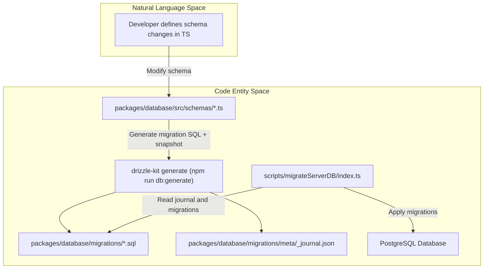
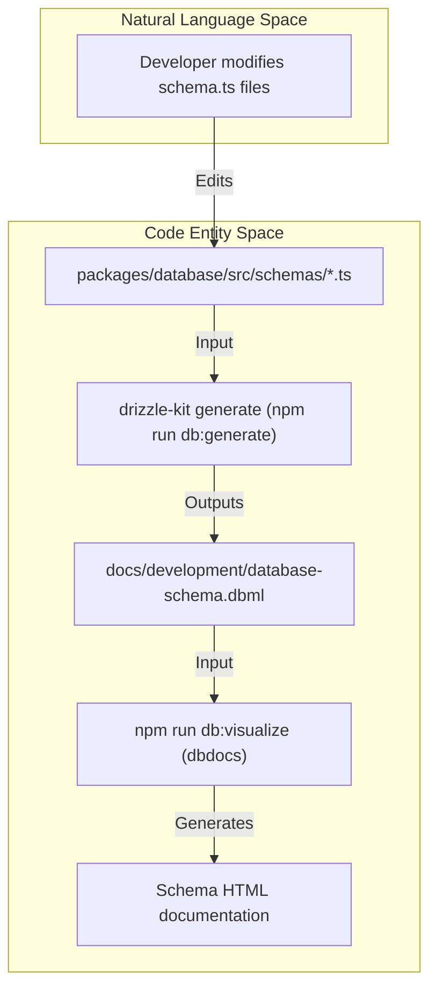
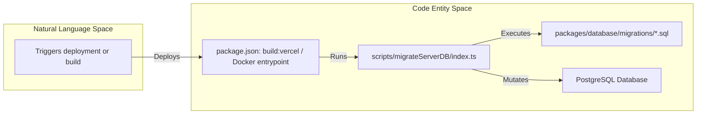

<!-- source: DeepWiki mcp.deepwiki.com · repo lobehub/lobehub · page 10.6 Database Migrations and Tooling · fetched 2026-10-29 -->

# Database Migrations and Tooling

<details>
<summary>Relevant source files</summary>

The following files were used as context for generating this wiki page:

- [apps/server/src/routers/lambda/recent.ts](apps/server/src/routers/lambda/recent.ts)
- [apps/server/src/services/document/__tests__/index.test.ts](apps/server/src/services/document/__tests__/index.test.ts)
- [apps/server/src/services/document/index.ts](apps/server/src/services/document/index.ts)
- [apps/server/src/services/memory/userMemory/__tests__/extract.runtime.test.ts](apps/server/src/services/memory/userMemory/__tests__/extract.runtime.test.ts)
- [apps/server/src/services/memory/userMemory/embedding.ts](apps/server/src/services/memory/userMemory/embedding.ts)
- [docs/development/database-schema.dbml](docs/development/database-schema.dbml)
- [packages/database/migrations/0086_video_generation_schema.sql](packages/database/migrations/0086_video_generation_schema.sql)
- [packages/database/migrations/0177_agent_accounts_live_unique_and_goal_subscriptions.sql](packages/database/migrations/0177_agent_accounts_live_unique_and_goal_subscriptions.sql)
- [packages/database/migrations/0180_task_archived_at.sql](packages/database/migrations/0180_task_archived_at.sql)
- [packages/database/migrations/meta/0086_snapshot.json](packages/database/migrations/meta/0086_snapshot.json)
- [packages/database/migrations/meta/0177_snapshot.json](packages/database/migrations/meta/0177_snapshot.json)
- [packages/database/migrations/meta/0180_snapshot.json](packages/database/migrations/meta/0180_snapshot.json)
- [packages/database/migrations/meta/_journal.json](packages/database/migrations/meta/_journal.json)
- [packages/database/package.json](packages/database/package.json)
- [packages/database/src/models/__tests__/agentAccount.test.ts](packages/database/src/models/__tests__/agentAccount.test.ts)
- [packages/database/src/models/__tests__/document.test.ts](packages/database/src/models/__tests__/document.test.ts)
- [packages/database/src/models/__tests__/drizzleMigration.test.ts](packages/database/src/models/__tests__/drizzleMigration.test.ts)
- [packages/database/src/models/__tests__/recent.test.ts](packages/database/src/models/__tests__/recent.test.ts)
- [packages/database/src/models/__tests__/topics/topic.create.test.ts](packages/database/src/models/__tests__/topics/topic.create.test.ts)
- [packages/database/src/models/agentAccount.ts](packages/database/src/models/agentAccount.ts)
- [packages/database/src/models/document.ts](packages/database/src/models/document.ts)
- [packages/database/src/models/recent.ts](packages/database/src/models/recent.ts)
- [packages/database/src/schemas/agent.ts](packages/database/src/schemas/agent.ts)
- [packages/database/src/schemas/agentAccount.ts](packages/database/src/schemas/agentAccount.ts)
- [packages/database/src/schemas/agentCronJob.ts](packages/database/src/schemas/agentCronJob.ts)
- [packages/database/src/schemas/apiKey.ts](packages/database/src/schemas/apiKey.ts)
- [packages/database/src/schemas/asyncTask.ts](packages/database/src/schemas/asyncTask.ts)
- [packages/database/src/schemas/chatGroup.ts](packages/database/src/schemas/chatGroup.ts)
- [packages/database/src/schemas/file.ts](packages/database/src/schemas/file.ts)
- [packages/database/src/schemas/generation.ts](packages/database/src/schemas/generation.ts)
- [packages/database/src/schemas/goalSubscription.ts](packages/database/src/schemas/goalSubscription.ts)
- [packages/database/src/schemas/index.ts](packages/database/src/schemas/index.ts)
- [packages/database/src/schemas/message.ts](packages/database/src/schemas/message.ts)
- [packages/database/src/schemas/rag.ts](packages/database/src/schemas/rag.ts)
- [packages/database/src/schemas/relations.ts](packages/database/src/schemas/relations.ts)
- [packages/database/src/schemas/session.ts](packages/database/src/schemas/session.ts)
- [packages/database/src/schemas/task.ts](packages/database/src/schemas/task.ts)
- [packages/database/src/schemas/topic.ts](packages/database/src/schemas/topic.ts)
- [packages/database/src/utils/idGenerator.ts](packages/database/src/utils/idGenerator.ts)
- [packages/types/src/goalSubscription.ts](packages/types/src/goalSubscription.ts)
- [packages/types/src/index.ts](packages/types/src/index.ts)
- [packages/types/src/recent.ts](packages/types/src/recent.ts)
- [packages/utils/package.json](packages/utils/package.json)
- [packages/utils/src/tokenizer/embedding.test.ts](packages/utils/src/tokenizer/embedding.test.ts)
- [packages/utils/src/tokenizer/embedding.ts](packages/utils/src/tokenizer/embedding.ts)
- [src/const/topic.ts](src/const/topic.ts)
- [src/features/Home/Recents/AllRecentsDrawer.tsx](src/features/Home/Recents/AllRecentsDrawer.tsx)
- [src/features/Home/Recents/ConnectedItem.tsx](src/features/Home/Recents/ConnectedItem.tsx)
- [src/features/Home/Recents/List.tsx](src/features/Home/Recents/List.tsx)
- [src/features/Home/Recents/useDropdownMenu.tsx](src/features/Home/Recents/useDropdownMenu.tsx)
- [src/hooks/useSyncRecents.ts](src/hooks/useSyncRecents.ts)
- [src/services/recent/index.ts](src/services/recent/index.ts)
- [src/store/home/slices/recent/action.test.ts](src/store/home/slices/recent/action.test.ts)
- [src/store/home/slices/recent/action.ts](src/store/home/slices/recent/action.ts)
- [src/store/home/slices/recent/initialState.ts](src/store/home/slices/recent/initialState.ts)
- [src/store/home/slices/recent/projection.ts](src/store/home/slices/recent/projection.ts)
- [src/store/home/slices/recent/selectors.ts](src/store/home/slices/recent/selectors.ts)

</details>


LobeHub utilizes **Drizzle ORM** to manage its PostgreSQL database schema, ensuring consistent schema versions across diverse environments including local development, Docker standalone containers, and Vercel serverless deployments. This document provides a detailed technical overview of the migration system, covering:

- Drizzle ORM migration system architecture and lifecycle
- Migration journal and snapshots maintaining migration state
- `idGenerator` conventions for creating namespaced unique IDs
- DBML schema visualization workflow and its integration in documentation pipelines

---

## Migration System Architecture

The schema is authored declaratively in TypeScript under `packages/database/src/schemas/` which acts as the canonical source of truth for all table and column definitions [packages/database/src/schemas/index.ts:1-60](). Migrations are generated by comparing these schemas with the current database state via Drizzle's CLI tooling.

### Core CLI Commands and Scripts

| Command                             | Description                                                                                                           |
|-----------------------------------|-----------------------------------------------------------------------------------------------------------------------|
| `npm run db:generate`              | Runs `drizzle-kit generate` to produce new SQL migrations and then executes `workflow:dbml` to export DBML schema files [package.json:61]() |
| `npm run db:migrate`               | Runs the custom migration runner `tsx ./scripts/migrateServerDB/index.ts` which applies pending migrations sequentially [package.json:63]() |
| `npm run db:studio`                | Launches an interactive database GUI to explore and modify the local DB schema [package.json:64]()                    |
| `npm run db:visualize`             | Uses `dbdocs build` to generate an HTML visualization of the DB schema from DBML files, for documentation purposes [package.json:65]() |
| `npm run db:install-fts-search-capture` | Installs DB triggers capturing full-text search data into sync tables [package.json:62]()                         |

The migration runner script synchronizes the database by locating unapplied migrations in the `packages/database/migrations/` directory and executing their DDL statements on the PostgreSQL target.

### Migration System Data Flow Diagram



This flow automates schema upgrade management by aligning the declarative schema with the database incrementally.

---

## Migration Journal and Snapshots

The migration system tracks schema evolution through a **migration journal JSON file** (`_journal.json`) located in `packages/database/migrations/meta/`. This file logs every migration entry's metadata in an append-only array structure [packages/database/migrations/meta/_journal.json:1-287]().

### Journal Entry Structure

Each journal entry includes:

| Field         | Description                                         |
|---------------|-----------------------------------------------------|
| `idx`         | Sequential migration index                           |
| `version`     | Drizzle ORM version used                             |
| `when`        | Unix timestamp (milliseconds) when migration created|
| `tag`         | Unique, human-readable migration identifier         |
| `breakpoints` | Marks important migration milestones (boolean)      |

Example excerpt:

| idx | version | when           | tag                    | breakpoints |
|-----|---------|----------------|------------------------|-------------|
| 0   | "6"     | 1716982944425  | "0000_init"            | true        |
| 5   | "7"     | 1722944166657  | "0005_pgvector"        | true        |
| 12  | "7"     | 1731858381716  | "0012_add_thread"      | true        |
| 30  | "7"     | 1756298669289  | "0030_add_group_chat"  | true        |
| 37  | "7"     | 1760086906862  | "0037_add_user_memory" | true        |

Each migration corresponds to a `.sql` file in the migrations directory with DDL commands reflecting that migration tag. The journal ensures migrations apply in order and tracks which migrations succeeded.

---

## `idGenerator` Conventions for Entity Identifiers

LobeHub enforces a **consistent namespaced ID convention** for primary keys and identifiers across all database tables. This convention generates a string ID with a *prefix* indicating the entity type, followed by a **random nanoid** for uniqueness, facilitating easy debugging and human-visible IDs.

### Implementation

- Located in `packages/database/src/utils/idGenerator.ts` [packages/database/src/utils/idGenerator.ts:1-59]()
- Prefix mappings are statically defined per entity namespace.
- IDs are generated by concatenating the prefix, an underscore, then a nanoid random string.

### Selected Namespace Prefix Examples

| Namespace       | Prefix |
|-----------------|--------|
| agents          | agt    |
| agentCronJobs   | cron   |
| chatGroups      | cg     |
| documents       | docs   |
| files           | file   |
| messages        | msg    |
| topics          | tpc    |
| threads         | thd    |
| user            | user   |
| workspaces      | ws     |

### Example Usage in Schema

The `topics` table `id` column uses `idGenerator` by default:

```ts
id: text('id')
  .$defaultFn(() => idGenerator('topics'))
  .primaryKey(),
```

which produces IDs like `tpc_Kf83ZqLNavBT` [packages/database/src/schemas/topic.ts:27-121]().

This pattern makes it straightforward to identify the entity type by ID prefix and prevents collisions in multi-tenant distributed environments.

---

## DBML Schema Visualization Workflow

To maintain rich, interactive database schema documentation, LobeHub exports the schema declaration to **DBML** (Database Markup Language), which is then used by tools like `dbdocs` for visualization.

### Workflow Steps

1. After generating migrations (`npm run db:generate`), the workflow exports DBML schema files (`docs/development/database-schema.dbml`) [package.json:61]() [docs/development/database-schema.dbml:1-195]().

2. The DBML file comprehensively reflects all tables, columns, data types, indexes, and foreign key relationships as defined in `schemas/*.ts`.

3. Running `npm run db:visualize` invokes the `dbdocs` CLI to create interactive HTML documentation from the DBML files [package.json:65]().

### Excerpt from DBML (`database-schema.dbml`)

```dbml
table agents {
  id text [pk, not null]
  slug varchar(100)
  title varchar(255)
  user_id text [not null]
  chat_config jsonb
  created_at timestamp [default: `now()`]
  updated_at timestamp [default: `now()`]
  indexes {
    (client_id, user_id) [unique]
    (slug, user_id) [unique]
    (workspace_id, slug) [unique]
  }
}
```

All relationships and constraints are documented to aid developers and DBAs in understanding schema roles.

### Visualization Flow Diagram



The DBML export is a key bridge between code authors and visual schema documentation.

---

## Deployment and Migration Integration

### Vercel Serverless Environment

- The build pipeline includes migration steps embedded in `build:vercel`.
- To optimize serverless bundle size for cold start, migration scripts are excluded during Webpack tracing [next.config.ts:9-20]().

### Docker Standalone Mode

- Migrations are executed during container startup or via CLI scripts like `npm run dev:docker:reset`.
- Enables deterministic migration application for local and production deployments.

### Deployment Migration Flow



This ensures database schema consistency during automated deployments.

---

# Summary

LobeHub's database migration system is a comprehensive solution built over Drizzle ORM, featuring:

- Declarative TypeScript schema files as the single source of truth
- A robust migration journal that records every applied migration with metadata
- A unified `idGenerator` util creating prefixed, unique IDs for easy identification and uniqueness
- A DBML export pipeline feeding to `dbdocs` for schema visualization and documentation
- Deployment integration supporting smooth migrations on Vercel and Docker environments

This design ensures reliable schema evolution to support LobeHub’s complex, multi-tenant AI agent platform.

---

**Sources:**  
- [packages/database/migrations/meta/_journal.json:1-287]()  
- [packages/database/src/schemas/index.ts:1-60]()  
- [packages/database/src/schemas/topic.ts:27-121]()  
- [packages/database/src/utils/idGenerator.ts:1-59]()  
- [docs/development/database-schema.dbml:1-195]()  
- [package.json:61-65]()  
- [next.config.ts:9-20]()  
- [scripts/migrateServerDB/index.ts:1-40]() *(inferred)*

---

