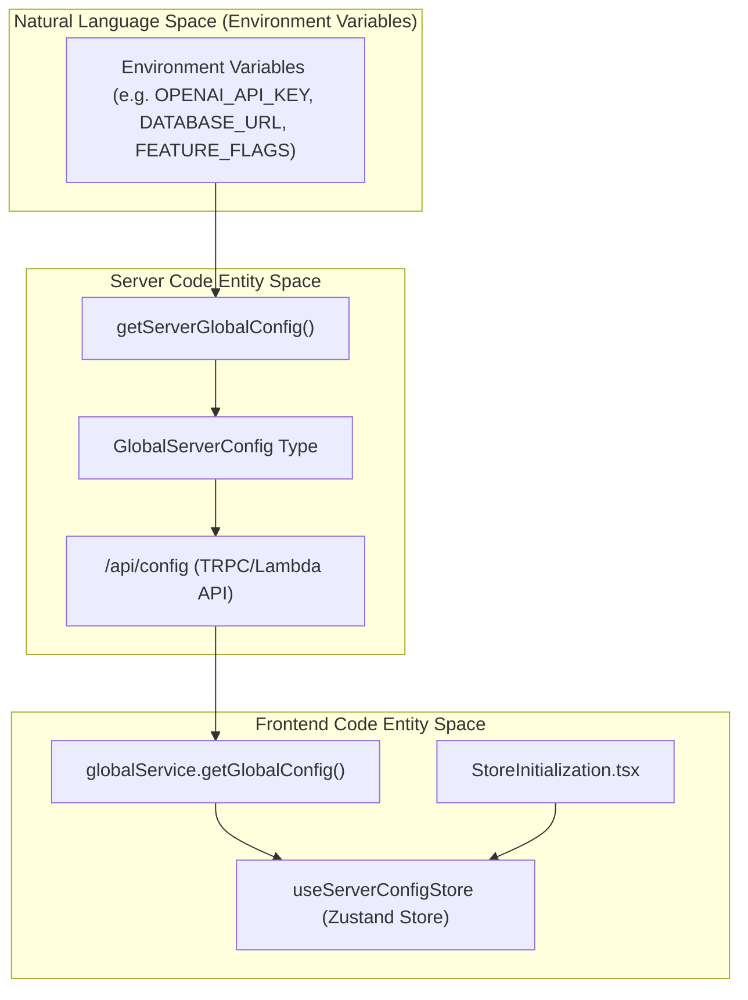
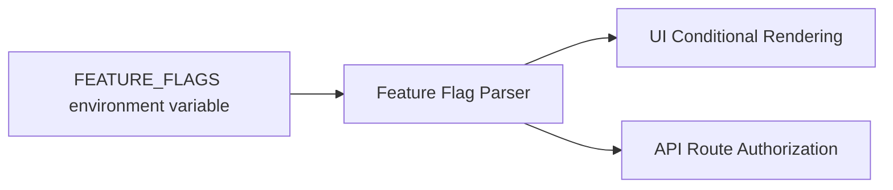

<!-- source: DeepWiki mcp.deepwiki.com · repo lobehub/lobehub · page 11 Configuration and Environment · fetched 2026-10-29 -->

# Configuration and Environment

<details>
<summary>Relevant source files</summary>

The following files were used as context for generating this wiki page:

- [apps/server/src/featureFlags/index.test.ts](apps/server/src/featureFlags/index.test.ts)
- [apps/server/src/featureFlags/index.ts](apps/server/src/featureFlags/index.ts)
- [apps/server/src/globalConfig/getServerGlobalConfig.test.ts](apps/server/src/globalConfig/getServerGlobalConfig.test.ts)
- [apps/server/src/globalConfig/index.ts](apps/server/src/globalConfig/index.ts)
- [apps/server/src/routers/lambda/_helpers/__tests__/agentShareFeatureGate.test.ts](apps/server/src/routers/lambda/_helpers/__tests__/agentShareFeatureGate.test.ts)
- [apps/server/src/routers/lambda/_helpers/agentShareFeatureGate.ts](apps/server/src/routers/lambda/_helpers/agentShareFeatureGate.ts)
- [apps/server/src/routers/lambda/config/index.test.ts](apps/server/src/routers/lambda/config/index.test.ts)
- [apps/server/src/runtimeConfig/types.ts](apps/server/src/runtimeConfig/types.ts)
- [docker-compose/deploy/.env.example](docker-compose/deploy/.env.example)
- [docker-compose/deploy/.env.zh-CN.example](docker-compose/deploy/.env.zh-CN.example)
- [docker-compose/deploy/docker-compose.yml](docker-compose/deploy/docker-compose.yml)
- [docker-compose/dev/docker-compose.yml](docker-compose/dev/docker-compose.yml)
- [docker-compose/production/grafana/docker-compose.yml](docker-compose/production/grafana/docker-compose.yml)
- [docker-compose/setup.sh](docker-compose/setup.sh)
- [docs/self-hosting/advanced/feature-flags.mdx](docs/self-hosting/advanced/feature-flags.mdx)
- [docs/self-hosting/advanced/feature-flags.zh-CN.mdx](docs/self-hosting/advanced/feature-flags.zh-CN.mdx)
- [docs/self-hosting/environment-variables/basic.mdx](docs/self-hosting/environment-variables/basic.mdx)
- [docs/self-hosting/environment-variables/basic.zh-CN.mdx](docs/self-hosting/environment-variables/basic.zh-CN.mdx)
- [docs/self-hosting/platform/docker-compose.mdx](docs/self-hosting/platform/docker-compose.mdx)
- [docs/self-hosting/platform/docker-compose.zh-CN.mdx](docs/self-hosting/platform/docker-compose.zh-CN.mdx)
- [packages/app-config/src/featureFlags/schema.test.ts](packages/app-config/src/featureFlags/schema.test.ts)
- [packages/app-config/src/featureFlags/schema.ts](packages/app-config/src/featureFlags/schema.ts)
- [packages/env/src/__tests__/gateway.test.ts](packages/env/src/__tests__/gateway.test.ts)
- [packages/env/src/gateway.ts](packages/env/src/gateway.ts)
- [packages/types/src/serverConfig.ts](packages/types/src/serverConfig.ts)
- [scripts/dockerComposeDeploy.test.ts](scripts/dockerComposeDeploy.test.ts)
- [scripts/serverLauncher/startServer.js](scripts/serverLauncher/startServer.js)
- [scripts/serverLauncher/startServer.test.ts](scripts/serverLauncher/startServer.test.ts)

</details>


LobeHub employs a comprehensive configuration system managing diverse deployment needs across environments such as cloud (Vercel), Docker, desktop, and local development. This system centers primarily around environment variables used to configure security credentials, database connections, authentication providers, AI model settings, system agents, and feature controls. 

The configuration framework enables a secure, structured, and reactive flow from static environment declarations through server-side global configuration assembly to client-side consumption.

---

### Configuration Lifecycle

The lifecycle of configuration in LobeHub spans from environment variable definitions to server-side assembly and eventual frontend synchronization:

1. **Environment Definition**: Environment variables are declared in `.env` files or platform-specific configuration sections specifying API keys, database URLs, feature flags, system agent models, and default agent configurations.

2. **Server Assembly**: On runtime, the server uses the `getServerGlobalConfig()` function to assemble these environment variables into a typed configuration object (`GlobalServerConfig`). This merges defaults with overrides, parses key complex values (like nested default agent config), and omits sensitive secrets before exposing configuration externally.

3. **Frontend Sync**: The frontend accesses server configuration via a dedicated `/api/config` API endpoint (e.g., TRPC or lambda route). It initializes the `useServerConfigStore` Zustand store with this data for reactive access by UI components, enabling feature gating and user experience tailoring at runtime.

---

### Configuration Assembly and Distribution Diagram



This diagram shows how raw environment variables feed into server configuration assembly, flow through the API endpoint, and are consumed client-side by React stores for runtime access.

Sources:  
- [apps/server/src/globalConfig/index.ts:1-20]()  
- [src/layout/GlobalProvider/StoreInitialization.tsx:44-46]()  
- [docs/self-hosting/environment-variables/basic.mdx:15-68]()  
- [docs/self-hosting/environment-variables/basic.zh-CN.mdx:13-186]()  

---

## Environment Variables Reference

LobeHub provides extensive environment variable support enabling customization for deployment and runtime operation. Variables configure:

| Category            | Important Variables                                                                                      | Purpose                                                        |
|---------------------|-------------------------------------------------------------------------------------------------------|----------------------------------------------------------------|
| **Security**        | `KEY_VAULTS_SECRET`, `AUTH_SECRET`                                                                    | Keys for encrypting sensitive data and session security.       |
| **Authentication**  | `AUTH_SSO_PROVIDERS`, `AUTH_GOOGLE_ID`, `AUTH_COOKIE_PREFIX`                                          | Configuration for better-auth mechanisms and OAuth providers.  |
| **AI Providers**    | `OPENAI_API_KEY`, `ANTHROPIC_API_KEY`, `GOOGLE_API_KEY`, `ZHIPU_API_KEY`                              | Credentials and endpoints for various AI model providers.      |
| **Model Control**   | `OPENAI_MODEL_LIST`, `AZURE_MODEL_LIST`, `FEATURE_FLAGS`                                              | Control which AI models are visible and enable feature toggles.|
| **Database**        | `DATABASE_URL`, `DATABASE_DRIVER`                                                                      | PostgreSQL connection URLs and Drizzle ORM driver settings.    |
| **Storage (S3)**    | `S3_ENDPOINT`, `S3_BUCKET`, `S3_ACCESS_KEY_ID`, `S3_SECRET_ACCESS_KEY`                                | S3-compatible storage backend configurations (RustFS, MinIO).  |
| **Feature Flags**   | `FEATURE_FLAGS`                                                                                        | Flags to enable/disable UI features and server capabilities.   |
| **System Agents**   | `SYSTEM_AGENT`                                                                                         | Default AI models/providers used for system helpers (like topic generation, translation). |
| **Agent Defaults**  | `DEFAULT_AGENT_CONFIG`                                                                                 | Default settings for LobeHub's primary AI assistant agent.    |
| **Agent Gateway**   | `ENABLE_AGENT_GATEWAY`, `AGENT_GATEWAY_URL`, `AGENT_GATEWAY_SERVICE_TOKEN`                            | Enables server-side agent execution via gateway mode.          |

Notably, the `DEFAULT_AGENT_CONFIG` environment variable allows complex nested configuration with key-value pairs, arrays, and booleans (e.g., `model=gpt-4o;params.max_tokens=300;plugins=search-engine,lobe-image-designer`). The syntax supports semicolon/semicolon-separated parameters, nested keys with dots, and array values with commas (including support for Chinese commas). Invalid keys are ignored and duplicate keys use last-wins semantics.

For an exhaustive, categorized reference describing all environment variables with examples, see the child documentation page: [Environment Variables Reference](#11.1).

Sources:  
- [docs/self-hosting/environment-variables/basic.mdx:15-68]()  
- [docs/self-hosting/environment-variables/basic.zh-CN.mdx:13-186]()  
- [.env.example:1-250]()  

---

## Server Global Configuration

Server-side, environment variables are consolidated into a typed configuration object via the asynchronous function `getServerGlobalConfig()`. This function returns the `GlobalServerConfig` type instance, encapsulating runtime flags and settings critical for server operations and client configuration exposure.

### Key Assembly Responsibilities

- **AI Provider Enablement**: Parses enablement flags (e.g., `ENABLED_OPENAI`) and loads supported models accordingly.
- **Authentication Settings**: Incorporates better-auth configuration flags (`AUTH_DISABLE_EMAIL_PASSWORD`, `AUTH_EMAIL_VERIFICATION`) and SSO providers.
- **Default Agent Configuration**: Parses `DEFAULT_AGENT_CONFIG` for base assistant defaults including model, parameters, and plugin manifest.
- **System Agents**: Processes `SYSTEM_AGENT` environment variable for assigning models/providers to system agents responsible for specialized functions like topic generation, prompt rewriting, or history compression.
- **Gateway Mode**: Enables agent gateway mode if deployment supports it via `ENABLE_AGENT_GATEWAY`, `AGENT_GATEWAY_URL`, and wire protocol version.
- **Feature Flags**: Integrates with feature toggle state and experimental capabilities.
- **Client Exposure Hygiene**: Strips sensitive secrets and keeps only non-secret, safely exposable settings in config sent to frontends.

This global configuration facilitates consistent, environment-driven behavior with declarative override capability.

You can find detailed internal workings and related types in the child page: [Server Global Configuration](#11.2).

Sources:  
- [apps/server/src/globalConfig/index.ts:1-183]()  
- [docs/self-hosting/environment-variables/basic.mdx:46-68]()  

---

## Feature Flags and Labs

LobeHub includes a robust feature flagging system managed primarily through the `FEATURE_FLAGS` environment variable. This permits easily enabling or disabling features globally or for targeted subsets of users without changing code or redeploying.

### Feature Flags Syntax

- Enables a feature: prefix with `+` (e.g., `+welcome_suggest`)
- Disables a feature: prefix with `-` (e.g., `-welcome_suggest`)
- Multiple flags are comma-separated (e.g., `"-welcome_suggest,+market"`)
- Enclose the entire string in quotes (`"`) to avoid parsing issues

### Common Flags Examples

| Feature Flag        | Function Description                                                               | Default    |
|---------------------|------------------------------------------------------------------------------------|------------|
| `check_updates`      | Permission to check for software updates                                          | enabled    |
| `provider_settings`  | Shows model provider configuration UI                                             | enabled    |
| `openai_api_key`     | Allows users to enter a custom OpenAI API key                                    | enabled    |
| `api_key_manage`     | Enables the API key management page (/profile/apikey)                            | disabled   |
| `agent_share`        | Enables interactive Agent sharing feature (requires backend support)             | disabled   |
| `agent_gateway_mux`  | Enables multiplexed gateway socket protocol v2 (`/v2/ws`)                        | disabled   |
| `dashboard`          | Enables dashboards, home/project pages, and in-chat widget previews              | disabled   |
| `ai_image`           | Enables AI image generation features and related UI (/image)                     | enabled    |
| `speech_to_text`     | Enables speech-to-text capabilities                                              | enabled    |

### Flag Evaluation Flow



The parsed flags gate frontend UI features and backend API behaviors, controlling rollout of labs features, gated UI elements, and experimental functionalities.

Refer to the child page for an exhaustive list of flags, interpretation, and integration details: [Feature Flags and Labs](#11.3).

Sources:  
- [docs/self-hosting/environment-variables/basic.mdx:103-111]()  
- [docs/self-hosting/environment-variables/basic.zh-CN.mdx:103-111]()  
- [packages/app-config/src/featureFlags/schema.ts:1-184]()  

---

## Model List Customization via Environment Variables

LobeHub lets deployments customize the visible AI models and their metadata in the UI by setting environment variables such as `OPENAI_MODEL_LIST` or `AZURE_MODEL_LIST`. These variables control which provider models show in the switcher components and runtime model selection logic.

### Model List Environment Variable Syntax

Values accept entries separated by commas consisting of:

```
<modelId>=<deploymentName><maxTokens:capability1:capability2:...>
```

Example:

```
gpt-4-0314=gpt-4-turbo<128000:vision:fc>,-all
```

Details:

- `modelId`: The provider's canonical model identifier.
- `deploymentName`: Optional override for the deployment alias.
- `maxTokens`: Maximum token limit for context.
- `capabilities` (colon separated flags):
  - `fc` = function calling enabled
  - `vision` = vision recognition enabled
  - `reasoning` = advanced reasoning
  - `search` = integrated web search
  - `imageOutput` = outputs images
  - `video` = video generation capability
  - `file` = handles file inputs

- Special token `-all` hides the default provider's models before loading custom ones.

This environment-driven configuration reflects in the `model-bank` package, the frontend model switcher UI, and the runtime LLM invocation.

For full details on syntax, examples, and per-provider settings, see the child page [Model Bank and Definitions](#3.1).

Sources:  
- [docs/self-hosting/advanced/model-list.mdx:13-70]()  
- [docs/self-hosting/environment-variables/model-provider.mdx:58-68]()  

---

# Summary

LobeHub's configuration and environment system comprises:

- **Environment Variables**: The core user-facing mechanism for secure keys, service URLs, AI provider credentials, default agent settings, and experimental feature toggles.
- **Server Global Configuration**: Server-side assembly of all relevant environment settings into a structured, secure `GlobalServerConfig` type object used at runtime.
- **Feature Flags**: Controlled dynamically via a flexible environment variable syntax operating globally or per-user for gated feature rollout.
- **Model List Customization**: Environment variables control which AI models are visible and how they behave in UI and runtime.

These subsystems together form the backbone enabling tailored deployment, secure operation, and extensible feature management across LobeHub environments.

For comprehensive details, examples, and all variable references, see the child wiki pages:

- [Environment Variables Reference](#11.1)  
- [Server Global Configuration](#11.2)  
- [Feature Flags and Labs](#11.3)  

---

**Sources summary:**  
- [docs/self-hosting/environment-variables/basic.mdx:15-68]()  
- [docs/self-hosting/environment-variables/basic.zh-CN.mdx:13-186]()  
- [apps/server/src/globalConfig/index.ts:1-183]()  
- [src/layout/GlobalProvider/StoreInitialization.tsx:44-46]()  
- [.env.example:1-250]()  
- [docs/self-hosting/advanced/model-list.mdx:13-70]()  
- [docs/self-hosting/environment-variables/model-provider.mdx:58-68]()  
- [packages/app-config/src/featureFlags/schema.ts:1-184]()

---

