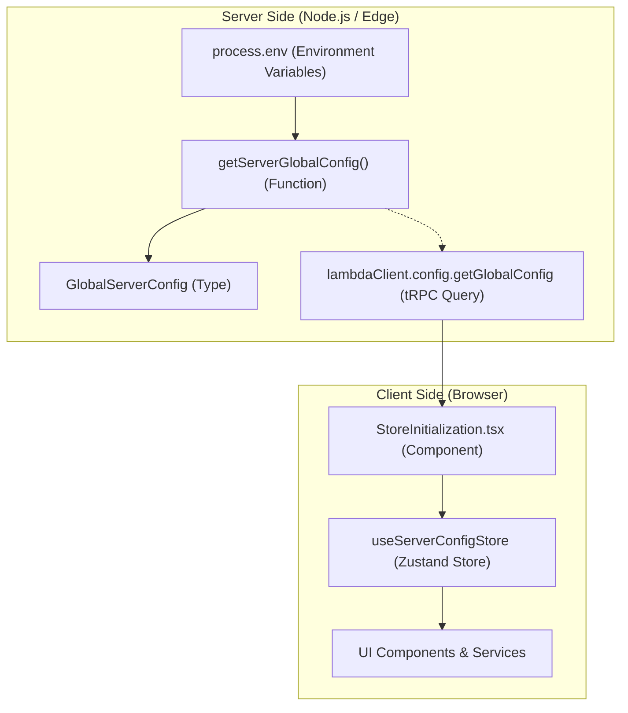
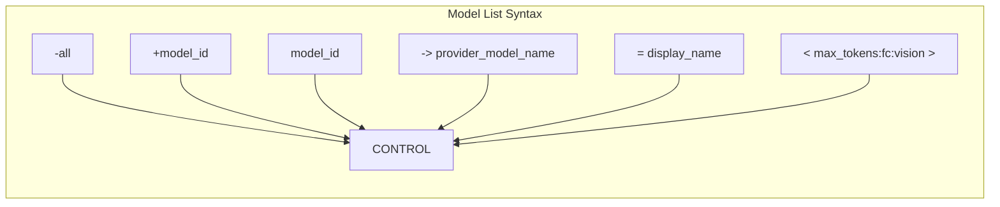
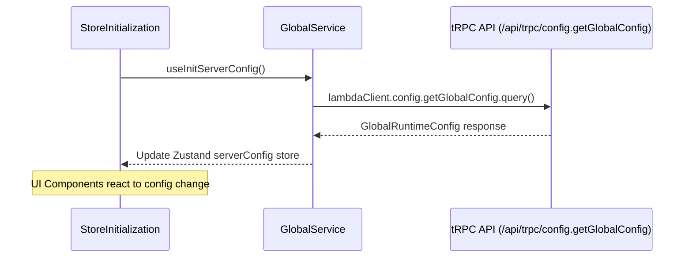

<!-- source: DeepWiki mcp.deepwiki.com · repo lobehub/lobehub · page 11.2 Server Global Configuration · fetched 2026-10-29 -->

# Server Global Configuration

<details>
<summary>Relevant source files</summary>

The following files were used as context for generating this wiki page:

- [apps/server/src/featureFlags/index.test.ts](apps/server/src/featureFlags/index.test.ts)
- [apps/server/src/featureFlags/index.ts](apps/server/src/featureFlags/index.ts)
- [apps/server/src/globalConfig/getServerGlobalConfig.test.ts](apps/server/src/globalConfig/getServerGlobalConfig.test.ts)
- [apps/server/src/globalConfig/index.ts](apps/server/src/globalConfig/index.ts)
- [apps/server/src/routers/lambda/_helpers/__tests__/agentShareFeatureGate.test.ts](apps/server/src/routers/lambda/_helpers/__tests__/agentShareFeatureGate.test.ts)
- [apps/server/src/routers/lambda/_helpers/agentShareFeatureGate.ts](apps/server/src/routers/lambda/_helpers/agentShareFeatureGate.ts)
- [apps/server/src/routers/lambda/config/index.test.ts](apps/server/src/routers/lambda/config/index.test.ts)
- [apps/server/src/runtimeConfig/types.ts](apps/server/src/runtimeConfig/types.ts)
- [docker-compose/deploy/.env.example](docker-compose/deploy/.env.example)
- [docker-compose/deploy/.env.zh-CN.example](docker-compose/deploy/.env.zh-CN.example)
- [docker-compose/deploy/docker-compose.yml](docker-compose/deploy/docker-compose.yml)
- [docker-compose/dev/docker-compose.yml](docker-compose/dev/docker-compose.yml)
- [docker-compose/production/grafana/docker-compose.yml](docker-compose/production/grafana/docker-compose.yml)
- [docker-compose/setup.sh](docker-compose/setup.sh)
- [docs/self-hosting/advanced/feature-flags.mdx](docs/self-hosting/advanced/feature-flags.mdx)
- [docs/self-hosting/advanced/feature-flags.zh-CN.mdx](docs/self-hosting/advanced/feature-flags.zh-CN.mdx)
- [docs/self-hosting/environment-variables/basic.mdx](docs/self-hosting/environment-variables/basic.mdx)
- [docs/self-hosting/environment-variables/basic.zh-CN.mdx](docs/self-hosting/environment-variables/basic.zh-CN.mdx)
- [docs/self-hosting/platform/docker-compose.mdx](docs/self-hosting/platform/docker-compose.mdx)
- [docs/self-hosting/platform/docker-compose.zh-CN.mdx](docs/self-hosting/platform/docker-compose.zh-CN.mdx)
- [packages/app-config/src/featureFlags/schema.test.ts](packages/app-config/src/featureFlags/schema.test.ts)
- [packages/app-config/src/featureFlags/schema.ts](packages/app-config/src/featureFlags/schema.ts)
- [packages/env/src/__tests__/gateway.test.ts](packages/env/src/__tests__/gateway.test.ts)
- [packages/env/src/gateway.ts](packages/env/src/gateway.ts)
- [packages/types/src/llm.ts](packages/types/src/llm.ts)
- [packages/types/src/serverConfig.ts](packages/types/src/serverConfig.ts)
- [packages/utils/src/object.test.ts](packages/utils/src/object.test.ts)
- [scripts/dockerComposeDeploy.test.ts](scripts/dockerComposeDeploy.test.ts)
- [scripts/serverLauncher/startServer.js](scripts/serverLauncher/startServer.js)
- [scripts/serverLauncher/startServer.test.ts](scripts/serverLauncher/startServer.test.ts)
- [src/business/client/services/BusinessGlobalService.ts](src/business/client/services/BusinessGlobalService.ts)
- [src/features/ModelSelect/index.tsx](src/features/ModelSelect/index.tsx)
- [src/features/Settings/provider/(list)/ProviderGrid/index.tsx](src/features/Settings/provider/(list)/ProviderGrid/index.tsx)
- [src/features/Settings/provider/ProviderMenu/index.tsx](src/features/Settings/provider/ProviderMenu/index.tsx)
- [src/features/Settings/provider/detail/default/CustomProviderDetail.tsx](src/features/Settings/provider/detail/default/CustomProviderDetail.tsx)
- [src/layout/GlobalProvider/StoreInitialization.tsx](src/layout/GlobalProvider/StoreInitialization.tsx)
- [src/services/__tests__/_url.test.ts](src/services/__tests__/_url.test.ts)
- [src/services/__tests__/global.test.ts](src/services/__tests__/global.test.ts)
- [src/services/_url.ts](src/services/_url.ts)
- [src/services/global.ts](src/services/global.ts)
- [src/store/aiInfra/slices/aiProvider/__tests__/action.test.ts](src/store/aiInfra/slices/aiProvider/__tests__/action.test.ts)
- [src/store/aiInfra/slices/aiProvider/__tests__/replica.test.ts](src/store/aiInfra/slices/aiProvider/__tests__/replica.test.ts)
- [src/store/aiInfra/slices/aiProvider/__tests__/selectors.test.ts](src/store/aiInfra/slices/aiProvider/__tests__/selectors.test.ts)
- [src/store/aiInfra/slices/aiProvider/action.test.ts](src/store/aiInfra/slices/aiProvider/action.test.ts)
- [src/store/aiInfra/slices/aiProvider/action.ts](src/store/aiInfra/slices/aiProvider/action.ts)
- [src/store/aiInfra/slices/aiProvider/initialState.ts](src/store/aiInfra/slices/aiProvider/initialState.ts)
- [src/store/aiInfra/slices/aiProvider/projection.ts](src/store/aiInfra/slices/aiProvider/projection.ts)
- [src/store/aiInfra/slices/aiProvider/selectors.ts](src/store/aiInfra/slices/aiProvider/selectors.ts)

</details>


The server global configuration system in LobeHub is responsible for aggregating environment variables into a structured, typed runtime configuration object. This configuration governs critical runtime behavior such as AI model providers, authentication, storage, system feature flags, and platform-specific details.

Given LobeHub supports multiple deployment modes—including Serverless cloud, Standalone Docker, and Electron Desktop—the global configuration is assembled dynamically at request time on the server and exposed to the client. This ensures the runtime state is reactive to environment changes, runtime flags, and user permissions.

---

## Global Configuration Data Flow

The following diagram illustrates the end-to-end flow for server global configuration assembly and usage in the client application:



1. Environment variables (`process.env`) are parsed and normalized by the server-side function `getServerGlobalConfig()`, producing a typed `GlobalServerConfig` object.
2. This configuration is exposed on a tRPC query endpoint `config.getGlobalConfig`, which the client invokes during initialization.
3. The client stores the received global configuration data in `useServerConfigStore`, providing reactive access for UI components and internal services.

Sources:
- `src/services/global.ts:68-70`
- `src/layout/GlobalProvider/StoreInitialization.tsx:38-53`

---

## Key Components

### `getServerGlobalConfig()`

This function is the heart of the server-side configuration system. It reads environment variables and assembles a comprehensive `GlobalServerConfig` object containing:

- **Model Provider Credentials and Settings**: Includes API keys and client IDs for OpenAI, Anthropic, Google, Azure, Seneca, and others.
- **Authentication Settings**: OIDC secrets, allowed user email lists, authentication toggles.
- **Storage System Config**: S3 credentials, endpoints, bucket names, and RustFS settings.
- **System and Security Flags**: Feature flags, CSP enablement, SSRF protection whitelist.
- **App URLs and Runtime Settings**: Application URL, WebSocket Gateway URLs, platform-specific flags (e.g., desktop mode).

The typed output ensures consistent usage across the server and client, enabling static checking of configuration data.

Sources:
- `src/services/global.ts:68-70`

### `GlobalServerConfig` Type

The `GlobalServerConfig` type broadly splits into:

- **Runtime Config** (safe to expose to client):
  Includes public flags, enabled providers, feature toggles, and URLs.

- **Private Server Config** (not exposed to client):
  Includes sensitive keys like `DATABASE_URL`, encryption secrets (`KEY_VAULTS_SECRET`), and API keys.

The final runtime config visible to the frontend is a sanitized subset known as `GlobalRuntimeConfig`.

Sources:
- `packages/types/src/serverConfig.ts:115-182`

---

## Environment Variable Configuration

LobeHub supports extensive environment configuration. Below are key categories:

### 1. AI Model Provider Configuration

LobeHub supports multiple AI model providers configurable via env vars:

| Variable | Description | Example Value |
| :-------------------- | :------------------------------------------- | :------------------------------------------ |
| `ENABLED_OPENAI` | Enable/disable OpenAI provider | `1` (enabled), `0` (disabled) |
| `OPENAI_API_KEY` | OpenAI API key (secret) | `sk-xxxx...` |
| `OPENAI_PROXY_URL` | Optional OpenAI API proxy | `https://api.proxy.com/v1` |
| `OPENAI_MODEL_LIST` | Model list syntax string specifying allowed models and their capabilities | `-all,+gpt-4o<512k:fc:vision>` |

**Model List String Syntax**

The model list environment variables allow fine-grained control of which models are enabled or hidden, their aliases, and capabilities. The syntax supports operations like:

- `-all`: Initially hides all defaults.
- `+model_id`: Enables a particular model by its ID.
- `model_id<capabilities:fc:vision>`: Specifies capabilities such as context length, functional calling, and vision support.
- `model_id->provider_model_name`: Maps logical ID to a provider-specific deployment/model name.
- `model_id=Display Name`: Renames the model display label.

This declarative syntax enables flexible deployment configurations.



Sources:
- `docs/self-hosting/environment-variables/basic.mdx:47-68`
- `docs/self-hosting/environment-variables/basic.zh-CN.mdx:44-64`

---

### 2. System Agent Configuration

The `SYSTEM_AGENT` environment variable allows overriding the LobeHub system agents which perform internal automation and context preprocessing:

| Agent Key | Purpose |
| :-------------------- | :---------------------------------------------------- |
| `topic` | Topic name generation from chat contents |
| `translation` | Multilingual translation assistance |
| `historyCompress` | History compression and context optimization |
| `agentMeta` | Assistant metadata generation |
| `thread` | Branch conversation title generation |
| `generationTopic` | AI image auto-naming topic |
| `inputCompletion` | Input auto-completion suggestions |
| `promptRewrite` | Prompt optimization before generation |

A value of `default` uses built-in standard agent configurations.

Sources:
- `docs/self-hosting/environment-variables/basic.mdx:73-100`
- `docs/self-hosting/environment-variables/basic.zh-CN.mdx:70-102`

---

### 3. Authentication & Security Flags

- `AUTH_SECRET`: Used to sign authentication cookies and OIDC tokens.
- `ALLOWED_EMAIL_LIST`: Limits authenticated users by email domain.
- `KEY_VAULTS_SECRET`: Secret for encrypting stored API keys in database.
- `SSRF_ALLOW_PRIVATE_IP_ADDRESS`: Boolean controlling SSRF protection to prevent server requests to internal IPs.
- `SSRF_ALLOW_IP_ADDRESS_LIST`: Comma-separated whitelist of IP addresses allowed for SSRF.

These guard the platform against misuse, unauthorized access, and internal network attacks.

Sources:
- `docs/self-hosting/environment-variables/basic.mdx:22-32`
- `docs/self-hosting/environment-variables/basic.zh-CN.mdx:22-32`

---

### 4. Storage Configuration

Includes:

- `S3_ACCESS_KEY_ID`, `S3_SECRET_ACCESS_KEY`: AWS S3 credentials.
- `S3_ENDPOINT`, `S3_BUCKET`: Endpoint URL and bucket name for object storage.
- `RUSTFS_ENDPOINT`: RustFS storage endpoint.
- `RUSTFS_ACCESS_KEY_ID`, `RUSTFS_SECRET_ACCESS_KEY`: Credentials for RustFS.

These environment variables define persistent storage backends used for file uploads, artifacts, and chat data.

Sources:
- `docker-compose/setup.sh:125-138`
- `docs/self-hosting/platform/docker-compose.mdx:266-272`
- `docs/self-hosting/platform/docker-compose.zh-CN.mdx:266-272`

---

## Client-Side Initialization and Usage

### Store Initialization

At app start, `StoreInitialization.tsx` initializes global state by calling a hook `useInitServerConfig` which invokes the global config query:

```tsx
// Fetch server config during the initialization lifecycle
const useFetchServerConfig = useServerConfigStore((s) => s.useInitServerConfig);
useFetchServerConfig();
```
[src/layout/GlobalProvider/StoreInitialization.tsx:51-53]()

This hook internally calls `globalService.getGlobalConfig()` from the client service, which performs:

```ts
getGlobalConfig = async (): Promise<GlobalRuntimeConfig> => {
  return lambdaClient.config.getGlobalConfig.query();
};
```
[src/services/global.ts:68-70]()

The resulting runtime configuration is saved in Zustand's `serverConfig` store slice, making it available to UI components.

Sources:
- `src/layout/GlobalProvider/StoreInitialization.tsx:51-53`
- `src/services/global.ts:68-70`

### Example Usage in Components

Many components subscribe to server-config-driven selectors to conditionally render or filter options. For example, the `ModelSelect` component uses enabled AI providers and models from the store to display valid options based on the fetched configuration.

Sources:
- `src/features/ModelSelect/index.tsx:132-146`

---

### Initialization Sequence Diagram



Sources:
- `src/layout/GlobalProvider/StoreInitialization.tsx:20-86`
- `src/services/global.ts:68-70`

---

## Security and Server Protection

### SSRF Protection

- `SSRF_ALLOW_PRIVATE_IP_ADDRESS` disables/enables requests to private IP space from server-side outbound requests.
- `SSRF_ALLOW_IP_ADDRESS_LIST` lets admins whitelist specific internal IP addresses to bypass this protection.

This prevents internal network scanning or exploiting vulnerable services on private subnets.

### Content Security Policy (CSP)

The environment variable `ENABLED_CSP` controls whether the server injects CSP and X-Frame-Options headers to harden browser security for embedded iframes.

### Middleware Behavior

`MIDDLEWARE_REWRITE_THROUGH_LOCAL` toggles local rewrite routing behavior addressing networking quirks in Docker setups or development environments.

### Encryption Keys

`KEY_VAULTS_SECRET` secures encryption of user API keys stored in the database, ensuring sensitive credentials are not stored in plaintext.

Sources:
- `docs/self-hosting/environment-variables/basic.mdx:22-32`
- `docs/self-hosting/environment-variables/basic.zh-CN.mdx:22-32`

---

# Summary

The LobeHub server global configuration system provides a robust, extensible framework for managing environment-driven runtime settings in a multi-provider AI agent platform. It ensures:

- Typed and safe configuration from environment variables.
- Dynamic assembly of server and client runtime configuration via `getServerGlobalConfig()` and tRPC.
- Fine-grained control over enabled AI models, security settings, authentication, and storage.
- Seamless client hydration of configuration for responsive UI and logic.

Understanding this system is key for deployment customization, feature toggling, and troubleshooting environment-based issues in LobeHub.

---

# References

- `src/services/global.ts:10-77`
- `src/layout/GlobalProvider/StoreInitialization.tsx:20-90`
- `docs/self-hosting/environment-variables/basic.mdx:22-100`
- `docs/self-hosting/environment-variables/basic.zh-CN.mdx:22-102`
- `src/features/ModelSelect/index.tsx:130-146`
- `packages/types/src/serverConfig.ts:115-182`
- `docker-compose/setup.sh:125-138`

---

---

