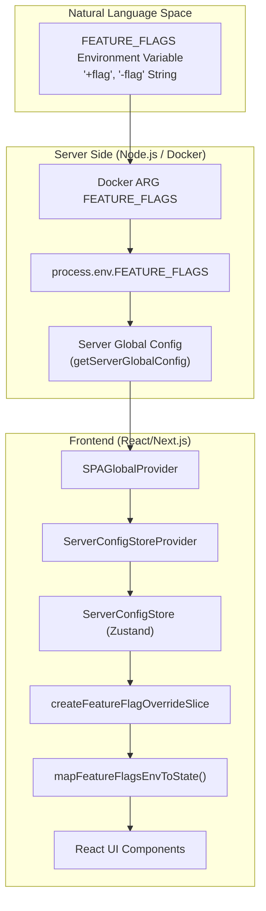
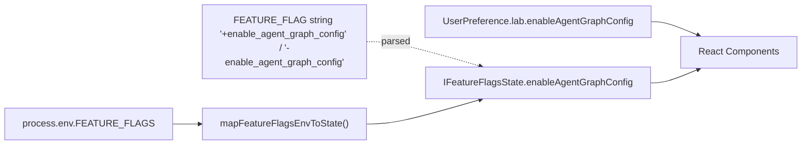

<!-- source: DeepWiki mcp.deepwiki.com · repo lobehub/lobehub · page 11.3 Feature Flags and Labs · fetched 2026-10-29 -->

# Feature Flags and Labs

<details>
<summary>Relevant source files</summary>

The following files were used as context for generating this wiki page:

- [apps/server/src/featureFlags/index.test.ts](apps/server/src/featureFlags/index.test.ts)
- [apps/server/src/featureFlags/index.ts](apps/server/src/featureFlags/index.ts)
- [apps/server/src/globalConfig/getServerGlobalConfig.test.ts](apps/server/src/globalConfig/getServerGlobalConfig.test.ts)
- [apps/server/src/globalConfig/index.ts](apps/server/src/globalConfig/index.ts)
- [apps/server/src/routers/lambda/_helpers/__tests__/agentShareFeatureGate.test.ts](apps/server/src/routers/lambda/_helpers/__tests__/agentShareFeatureGate.test.ts)
- [apps/server/src/routers/lambda/_helpers/agentShareFeatureGate.ts](apps/server/src/routers/lambda/_helpers/agentShareFeatureGate.ts)
- [apps/server/src/routers/lambda/config/index.test.ts](apps/server/src/routers/lambda/config/index.test.ts)
- [apps/server/src/runtimeConfig/types.ts](apps/server/src/runtimeConfig/types.ts)
- [docker-compose/deploy/.env.example](docker-compose/deploy/.env.example)
- [docker-compose/deploy/.env.zh-CN.example](docker-compose/deploy/.env.zh-CN.example)
- [docker-compose/deploy/docker-compose.yml](docker-compose/deploy/docker-compose.yml)
- [docker-compose/dev/docker-compose.yml](docker-compose/dev/docker-compose.yml)
- [docker-compose/production/grafana/docker-compose.yml](docker-compose/production/grafana/docker-compose.yml)
- [docker-compose/setup.sh](docker-compose/setup.sh)
- [docs/self-hosting/advanced/feature-flags.mdx](docs/self-hosting/advanced/feature-flags.mdx)
- [docs/self-hosting/advanced/feature-flags.zh-CN.mdx](docs/self-hosting/advanced/feature-flags.zh-CN.mdx)
- [docs/self-hosting/environment-variables/basic.mdx](docs/self-hosting/environment-variables/basic.mdx)
- [docs/self-hosting/environment-variables/basic.zh-CN.mdx](docs/self-hosting/environment-variables/basic.zh-CN.mdx)
- [docs/self-hosting/platform/docker-compose.mdx](docs/self-hosting/platform/docker-compose.mdx)
- [docs/self-hosting/platform/docker-compose.zh-CN.mdx](docs/self-hosting/platform/docker-compose.zh-CN.mdx)
- [locales/en-US/labs.json](locales/en-US/labs.json)
- [locales/zh-CN/labs.json](locales/zh-CN/labs.json)
- [packages/app-config/src/featureFlags/schema.test.ts](packages/app-config/src/featureFlags/schema.test.ts)
- [packages/app-config/src/featureFlags/schema.ts](packages/app-config/src/featureFlags/schema.ts)
- [packages/const/src/user.ts](packages/const/src/user.ts)
- [packages/env/src/__tests__/gateway.test.ts](packages/env/src/__tests__/gateway.test.ts)
- [packages/env/src/gateway.ts](packages/env/src/gateway.ts)
- [packages/locales/src/default/labs.ts](packages/locales/src/default/labs.ts)
- [packages/types/src/serverConfig.ts](packages/types/src/serverConfig.ts)
- [packages/types/src/user/preference.ts](packages/types/src/user/preference.ts)
- [scripts/dockerComposeDeploy.test.ts](scripts/dockerComposeDeploy.test.ts)
- [scripts/serverLauncher/startServer.js](scripts/serverLauncher/startServer.js)
- [scripts/serverLauncher/startServer.test.ts](scripts/serverLauncher/startServer.test.ts)
- [src/features/Settings/labs/features.ts](src/features/Settings/labs/features.ts)
- [src/features/Settings/labs/index.test.tsx](src/features/Settings/labs/index.test.tsx)
- [src/store/user/slices/preference/selectors.test.ts](src/store/user/slices/preference/selectors.test.ts)
- [src/store/user/slices/preference/selectors/labPrefer.ts](src/store/user/slices/preference/selectors/labPrefer.ts)

</details>


Feature flags and the Labs preference system in LobeHub provide a flexible and dynamic mechanism to control the exposure of experimental and optionally enabled features throughout the UI and API layers. This page documents the environment-level `FEATURE_FLAGS` variable, the individual feature flag names, the Labs selectors in user preferences, and their integration into gating UI and server behaviors.

---

## Purpose and Scope

LobeHub employs feature flags primarily to:

- Gate experimental or incomplete features for testing and phased rollout.
- Allow users and workspace members to enable or disable specific Labs features.
- Support environment-level overrides via `FEATURE_FLAGS` environment variable.
- Provide developers with UI tools to override flags during development.

This system covers both frontend (React UI feature toggling) and backend behaviors (e.g. feature availability, API routing), ensuring consistent flag state is derived and consumed from a single source of truth.

Sources: [packages/types/src/user/preference.ts:155-168](), [src/store/user/slices/preference/selectors/labPrefer.ts:6-37]()

---

## Feature Flags Configuration: The `FEATURE_FLAGS` Environment Variable

LobeHub uses a standardized string syntax in the environment variable `FEATURE_FLAGS` to enable or disable features globally.

### Syntax

- Use `+` prefix to enable a feature (e.g., `+wechat`)
- Use `-` prefix to disable a feature (e.g., `-welcome_suggest`)
- Separate multiple flags with commas `,`
- Wrap in double quotes to avoid shell interpretation issues

### Examples

| Configuration | Effect |
|---|---|
| `FEATURE_FLAGS="-welcome_suggest"` | Disables the welcome suggestion feature globally. |
| `FEATURE_FLAGS="+wechat,+mcp"` | Enables WeChat integration and MCP support. |
| `FEATURE_FLAGS="-all,+wechat"` | Disables all default features except WeChat. |

This environment variable is injected during Docker build or runtime and parsed at server startup into an internal feature flags state.

Sources: [docs/self-hosting/environment-variables/basic.mdx:103-109](), [docs/self-hosting/environment-variables/basic.zh-CN.mdx:103-109]()

---

## Data Flow and Implementation

The feature flag system tightly integrates server environment configuration with frontend state management via the `ServerConfigStore`.

### High-level Data Flow



**Explanation:**

- The `FEATURE_FLAGS` string is supplied as a Docker build ARG or environment variable.
- Loaded into `process.env` in the Node.js backend.
- Passed into the server global config layer (`getServerGlobalConfig`).
- Injected into `window.__SERVER_CONFIG__` for the SPA.
- The SPA sets up the `ServerConfigStore` Zustand instance via the `ServerConfigStoreProvider`.
- A feature flags slice manages overrides and parses the env string into a typed state (`IFeatureFlagsState`) using `mapFeatureFlagsEnvToState()`.
- React UI components consume this slice to conditionally render features.

Sources: [apps/server/src/globalConfig/index.ts:1-10](), [packages/types/src/serverConfig.ts:20-72]()

---

## Defined Feature Flags and Labs Preference Selectors

The feature flag system and Labs preferences include a rich set of flags representing experimental or optional capabilities. These appear as boolean flags in:

- The environment variable `FEATURE_FLAGS`
- The user/workspace preference namespace `preference.lab` (typed as `UserLabSchema`)

### Feature Flags List and Descriptions

| Flag Name | Description | Default Value | Notes |
|---|---|---|---|
| `enableAgentGraphConfig` | Show graph runtime configuration in agent profile advanced settings. | `false` | Controlled by `preference.lab.enableAgentGraphConfig` |
| `enableArtifactDeployment` | Allow publishing artifacts to hosted URLs and manage releases from conversation sidebar. | `false` | Enables artifact-related UI and deployment features |
| `enableClaudeCodeSdk` | Run Claude Code sessions via Claude Agent SDK instead of CLI spawn. | `false` | Provides richer streaming and session control |
| `enableCodexAppServer` | Run Codex sessions through local app-server instead of one-shot CLI processes. | `false` | Enables token streaming and native turn control |
| `enableDesktopSplitView` | Show two desktop tabs side-by-side with resizable divider. | `false` | On desktop mode, enables split view UI |
| `enableDeviceTunnel` | Give a port on the working device a link, so a dev server running there can be opened from here. The link only works for people who can reach that device. | `false` | Enables remote port links for development servers |
| `enableEvalCapture` | Adds a message action to capture conversation turns as evaluation test cases. | `false` | Supports capturing evaluation data from conversations |
| `enableGoals` | Hand the agent a goal: it breaks the goal into tasks, tracks progress, and delivers the result for you to review. | `false` | Enables the Goals feature |
| `enableGroupChat` | Enable multi-agent group chat coordination. | `false` | Enables multi-agent group chat functionality |
| `enableHeteroSessionImport` | Add "Import Local Agent Sessions" to topic list menu for CLI session transcripts import. | `false` | Supports incremental sync of local CLI transcripts |
| `enableImessage` | Connect agents to iMessage through local LobeHub Desktop BlueBubbles bridge. | `false` | Enables iMessage integration channel |
| `enableInAppBrowser` | Show the Browser tab in the conversation side panel: an embedded browser that opens search results in place and lets agents browse visibly. | `false` | Enables an embedded browser in the chat sidebar |
| `enableInputMarkdown` | Render Markdown syntax in the chat input area in real-time. | `true` | Enhances input editor with live Markdown |
| `enableIntegrations` | Show the Integrations settings page: connect the GitHub App so merged pull requests accept deliveries and failing checks or reviews reach the agent that opened them. Hidden by default. | `false` | Enables the Integrations settings page |
| `enableMessageTextSelectionActions` | Show quick actions when selecting text in messages, adding text to next context. | `false` | Facilitates contextual quick actions on text selection |
| `enableOAuthApps` | Show OAuth app management in personal and workspace settings UI. | `false` | Feature hidden by default unless flag enabled |
| `enablePersistentSandbox` | Keep files the cloud sandbox writes. Its working directory survives session recycling and is shared across your topics, instead of being discarded with the sandbox. Requires a paid plan; large downloads and dependencies still belong in /tmp. | `false` | Enables persistent storage for the cloud sandbox |
| `enableProjects` | Organize long-running goals into dedicated workspaces with their own agents, knowledge bases, and tasks. | `false` | Enables project workspace features |
| `enableSelfLearning` | Let every agent learn from your conversations in the background: it remembers facts, refines skills, collects lessons, and reviews its day each night. Rounds you send back become rules. Each nightly review covers at most 50 conversations. See it all under Memory → Self-evolving. | `false` | Enables agent self-learning and memory features |
| `enableTaskVerify` | Add Acceptance section to task detail for AI-generated verify criteria. | `false` | Acceptance and delivery checks UI |

### User Preference Labs Selectors

The frontend user state offers selectors to query Labs feature flags from user preferences, falling back to defaults.

Example selector usage snippet:

```ts
import { DEFAULT_PREFERENCE } from '@lobechat/const';
import { type UserState } from '@/store/user/initialState';

export const labPreferSelectors = {
  enableAgentGraphConfig: (s: UserState): boolean =>
    s.preference.lab?.enableAgentGraphConfig ??
    DEFAULT_PREFERENCE.lab?.enableAgentGraphConfig ??
    false,
  enableArtifactDeployment: (s: UserState): boolean =>
    s.preference.lab?.enableArtifactDeployment ?? false,
  enableClaudeCodeSdk: (s: UserState): boolean => s.preference.lab?.enableClaudeCodeSdk ?? false,
  enableCodexAppServer: (s: UserState): boolean => s.preference.lab?.enableCodexAppServer ?? false,
  enableDeviceTunnel: (s: UserState): boolean => s.preference.lab?.enableDeviceTunnel ?? false,
  enableDesktopSplitView: (s: UserState): boolean =>
    s.preference.lab?.enableDesktopSplitView ?? false,
  enableEvalCapture: (s: UserState): boolean => s.preference.lab?.enableEvalCapture ?? false,
  enableHeteroSessionImport: (s: UserState): boolean =>
    s.preference.lab?.enableHeteroSessionImport ?? false,
  enableImessage: (s: UserState): boolean => s.preference.lab?.enableImessage ?? false,
  enableIntegrations: (s: UserState): boolean => s.preference.lab?.enableIntegrations ?? false,
  enableInputMarkdown: (s: UserState): boolean =>
    s.preference.lab?.enableInputMarkdown ?? DEFAULT_PREFERENCE.lab?.enableInputMarkdown ?? true,
  enableMessageTextSelectionActions: (s: UserState): boolean =>
    s.preference.lab?.enableMessageTextSelectionActions ??
    DEFAULT_PREFERENCE.lab?.enableMessageTextSelectionActions ??
    false,
  enableOAuthApps: (s: UserState): boolean => s.preference.lab?.enableOAuthApps ?? false,
  enablePersistentSandbox: (s: UserState): boolean =>
    s.preference.lab?.enablePersistentSandbox ?? false,
  enableSelfLearning: (s: UserState): boolean => s.preference.lab?.enableSelfLearning ?? false,
  enableProjects: (s: UserState): boolean => s.preference.lab?.enableProjects ?? false,
  enableGoals: (s: UserState): boolean =>
    s.preference.lab?.enableTopicAcceptance ?? s.preference.lab?.enableGoals ?? false,
  enableTaskVerify: (s: UserState): boolean => s.preference.lab?.enableTaskVerify ?? false,
};
```

These selectors enable UI components to render conditionally according to the user's lab preferences, synchronized with global feature flags.

Sources: [packages/types/src/user/preference.ts:155-168](), [src/store/user/slices/preference/selectors/labPrefer.ts:6-37](), [locales/en-US/labs.json:3-46](), [packages/locales/src/default/labs.ts:3-68](), [packages/const/src/user.ts:11-15]()

---

## Interaction Between Natural Language Feature Flags and Code Entities

The flags, often specified as kebab-case or snake_case strings in environment variables or UI, map to camelCase properties in the code (e.g. `enableAgentGraphConfig`). This mapping ensures consistent access to flags both as raw strings and typed boolean properties.

### Mapping Example Diagram



Sources: [src/store/user/slices/preference/selectors/labPrefer.ts:6-37](), [packages/types/src/user/preference.ts:155-168]()

---

## Development Overrides and Debugging

LobeHub provides a development-only UI component called `DevFeatureFlagPanel` for quickly toggling feature flags during local development without restarting servers.

### Key Implementation Details

- Rendered inside `SPAGlobalProvider` when `__DEV__` is true.
- Allows toggling `true`, `false`, or `inherit` (revert to server config).
- Flag keys are converted to `snake_case` for display matching environment semantics.
- Overrides are stored in a dedicated Zustand slice separate from server state.
- Useful for testing labs features in isolation or for transient overrides.

This panel complements the environment variable and preference-based flag system with runtime local state overrides.

Sources: [src/features/Settings/labs/features.ts:1-10]()

---

# Summary

| Aspect | Description |
|---|---|
| Feature Flags Source | `FEATURE_FLAGS` environment variable string parsed at startup |
| Flag Representation | Typed boolean `IFeatureFlagsState` properties |
| User Preference API | `UserLabSchema` in `preference.lab` with selectors in store |
| UI Integration | React components conditionally rendered based on flags and prefs |
| Dev Overrides | `DevFeatureFlagPanel` supports runtime flag toggles locally |

---

This feature flag and Labs system in LobeHub ensures extensibility, rapid iteration of experimental capabilities, and user-configurable toggles for enhanced flexibility across environments and workspaces.

Sources:
[packages/types/src/user/preference.ts:14-190](),
[src/store/user/slices/preference/selectors/labPrefer.ts:1-37](),
[locales/en-US/labs.json:1-54](),
[locales/zh-CN/labs.json:1-54](),
[packages/locales/src/default/labs.ts:1-78](),
[docs/self-hosting/environment-variables/basic.mdx:103-109](),
[docs/self-hosting/environment-variables/basic.zh-CN.mdx:103-109](),
[packages/types/src/serverConfig.ts:20-72](),
[packages/const/src/user.ts:5-20](),
[src/features/Settings/labs/features.ts:1-10]()

---

