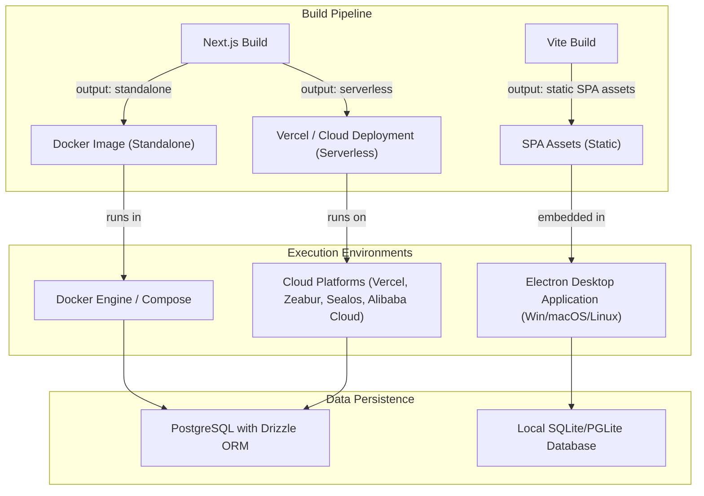
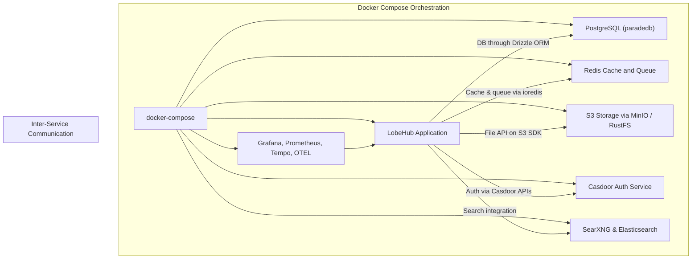
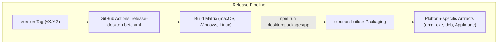
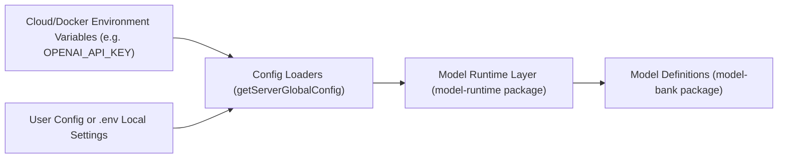
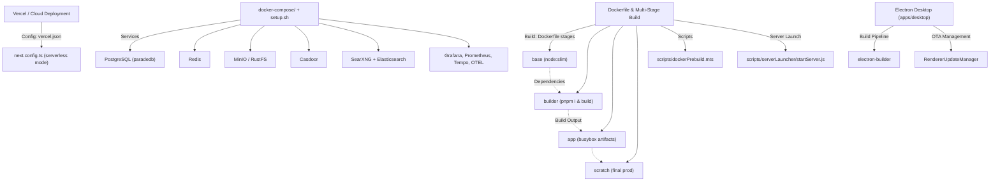

<!-- source: DeepWiki mcp.deepwiki.com · repo lobehub/lobehub · page 12 Deployment · fetched 2026-10-29 -->

# Deployment

<details>
<summary>Relevant source files</summary>

The following files were used as context for generating this wiki page:

- [.env.example](.env.example)
- [Dockerfile](Dockerfile)
- [docs/self-hosting/advanced/model-list.mdx](docs/self-hosting/advanced/model-list.mdx)
- [docs/self-hosting/advanced/model-list.zh-CN.mdx](docs/self-hosting/advanced/model-list.zh-CN.mdx)
- [docs/self-hosting/environment-variables/model-provider.mdx](docs/self-hosting/environment-variables/model-provider.mdx)
- [docs/self-hosting/environment-variables/model-provider.zh-CN.mdx](docs/self-hosting/environment-variables/model-provider.zh-CN.mdx)

</details>


LobeHub supports a diverse range of deployment strategies tailored for different use cases, including individual local usage, enterprise self-hosting, and cloud deployments. The architecture leverages Next.js for web delivery alongside Electron for desktop distribution, consolidating a unified core logic across platforms.

---

### Deployment Ecosystem Overview

This diagram illustrates how the various build artifacts correspond to their target runtime environments, showing how LobeHub can be deployed as a cloud serverless app, a Docker container, a desktop app, or a standalone SPA:


Sources: [Dockerfile:110-119](), [Dockerfile:144-156]()

---

## Vercel and Cloud Deployment

LobeHub is optimized for deployment on Vercel, utilizing the `serverless` output mode of Next.js for scalable and zero-maintenance hosting. The `vercel.json` configuration, coupled with adjustments in `next.config.ts`, streamlines serverless optimizations by removing unneeded binaries (such as `musl`-specific libraries), which helps keep the size of the serverless functions within platform limits.

This deployment mode supports additional cloud providers like Zeabur, Sealos, and Alibaba Cloud, which share similar serverless deployment strategies. Environment variables defining the enabled AI model providers and configuration related to API keys are crucial for functionality in cloud environments.

For a detailed guide, including `vercel.json` setup and serverless considerations, see [Vercel and Cloud Deployment](#12.1).

Sources: []()

---

## Docker Deployment

The official Docker image for LobeHub is built through a multi-stage `Dockerfile`, producing a highly optimized standalone image for containerized deployments. The build process proceeds through several stages:

- **base**: A `node:slim` base image where OS-level dependencies and proxy tools are installed. [Dockerfile:5-27]()
- **builder**: Runs `pnpm install` to resolve dependencies and builds the Next.js standalone server along with CLI tools for search and migration. [Dockerfile:30-106]()
- **app**: Copies build artifacts and runtime dependencies into a minimal BusyBox image. [Dockerfile:109-143]()
- **scratch**: The final tiny production image based on the `scratch` base, containing the built app, database migration scripts, and startup scripts. [Dockerfile:144-156]()

```mermaid
graph LR
    subgraph Dockerfile Build Stages
        Base[base (node:slim)]
        Builder[builder (pnpm install & build)]
        App[app (busybox/copy artifacts)]
        Prod[Final Production (scratch)]

        Base --> Builder
        Builder --> App
        App --> Prod
    end

    subgraph Code Components
        Builder --> |"Prebuild Script (scripts/dockerPrebuild.mts)"| Prebuild
        Builder --> |"Next.js Standalone Build (npm run build:docker)"| NextStandalone
        App --> |"Server Launcher (scripts/serverLauncher/startServer.js)"| StartServer
        App --> |"DB Migration (scripts/migrateServerDB/*.ts)"| DbMigrations
    end
```

During the build, environment validation and cleanup of desktop-only routes take place (`scripts/dockerPrebuild.mts`), producing a production-ready standalone Next.js app with statically traced files for minimized image size. [Dockerfile:94-96]()

For detailed Dockerfile arrangements, build environment variables, and runtime parameters, see [Docker Deployment](#12.2).

Sources: [Dockerfile:1-147](), [Dockerfile:92-96]()

---

## Docker Compose Self-Hosting

For enterprise or advanced users requiring a full self-hosted infrastructure stack, LobeHub supports orchestration with Docker Compose. This setup provisions a suite of interconnected services essential for production-grade deployment, including:

| Service | Role | Configuration / Identifier |
|---|---|---|
| **PostgreSQL**| Primary data store with vector support | Image: `paradedb/paradedb:latest` |
| **Redis** | Caching and task queue management| Configured by `REDIS_URL` in `.env.example` |
| **RustFS/MinIO** | Object storage for files and knowledge | Configured via `S3_ENDPOINT` in `.env.example`|
| **Casdoor** | Authentication and Single Sign-On| Orchestrated service container |
| **SearXNG / Elasticsearch** | Search engine & indexing | Integrated for knowledge base support |
| **LobeHub Core**| Application container | Image: `lobehub/lobehub` |
| **Observability Stack** | Monitoring & tracing | Grafana, Prometheus, Tempo, OpenTelemetry (OTEL) |



This orchestration offers full control over all subsystems necessary for robust AI operations including knowledge base management and enterprise-grade authentication integration.

For provisioning scripts, service orchestration details, environment modes, and monitoring setup, see [Docker Compose Self-Hosting](#12.3).

Sources: [.env.example:28-42](), [.env.example:166-169]()

---

## Desktop Application Distribution and Over-the-Air Updates

LobeHub is also shipped as a native desktop application built with Electron, under the `apps/desktop` package workspace. The Electron build pipeline leverages `electron-builder` for multi-platform packaging (Windows, macOS Intel & Silicon, Linux).

Release channels and workflows are automated via GitHub Actions, supporting:

- **Stable releases**, triggered by official version tags.
- **Beta releases**, triggered by pre-release tags (e.g., `v2.0.0-beta.1`).
- **Nightly builds** from main branch pushes.



The desktop build supports over-the-air (OTA) updates for the renderer process through the `RendererUpdateManager`, with manifests and update channels to deliver smooth incremental updates.

For comprehensive coverage of the desktop build pipeline, electron-builder configuration, platform-specific packaging, OTA update mechanics, and release workflows, refer to [Desktop Application Distribution and OTA](#12.4).

Sources: []()

---

# Deployment and Model Provider Configuration Relationship

The deployment environment must be configured properly for the AI model providers utilized by LobeHub. This is especially important for cloud and Docker deployments to enable models using API keys and proxy URLs.

Below is a conceptual mapping between deployment environments and provider configuration entities in the code:



LobeHub uses environment variables such as `OPENAI_API_KEY`, `AZURE_API_KEY`, etc., to enable respective providers in deployment. [docs/self-hosting/environment-variables/model-provider.mdx:25-30](), [docs/self-hosting/environment-variables/model-provider.mdx:100-105]() The model-runtime package contains interfaces and factories that utilize this configuration at runtime to instantiate provider clients.

For detailed environment variable references and best practices for setting up model providers, see the [Model Service Providers - Environment Variables](docs/self-hosting/environment-variables/model-provider.mdx) documentation.

Sources: [docs/self-hosting/environment-variables/model-provider.mdx:14-154](), [.env.example:48-190]()

---

# Summary

| Deployment Option | Description | Key Resources |
|---|---|---|
| Vercel / Cloud Deployment | Serverless hosting with Next.js on Vercel and similar clouds | [Vercel and Cloud Deployment](#12.1) |
| Docker Deployment | Multi-stage Docker image with standalone Next.js server | [Docker Deployment](#12.2) |
| Docker Compose Self-Hosting| Full-stack self-hosted environment orchestration | [Docker Compose Self-Hosting](#12.3) |
| Desktop Application | Electron packaged native desktop clients with OTA updates | [Desktop Application Distribution and OTA](#12.4) |

Each deployment model shares the same underlying codebase, with environment and build-time configurations tuning the final artifact's behavior and dependencies.

---

For more detailed instructions and technical configurations, please explore the individual child pages dedicated to each deployment method:

- [Vercel and Cloud Deployment](#12.1)
- [Docker Deployment](#12.2)
- [Docker Compose Self-Hosting](#12.3)
- [Desktop Application Distribution and OTA](#12.4)

---

# Additional Diagram Bridging Natural Language Space and Code Entities

This diagram maps the deployment system names from natural language into specific code entities and scripts involved in the build and run lifecycle:



This illustrates the concrete implementations referenced in the Dockerfile, scripts, configuration files, and Electron app that realize each deployment environment.

Sources: [Dockerfile:1-150]()

---

# References

- `Dockerfile`: multi-stage Docker build and runtime image creation [Dockerfile:1-156]()
- `.env.example` and `docs/self-hosting/environment-variables/model-provider.mdx`: environment variable definitions for AI providers in deployment [.env.example:1-545](), [docs/self-hosting/environment-variables/model-provider.mdx:1-912]()
- GitHub Actions workflows for desktop release automation
- Electron workspace under `apps/desktop` for native desktop builds
- Docker Compose directory for self-hosted infrastructure orchestration

---

This concludes the high-level overview of all supported deployment options for LobeHub.

---

