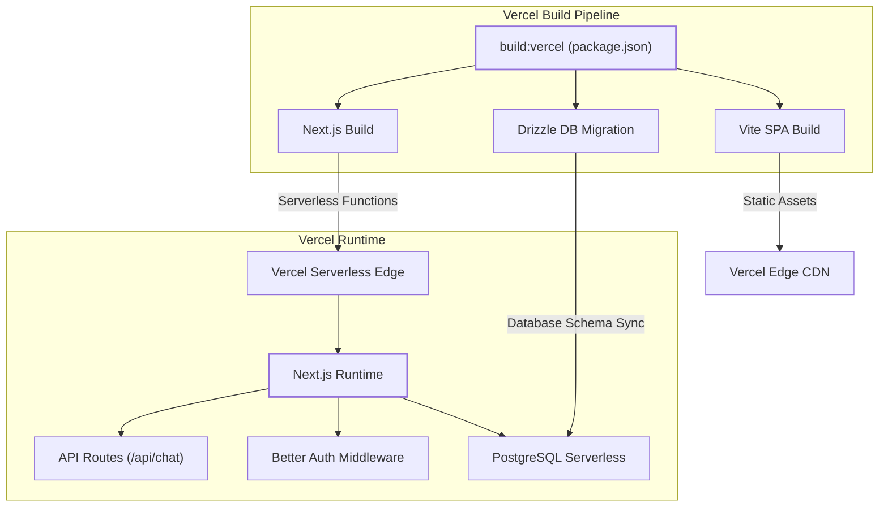
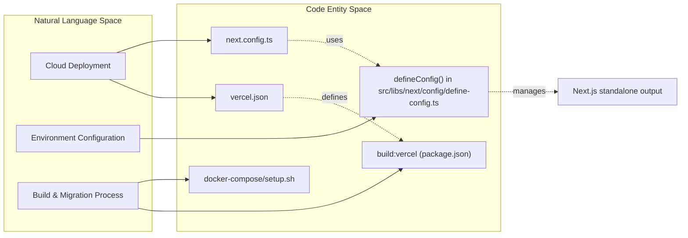

<!-- source: DeepWiki mcp.deepwiki.com · repo lobehub/lobehub · page 12.1 Vercel and Cloud Deployment · fetched 2026-10-29 -->

# Vercel and Cloud Deployment

<details>
<summary>Relevant source files</summary>

The following files were used as context for generating this wiki page:

- [.bunfig.toml](.bunfig.toml)
- [.github/scripts/create-failure-issue.js](.github/scripts/create-failure-issue.js)
- [.github/workflows/auto-i18n.yml](.github/workflows/auto-i18n.yml)
- [.github/workflows/auto-tag-release.yml](.github/workflows/auto-tag-release.yml)
- [.github/workflows/lighthouse.yml](.github/workflows/lighthouse.yml)
- [.github/workflows/release.yml](.github/workflows/release.yml)
- [.github/workflows/sync-database-schema.yml](.github/workflows/sync-database-schema.yml)
- [.github/workflows/sync-main-to-canary.yaml](.github/workflows/sync-main-to-canary.yaml)
- [.github/workflows/sync.yml](.github/workflows/sync.yml)
- [.github/workflows/test.yml](.github/workflows/test.yml)
- [.npmrc](.npmrc)
- [CHANGELOG.md](CHANGELOG.md)
- [README.md](README.md)
- [README.zh-CN.md](README.zh-CN.md)
- [apps/cli/.npmrc](apps/cli/.npmrc)
- [apps/cli/pnpm-workspace.yaml](apps/cli/pnpm-workspace.yaml)
- [apps/desktop/.npmrc](apps/desktop/.npmrc)
- [apps/desktop/package.json](apps/desktop/package.json)
- [apps/desktop/pnpm-lock.yaml](apps/desktop/pnpm-lock.yaml)
- [apps/desktop/pnpm-workspace.yaml](apps/desktop/pnpm-workspace.yaml)
- [apps/desktop/src/main/controllers/AuvCtr.ts](apps/desktop/src/main/controllers/AuvCtr.ts)
- [apps/desktop/src/main/services/__tests__/auvSrv.test.ts](apps/desktop/src/main/services/__tests__/auvSrv.test.ts)
- [apps/desktop/src/main/services/auvSrv.ts](apps/desktop/src/main/services/auvSrv.ts)
- [changelog/CHANGELOG.v0.md](changelog/CHANGELOG.v0.md)
- [changelog/CHANGELOG.v1.md](changelog/CHANGELOG.v1.md)
- [changelog/v0.json](changelog/v0.json)
- [changelog/v1.json](changelog/v1.json)
- [changelog/v2.json](changelog/v2.json)
- [codecov.yml](codecov.yml)
- [docs/changelog/2025-03-02-new-models.zh-CN.mdx](docs/changelog/2025-03-02-new-models.zh-CN.mdx)
- [docs/changelog/2025-06-08-claude-4.zh-CN.mdx](docs/changelog/2025-06-08-claude-4.zh-CN.mdx)
- [docs/changelog/2025-07-08-mcp-market.zh-CN.mdx](docs/changelog/2025-07-08-mcp-market.zh-CN.mdx)
- [docs/changelog/2025-09-08-gemini.zh-CN.mdx](docs/changelog/2025-09-08-gemini.zh-CN.mdx)
- [docs/changelog/2025-10-08-python.zh-CN.mdx](docs/changelog/2025-10-08-python.zh-CN.mdx)
- [docs/changelog/2025-12-20-mcp.zh-CN.mdx](docs/changelog/2025-12-20-mcp.zh-CN.mdx)
- [docs/changelog/schema.json](docs/changelog/schema.json)
- [next.config.ts](next.config.ts)
- [package.json](package.json)
- [patches/@upstash__qstash.patch](patches/@upstash__qstash.patch)
- [pnpm-workspace.yaml](pnpm-workspace.yaml)
- [renovate.json](renovate.json)
- [scripts/changelogWorkflow/const.ts](scripts/changelogWorkflow/const.ts)
- [scripts/changelogWorkflow/generateChangelog.ts](scripts/changelogWorkflow/generateChangelog.ts)
- [scripts/dbmlWorkflow/index.ts](scripts/dbmlWorkflow/index.ts)
- [scripts/releaseWorkflow/index.ts](scripts/releaseWorkflow/index.ts)
- [src/features/ShareModal/ShareImage/style.ts](src/features/ShareModal/ShareImage/style.ts)
- [src/libs/next/config/define-config.test.ts](src/libs/next/config/define-config.test.ts)
- [src/libs/next/config/define-config.ts](src/libs/next/config/define-config.ts)
- [vercel.json](vercel.json)

</details>


This page documents how to deploy LobeHub to Vercel and other cloud platforms such as Zeabur, Sealos, and Alibaba Cloud. It provides detailed configuration insights including the `vercel.json` setup and Next.js serverless output mode optimizations, as well as deployment workflows tailored to cloud environments.

---

## Overview

LobeHub is architected as a cloud-native framework, optimized for serverless and containerized deployments. Its dual-build strategy involves:

- A **Next.js server-side application** serving API routes, authentication, and backend logic.
- A **high-performance SPA** compiled by Vite for frontend static assets.

While self-hosting via Docker is supported, the codebase is specifically optimized to leverage Vercel's serverless infrastructure with careful build and runtime configurations.

---

## Vercel Deployment Architecture

### Build Workflow and Optimization

For Vercel, the deployment process triggers the `build:vercel` script (defined in `package.json`) which covers:

- Complete SPA asset compilation.
- Next.js application server build.
- Automatic execution of database migrations for schema synchronization.

The build command in `vercel.json` is:

```json
"buildCommand": "bun run build:vercel"
```

which invokes this integrated build-and-migrate pipeline [package.json:61](), [vercel.json:2]().

To keep serverless function sizes within Vercel limits, `next.config.ts` applies key optimizations:

- **Excluding musl binaries:** Since Vercel runs on Amazon Linux (glibc), it excludes Alpine Linux musl binaries used by libraries like `sharp`, saving ~16 MB per function [next.config.ts:9-12]().
- **Excluding SPA/desktop/mobile build artifacts:** These bulky assets are omitted from serverless function bundles to minimize deployment size [next.config.ts:13-19]().

This ensures lean, efficient serverless functions and avoids oversize bundle failures.

### Vercel Configuration (`vercel.json`)

The `vercel.json` file governs the build environment and runtime headers:

- **Install Command:** Enforces pnpm v12.4.1 for consistent dependency installation [vercel.json:53]().

- **Headers:**
  - Aggressive caching for SPA assets under path `/_spa/` via `Cache-Control` and `CDN-Cache-Control` headers to improve response performance and enable stale-while-revalidate policies [vercel.json:3-15]().
  - No-cache directives for the `_dangerous_local_dev_proxy` route used in local dev [vercel.json:17-49]().

- **Rewrites:** Proxy rewrites for the local dev proxy routes to serve specialized content [vercel.json:54-62]().

Example excerpt from `vercel.json`:

```json
{
  "headers": [
    {
      "source": "/_spa/(.*)",
      "headers": [
        {
          "key": "Cache-Control",
          "value": "public, max-age=86400, s-maxage=86400, stale-while-revalidate=604800, stale-if-error=86400, immutable"
        },
        {
          "key": "CDN-Cache-Control",
          "value": "public, max-age=86400, s-maxage=86400, stale-while-revalidate=604800, stale-if-error=86400, immutable"
        }
      ]
    }
  ],
  "rewrites": [
    {
      "source": "/_dangerous_local_dev_proxy",
      "destination": "/_dangerous_local_dev_proxy.html"
    },
    {
      "source": "/_dangerous_local_dev_proxy/:path*",
      "destination": "/_dangerous_local_dev_proxy.html"
    }
  ]
}
```

### Deployment Flow Diagram


Sources:
- [package.json:61]()
- [vercel.json:2-62]()
- [next.config.ts:9-19]()

---

## Serverless Output Mode

### Next.js Configuration

LobeHub's Next.js configuration is controlled via the custom `defineConfig` function (`src/libs/next/config/define-config.ts`). It detects environment variables to optimally apply output modes:

- **Standalone Mode:** Activated when building for Docker or if `NEXT_BUILD_STANDALONE=1`. This enables `output: 'standalone'` mode optimized for containerized deployment [src/libs/next/config/define-config.ts:28-31]().

- **Vercel Mode:** When `process.env.VERCEL_ENV` is detected (`isVercel` true), specialized serverless-related build optimizations are enabled. Key exclusions are applied to prevent musl native bindings and SPA/desktop/mobile build artifacts from increasing bundle size [next.config.ts:3-20]().

This hybrid approach lets LobeHub dynamically optimize for serverless (Vercel) or standalone (Docker/cloud VM) environments without multiple codebases.

### Dynamic Configuration Flow Mapping


Sources:
- [src/libs/next/config/define-config.ts:28-31]()
- [next.config.ts:3-20]()

---

## Other Cloud Platforms

### Zeabur and Sealos

These container-based cloud providers typically deploy LobeHub using the official Docker image or directly from the GitHub repository. The key requirement is proper environment variable configuration for database and storage endpoints (notably `DATABASE_URL` for PostgreSQL).

### Alibaba Cloud and Self-Hosted Docker Compose

For Alibaba Cloud or other self-hosted Kubernetes solutions, LobeHub supports a Docker Compose setup including:

- Automated provisioning script `docker-compose/setup.sh` to initialize all dependencies (PostgreSQL, MinIO for S3-compatible object storage, authentication services, etc.).
- Configuration prompts for language, secrets (`KEY_VAULTS_SECRET`), and deployment mode automation.
- This setup enables scaling and integration in cloud VM or Kubernetes container environments.

### Platform Comparison

| Feature                     | Vercel                          | Zeabur / Sealos                   | Docker (Self-Hosted)             |
|-----------------------------|---------------------------------|-----------------------------------|----------------------------------|
| Primary Deployment Mode     | Serverless functions            | Containerized                     | Containerized                    |
| Build Tool                  | `bun` / `pnpm`                  | Docker Engine                     | Docker / Docker Compose          |
| Database Migration          | Automatic post-build (migration)| Automatic on start (via script)   | `db:migrate` script (CLI)        |
| Next.js Output Mode         | Serverless optimized (`outputFileTracingExcludes`)| Standalone (container mode)   | Standalone                       |

---

## Environment Variable Configuration

Cloud deployments use environment variables extensively. Critical subsets include:

### AI Provider Credentials

- `KEY_VAULTS_SECRET`: Encryption key for secrets and API keys; once set, it must not be changed to avoid data loss.

### Database and Storage

- `DATABASE_URL`: The PostgreSQL connection string for chat, agent, and user data.

- S3-compatible object storage environment variables such as `S3_ENDPOINT`, `S3_BUCKET`, and `S3_ACCESS_KEY_ID` for document and artifact storage.

### Security and Authentication

- `AUTH_SECRET`: Secret key for encrypting sessions for Better Auth middleware.

- `JWKS_KEY`: JWT signing key utilized for authorization and API security.

- `ENABLED_CSP`: Enable Content Security Policy headers in Next.js routes for security hardening [src/libs/next/config/define-config.ts:23, 96-107]().

Sources:
- [src/libs/next/config/define-config.ts:23,96-107]()

---

## Summary Table of Relevant Files and Concepts

| Filename                          | Description                                            |
|-----------------------------------|--------------------------------------------------------|
| `vercel.json`                     | Vercel build command, headers, rewrites config [vercel.json:2-63]()|
| `next.config.ts`                  | Next.js config for Vercel optimizations [next.config.ts:1-25]()       |
| `src/libs/next/config/define-config.ts` | Env-based Next.js config and standalone/serverless logic [src/libs/next/config/define-config.ts:1-50]() |
| `package.json`                    | Build commands including `build:vercel` [package.json:61]()      |
| `Dockerfile`                      | Notes on environment variables used in container builds |
| `docker-compose/setup.sh`         | Self-hosted provisioning script for cloud VMs           |

---

# Appendix: Detailed Config Snippet for `next.config.ts`

```ts
import { defineConfig } from './src/libs/next/config/define-config';

const isVercel = !!process.env.VERCEL_ENV;

const vercelConfig = {
  // Vercel serverless optimization: exclude musl binaries from all routes
  // Vercel uses Amazon Linux (glibc), not Alpine Linux (musl)
  // Saves ~16MB (sharp-musl) per serverless function
  outputFileTracingExcludes: {
    '*': [
      'node_modules/.pnpm/@img+sharp-libvips-*musl*',
      // Exclude SPA/desktop/mobile build artifacts from serverless functions
      'public/_spa/**',
      'dist/desktop/**',
      'dist/mobile/**',
      'apps/desktop/**',
      'packages/database/migrations/**',
    ],
  },
};
const nextConfig = defineConfig({
  ...(isVercel ? vercelConfig : {}),
});

export default nextConfig;
```

---

This page captures the technical details enabling LobeHub's cloud-native deployment on Vercel and other cloud platforms, emphasizing build optimization, serverless function size constraints, and environmental configuration for seamless operation.

**Sources:**
- [package.json:61]()
- [vercel.json:2-63]()
- [next.config.ts:1-25]()
- [src/libs/next/config/define-config.ts:1-50]()

---

