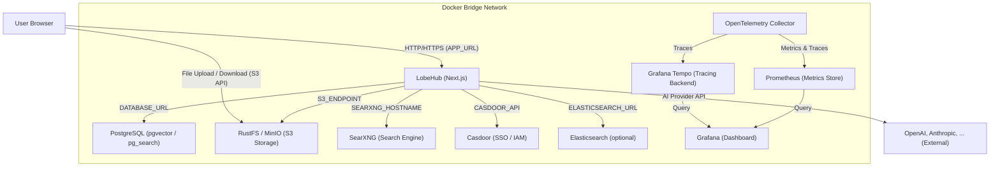
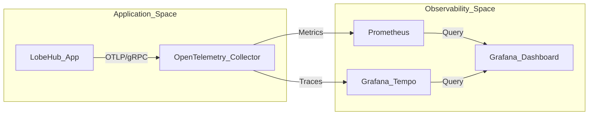
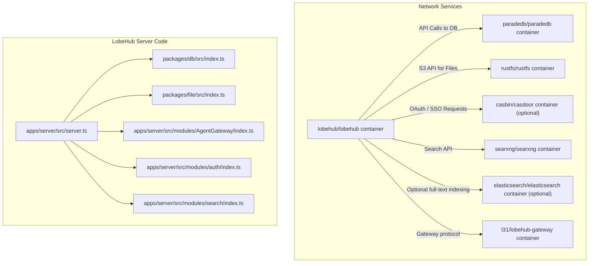

<!-- source: DeepWiki mcp.deepwiki.com · repo lobehub/lobehub · page 12.3 Docker Compose Self-Hosting · fetched 2026-10-29 -->

# Docker Compose Self-Hosting

<details>
<summary>Relevant source files</summary>

The following files were used as context for generating this wiki page:

- [apps/server/src/featureFlags/index.test.ts](apps/server/src/featureFlags/index.test.ts)
- [apps/server/src/featureFlags/index.ts](apps/server/src/featureFlags/index.ts)
- [apps/server/src/globalConfig/getServerGlobalConfig.test.ts](apps/server/src/globalConfig/getServerGlobalConfig.test.ts)
- [apps/server/src/globalConfig/index.ts](apps/server/src/globalConfig/index.ts)
- [apps/server/src/routers/lambda/_helpers/__tests__/agentShareFeatureGate.test.ts](apps/server/src/routers/lambda/_helpers/__tests__/agentShareFeatureGate.test.ts)
- [apps/server/src/routers/lambda/_helpers/agentShareFeatureGate.ts](apps/server/src/routers/lambda/_helpers/agentShareFeatureGate.ts)
- [apps/server/src/routers/lambda/config/index.test.ts](apps/server/src/routers/lambda/config/index.test.ts)
- [apps/server/src/runtimeConfig/types.ts](apps/server/src/runtimeConfig/types.ts)
- [docker-compose/deploy/.env.example](docker-compose/deploy/.env.example)
- [docker-compose/deploy/.env.zh-CN.example](docker-compose/deploy/.env.zh-CN.example)
- [docker-compose/deploy/docker-compose.yml](docker-compose/deploy/docker-compose.yml)
- [docker-compose/dev/docker-compose.yml](docker-compose/dev/docker-compose.yml)
- [docker-compose/production/grafana/docker-compose.yml](docker-compose/production/grafana/docker-compose.yml)
- [docker-compose/setup.sh](docker-compose/setup.sh)
- [docs/self-hosting/advanced/feature-flags.mdx](docs/self-hosting/advanced/feature-flags.mdx)
- [docs/self-hosting/advanced/feature-flags.zh-CN.mdx](docs/self-hosting/advanced/feature-flags.zh-CN.mdx)
- [docs/self-hosting/environment-variables/basic.mdx](docs/self-hosting/environment-variables/basic.mdx)
- [docs/self-hosting/environment-variables/basic.zh-CN.mdx](docs/self-hosting/environment-variables/basic.zh-CN.mdx)
- [docs/self-hosting/platform/docker-compose.mdx](docs/self-hosting/platform/docker-compose.mdx)
- [docs/self-hosting/platform/docker-compose.zh-CN.mdx](docs/self-hosting/platform/docker-compose.zh-CN.mdx)
- [packages/app-config/src/featureFlags/schema.test.ts](packages/app-config/src/featureFlags/schema.test.ts)
- [packages/app-config/src/featureFlags/schema.ts](packages/app-config/src/featureFlags/schema.ts)
- [packages/env/src/__tests__/gateway.test.ts](packages/env/src/__tests__/gateway.test.ts)
- [packages/env/src/gateway.ts](packages/env/src/gateway.ts)
- [packages/types/src/serverConfig.ts](packages/types/src/serverConfig.ts)
- [scripts/dockerComposeDeploy.test.ts](scripts/dockerComposeDeploy.test.ts)
- [scripts/serverLauncher/startServer.js](scripts/serverLauncher/startServer.js)
- [scripts/serverLauncher/startServer.test.ts](scripts/serverLauncher/startServer.test.ts)

</details>


LobeHub provides a comprehensive Docker Compose orchestration suite designed for technically proficient users who want a fully self-contained, production-grade AI assistant environment. This orchestration brings up a multi-container stack, integrating core services including the main app, database, object storage, search engine, optional identity management, and observability tooling.

This page documents the contents and mechanics of the `docker-compose/` directory, focusing on:

- The provisioning script `setup.sh`
- Orchestration of services: PostgreSQL, MinIO/RustFS, Casdoor, SearXNG, Elasticsearch
- Deployment modes and network configuration
- The Observability stack with Grafana, Tempo, Prometheus, and OpenTelemetry Collector (OTEL)

---

## 1. Orchestration Overview

The Docker Compose setup orchestrates multiple containers to support essential LobeHub features including RAG knowledge bases, file uploads, search, authentication, and production monitoring.

### 1.1 Core Services

| Service           | Image / Role                  | Responsibility                                                                                      |
|-------------------|------------------------------|---------------------------------------------------------------------------------------------------|
| **LobeHub (App)** | `lobehub/lobehub`             | The Next.js frontend combined with the backend API server. Handles chat pipeline, AI agents, data persistence, and client communication. |
| **PostgreSQL**    | `paradedb/paradedb`           | Core relational database extended with `pgvector` for vector search support and `pg_search` for full-text search. Stores conversations, agents, files metadata, and knowledge base data. |
| **MinIO / RustFS**| `rustfs/rustfs`               | S3-compatible object storage for handling file uploads, knowledge base documents, and media files. Supports RESTful S3 API and administrative UI. |
| **Casdoor**       | `casbin/casdoor` (optional)   | Identity and Access Management providing single sign-on (SSO) with OIDC support for user authentication. Optional for multi-user or enterprise setups. |
| **SearXNG**       | `searxng/searxng`             | Privacy-focused meta search engine allowing AI agents to perform live web searches securely. Integrated as a tool for enhanced information retrieval. |
| **Elasticsearch** | `elasticsearch/elasticsearch` | Optional full-text search engine augmenting knowledge base search capabilities. Integrated with internal reindexing scripts. |

### 1.2 Observability Stack

For production deployments, an observability stack is included to capture metrics, traces, and logs:

- **OpenTelemetry Collector (OTEL)**: Aggregates telemetry data (metrics/traces) from various services.
- **Prometheus**: Scrapes and stores time-series metrics from OTEL and instrumented services.
- **Grafana**: Provides detailed dashboards and visualizations for metrics and traces.
- **Grafana Tempo**: Distributed tracing backend to view detailed request and agent execution traces.

---

## 2. Service Data Flow and Architecture

The Docker Compose network exposes services internally via a Docker bridge network. External access is typically proxied through a reverse proxy or directly mapped ports depending on deployment mode.

### Diagram: Service Orchestration and Data Flow



### Explanation

- The main LobeHub service interfaces internally via Docker network aliases to PostgreSQL, RustFS for S3 storage, and search services.
- PostgreSQL is enhanced with vector and full-text search for RAG knowledge base retrieval.
- RustFS supplies an S3-compatible API enabling file uploads and downloads by both the LobeHub backend and users.
- SearXNG enables agents to perform internet searches securely and privately.
- Casdoor is optionally integrated to provide enterprise-grade IAM with SSO capabilities.
- Elasticsearch optionally supports advanced full-text search functionalities.
- All services export telemetry data collected by the OpenTelemetry Collector, feeding Prometheus metrics and Grafana Tempo traces, viewed via Grafana dashboards.

Sources: [docs/self-hosting/platform/docker-compose.zh-CN.mdx:264-272](), [docs/self-hosting/platform/docker-compose.zh-CN.mdx:305-317]()

---

## 3. Provisioning Script: `setup.sh`

The `setup.sh` script inside the `docker-compose/` directory automates initial environment setup, secret key generation, and deployment configuration tailored to the host environment and deployment mode.

### 3.1 Implementation Details

- **Operating System Detection**: The script detects if running on macOS or Linux and adjusts `sed` in-place arguments accordingly to modify configuration files [docker-compose/setup.sh:9-15]().

- **Argument Parsing**: Supports CLI arguments for language (`-l`/`--lang`), source URL (`--url`) for downloading latest compose files, and hosting domain or IP (`--host`) [docker-compose/setup.sh:21-65]().

- **Secret Generation**: 
  - Generates cryptographic secrets for `KEY_VAULTS_SECRET` and `AUTH_SECRET` using `openssl` or a fallback to `/dev/urandom` [docker-compose/setup.sh:123-142]().
  - Warns user to keep secrets consistent to avoid data decryption issues.

- **Deployment Modes**: Offers interactive deployment mode selection:
  - `local`: Single-machine local deployment with localhost access.
  - `port`: Network deployment exposing service ports on host IP for LAN access.
  - `domain`: Production-grade domain name deployment requiring reverse proxy configuration.

- **Configuration File Generation**: Adjusts `.env` files and `docker-compose.yml` according to user selections, embedding generated secrets, hostnames, ports, and deployment mode options.

### 3.2 Usage

Run the script with:

```bash
chmod +x setup.sh
./setup.sh
```

Follow prompts to select language, deployment mode, hostnames, and accept defaults or customize as needed. The script fetches necessary Docker Compose files and writes generated configuration files.

Sources: [docker-compose/setup.sh:1-142]()

---

## 4. Supported Deployment Modes

### 4.1 Local Mode

- Accessible only via `http://localhost:3210`.
- Minimal configuration; suitable for evaluation and single-user testing.
- Does not support LAN or public network access.

### 4.2 Port Mode (LAN)

- Exposes LobeHub service and subsidiary containers on the host's IP address.
- Ports such as 3210, 9000, 8080, and 8787 are bound to the host to allow local network access.
- Ideal for internal network use without domain name setup.

### 4.3 Domain Mode (Recommended for Production)

- Deploy with reverse proxy (e.g., Nginx, Traefik) handling HTTPS termination and hostname routing.
- Requires configuring domain names that map to the following services and ports internally:

| Service          | Internal Port | Recommended Domain       |
|------------------|---------------|-------------------------|
| LobeHub App      | 3210          | `lobe.example.com`      |
| S3 Object Storage| 9000          | `s3.example.com`        |
| S3 Console       | 9001          | `s3-ui.example.com`     |
| Agent Gateway    | 8787          | `gateway.example.com`   |
| SearXNG          | 8080          | `search.example.com`    |

- Reverse proxy must allow WebSocket upgrades for the agent gateway.
- `INTERNAL_APP_URL` environment variable should be set to Docker hostname `http://lobe:3210` inside containers to enable internal API access.

Sources: [docs/self-hosting/platform/docker-compose.zh-CN.mdx:305-310]()

---

## 5. Key Environment Variables

LobeHub and related services use environment variables set in `.env` files, injected into containers at runtime. Some critical variables:

| Variable            | Description                                               | Notes / Defaults                                  |
|---------------------|-----------------------------------------------------------|--------------------------------------------------|
| `KEY_VAULTS_SECRET` | Encryption key securing API provider secrets and secrets management | Must remain constant after initial generation to avoid data loss. |
| `AUTH_SECRET`       | Encryption key for session and token signing in Better Auth middleware | Generated during setup. |
| `DATABASE_URL`      | PostgreSQL database connection URL                        | Formed as `postgresql://postgres:<password>@postgresql:5432/<db_name>` referencing Docker service. |
| `S3_ENDPOINT`       | RustFS/MinIO S3 API URL for browser access                | Typically `http://localhost:9000` or domain-based URL. |
| `S3_INTERNAL_ENDPOINT`| RustFS/MinIO API URL internal to Docker network          | Used by backend services for local access. usually `http://rustfs:9000`. |
| `SEARXNG_URL`       | URL for SearXNG search engine service                      | `http://searxng:8080` inside Docker network. |
| `INTERNAL_APP_URL`  | Address used internally by the app to call its own APIs   | Often `http://lobe:3210` referencing container name. |
| `ENABLE_AGENT_GATEWAY`| Enables Gateway Mode for agent execution offload         | Enabled (`1`) for production deployments. |
| `AGENT_GATEWAY_INTERNAL_URL` | Internal hostname/URL for the gateway to be used inside Docker network | Usually `http://gateway:8787`. |
| `GATEWAY_SERVICE_TOKEN` | Service token for authenticating Agent and Device Gateway | Optional, generated or configured in setup. |

### Model List Environment Variable Syntax

LobeHub supports configuration of AI model selections via environment variables such as `OPENAI_MODEL_LIST` with rich syntax. This allows adding (+) or hiding (-) models and specifying parameters like token limits and capabilities:

```
OPENAI_MODEL_LIST=-all,+gpt-4o,+gpt-4o-mini<24000:1:0:0:1:0>
```

- The syntax involves model IDs possibly augmented by `->deploymentName`, custom display names, and capability flags (`vision`, `function-calling`, `file`, etc.).
- This feature personalizes the model dropdowns in the UI and controls available runtime models.

Sources: [docs/self-hosting/environment-variables/basic.mdx:19-72]()

---

## 6. Docker Compose Files and Service Configuration

### 6.1 PostgreSQL (`paradedb/paradedb`)

- Docker image `paradedb/paradedb` runs PostgreSQL 17 with extensions:
  - `pgvector` for embedding similarity search.
  - `pg_search` for full-text search optimization.
- Configured with volumes for persistent data.
- Health checks probe readiness and startup.

### 6.2 RustFS / MinIO (`rustfs/rustfs`)

- Provides S3-compatible object store and REST API.
- Exposes ports:
  - `9000` for S3 API access.
  - `9001` for RustFS admin console.
- Configured with access keys and secret keys via environment variables.
- Runs an init container `rustfs-init` to create default buckets and set CORS permissions required for browser uploads.

### 6.3 Casdoor (`casbin/casdoor`)

- Optional identity and access management system.
- Supports OAuth2 and OIDC protocols.
- Used for single sign-on user authentication flows.
- Useful for team deployments requiring centralized user management.

### 6.4 SearXNG (`searxng/searxng`)

- Privacy respecting meta-search engine.
- Allows AI agents to invoke web searches anonymously.
- Configured within the stack with API URL passed as environment variable.

### 6.5 Elasticsearch (Optional)

- Deployed optionally for enhanced full-text search capabilities over knowledge base content.
- Requires manual reindexing and synchronization scripts.
- Integrated via environment variables and internal tasks.

Sources: [docker-compose/deploy/docker-compose.yml:3-168]()

---

## 7. Observability Stack Setup

LobeHub supports a comprehensive observability stack to monitor service health, performance, and agent executions. This includes:

- **OpenTelemetry Collector (OTEL)**: Receives tracing and metric data via OTLP/gRPC from instrumented services such as the Next.js app, PostgreSQL exporter, etc.
- **Prometheus**: Scrapes metrics from OTEL and other sources, storing time-series data for analysis.
- **Grafana**: Provides dashboards for visualizing metrics and traces; configurable with panels for latency, errors, and usage insights.
- **Grafana Tempo**: Backend for distributed tracing, enabling detailed visualization of request flows and asynchronous agent actions.

### Observability Data Flow Diagram



- Each component runs in its own container linked via Docker networking.
- Configured via compose files and environment variables to enable metric scraping and trace collection.
- Useful for production deployments to troubleshoot and tune performance.

Sources: [docker-compose/production/grafana/docker-compose.yml]()

---

## 8. Summary

The Docker Compose self-hosting setup offers a robust and extensible deployment for LobeHub, providing:

- Full control and privacy with self-hosted PostgreSQL and S3-compatible storage.
- Integrated search engines for enhanced AI agent capabilities.
- Optional enterprise-grade identity and access management.
- Flexible deployment modes accommodating local, LAN, and cloud production setups with domain and reverse proxy.
- Advanced observability tooling for monitoring and tracing.

This setup is ideal for organizations, teams, or power users seeking production-grade AI assistant infrastructure with open-source components.

---

## References & Sources

- `docker-compose/setup.sh` [docker-compose/setup.sh:1-142]()
- Docker Compose deployment file [docker-compose/deploy/docker-compose.yml:1-168]()
- Environment variables and model list docs [docs/self-hosting/environment-variables/basic.mdx:19-72]()
- Platform guide and deployment modes [docs/self-hosting/platform/docker-compose.zh-CN.mdx:264-317]()
- Observability stack compose config [docker-compose/production/grafana/docker-compose.yml]()
- Feature flags and global runtime config [packages/app-config/src/featureFlags/schema.ts](), [apps/server/src/globalConfig/index.ts]()

---

## Additional Diagram: Mapping Key Services to Code Entities



This diagram ties the Docker Compose deployed containers back to the relevant server-side code areas that handle these services' integration.

Sources: [docker-compose/deploy/docker-compose.yml:1-168](), [apps/server/src/modules/AgentGateway/index.ts](), [apps/server/src/modules/auth/index.ts]()

---

This page provides detailed technical guidance for deploying and managing LobeHub as a Docker Compose multi-service self-hosted stack, including key implementation insights and architectural overviews.

---

