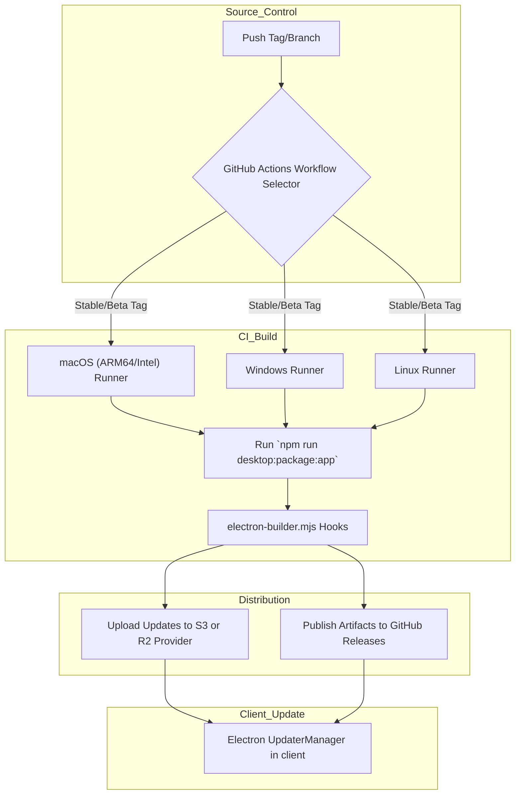

<!-- source: DeepWiki mcp.deepwiki.com · repo lobehub/lobehub · page 12.4 Desktop Application Distribution and OTA · fetched 2026-10-29 -->

# Desktop Application Distribution and OTA

<details>
<summary>Relevant source files</summary>

The following files were used as context for generating this wiki page:

- [.github/actions/desktop-build-setup/action.yml](.github/actions/desktop-build-setup/action.yml)
- [.github/actions/desktop-publish-s3/action.yml](.github/actions/desktop-publish-s3/action.yml)
- [.github/actions/desktop-upload-artifacts/action.yml](.github/actions/desktop-upload-artifacts/action.yml)
- [.github/actions/setup-env/action.yml](.github/actions/setup-env/action.yml)
- [.github/actions/setup-node-bun/action.yml](.github/actions/setup-node-bun/action.yml)
- [.github/actions/setup-node-pnpm/action.yml](.github/actions/setup-node-pnpm/action.yml)
- [.github/workflows/manual-build-desktop.yml](.github/workflows/manual-build-desktop.yml)
- [.github/workflows/pr-build-desktop.yml](.github/workflows/pr-build-desktop.yml)
- [.github/workflows/pr-build-docker.yml](.github/workflows/pr-build-docker.yml)
- [.github/workflows/release-desktop-beta.yml](.github/workflows/release-desktop-beta.yml)
- [.github/workflows/release-desktop-canary.yml](.github/workflows/release-desktop-canary.yml)
- [.github/workflows/release-desktop-stable.yml](.github/workflows/release-desktop-stable.yml)
- [.github/workflows/release-docker.yml](.github/workflows/release-docker.yml)
- [.github/workflows/release-model-bank.yml](.github/workflows/release-model-bank.yml)
- [.github/workflows/release-sdk.yml](.github/workflows/release-sdk.yml)
- [apps/cli/README.md](apps/cli/README.md)
- [apps/cli/src/auth/proactiveRefresh.ts](apps/cli/src/auth/proactiveRefresh.ts)
- [apps/cli/src/commands/connect.nativeRuntimes.test.ts](apps/cli/src/commands/connect.nativeRuntimes.test.ts)
- [apps/cli/src/device/systemInfo.test.ts](apps/cli/src/device/systemInfo.test.ts)
- [apps/cli/src/device/systemInfo.ts](apps/cli/src/device/systemInfo.ts)
- [apps/desktop/.prettierignore](apps/desktop/.prettierignore)
- [apps/desktop/THIRD_PARTY_NOTICES.md](apps/desktop/THIRD_PARTY_NOTICES.md)
- [apps/desktop/electron-builder.mjs](apps/desktop/electron-builder.mjs)
- [apps/desktop/external-runtime-deps.config.mjs](apps/desktop/external-runtime-deps.config.mjs)
- [apps/desktop/module-deps.config.mjs](apps/desktop/module-deps.config.mjs)
- [apps/desktop/native-deps.config.mjs](apps/desktop/native-deps.config.mjs)
- [apps/desktop/scripts/__tests__/buildCoreManifest.test.mjs](apps/desktop/scripts/__tests__/buildCoreManifest.test.mjs)
- [apps/desktop/scripts/__tests__/buildCoreV4.test.mjs](apps/desktop/scripts/__tests__/buildCoreV4.test.mjs)
- [apps/desktop/scripts/__tests__/computerUseHelper.test.mjs](apps/desktop/scripts/__tests__/computerUseHelper.test.mjs)
- [apps/desktop/scripts/__tests__/verifyFontListSigning.test.mjs](apps/desktop/scripts/__tests__/verifyFontListSigning.test.mjs)
- [apps/desktop/scripts/buildCoreManifest.mjs](apps/desktop/scripts/buildCoreManifest.mjs)
- [apps/desktop/scripts/buildCoreV4.mjs](apps/desktop/scripts/buildCoreV4.mjs)
- [apps/desktop/scripts/buildRendererManifest.mjs](apps/desktop/scripts/buildRendererManifest.mjs)
- [apps/desktop/scripts/computerUseHelper.mjs](apps/desktop/scripts/computerUseHelper.mjs)
- [apps/desktop/scripts/update-test/README.md](apps/desktop/scripts/update-test/README.md)
- [apps/desktop/scripts/verifyFontListSigning.mjs](apps/desktop/scripts/verifyFontListSigning.mjs)
- [apps/desktop/src/common/routes.ts](apps/desktop/src/common/routes.ts)
- [apps/desktop/src/main/__mocks__/node-mac-permissions.ts](apps/desktop/src/main/__mocks__/node-mac-permissions.ts)
- [apps/desktop/src/main/__mocks__/setup.ts](apps/desktop/src/main/__mocks__/setup.ts)
- [apps/desktop/src/main/appBrowsers.ts](apps/desktop/src/main/appBrowsers.ts)
- [apps/desktop/src/main/const/env.ts](apps/desktop/src/main/const/env.ts)
- [apps/desktop/src/main/const/store.ts](apps/desktop/src/main/const/store.ts)
- [apps/desktop/src/main/controllers/AuthCtr.ts](apps/desktop/src/main/controllers/AuthCtr.ts)
- [apps/desktop/src/main/controllers/BrowserWindowsCtr.ts](apps/desktop/src/main/controllers/BrowserWindowsCtr.ts)
- [apps/desktop/src/main/controllers/McpInstallCtr.ts](apps/desktop/src/main/controllers/McpInstallCtr.ts)
- [apps/desktop/src/main/controllers/NetworkProxyCtr.ts](apps/desktop/src/main/controllers/NetworkProxyCtr.ts)
- [apps/desktop/src/main/controllers/RemoteServerConfigCtr.ts](apps/desktop/src/main/controllers/RemoteServerConfigCtr.ts)
- [apps/desktop/src/main/controllers/RemoteServerSyncCtr.ts](apps/desktop/src/main/controllers/RemoteServerSyncCtr.ts)
- [apps/desktop/src/main/controllers/SystemCtr.ts](apps/desktop/src/main/controllers/SystemCtr.ts)
- [apps/desktop/src/main/controllers/UpdaterCtr.ts](apps/desktop/src/main/controllers/UpdaterCtr.ts)
- [apps/desktop/src/main/controllers/__tests__/AuthCtr.test.ts](apps/desktop/src/main/controllers/__tests__/AuthCtr.test.ts)
- [apps/desktop/src/main/controllers/__tests__/RemoteServerConfigCtr.test.ts](apps/desktop/src/main/controllers/__tests__/RemoteServerConfigCtr.test.ts)
- [apps/desktop/src/main/controllers/__tests__/SystemCtr.test.ts](apps/desktop/src/main/controllers/__tests__/SystemCtr.test.ts)
- [apps/desktop/src/main/controllers/__tests__/controllerDefaultExport.test.ts](apps/desktop/src/main/controllers/__tests__/controllerDefaultExport.test.ts)
- [apps/desktop/src/main/controllers/registry.ts](apps/desktop/src/main/controllers/registry.ts)
- [apps/desktop/src/main/core/App.ts](apps/desktop/src/main/core/App.ts)
- [apps/desktop/src/main/core/__tests__/App.test.ts](apps/desktop/src/main/core/__tests__/App.test.ts)
- [apps/desktop/src/main/core/browser/Browser.ts](apps/desktop/src/main/core/browser/Browser.ts)
- [apps/desktop/src/main/core/browser/BrowserManager.ts](apps/desktop/src/main/core/browser/BrowserManager.ts)
- [apps/desktop/src/main/core/browser/WindowThemeManager.ts](apps/desktop/src/main/core/browser/WindowThemeManager.ts)
- [apps/desktop/src/main/core/browser/__tests__/Browser.test.ts](apps/desktop/src/main/core/browser/__tests__/Browser.test.ts)
- [apps/desktop/src/main/core/browser/__tests__/BrowserManager.test.ts](apps/desktop/src/main/core/browser/__tests__/BrowserManager.test.ts)
- [apps/desktop/src/main/core/browser/__tests__/WindowThemeManager.test.ts](apps/desktop/src/main/core/browser/__tests__/WindowThemeManager.test.ts)
- [apps/desktop/src/main/core/infrastructure/BackendProxyProtocolManager.ts](apps/desktop/src/main/core/infrastructure/BackendProxyProtocolManager.ts)
- [apps/desktop/src/main/core/infrastructure/UpdaterManager.ts](apps/desktop/src/main/core/infrastructure/UpdaterManager.ts)
- [apps/desktop/src/main/core/infrastructure/__tests__/BackendProxyProtocolManager.test.ts](apps/desktop/src/main/core/infrastructure/__tests__/BackendProxyProtocolManager.test.ts)
- [apps/desktop/src/main/core/infrastructure/__tests__/UpdaterManager.test.ts](apps/desktop/src/main/core/infrastructure/__tests__/UpdaterManager.test.ts)
- [apps/desktop/src/main/env.ts](apps/desktop/src/main/env.ts)
- [apps/desktop/src/main/modules/screenCapture/WindowSourceService.test.ts](apps/desktop/src/main/modules/screenCapture/WindowSourceService.test.ts)
- [apps/desktop/src/main/modules/screenCapture/WindowSourceService.ts](apps/desktop/src/main/modules/screenCapture/WindowSourceService.ts)
- [apps/desktop/src/main/modules/updater/configs.ts](apps/desktop/src/main/modules/updater/configs.ts)
- [apps/desktop/src/main/modules/updater/electronUpdaterEngine.ts](apps/desktop/src/main/modules/updater/electronUpdaterEngine.ts)
- [apps/desktop/src/main/modules/updater/engine.ts](apps/desktop/src/main/modules/updater/engine.ts)
- [apps/desktop/src/main/services/__tests__/gatewayConnectionSrv.test.ts](apps/desktop/src/main/services/__tests__/gatewayConnectionSrv.test.ts)
- [apps/desktop/src/main/types/protocol.ts](apps/desktop/src/main/types/protocol.ts)
- [apps/desktop/src/main/types/store.ts](apps/desktop/src/main/types/store.ts)
- [apps/desktop/src/main/utils/logger.ts](apps/desktop/src/main/utils/logger.ts)
- [apps/desktop/src/main/utils/permissions.ts](apps/desktop/src/main/utils/permissions.ts)
- [apps/desktop/tsconfig.json](apps/desktop/tsconfig.json)
- [apps/desktop/vitest.config.mts](apps/desktop/vitest.config.mts)
- [packages/electron-client-ipc/src/events/index.ts](packages/electron-client-ipc/src/events/index.ts)
- [packages/electron-client-ipc/src/events/system.ts](packages/electron-client-ipc/src/events/system.ts)
- [packages/electron-client-ipc/src/events/update.ts](packages/electron-client-ipc/src/events/update.ts)
- [packages/electron-client-ipc/src/types/binary.ts](packages/electron-client-ipc/src/types/binary.ts)
- [packages/electron-client-ipc/src/types/index.ts](packages/electron-client-ipc/src/types/index.ts)
- [packages/electron-client-ipc/src/types/system.ts](packages/electron-client-ipc/src/types/system.ts)
- [packages/electron-client-ipc/src/types/update.ts](packages/electron-client-ipc/src/types/update.ts)
- [packages/electron-client-ipc/src/types/window.ts](packages/electron-client-ipc/src/types/window.ts)
- [packages/file-loaders/package.json](packages/file-loaders/package.json)
- [packages/file-loaders/test/setup.ts](packages/file-loaders/test/setup.ts)
- [packages/model-bank/tsconfig.json](packages/model-bank/tsconfig.json)
- [packages/model-bank/tsdown.config.ts](packages/model-bank/tsdown.config.ts)
- [scripts/cdnWorkflow/index.ts](scripts/cdnWorkflow/index.ts)
- [scripts/cdnWorkflow/utils.ts](scripts/cdnWorkflow/utils.ts)
- [scripts/clerk-to-betterauth/index.ts](scripts/clerk-to-betterauth/index.ts)
- [scripts/countEnWord.ts](scripts/countEnWord.ts)
- [scripts/docsWorkflow/autoCDN.ts](scripts/docsWorkflow/autoCDN.ts)
- [scripts/docsWorkflow/utils.ts](scripts/docsWorkflow/utils.ts)
- [scripts/electronWorkflow/buildDesktopChannel.ts](scripts/electronWorkflow/buildDesktopChannel.ts)
- [scripts/electronWorkflow/setDesktopVersion.ts](scripts/electronWorkflow/setDesktopVersion.ts)
- [scripts/replaceComponentImports.ts](scripts/replaceComponentImports.ts)
- [src/business/client/features/NavPanelUpgradeEntry.tsx](src/business/client/features/NavPanelUpgradeEntry.tsx)
- [src/features/Electron/connection/DeviceGateway.tsx](src/features/Electron/connection/DeviceGateway.tsx)
- [src/features/Electron/system/macWindowFullscreen.ts](src/features/Electron/system/macWindowFullscreen.ts)
- [src/features/Electron/system/useMacWindowFullscreen.ts](src/features/Electron/system/useMacWindowFullscreen.ts)
- [src/features/NavPanel/components/NavPanelDraggable.tsx](src/features/NavPanel/components/NavPanelDraggable.tsx)
- [src/features/Settings/about/features/Version.tsx](src/features/Settings/about/features/Version.tsx)
- [src/layout/GlobalProvider/ElectronAppStateSync.desktop.tsx](src/layout/GlobalProvider/ElectronAppStateSync.desktop.tsx)
- [src/services/electron/autoUpdate.ts](src/services/electron/autoUpdate.ts)
- [src/services/electron/binary.test.ts](src/services/electron/binary.test.ts)
- [src/services/electron/binary.ts](src/services/electron/binary.ts)
- [src/services/electron/gatewayConnection.ts](src/services/electron/gatewayConnection.ts)
- [src/services/electron/system.ts](src/services/electron/system.ts)
- [src/spa/BootShell/geometry.ts](src/spa/BootShell/geometry.ts)
- [src/store/electron/actions/app.ts](src/store/electron/actions/app.ts)

</details>


This page documents the distribution and over-the-air (OTA) update infrastructure of the LobeHub desktop application. It covers the Electron desktop build pipeline, configuration of `electron-builder`, platform-specific distribution nuances, the renderer OTA subsystem, and the release workflows for Beta, Canary, and Stable channels. The focus is to provide a comprehensive technical reference for the build and release pipelines, update flow, and how update-related components interoperate.

---

## Overview

LobeHub's desktop client is implemented with Electron and packaged for macOS (ARM64 and Intel), Windows, and Linux. The build pipeline integrates with `electron-vite` for compiling the multi-process app layers and `electron-builder` for cross-platform packaging, signing, and artifact generation. Updates leverage GitHub Actions continuous integration workflows and an external update server (S3/R2 or GitHub Releases) supporting channel-aware versioning and renderer process OTA updates.

---

## Electron Desktop Build Pipeline

### Build and Packaging Overview

The desktop app is split into three Electron processes compiled and bundled with `vite`:

- **Main process**: Node.js backend coordinating the app lifecycle
- **Preload scripts**: Context bridge and sandbox preload for rendering windows
- **Renderer process**: React-based web UI

The desktop app build is invoked mainly via npm scripts defined in `apps/desktop/package.json`:

| Script | Description |
|--------|-------------|
| `build:main` | Builds the Main, Preload, and Renderer code bundles with elevated Node memory limit [apps/desktop/package.json:15-17]() |
| `package:mac` | Uses `electron-builder` to package macOS binaries, supporting ARM64 and Intel architectures, including optional notarization [apps/desktop/package.json:38-39]() |
| `package:win` | Packages Windows binaries [apps/desktop/package.json:40-41]() |
| `package:linux` | Packages Linux binaries [apps/desktop/package.json:35]() |

Sources:
- [apps/desktop/package.json:15-17]()
- [apps/desktop/package.json:38-39]()
- [apps/desktop/package.json:40-41]()
- [apps/desktop/package.json:35]()

### `electron-builder` Configuration

The key configuration for electron-builder resides in `apps/desktop/electron-builder.mjs`. It provides platform targeting, packaging options, signing, and build hooks.

- **Signing and Notarization:** On macOS, if `CSC_LINK` (Apple certificate) is provided, notarization and signing are enabled. Otherwise, auto-discovery is disabled for unsigned builds to proceed [apps/desktop/electron-builder.mjs:126-131]().
- **Protocols:** The app registers custom URI schemes based on update channel (e.g., `lobehub-canary`, `lobehub-nightly`, or just `lobehub`) [apps/desktop/electron-builder.mjs:133-138]().
- **Platform-specific post-pack hooks:** For example, macOS copies `Assets.car` for vibrancy effects and removes unnecessary Electron Framework localizations to reduce package size [apps/desktop/electron-builder.mjs:300-340]().
- **Publish Configuration:** The `getPublishConfig` function determines the update provider. If `UPDATE_SERVER_URL` is set, it uses a `generic` provider pointing to the specified URL (with channel path appended). Otherwise, it falls back to the `github` provider [apps/desktop/electron-builder.mjs:97-124]().
- **Sparkle Integration:** For macOS, `electron-builder` can integrate with Sparkle for updates if `SPARKLE_ED_PUBLIC_KEY` is provided and other conditions are met. This involves building the Sparkle bridge addon and configuring the `sparkleFeedUrl` [apps/desktop/electron-builder.mjs:143-157]().

Sources:
- [apps/desktop/electron-builder.mjs:126-131]()
- [apps/desktop/electron-builder.mjs:133-138]()
- [apps/desktop/electron-builder.mjs:300-340]()
- [apps/desktop/electron-builder.mjs:97-124]()
- [apps/desktop/electron-builder.mjs:143-157]()

### Build Hooks and CLI Embedding

The build process embeds a separately built CLI bundle within the packaged app at `resources/bin/lobe-cli.js` using a `beforePack` hook. This involves:

1. Resolving symlinks in `node_modules` for native dependencies.
2. Running the CLI build process in `apps/cli` with minification.
3. Copying the resulting CLI code into the app resources for use by the Electron main process [apps/desktop/electron-builder.mjs:174-188]().

Sources:
- [apps/desktop/electron-builder.mjs:174-188]()

---

## Platform-Specific Distribution Details

### macOS

- Supports both ARM64 (Apple Silicon) and Intel architectures.
- The CI builds ARM64 and Intel packages on different runners.
- A dedicated merge step combines artifacts and metadata (`latest-mac.yml`) for multi-arch support, ensuring auto-update compatibility across macOS platforms [release-desktop-beta.yml:137-158]().
- Provisioning profiles can be applied via `MAC_PROVISIONING_PROFILE_BASE64` to enable specific entitlements like communication notifications [release-desktop-beta.yml:127-134]().

Sources:
- [release-desktop-beta.yml:137-158]()
- [release-desktop-beta.yml:127-134]()

### Windows

- Built on the `windows-2025` GitHub runner.
- Environmental variables `TEMP` and `TMP` are redirected to `C:\temp` to mitigate packaging and permission issues during build [release-desktop-beta.yml:174-176]().

Sources:
- [release-desktop-beta.yml:174-176]()

### Linux

- Built on `ubuntu-latest`.
- Generates `.AppImage` and `.deb` packages.
- Uses a generic update provider via update server URL [release-desktop-beta.yml:178-180]().

Sources:
- [release-desktop-beta.yml:178-180]()

---

## Renderer Over-the-Air (OTA) Updates

### Purpose and Roles

Electron apps traditionally update the entire binary. LobeHub adds fine-grained OTA for the renderer process, allowing updating the web UI (React app) independently from the main Electron binary. This permits quicker UI updates and smaller update payloads.

### RendererUpdateManager

- Central class managing the renderer OTA lifecycle.
- Responsible for downloading update manifests, downloading updated files, verifying integrity, and applying updates on demand [apps/desktop/src/main/core/infrastructure/rendererOta/RendererUpdateManager.ts]().
- Supports multiple channels (stable, beta, canary).
- Uses manifest files listing resource hashes and URLs to determine changes.

Sources:
- [apps/desktop/src/main/core/infrastructure/rendererOta/RendererUpdateManager.ts]()

### Update Flow

1. On startup or update check, `RendererUpdateManager` fetches the current manifest from the update server endpoint associated with the configured channel.
2. It compares the manifest with local cached versions.
3. New or updated files are downloaded.
4. Upon user trigger, the renderer OTA update is applied, reloading the renderer with new assets without impacting the main process.

### User Interaction Components

The UI layer includes an update notification component that listens for renderer OTA-related events:

- Shows update availability with version and release notes.
- Allows users to choose to upgrade immediately or later.
- Applies updates by invoking `rendererOtaService.applyNow()` [src/features/Electron/updater/UpdateNotification.tsx]().

Sources:
- [src/features/Electron/updater/UpdateNotification.tsx]()

---

## Release Workflows

LobeHub uses GitHub Actions workflows to automate builds, tests, and releases for the desktop app. These workflows handle versioning, multi-platform packaging, and deployment to GitHub releases and update servers.

### Release Channels and Triggers

| Channel | Trigger Condition | Version Tag Pattern | Description |
| ---------|-------------------|---------------------|-------------|
| **Stable** | GitHub Release without pre-release suffix (e.g., `v2.0.0`) or manual dispatch | `vX.Y.Z` | Production-ready builds pushed to all platforms with S3 update server integration [release-desktop-stable.yml:6-20]() |
| **Beta** | GitHub Release with pre-release suffix containing `beta`, `alpha`, or `rc` (e.g., `v2.0.0-beta.1`) | `vX.Y.Z-beta.N` | For testing upcoming features before stable release [release-desktop-beta.yml:6-10]() |
| **Canary** | Pushes to the `canary` branch (if commit type matches) or manual workflow dispatch | `vX.Y.Z-canary.N` | Automatic incremental patch builds for early testing [release-desktop-canary.yml:6-17]() |

Sources:
- [.github/workflows/release-desktop-stable.yml:6-20]()
- [.github/workflows/release-desktop-beta.yml:6-10]()
- [.github/workflows/release-desktop-canary.yml:6-17]()

### Versioning Logic for Canary

- The latest **stable** version tag is retrieved.
- The patch version is incremented by one.
- A build sequence number is appended like `-canary.N` where `N` increases for each canary build at the patch level.
- This ensures canary versions naturally follow the stable versioning and increment automatically on CI [release-desktop-canary.yml:135-168]().

Sources:
- [.github/workflows/release-desktop-canary.yml:135-168]()

### PR Build Workflow

A dedicated workflow `pr-build-desktop.yml` is triggered on pull request updates or label changes if the `trigger:build-desktop` label is present or the PR branch starts with `release/`.
- It performs code quality checks (lint, type-check).
- Determines a version in the format `0.0.0-nightly.pr{PR_NUMBER}.{CI_BUILD_NUMBER}` [pr-build-desktop.yml:78-85]().
- Builds desktop apps for macOS, Windows, and Linux using the `nightly` update channel [pr-build-desktop.yml:133-134]().
- macOS builds are provisionally signed for PRs [pr-build-desktop.yml:146-150]().

Sources:
- [.github/workflows/pr-build-desktop.yml:78-85]()
- [.github/workflows/pr-build-desktop.yml:133-134]()
- [.github/workflows/pr-build-desktop.yml:146-150]()

---

## Release Pipeline Data Flow



This pipeline encompasses build execution, artifact creation, upload to update servers, and client auto-update flow.

Sources:
- [apps/desktop/package.json:14-41]()
- [apps/desktop/electron-builder.mjs:10-140]()
- [.github/workflows/release-desktop-stable.yml:1-187]()
- [.github/workflows/release-desktop-beta.yml:1-182]()
- [.github/workflows/release-desktop-canary.yml:1-193]()

---

## Core Application Infrastructure and Update Integration

### Main Components

```mermaid
flowchart LR
  subgraph Main_Process
    APP["App.ts"] --> BM["BrowserManager.ts"]
    APP --> UM["UpdaterManager.ts"]
    APP --> BLM["BinaryManager.ts"]
    APP --> CUM["CoreUpdateManager.ts"]
  end

  subgraph Window_Layer
    BM --> B["Browser.ts"]
    B --> WSM["WindowStateManager.ts"]
    B --> WTM["WindowThemeManager.ts"]
  end

  subgraph IPC_and_Controllers
    B -- "webContents" --> IPC["ElectronIPCServer"]
    IPC --> UCTR["UpdaterCtr.ts"]
    UCTR --> UM
    IPC --> SYSC["SystemCtr.ts"]
  end

  subgraph Update_Subsystem
    UM --> RUM["RendererUpdateManager.ts"]
    UM -- "electron-updater" --> "Update Server"
    CUM -- "Core OTA" --> "Update Server"
  end
```

- `App.ts` initializes the app, creating window managers and update managers [apps/desktop/src/main/core/App.ts:70-81]().
- `UpdaterManager` handles app update checks and coordinates update controllers [apps/desktop/src/main/core/infrastructure/UpdaterManager.ts]().
- `CoreUpdateManager` handles core-only OTA updates, which update the Electron shell without a full app re-download [apps/desktop/src/main/core/infrastructure/coreOta/CoreUpdateManager.ts]().
- `RendererUpdateManager` manages differential over-the-air updates for the renderer process separately from the main app update process.
- IPC is used between renderer and main process, allowing update notifications and commands to flow.

Sources:
- [apps/desktop/src/main/core/App.ts]()
- [apps/desktop/src/main/core/App.ts:70-81]()
- [apps/desktop/src/main/core/infrastructure/UpdaterManager.ts]()
- [apps/desktop/src/main/core/infrastructure/coreOta/CoreUpdateManager.ts]()
- [apps/desktop/src/main/core/infrastructure/rendererOta/RendererUpdateManager.ts]()

### Window Management

- `BrowserManager.ts` manages the lifecycle of individual browser windows (`Browser.ts`) [apps/desktop/src/main/core/browser/BrowserManager.ts]().
- `Browser.ts` manages state persistence (`WindowStateManager.ts`) and native UI themes (`WindowThemeManager.ts`) [apps/desktop/src/main/core/browser/Browser.ts:171-176]().
- CORS headers are rewritten internally to allow unrestricted web requests from the renderer to third-party AI providers [apps/desktop/src/main/core/browser/Browser.ts:202-209]().
- The `Browser` class also handles unload confirmations, especially during OTA updates, to prevent data loss [apps/desktop/src/main/core/browser/Browser.ts:121-159]().

Sources:
- [apps/desktop/src/main/core/browser/BrowserManager.ts]()
- [apps/desktop/src/main/core/browser/Browser.ts:171-176]()
- [apps/desktop/src/main/core/browser/Browser.ts:202-209]()
- [apps/desktop/src/main/core/browser/Browser.ts:121-159]()

---

## Renderer OTA Update Workflow in GitHub Actions

The renderer OTA update workflow is factored out into a dedicated workflow file: `.github/workflows/release-desktop-renderer-ota.yml`. It is used as a reusable workflow entry point by the Beta, Canary, and Stable release workflows.

- The workflow downloads the built renderer assets.
- Generates a manifest describing file checksums and versions.
- Publishes the manifest and assets to the OTA update server.
- Supports `channel` input parameter to differentiate stable, beta, and canary update URLs.

This enables the renderer UI to receive OTA updates independent of full Electron app releases.

Sources:
- [.github/workflows/release-desktop-renderer-ota.yml]()
- [.github/workflows/release-desktop-beta.yml:74-82]()
- [.github/workflows/release-desktop-stable.yml:140-148]()
- [.github/workflows/release-desktop-canary.yml:86-94]()

---

## Summary

The desktop application distribution system is designed for efficient multi-platform packaging, code signing, and seamless release workflows with three release tracks: stable, beta, and canary. The build pipeline leverages `electron-builder` with advanced lifecycle hooks and embeds a CLI utility inside the main app binary for extended functionalities.

A key innovation is the renderer OTA update system enabled by `RendererUpdateManager`, which fetches renderer bundles and manifests at runtime and applies differential UI updates without requiring full client reinstall. Update workflows are automated in GitHub Actions to continuously deliver tested builds to users.

This layered update architecture improves update velocity, reliability, and user experience across platforms in an open-source Electron application framework.

---

# Appendix: Important Build Scripts from `apps/desktop/package.json`

| Script | Command | Description |
|---|---|---|
| `build:main` | `cross-env NODE_OPTIONS=--max-old-space-size=8192 npm run build:main:raw` | Compile main, preload and renderer processes |
| `package:mac` | `npm run build:main && electron-builder --mac --config electron-builder.mjs` | Build macOS app package |
| `package:win` | `npm run build:main && electron-builder --win --config electron-builder.mjs` | Build Windows app package |
| `package:linux` | `npm run build:main && electron-builder --linux --config electron-builder.mjs` | Build Linux app package |

Sources:
- [apps/desktop/package.json:13-45]()

---

# References

- `apps/desktop/electron-builder.mjs` lifecycle and platform hooks
- `apps/desktop/package.json` build scripts
- `apps/desktop/src/main/core/App.ts`, `BrowserManager.ts`, `Browser.ts`
- `apps/desktop/src/main/core/infrastructure/UpdaterManager.ts`
- `apps/desktop/src/main/core/infrastructure/rendererOta/RendererUpdateManager.ts`
- `.github/workflows/release-desktop-stable.yml`
- `.github/workflows/release-desktop-beta.yml`
- `.github/workflows/release-desktop-canary.yml`
- `.github/workflows/release-desktop-renderer-ota.yml`
- `src/features/Electron/updater/UpdateNotification.tsx`

---

**End of Section 12.4**

---

