<!-- source: DeepWiki mcp.deepwiki.com · repo lobehub/lobehub · page 13 Development Guide · fetched 2026-10-29 -->

# Development Guide

Relevant source files

The following files were used as context for generating this wiki page:

- [.agents/scripts/check/advisories.ts](.agents/scripts/check/advisories.ts)
- [.agents/scripts/check/base.ts](.agents/scripts/check/base.ts)
- [.agents/scripts/check/check.test.ts](.agents/scripts/check/check.test.ts)
- [.agents/scripts/check/fileSize.ts](.agents/scripts/check/fileSize.ts)
- [.agents/scripts/check/index.ts](.agents/scripts/check/index.ts)
- [.agents/scripts/check/report.ts](.agents/scripts/check/report.ts)
- [.agents/scripts/check/routing.ts](.agents/scripts/check/routing.ts)
- [.agents/scripts/check/size-gate.ts](.agents/scripts/check/size-gate.ts)
- [.agents/scripts/check/sizeGate.ts](.agents/scripts/check/sizeGate.ts)
- [.agents/skills/desktop/SKILL.md](.agents/skills/desktop/SKILL.md)
- [.agents/skills/react/SKILL.md](.agents/skills/react/SKILL.md)
- [.agents/skills/testing/references/desktop-controller-test.md](.agents/skills/testing/references/desktop-controller-test.md)
- [AGENTS.md](AGENTS.md)

This guide provides a high-level technical overview for developers contributing to or working with the LobeHub codebase. It covers the main areas pertinent to setting up the development environment, understanding project structure, workflow, testing, CI/CD, and key subsystems, with pointers to detailed child pages for in-depth information.

LobeHub is a modern open-source AI Agent platform, built as a TypeScript monorepo using Next.js, React, Electron for desktop, and a rich set of backend and agent system packages. This guide orients you on how the codebase is organized and how to engage with development efficiently.

---

## Project Structure and Conventions

The LobeHub repository is organized as a `pnpm` workspace monorepo, dividing code into multiple packages and apps. This separation supports scalable development and clear dependency boundaries.

- **`apps/`** contain deployable applications:
  - `desktop`: Electron-based desktop client.
  - `cli`: Command-line interface tool (`lh`) for managing agents, tasks, and more.
  - The primary Next.js web server app under `apps/server`.

- **`packages/`** hold reusable libraries and business logic encompassing:
  - Core backend like `database` (Drizzle ORM schemas and migrations),
  - AI agent runtimes (`agent-runtime`),
  - AI model definitions and API adapters (`model-bank`, `model-runtime`),
  - REST API server (`openapi`),
  - Plugins and tool engines (`builtin-tool-*`, `builtin-skills`),
  - Localization (`locales`),
  - Agent skills (`.agents`),
  - And others supporting RAG, memory, task systems, etc.

Within apps and packages, source code uses a roots-vs-features split: lightweight routing or app entry points under `src/routes` or `src/app`, with domain feature modules under `src/features/` for encapsulated business UI and logic. [AGENTS.md:30-31]()

Detailed directory layout, conventions for SPA routing, and .agents skill file ownership are documented in [Project Structure and Conventions](#13.1).

Sources:
- AGENTS.md:30-31

---

## Development Workflow

LobeHub development is complex given its multi-package monorepo and multiple deployment targets. The workflow is designed to support efficient local development, testing, and iteration.

- **Local environments** can be started in various modes for frontend SPA-only development (`bun run dev:spa`), full-stack (Next.js + Vite SPA concurrently via `bun run dev`), or standalone backend service (`pnpm --filter @lobechat/server dev`) [AGENTS.md:36-50]().

- The backend server usually runs on port `3010` in development for local integration with SPA, while production starts on port `3210`.

- Package management uses `pnpm`, with `bun` to run npm scripts and executable packages via `bunx` [AGENTS.md:70-74]().

- Code quality checks with `bun run check`, including linting, type checking, and testing, are required before commits. Regression tests must accompany bug fixes [AGENTS.md:77-82]().

- The Git workflow uses a `canary` branch for active development and `main` branch for stable releases. Branch naming and committing follow gitmoji conventions [AGENTS.md:63-68]().

- i18n keys are authored in English and Chinese by hand; other locales are auto-translated daily in CI.

- Acceptance testing governs product verification before merging PRs [AGENTS.md:88-94]().

For setup, scripts, and database migration workflows, see [Development Workflow](#13.2).

Sources:
- AGENTS.md:36-50
- AGENTS.md:63-68
- AGENTS.md:70-74
- AGENTS.md:77-82
- AGENTS.md:88-94

---

## Testing Strategy

LobeHub utilizes multiple testing frameworks for comprehensive quality assurance:

- **Vitest** is the main unit and integration test runner configured in `vitest.config.mts`.
- **Playwright** and **Cucumber** provide end-to-end testing with e2e scenarios and probes under the `e2e/` directory [AGENTS.md:33]().
- Tests run in a Node + happy-dom environment for DOM emulation.
- Coverage results use the `v8` provider with reports uploaded to Codecov in CI.
- Utilities support mocking, fixtures, and test organization. For example, desktop controller unit tests are placed beside the controller file, e.g., `McpCtr.test.ts` for `McpCtr.ts` [references/desktop-controller-test.md:8-10]().

For detailed setup, running tests, and coverage reports, see [Testing Strategy](#13.3).

Sources:
- AGENTS.md:33
- .agents/skills/testing/references/desktop-controller-test.md:8-10

---

## Continuous Integration / Deployment (CI/CD)

The project employs GitHub Actions workflows for automating builds, tests, releases, and code quality:

- Release automation workflows support periodic publishing via version tags, changelog generation, and artifact releases.
- CI runs test matrices, bundle size checks, and linting on PRs.
- Automatic i18n update jobs keep translations current.
- Special workflows handle desktop beta/nightly builds, Docker image publishing, database migrations, and Lighthouse audits.
- A custom Claude Code workflow automates PR reviewer assignment based on code analysis and team rules.

Details on each workflow and required secrets can be found in [CI/CD Workflows Reference](#13.4).

---

## Contributor Guide and Code Quality

Contributing is structured to ensure code quality and maintainability:

- PR review processes emphasize both automated checks and manual deep review for UX flows and critical fixes.
- Commit messages follow conventional gitmoji prefixes and branch naming conventions [AGENTS.md:67]().
- ESLint, Stylelint, and Prettier enforce consistent code style with format-on-save in VSCode.
- The changelog is updated with each release cycle, and i18n translations are integrated into the workflow.
- Code ownership and responsibilities are defined, with `AGENTS.md` and skill files governing certain domains [AGENTS.md:24]().
- The `bun run check` script is used for quality checks, including linting, testing, and type checking [AGENTS.md:77-83](). It can also detect new `.test.tsx` files and advise against them, preferring `.test.ts` for complex logic [advisories.ts:49]().
- File size limits (e.g., `MAX_FILE_LINES = 800`) are enforced for source files, with advisories for growing legacy files and errors for new or newly oversized files [fileSize.ts:8-10, 91-99]().

For full contributing rules and coding standards, see [Contributing Guidelines](#13.5).

Sources:
- AGENTS.md:24
- AGENTS.md:67
- AGENTS.md:77-83
- .agents/scripts/check/advisories.ts:49
- .agents/scripts/check/fileSize.ts:8-10
- .agents/scripts/check/fileSize.ts:91-99

---

## Command Line Interface (CLI)

The `lh` CLI tool located in `apps/cli` offers extensive commands for managing the platform:

- Authentication (`login/logout`),
- Device connection and daemon control,
- Agent, bot, session, task, goal, verification, and evaluation commands,
- Heterogeneous agent operations and artifact management,
- Shell completion and man pages.

This CLI enables scripted interaction with LobeHub backend and agents, useful for automation and debugging.

For full CLI command documentation, see [CLI Tool (lh)](#13.6).

---

## OpenAPI REST API Server

LobeHub provides an OpenAPI-compliant HTTP REST backend server in `packages/openapi`:

- Auth middleware supports OIDC and API key authentication.
- Routes include OpenAI-, Anthropic-, and heterogeneous-agent relays.
- A service layer abstracts business logic.
- An SDK package enables easy external client integration.

Developers can extend or interact with this API for custom applications.

Refer to [OpenAPI and External HTTP API](#13.7) for full details.

---

## Agent Skills System

The `.agents` directory maintains AI agent skill specifications as markdown files (`SKILL.md`):

- Skills cover various domains such as React, TypeScript, testing, desktop features, UX, state management with Zustand, and Upstash workflows [AGENTS.md:20-21]().
- The skills audit process ensures quality and correctness.
- Special assets for acceptance testing and chaos engineering live here.
- New skills should be authored following the documented conventions. For example, the `react` skill provides guidelines for styling, component priority, state management, render performance, and layout [react/SKILL.md:9-82](). The `desktop` skill details how to add new desktop features, including creating controllers, defining IPC types, and implementing renderer services [desktop/SKILL.md:17-65]().

This system enables modular and composable AI agent capabilities.

See [Agent Skills System (.agents)](#13.8) for how to author and maintain skills.

Sources:
- AGENTS.md:20-21
- .agents/skills/react/SKILL.md:9-82
- .agents/skills/desktop/SKILL.md:17-65

---

## Bridging Natural Language Concepts to Code Entities

Below are two diagrams to help developers understand the mapping between common natural language domain concepts and their associated code parts in LobeHub.

### Diagram 1: Natural Language → Code Entity Space (Core Developer View)

```mermaid
graph TD
    subgraph "Natural Language Concepts"
        AgentConfig["Agent Configuration"]
        ChatUI["Chat User Interface"]
        DesktopApp["Desktop Application"]
        DBLayer["Database & ORM"]
        AgentSkills["Agent Skills & Instructions"]
    end

    subgraph "Code Entities"
        LobeAgentConfig["LobeAgentConfig Type & Schema"]
        AgentSettingFeature["src/features/AgentSetting"]
        ConversationFeature["src/features/Conversation"]
        SpaWebEntry["src/spa/entry.web.tsx"]
        DesktopMainSrc["apps/desktop/src/main"]
        SpaDesktopEntry["src/spa/entry.desktop.tsx"]
        DrizzleDatabase["packages/database"]
        DrizzleMigrations["drizzle-kit migrations"]
        AgentsFolder[".agents/skills/"]
        SkillMdFile["SKILL.md Instruction Sets"]
    end

    AgentConfig --> LobeAgentConfig
    AgentConfig --> AgentSettingFeature
    ChatUI --> ConversationFeature
    ChatUI --> SpaWebEntry
    DesktopApp --> DesktopMainSrc
    DesktopApp --> SpaDesktopEntry
    DBLayer --> DrizzleDatabase
    DBLayer --> DrizzleMigrations
    AgentSkills --> AgentsFolder
    AgentSkills --> SkillMdFile
```

### Diagram 2: Natural Language → Code Entity Space (Development Workflow View)

```mermaid
graph TD
    subgraph "Natural Language Space"
        DevEnv["Development Environment"]
        DevScripts["Development Scripts"]
        DBSetup["Database Setup"]
        CodeStyle["Code Style & Lint"]
        Acceptance["Product Acceptance"]
        i18n["Localization Workflow"]
        GitWorkflow["Git & PR Workflow"]
        Testing["Testing Strategy"]
        FileSizeLimits["File Size Limits"]
    end

    subgraph "Code Entity Space"
        DevEnvScripts["package.json scripts"]
        DrizzleMigrations["drizzle-kit migration scripts"]
        ESLintConfig[".eslintrc.js & stylelint config"]
        AcceptanceSkill["acceptance skill in .agents"]
        LocalesFiles["packages/locales/src/default/"]
        GitConventions["AGENTS.md & CLAUDE.md"]
        BunScripts["bun run check"]
        VitestConfig["vitest.config.mts"]
        PlaywrightE2E["e2e/ directory"]
        FileSizeCheck["fileSize.ts & sizeGate.ts"]
    end

    DevEnv --> DevEnvScripts
    DevScripts --> BunScripts
    DBSetup --> DrizzleMigrations
    CodeStyle --> ESLintConfig
    Acceptance --> AcceptanceSkill
    i18n --> LocalesFiles
    GitWorkflow --> GitConventions
    Testing --> VitestConfig
    Testing --> PlaywrightE2E
    FileSizeLimits --> FileSizeCheck
```

---

## Summary and Further Reading

This page has introduced the essentials of LobeHub’s development setup, architecture, and workflows. It connects high-level concepts to code modules to facilitate efficient new contributor onboarding and productive development.

For comprehensive technical details, setup guides, and references, consult the respective child pages:

- [Project Structure and Conventions](#13.1)
- [Development Workflow](#13.2)
- [Testing Strategy](#13.3)
- [CI/CD Workflows Reference](#13.4)
- [Contributing Guidelines](#13.5)
- [CLI Tool (lh)](#13.6)
- [OpenAPI and External HTTP API](#13.7)
- [Agent Skills System (.agents)](#13.8)

---

### Sources

- AGENTS.md:1-110
- .agents/scripts/check/advisories.ts:49
- .agents/scripts/check/fileSize.ts:8-10
- .agents/scripts/check/fileSize.ts:91-99
- .agents/skills/desktop/SKILL.md:17-65
- .agents/skills/react/SKILL.md:9-82
- .agents/skills/testing/references/desktop-controller-test.md:8-10

---

