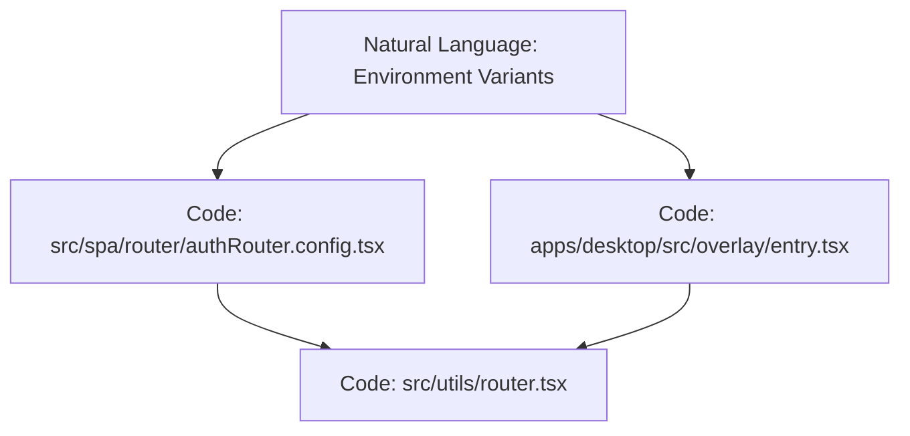
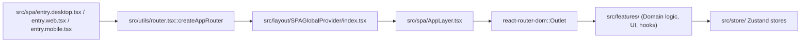

<!-- source: DeepWiki mcp.deepwiki.com · repo lobehub/lobehub · page 13.1 Project Structure and Conventions · fetched 2026-10-29 -->

# Project Structure and Conventions

<details>
<summary>Relevant source files</summary>

The following files were used as context for generating this wiki page:

- [.agents/scripts/check/advisories.ts](.agents/scripts/check/advisories.ts)
- [.agents/scripts/check/base.ts](.agents/scripts/check/base.ts)
- [.agents/scripts/check/check.test.ts](.agents/scripts/check/check.test.ts)
- [.agents/scripts/check/fileSize.ts](.agents/scripts/check/fileSize.ts)
- [.agents/scripts/check/index.ts](.agents/scripts/check/index.ts)
- [.agents/scripts/check/report.ts](.agents/scripts/check/report.ts)
- [.agents/scripts/check/routing.ts](.agents/scripts/check/routing.ts)
- [.agents/scripts/check/size-gate.ts](.agents/scripts/check/size-gate.ts)
- [.agents/scripts/check/sizeGate.ts](.agents/scripts/check/sizeGate.ts)
- [.agents/skills/desktop/SKILL.md](.agents/skills/desktop/SKILL.md)
- [.agents/skills/react/SKILL.md](.agents/skills/react/SKILL.md)
- [.agents/skills/testing/references/desktop-controller-test.md](.agents/skills/testing/references/desktop-controller-test.md)
- [.stylelintignore](.stylelintignore)
- [AGENTS.md](AGENTS.md)
- [apps/desktop/src/overlay/entry.tsx](apps/desktop/src/overlay/entry.tsx)
- [packages/python-interpreter/src/__tests__/interpreter.test.ts](packages/python-interpreter/src/__tests__/interpreter.test.ts)
- [packages/python-interpreter/src/__tests__/worker.test.ts](packages/python-interpreter/src/__tests__/worker.test.ts)
- [packages/python-interpreter/src/index.ts](packages/python-interpreter/src/index.ts)
- [packages/python-interpreter/src/interpreter.ts](packages/python-interpreter/src/interpreter.ts)
- [packages/python-interpreter/src/types.ts](packages/python-interpreter/src/types.ts)
- [packages/python-interpreter/src/worker.ts](packages/python-interpreter/src/worker.ts)
- [packages/python-interpreter/vitest.config.mts](packages/python-interpreter/vitest.config.mts)
- [plugins/vite/vercelSkewProtection.ts](plugins/vite/vercelSkewProtection.ts)
- [public/_dangerous_local_dev_proxy.html](public/_dangerous_local_dev_proxy.html)
- [scripts/copySpaBuild.test.ts](scripts/copySpaBuild.test.ts)
- [scripts/copySpaBuildCore.ts](scripts/copySpaBuildCore.ts)
- [src/components/BootErrorBoundary/index.test.tsx](src/components/BootErrorBoundary/index.test.tsx)
- [src/components/BootErrorBoundary/index.tsx](src/components/BootErrorBoundary/index.tsx)
- [src/components/DebugNode.tsx](src/components/DebugNode.tsx)
- [src/components/Error/index.tsx](src/components/Error/index.tsx)
- [src/features/AgentMockDevtools/index.tsx](src/features/AgentMockDevtools/index.tsx)
- [src/features/SkillStore/index.tsx](src/features/SkillStore/index.tsx)
- [src/initialize.test.ts](src/initialize.test.ts)
- [src/initialize.ts](src/initialize.ts)
- [src/layout/GlobalProvider/FaviconProvider.tsx](src/layout/GlobalProvider/FaviconProvider.tsx)
- [src/layout/SPAGlobalProvider/index.test.tsx](src/layout/SPAGlobalProvider/index.test.tsx)
- [src/layout/SPAGlobalProvider/index.tsx](src/layout/SPAGlobalProvider/index.tsx)
- [src/spa/entry.auth.tsx](src/spa/entry.auth.tsx)
- [src/spa/entry.desktop.tsx](src/spa/entry.desktop.tsx)
- [src/spa/entry.mobile.tsx](src/spa/entry.mobile.tsx)
- [src/spa/entry.popup.tsx](src/spa/entry.popup.tsx)
- [src/spa/entry.web.tsx](src/spa/entry.web.tsx)
- [src/spa/initialize/bootstrap.ts](src/spa/initialize/bootstrap.ts)
- [src/spa/router/authRouter.config.tsx](src/spa/router/authRouter.config.tsx)
- [src/utils/chunkError.ts](src/utils/chunkError.ts)
- [src/utils/router.tsx](src/utils/router.tsx)
- [tsconfig.json](tsconfig.json)
- [vitest.config.mts](vitest.config.mts)

</details>


This page details the directory layout, naming conventions, code organization principles, SPA entry points, routing system conventions, and special documentation usage in LobeHub. It aims to provide a comprehensive technical description for engineers working on or contributing to the codebase.

LobeHub is an open-source AI Agent framework designed with modularity and extensibility in mind, supporting multi-model AI integrations, plugin systems (MCP), TTS/STT, knowledge bases, user memory, and varied deployment modes (web, desktop, CLI).

---

## 1. Monorepo Package Structure

LobeHub adopts a **pnpm workspace monorepo** structure to manage multiple apps and shared libraries efficiently.

### 1.1 Applications (`apps/`)

The main user-facing and infrastructure entry points reside here.

| Path | Description |
|---|---|
| `apps/desktop` | Electron-based desktop application shell wrapping the SPA UI. |
| `apps/cli` | Command-line interface for local and remote management. |
| `apps/share` | Standalone app for content sharing functionality. |
| `apps/workbench` | Standalone developer/features workbench environment. |

These apps bootstrap either Next.js servers (e.g., `apps/server`) or Electron and CLI runtimes.

### 1.2 Shared Packages (`packages/`)

Reusable and core logic is centralized here. Key packages include:

| Package | Responsibility |
|---|---|
| `packages/database` | Drizzle ORM schemas, migrations, and repositories for the PostgreSQL DB. |
| `packages/agent-runtime` | Core AI Agent execution engine and lifecycle management. |
| `packages/agent-tracing` | Recording and playback of agent executions for debugging. |
| `packages/openapi` | Hono-based REST API server and SDK for external integrations. |
| `packages/env` | Environment variable typing and configuration helpers. |
| `packages/locales` | Internationalization sources and localization key management. |
| `packages/business/*` | Business domain-specific packages wired into the main system. |
| `packages/python-interpreter` | Python interpreter for agent execution. |

This modularization enables isolation of complex domains and shared code reuse.

Sources: [AGENTS.md:25-31](), [AGENTS.md:67-75](), [packages/python-interpreter/src/interpreter.ts:1-10](), [packages/python-interpreter/src/worker.ts:1-10](), [packages/python-interpreter/src/types.ts:1-10]()

---

## 2. Source Code Organization

The main codebase is organized under `src/` with clear separation between route definitions, domain features, and SPA-specific code.

### 2.1 Routes vs Features Split

- **`src/app/`** or **`src/routes/`**: These folders contain *route segment files* such as Next.js layouts, pages, error and loading components. They act as thin shells responsible for composing UI from features and are tightly aligned with URL segments.
- **`src/features/`**: Contains reusable, domain-specific React components, hooks, stores, and utilities grouped by business concern (e.g., Chat, Agent, Workspace). Features export clean API surfaces via their `index.ts`.
- **`src/services/`** and **`src/store/`**: Client-side API wrappers and Zustand store slices provide declarative state and service layer abstractions.

This "Roots vs Features" pattern improves maintainability and separation of concerns.

Sources: [AGENTS.md:27-30]()

### 2.2 SPA Entry Points

Multiple SPA entry points target different runtimes and contexts, offering optimized configurations and router setups.

| Entry Point | Platform |
|---|---|
| `src/spa/entry.web.tsx` | Single Page Application entry for standard web browsers. |
| `src/spa/entry.mobile.tsx` | Mobile-optimized SPA entry point. |
| `src/spa/entry.desktop.tsx` | Electron desktop SPA entry point. |
| `src/spa/entry.auth.tsx` | Standalone SPA entry for authentication flows. |
| `src/spa/entry.popup.tsx` | Secondary popup windows in Electron or browser. |

Sources: [src/spa/entry.web.tsx:1-10](), [src/spa/entry.mobile.tsx:1-10](), [src/spa/entry.desktop.tsx:1-10](), [src/spa/entry.auth.tsx:1-10](), [src/spa/entry.popup.tsx:1-10]()

### 2.3 Routing Conventions and Variants

LobeHub implements a sophisticated **`[variants]` dynamic segment routing system** to provide platform-specific layouts and route sets:

- This system exists primarily under `src/app/(variants)/` where variants may be `desktop`, `web`, or `mobile`.
- It enables loading different UI shells and logic based on the runtime (Electron desktop vs web browser).
- Example: `src/spa/router/authRouter.config.tsx` defines desktop-specific route trees with lazy loading and error boundaries, composing shared route sets extracted in `desktopRouter.shared.tsx`.
- The SPA uses `react-router` with dynamic element loading via `dynamicElement()` and `dynamicLayout()` utilities to defer component instantiation until mounted.

Sources: [src/utils/router.tsx:102-117](), [src/utils/router.tsx:123-138](), [src/spa/router/authRouter.config.tsx:1-10]()

### 2.4 SPA Routing and Data Flow

The following diagram illustrates how SPA routing interfaces with features and state management:

```mermaid
graph TD
  subgraph SPA Root "src/spa/"
    Entrypoint["entry.web.tsx / entry.desktop.tsx / entry.mobile.tsx"]
    Router["src/spa/router/"]
  end

  subgraph Routes "src/app/(variants)/"
    Layout["layout.tsx (route shells)"]
    Pages["page.tsx"]
  end

  subgraph Features "src/features/"
    Components["UI Components"]
    Hooks["Custom Hooks"]
  end

  subgraph State "src/store/"
    ZustandStore["Zustand Slices"]
  end

  Entrypoint --> Router
  Router --> Layout
  Layout --> Pages
  Pages --> Components
  Components --> Hooks
  Hooks --> ZustandStore
```

This flow supports resolution of pages/routes based on variant and workspace context, and structured UI composition.

Sources: [AGENTS.md:25-32](), [src/utils/router.tsx:172-207]()

---

## 3. Naming Conventions and Code Organization Principles

- **File and Folder Names:**
  - Route files under `src/app` use Next.js conventions: `layout.tsx`, `page.tsx`, `loading.tsx`, `error.tsx`.
  - Feature folders and files are kebab-case or camelCase as appropriate, encapsulating domain logic.
  - Store slices follow naming like `chatStore`, `agentStore`.
- **Component Priorities:**
  1. Reusable UI components under `src/components`.
  2. Domain-specific components under `src/features`.
  3. Ant Design and `@lobehub/ui` custom wrappers provide design consistency.
  The `react` skill provides detailed guidance on component selection and styling [AGENTS.md:20-22](), [AGENTS.md:25-42]().
- **Dynamic Route Routing:**
  - Use `[param]` for dynamic segments.
  - Variant-based routing uses `([variant])` for dynamic segment matching different platforms.
- **Lazy Loading:**
  - All route components are lazy loaded with `dynamicElement()` to defer network and render cost.
- **Error Boundaries:**
  - Routes are wrapped with error boundary components to locally catch and present errors. The `ErrorBoundary` component in `src/utils/router.tsx` handles route-level errors, while `BootErrorBoundary` in `src/components/BootErrorBoundary/index.tsx` handles errors during SPA bootstrap, including hard reloads for chunk load errors [src/utils/router.tsx:145-166](), [src/components/BootErrorBoundary/index.tsx:25-30]().
- **State Slices:**
  - Zustand stores are composed with slices for scalability (`chatSlice`, `agentSlice`, etc.)

Sources: [AGENTS.md:16-32](), [AGENTS.md:20-22](), [AGENTS.md:25-42](), [src/utils/router.tsx:145-166](), [src/components/BootErrorBoundary/index.tsx:25-30]()

---

## 4. The `src/spa/routes/` vs `src/features/` Split

- **`src/spa/routes/`**:
  - Contains thin route segment modules that glue feature UI pieces to URL paths.
  - Routes manage page-level layout and define error/loading boundaries.
  - The `spa-routes` skill provides guidance on SPA navigation, route ownership, and router configuration [AGENTS.md:35-36]().
- **`src/features/`**:
  - Implements all heavy domain business logic, reusable UI components, hooks, and stores.
  - Features expose explicit API through `index.ts` for ease of import.
  - Keeps routing concerns out of business logic.

This decoupling ensures routing changes do not force feature layer modifications, facilitating independent evolution.

Sources: [AGENTS.md:27-30](), [AGENTS.md:35-36]()

---

## 5. SPA Entry Points and Their Roles

LobeHub defines several SPA entry points tailored for various runtime setups:

| Entry Point Path | Role and Description |
|---|---|
| `src/spa/entry.web.tsx` | Main web SPA with full desktop browser support. |
| `src/spa/entry.mobile.tsx` | Mobile-optimized SPA with a limited route subset. |
| `src/spa/entry.desktop.tsx` | Electron-powered desktop SPA, optimized for native shell. |
| `src/spa/entry.auth.tsx` | SPA dedicated to authentication workflows. |
| `src/spa/entry.popup.tsx` | Secondary popup windows for Electron or browser usage. |

These entry points are configured to copy specific assets during the build process. For example, `copySpaBuildCore.ts` handles copying assets like `assets`, `devtools`, `i18n`, `model-bank`, `shiki`, and `vendor` directories, as well as root files like favicons, to the respective public SPA directories (`public/_spa`, `public/_spa-auth`, etc.) [scripts/copySpaBuildCore.ts:4-18]().

The `SPAGlobalProvider` component in `src/layout/SPAGlobalProvider/index.tsx` acts as a global wrapper for all SPA entry points, providing common contexts like `AuthProvider`, `MarketAuthProvider`, `QueryProvider`, `AppTheme`, and `Locale` [src/layout/SPAGlobalProvider/index.tsx:78-141](). It also hosts imperative UI components like `ModalHost`, `ToastHost`, and `ContextMenuHost` [src/layout/SPAGlobalProvider/index.tsx:111-113]().

Sources: [AGENTS.md:31-34](), [scripts/copySpaBuildCore.ts:4-18](), [src/layout/SPAGlobalProvider/index.tsx:78-141](), [src/layout/SPAGlobalProvider/index.tsx:111-113]()

---

## 6. `AGENTS.md` and `CLAUDE.md` Documentation Conventions

- **`AGENTS.md`** contains repository-wide architecture guidelines, workflows, and technical rules specifically for AI coding agent features and collaboration.
  - It explains the strict code ownership model (e.g., backend code in `apps/server/src`, frontend shells in `src/app`, SPA lazy routes in `src/spa`, state management, and workspace-aware routing) [AGENTS.md:21-31]().
  - It prescribes development workflows, quality checks, branch strategies, and commit message formats [AGENTS.md:39-75]().
  - Includes references to skills comprising detailed implementation rules (React component handling, routing, i18n, UX design) [AGENTS.md:15-30]().
  - Describes SPA route consistency tests and conventions on `react-router` usage [AGENTS.md:35-36]().
  - The `check` script, defined in `.agents/scripts/check/index.ts`, is the agent CLI for quality checks, including linting, testing, and type-checking [AGENTS.md:83-84](), [.agents/scripts/check/index.ts:21-22]().
- **`CLAUDE.md`** currently contains only a reference back to `AGENTS.md` indicating shared or inherited conventions [CLAUDE.md:1]().

These markdown files serve as living documents around coding standards and AI agent usage in development.

Sources: [AGENTS.md:1-105](), [CLAUDE.md:1](), [AGENTS.md:21-31](), [AGENTS.md:39-75](), [AGENTS.md:15-30](), [AGENTS.md:35-36](), [AGENTS.md:83-84](), [.agents/scripts/check/index.ts:21-22]()

---

## Diagrams Bridging Natural Language to Code Entities

### 6.1 SPA Route Variant System


Sources: [src/spa/router/authRouter.config.tsx:1-10](), [apps/desktop/src/overlay/entry.tsx:1-5](), [src/utils/router.tsx:1-215]()

### 6.2 SPA Entry Points to Router and Features


Sources: [src/spa/entry.desktop.tsx:1-10](), [src/spa/entry.web.tsx:1-10](), [src/spa/entry.mobile.tsx:1-10](), [src/utils/router.tsx:195-207](), [src/layout/SPAGlobalProvider/index.tsx:78-141]()

---

# Summary

- The repository is a pnpm monorepo with `apps/` for key applications and `packages/` for shared libraries.
- The main code lives under `src/`, split between route definition shells (`src/app`, `src/routes`) and feature domain logic (`src/features`).
- SPA entry points in `src/spa/` provide different runtime targets (desktop, mobile, auth).
- Advanced `[variants]` routing enables platform-adaptive UIs.
- `AGENTS.md` provides authoritative guidelines on repository-wide architecture, branching, coding styles, and AI agent development conventions.
- `CLAUDE.md` currently redirects to `AGENTS.md` for coding agent conventions.
- Routing uses `react-router` with lazy-loaded dynamic elements to optimize performance.
- Zustand slices and services are leveraged to organize client state and interactions efficiently.

This structure supports robust development, clear ownership, and extensibility of AI Agent capabilities across multiple deployment platforms.

---

**Sources:**
[AGENTS.md:1-105](),
[CLAUDE.md:1](),
[src/utils/router.tsx:1-215](),
[src/layout/SPAGlobalProvider/index.tsx:1-146](),
[src/components/BootErrorBoundary/index.tsx:1-153](),
[src/initialize.ts:1-44](),
[scripts/copySpaBuildCore.ts:1-61](),
[.agents/scripts/check/index.ts:1-171](),
[.agents/scripts/check/check.test.ts:1-180](),
[vitest.config.mts:1-169](),
[tsconfig.json:1-82](),
[.agents/skills/react/SKILL.md:1-89]()

---

