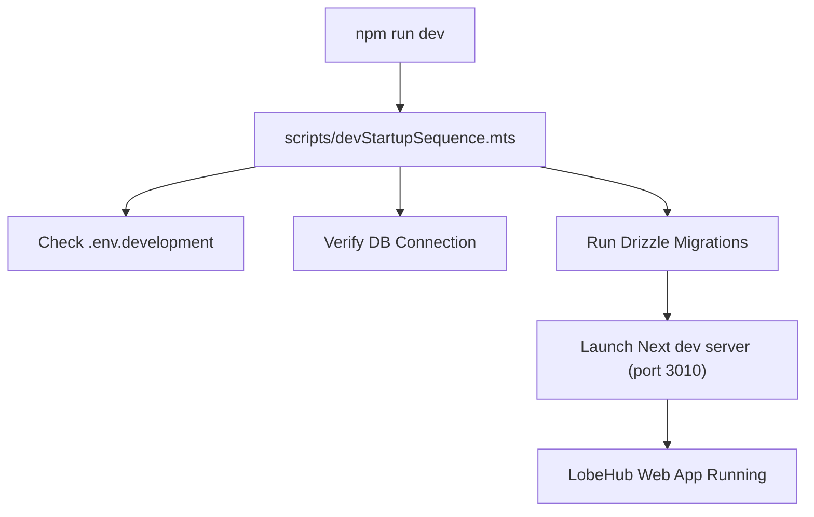
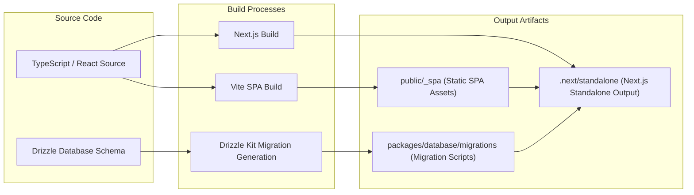

<!-- source: DeepWiki mcp.deepwiki.com · repo lobehub/lobehub · page 13.2 Development Workflow · fetched 2026-10-29 -->

# Development Workflow

<details>
<summary>Relevant source files</summary>

The following files were used as context for generating this wiki page:

- [.bunfig.toml](.bunfig.toml)
- [.github/scripts/create-failure-issue.js](.github/scripts/create-failure-issue.js)
- [.github/workflows/auto-i18n.yml](.github/workflows/auto-i18n.yml)
- [.github/workflows/auto-tag-release.yml](.github/workflows/auto-tag-release.yml)
- [.github/workflows/lighthouse.yml](.github/workflows/lighthouse.yml)
- [.github/workflows/release.yml](.github/workflows/release.yml)
- [.github/workflows/sync-database-schema.yml](.github/workflows/sync-database-schema.yml)
- [.github/workflows/sync-main-to-canary.yaml](.github/workflows/sync-main-to-canary.yaml)
- [.github/workflows/sync.yml](.github/workflows/sync.yml)
- [.github/workflows/test.yml](.github/workflows/test.yml)
- [.gitignore](.gitignore)
- [.npmrc](.npmrc)
- [.prettierignore](.prettierignore)
- [.vscode/settings.json](.vscode/settings.json)
- [CHANGELOG.md](CHANGELOG.md)
- [README.md](README.md)
- [README.zh-CN.md](README.zh-CN.md)
- [apps/cli/.npmrc](apps/cli/.npmrc)
- [apps/cli/pnpm-workspace.yaml](apps/cli/pnpm-workspace.yaml)
- [apps/desktop/.npmrc](apps/desktop/.npmrc)
- [apps/desktop/package.json](apps/desktop/package.json)
- [apps/desktop/pnpm-lock.yaml](apps/desktop/pnpm-lock.yaml)
- [apps/desktop/pnpm-workspace.yaml](apps/desktop/pnpm-workspace.yaml)
- [apps/desktop/src/main/controllers/AuvCtr.ts](apps/desktop/src/main/controllers/AuvCtr.ts)
- [apps/desktop/src/main/services/__tests__/auvSrv.test.ts](apps/desktop/src/main/services/__tests__/auvSrv.test.ts)
- [apps/desktop/src/main/services/auvSrv.ts](apps/desktop/src/main/services/auvSrv.ts)
- [changelog/CHANGELOG.v0.md](changelog/CHANGELOG.v0.md)
- [changelog/CHANGELOG.v1.md](changelog/CHANGELOG.v1.md)
- [changelog/v0.json](changelog/v0.json)
- [changelog/v1.json](changelog/v1.json)
- [changelog/v2.json](changelog/v2.json)
- [codecov.yml](codecov.yml)
- [docs/changelog/2025-03-02-new-models.zh-CN.mdx](docs/changelog/2025-03-02-new-models.zh-CN.mdx)
- [docs/changelog/2025-06-08-claude-4.zh-CN.mdx](docs/changelog/2025-06-08-claude-4.zh-CN.mdx)
- [docs/changelog/2025-07-08-mcp-market.zh-CN.mdx](docs/changelog/2025-07-08-mcp-market.zh-CN.mdx)
- [docs/changelog/2025-09-08-gemini.zh-CN.mdx](docs/changelog/2025-09-08-gemini.zh-CN.mdx)
- [docs/changelog/2025-10-08-python.zh-CN.mdx](docs/changelog/2025-10-08-python.zh-CN.mdx)
- [docs/changelog/2025-12-20-mcp.zh-CN.mdx](docs/changelog/2025-12-20-mcp.zh-CN.mdx)
- [docs/changelog/schema.json](docs/changelog/schema.json)
- [eslint-suppressions.json](eslint-suppressions.json)
- [eslint.config.mjs](eslint.config.mjs)
- [next.config.ts](next.config.ts)
- [package.json](package.json)
- [packages/builtin-tool-notebook/src/systemRole.ts](packages/builtin-tool-notebook/src/systemRole.ts)
- [packages/context-engine/src/providers/GroupContextInjector.ts](packages/context-engine/src/providers/GroupContextInjector.ts)
- [packages/context-engine/src/providers/__tests__/GroupContextInjector.test.ts](packages/context-engine/src/providers/__tests__/GroupContextInjector.test.ts)
- [packages/context-engine/src/providers/__tests__/__snapshots__/GroupContextInjector.test.ts.snap](packages/context-engine/src/providers/__tests__/__snapshots__/GroupContextInjector.test.ts.snap)
- [patches/@upstash__qstash.patch](patches/@upstash__qstash.patch)
- [pnpm-workspace.yaml](pnpm-workspace.yaml)
- [renovate.json](renovate.json)
- [scripts/changelogWorkflow/const.ts](scripts/changelogWorkflow/const.ts)
- [scripts/changelogWorkflow/generateChangelog.ts](scripts/changelogWorkflow/generateChangelog.ts)
- [scripts/dbmlWorkflow/index.ts](scripts/dbmlWorkflow/index.ts)
- [scripts/releaseWorkflow/index.ts](scripts/releaseWorkflow/index.ts)
- [src/app/manifest.ts](src/app/manifest.ts)
- [src/components/StreamingMarkdown/index.tsx](src/components/StreamingMarkdown/index.tsx)
- [src/features/AgentTasks/features/TaskStatusCascadeModal.tsx](src/features/AgentTasks/features/TaskStatusCascadeModal.tsx)
- [src/features/Billboard/Carousel.tsx](src/features/Billboard/Carousel.tsx)
- [src/features/Billboard/index.tsx](src/features/Billboard/index.tsx)
- [src/features/Conversation/Messages/AgentCouncil/components/AutoScrollShadow.tsx](src/features/Conversation/Messages/AgentCouncil/components/AutoScrollShadow.tsx)
- [src/features/Conversation/Messages/AgentCouncil/components/CouncilMember.tsx](src/features/Conversation/Messages/AgentCouncil/components/CouncilMember.tsx)
- [src/features/Conversation/Messages/AssistantGroup/components/ContentBlocksScroll.test.tsx](src/features/Conversation/Messages/AssistantGroup/components/ContentBlocksScroll.test.tsx)
- [src/features/Conversation/Messages/AssistantGroup/components/ContentBlocksScroll.tsx](src/features/Conversation/Messages/AssistantGroup/components/ContentBlocksScroll.tsx)
- [src/features/Conversation/WorkingSidebar/Review/FileRow.tsx](src/features/Conversation/WorkingSidebar/Review/FileRow.tsx)
- [src/features/Conversation/components/Thinking/index.tsx](src/features/Conversation/components/Thinking/index.tsx)
- [src/features/Electron/HeterogeneousAgent/StatusGuide/states/AuthRequiredState.tsx](src/features/Electron/HeterogeneousAgent/StatusGuide/states/AuthRequiredState.tsx)
- [src/features/Electron/system/ZoomHUD/index.test.tsx](src/features/Electron/system/ZoomHUD/index.test.tsx)
- [src/features/Electron/system/ZoomHUD/index.tsx](src/features/Electron/system/ZoomHUD/index.tsx)
- [src/features/ShareModal/ShareImage/style.ts](src/features/ShareModal/ShareImage/style.ts)
- [src/features/TaskDock/index.tsx](src/features/TaskDock/index.tsx)
- [src/libs/next/config/define-config.test.ts](src/libs/next/config/define-config.test.ts)
- [src/libs/next/config/define-config.ts](src/libs/next/config/define-config.ts)
- [src/utils/sanitizeFileName.ts](src/utils/sanitizeFileName.ts)
- [vercel.json](vercel.json)

</details>


This page documents the local development setup and engineering lifecycle for the LobeHub repository. It covers environment configuration, database management via Drizzle migrations, development scripts, the SPA and desktop build pipeline, environment variables, and the prebuild startup sequence to set up a consistent development environment.

---

## Local Development Setup

LobeHub is organized as a `pnpm` workspace monorepo, managing multiple packages under `packages/*` and applications under `apps/*` [package.json:36-42](). Development scripts are run primarily using `bun` for fast runtime and `tsx` for executing TypeScript utilities and scripts [package.json:44-112]().

### Environment Configuration

- The `.env.development` file is used to set environment variables in local development and is **not tracked in Git** to protect sensitive keys [`.gitignore`:48]().
- It configures:
  - **AI Provider keys** (OpenAI, Anthropic, Google, etc.)
  - **Database credentials**, including PostgreSQL and Redis connections
  - **Authentication** providers (Better Auth, OIDC)
  - **Storage** backends (S3 or RustFS)
  - Various **feature flags** and runtime switches

Proper configuration of `.env.development` is required before running local dev servers or scripts.

### Development Startup Sequence

Starting the development server should be done via:

```bash
npm run dev
```

This runs the `scripts/devStartupSequence.mts` script [package.json:78](), which performs the following critical initialization steps:

- Validates the `.env.development` presence and content
- Checks the accessibility and readiness of the local database
- Ensures required migrations are applied
- Finally, launches the Next.js development server on port `3010`

#### Initialization Flow



This orchestrated flow avoids common development pitfalls such as missing environment variables or database migrations not applied.

---

## Database Setup and Drizzle Migrations

LobeHub relies on **Drizzle ORM** for defining database schemas, running migrations, and maintaining a migration journal for consistency between schema versions and deployed databases.

### Drizzle ORM Schema and Migrations

- Schema files are contained in the `packages/database/src/schemas/` directory.
- Migrations are generated and managed in `packages/database/migrations/`.
- Migration journal metadata is found in `packages/database/migrations/meta/_journal.json`.
- Drizzle CLI integration via `drizzle-kit` is employed to generate migration scripts and to launch the Drizzle Studio GUI.

### Common Database Commands

| Command                  | Description                                   | Implementation Detail                                          |
|--------------------------|-----------------------------------------------|---------------------------------------------------------------|
| `npm run db:generate`    | Generates migration scripts and updates DBML | Runs `drizzle-kit generate` and updates DBML schema docs [package.json:65]() |
| `npm run db:migrate`     | Executes all pending migrations on the DB     | Calls `scripts/migrateServerDB/index.ts` with `MIGRATION_DB=1` env flag [package.json:67]() |
| `npm run db:studio`      | Opens Drizzle ORM’s web studio for DB         | Runs `drizzle-kit studio` for database inspection [package.json:68]() |
| `npm run db:visualize`   | Builds DB schema documentation (DBML)          | Uses `dbdocs` to produce visual schema docs [package.json:69]() |

### Dockerized Local Database Environment

Developers can use a Docker Compose setup to start PostgreSQL, Redis, RustFS, and other needed services for development:

- `npm run dev:docker` spins up all dependent services [package.json:81]()
- `npm run dev:docker:reset` wipes and reinitializes the Docker services and DB data [package.json:83]()

---

### Natural Language to Database Entity Mapping

This diagram maps natural language concepts in conversation and agent structures to Drizzle ORM tables and key database entities.

```mermaid
classDiagram
    class "topics Table" {
        +String id
        +String title
        +String userId
        +String sessionId
        +String status
    }
    class "threads Table" {
        +String id
        +String topicId
        +String type
        +String status
    }
    class "messages Table" {
        +String id
        +String threadId
        +String role
        +String content
    }
    class "agents Table" {
        +String id
        +String model
        +String provider
        +JSONB chatConfig
    }

    "topics Table" "1" -- "*" "threads Table" : references topicId
    "threads Table" "1" -- "*" "messages Table" : references threadId
    "agents Table" "1" -- "*" "topics Table" : references agentId
```

---

## Development Scripts and Modes

LobeHub supports several modes of local development including:

- The standard Next.js server for web access on port 3010
- A set of Single Page Applications (SPAs) built with Vite for specialized UIs (Auth, Workbench, Share, Desktop)
- An Electron-based Desktop app development environment located under `apps/desktop`

### Core Dev Commands Summary

| Script                 | Description                        | Command Usage / Underlying Script                                |
|------------------------|----------------------------------|-----------------------------------------------------------------|
| `dev`                  | Full local startup               | Runs `tsx scripts/devStartupSequence.mts` [package.json:78]()   |
| `dev:next`             | Run Next.js dev directly         | Runs `next dev -p 3010` [package.json:85]()                     |
| `dev:spa`              | Build and serve SPA              | Runs `vite` [package.json:86]()                                  |
| `dev:spa:auth`         | SPA with Auth mode               | Runs `vite` with `AUTH=true` env [package.json:87]()            |
| `dev:spa:mobile`       | SPA in mobile mode               | Runs `vite` with `MOBILE=true` env [package.json:88]()          |
| `dev:spa:share`        | Development for Share micro-app  | Runs SPA dev in `@lobehub/share` package [package.json:89]()    |
| `dev:spa:workbench`    | Development for Workbench SPA    | Runs SPA dev in `@lobehub/workbench` package [package.json:90]()|
| `dev:desktop`          | Electron desktop development     | Runs pnpm dev inside `apps/desktop` [package.json:80]()         |

### Build Scripts Summary

| Script                  | Description                               | Notes                                        |
|-------------------------|-------------------------------------------|----------------------------------------------|
| `build`                 | Full production build chain               | Runs SPA builds + Next.js build [package.json:48]()  |
| `build:spa`             | Raw SPA build using Vite                  | [package.json:55]()                           |
| `build:spa:auth`        | SPA build with authentication mode        | Uses `AUTH=true` env [package.json:56]()    |
| `build:spa:mobile`      | SPA mobile mode build                      | Uses `MOBILE=true` env [package.json:58]()  |
| `build:spa:copy`        | Copy SPA build output to Next.js `public` | Uses scripts `copySpaBuild.mts` and `generateSpaTemplates.mts` [package.json:57]() |
| `build:next`            | Next.js production build                   | Runs `next build` [package.json:52]()        |
| `build:docker`          | Build optimized for Docker deployment      | Runs combined SPA and Next builds with Docker flags [package.json:51]() |

---

## Build System Architecture

The build system involves several pipelines producing discrete but complementary assets:

- The SPA assets are built with **Vite** producing static files in `public/_spa` [package.json:58]()
- Next.js is built with either:
  - **Standalone** mode for Docker deployment with bundled assets and native dependencies [package.json:51]()
  - **Serverless** mode for Vercel deployment optimized for their platform [package.json:61]()
- Database schema is synchronized via **Drizzle-Kit** migrations generation [package.json:65]()
- SPA assets are copied into the Next.js public folder for serving alongside SSR pages [package.json:57]()

### Next.js Configuration for Builds

- The `next.config.ts` uses a custom `defineConfig()` function that enhances with environment-aware options [next.config.ts:1-25]()
- When deployed on Vercel (detected via `VERCEL_ENV`), excludes Alpine musl native binary dependencies and SPA/desktop/mobile build artifacts from serverless functions to reduce lambda size [next.config.ts:3-19]()
- Standalone build mode is activated with `DOCKER=true` or `NEXT_BUILD_STANDALONE=1` for Docker container builds, producing a self-contained deployment.

### Build Data Flow Diagram



---

## Prebuild Script and Development Orchestration

The `devStartupSequence.mts` script orchestrates the setup and launch for local development. This script ensures:

- Environment variables in `.env.development` are valid and loaded
- Database connectivity is tested and migrations are applied if needed
- Necessary auxiliary services or mocking setups are initialized
- Finally, starts Next.js dev server on port 3010

This script is critical to prevent common issues such as missing DB migrations or misconfigured development environment.

---

## Summary of Key Development Scripts

| Script                         | Description                                                      |
|--------------------------------|-----------------------------------------------------------------|
| `npm run dev`                  | Start full local dev environment including environment checks and Next.js server |
| `npm run dev:next`             | Start Next.js development server only on port 3010              |
| `npm run dev:spa`              | Start SPA development via Vite                                  |
| `npm run dev:desktop`          | Start Electron desktop development in `apps/desktop`           |
| `npm run db:generate`          | Generate Drizzle migration files after schema change            |
| `npm run db:migrate`           | Run Drizzle migrations on local database                         |
| `npm run db:studio`            | Launch Drizzle Studio GUI for database inspection                |
| `npm run dev:docker`           | Start database and support services for development via Docker Compose |
| `npm run dev:docker:reset`     | Reset Docker Compose services and migrations for a clean slate  |

---

## Sync and Automation Workflows

- Localization (`npm run i18n`) and linting workflows are automated for development ease [package.json:100-111]().
- GitHub Actions run periodic upstream repo syncs and database schema sync jobs [`.github/workflows/sync.yml`:1-30]().

---

# Sources

- `package.json:1-112`
- `package.json:36-42`
- `package.json:44-112`
- `package.json:48`
- `package.json:51`
- `package.json:52`
- `package.json:55`
- `package.json:56`
- `package.json:57`
- `package.json:58`
- `package.json:61`
- `package.json:65`
- `package.json:67`
- `package.json:68`
- `package.json:69`
- `package.json:78`
- `package.json:80`
- `package.json:81`
- `package.json:83`
- `package.json:85`
- `package.json:86`
- `package.json:87`
- `package.json:88`
- `package.json:89`
- `package.json:90`
- `package.json:100-111`
- `next.config.ts:1-25`
- `next.config.ts:3-19`
- `.gitignore`:48
- `.github/workflows/sync.yml:1-30`

---

