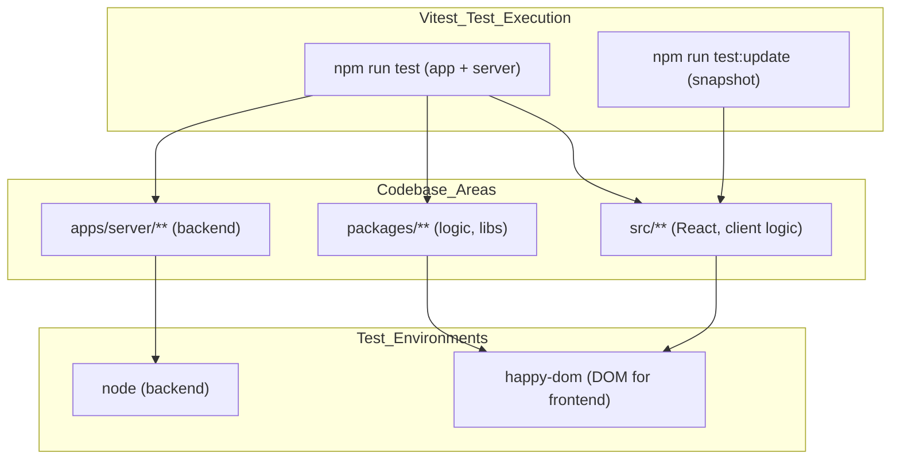
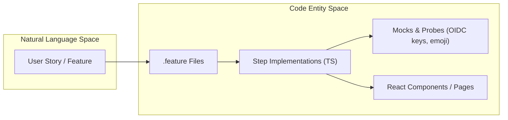
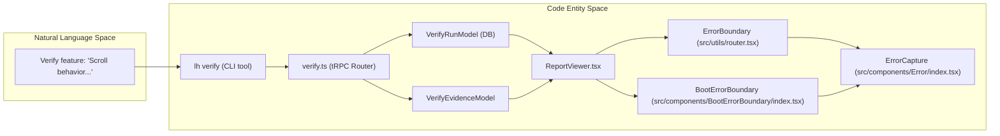
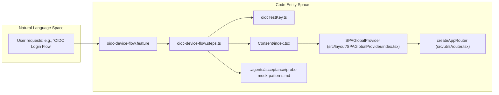

<!-- source: DeepWiki mcp.deepwiki.com · repo lobehub/lobehub · page 13.3 Testing Strategy · fetched 2026-10-29 -->

# Testing Strategy

Relevant source files

The following files were used as context for generating this wiki page:

- [.agents/acceptance/PROCESS.md](.agents/acceptance/PROCESS.md)
- [.agents/acceptance/PROJECT.md](.agents/acceptance/PROJECT.md)
- [.agents/acceptance/common-mistakes.md](.agents/acceptance/common-mistakes.md)
- [.agents/acceptance/probe-mock-patterns.md](.agents/acceptance/probe-mock-patterns.md)
- [.agents/acceptance/scripts/acceptance-guard.sh](.agents/acceptance/scripts/acceptance-guard.sh)
- [.agents/acceptance/scripts/acceptance-guard.test.sh](.agents/acceptance/scripts/acceptance-guard.test.sh)
- [.agents/acceptance/scripts/fixture.mjs](.agents/acceptance/scripts/fixture.mjs)
- [.agents/acceptance/scripts/report-init.sh](.agents/acceptance/scripts/report-init.sh)
- [.agents/acceptance/scripts/resource-guard.test.sh](.agents/acceptance/scripts/resource-guard.test.sh)
- [.agents/scripts/check/pipelines.ts](.agents/scripts/check/pipelines.ts)
- [.agents/skills/acceptance/LICENSE](.agents/skills/acceptance/LICENSE)
- [.agents/skills/acceptance/SKILL.md](.agents/skills/acceptance/SKILL.md)
- [.agents/skills/acceptance/references/acceptance-checker.md](.agents/skills/acceptance/references/acceptance-checker.md)
- [.agents/skills/acceptance/references/agent-browser.md](.agents/skills/acceptance/references/agent-browser.md)
- [.agents/skills/acceptance/references/auth-web.md](.agents/skills/acceptance/references/auth-web.md)
- [.agents/skills/acceptance/references/axe.md](.agents/skills/acceptance/references/axe.md)
- [.agents/skills/acceptance/references/common-mistakes.md](.agents/skills/acceptance/references/common-mistakes.md)
- [.agents/skills/acceptance/references/computer-use.md](.agents/skills/acceptance/references/computer-use.md)
- [.agents/skills/acceptance/references/evidence.md](.agents/skills/acceptance/references/evidence.md)
- [.agents/skills/acceptance/references/plan-format.md](.agents/skills/acceptance/references/plan-format.md)
- [.agents/skills/acceptance/references/recording-cdp.md](.agents/skills/acceptance/references/recording-cdp.md)
- [.agents/skills/acceptance/references/recording-ios-simulator.md](.agents/skills/acceptance/references/recording-ios-simulator.md)
- [.agents/skills/acceptance/references/recording-native-macos.md](.agents/skills/acceptance/references/recording-native-macos.md)
- [.agents/skills/acceptance/references/report.md](.agents/skills/acceptance/references/report.md)
- [.agents/skills/acceptance/references/resource-guard.md](.agents/skills/acceptance/references/resource-guard.md)
- [.agents/skills/acceptance/references/sim-use.md](.agents/skills/acceptance/references/sim-use.md)
- [.agents/skills/acceptance/references/video-chapters.md](.agents/skills/acceptance/references/video-chapters.md)
- [.agents/skills/acceptance/scripts/resource-guard.sh](.agents/skills/acceptance/scripts/resource-guard.sh)
- [.agents/skills/acceptance/surfaces/ios-simulator.md](.agents/skills/acceptance/surfaces/ios-simulator.md)
- [.agents/skills/acceptance/surfaces/web.md](.agents/skills/acceptance/surfaces/web.md)
- [.stylelintignore](.stylelintignore)
- [apps/desktop/src/overlay/entry.tsx](apps/desktop/src/overlay/entry.tsx)
- [packages/python-interpreter/src/__tests__/interpreter.test.ts](packages/python-interpreter/src/__tests__/interpreter.test.ts)
- [packages/python-interpreter/src/__tests__/worker.test.ts](packages/python-interpreter/src/__tests__/worker.test.ts)
- [packages/python-interpreter/src/index.ts](packages/python-interpreter/src/index.ts)
- [packages/python-interpreter/src/interpreter.ts](packages/python-interpreter/src/interpreter.ts)
- [packages/python-interpreter/src/types.ts](packages/python-interpreter/src/types.ts)
- [packages/python-interpreter/src/worker.ts](packages/python-interpreter/src/worker.ts)
- [packages/python-interpreter/vitest.config.mts](packages/python-interpreter/vitest.config.mts)
- [plugins/vite/vercelSkewProtection.ts](plugins/vite/vercelSkewProtection.ts)
- [public/_dangerous_local_dev_proxy.html](public/_dangerous_local_dev_proxy.html)
- [scripts/copySpaBuild.test.ts](scripts/copySpaBuild.test.ts)
- [scripts/copySpaBuildCore.ts](scripts/copySpaBuildCore.ts)
- [src/components/BootErrorBoundary/index.test.tsx](src/components/BootErrorBoundary/index.test.tsx)
- [src/components/BootErrorBoundary/index.tsx](src/components/BootErrorBoundary/index.tsx)
- [src/components/DebugNode.tsx](src/components/DebugNode.tsx)
- [src/components/Error/index.tsx](src/components/Error/index.tsx)
- [src/features/AgentMockDevtools/index.tsx](src/features/AgentMockDevtools/index.tsx)
- [src/features/SkillStore/index.tsx](src/features/SkillStore/index.tsx)
- [src/initialize.test.ts](src/initialize.test.ts)
- [src/initialize.ts](src/initialize.ts)
- [src/layout/GlobalProvider/FaviconProvider.tsx](src/layout/GlobalProvider/FaviconProvider.tsx)
- [src/layout/SPAGlobalProvider/index.test.tsx](src/layout/SPAGlobalProvider/index.test.tsx)
- [src/layout/SPAGlobalProvider/index.tsx](src/layout/SPAGlobalProvider/index.tsx)
- [src/spa/entry.auth.tsx](src/spa/entry.auth.tsx)
- [src/spa/entry.desktop.tsx](src/spa/entry.desktop.tsx)
- [src/spa/entry.mobile.tsx](src/spa/entry.mobile.tsx)
- [src/spa/entry.popup.tsx](src/spa/entry.popup.tsx)
- [src/spa/entry.web.tsx](src/spa/entry.web.tsx)
- [src/spa/initialize/bootstrap.ts](src/spa/initialize/bootstrap.ts)
- [src/spa/router/authRouter.config.tsx](src/spa/router/authRouter.config.tsx)
- [src/utils/chunkError.ts](src/utils/chunkError.ts)
- [src/utils/router.tsx](src/utils/router.tsx)
- [tsconfig.json](tsconfig.json)
- [vitest.config.mts](vitest.config.mts)

LobeHub employs a comprehensive testing strategy aiming to ensure robustness and reliability of its AI Agent Framework, spanning the frontend, backend, and integrated subsystems. The strategy integrates fast unit and integration testing with **Vitest**, system-wide end-to-end testing using **Playwright** with a Cucumber BDD approach, and a sophisticated **Verify (Delivery Checker)** system for automated agentic output validation. This page documents the technical setup, data flow, and key components involved in this testing ecosystem.

---

## Unit and Integration Testing with Vitest

LobeHub uses **Vitest** as the central framework for unit and integration tests across frontend React components, business logic packages, and the backend server code.

### Configuration and Environment Setup

- The root Vitest configuration file is `vitest.config.mts` [vitest.config.mts:4](). It manages module resolution, mocks, global aliases, and testing environment dispatching.
- **Multi-environment**: The config distinguishes frontend tests (running under `happy-dom` DOM simulation) from backend Node tests by glob-based environment resolution [vitest.config.mts:168-169]().
- **Aliases**: Internal workspace packages like `@lobechat/business-model-runtime` [vitest.config.mts:15](), `@lobechat/business-model-bank` [vitest.config.mts:23]() and client-side stores (e.g., `@/store/workspace` [vitest.config.mts:45]) are aliased to local source files or mocks to maintain hermetic tests, avoiding resolution breaks due to workspace pnpm overrides. The `tsconfig.json` also defines paths for various internal packages [tsconfig.json:20-30]().
- **Mocking**: Heavily used external libraries (e.g., `@emoji-mart/data` [vitest.config.mts:27], `@emoji-mart/react` [vitest.config.mts:28]) are mocked via path aliases to avoid side-effects or runtime errors in test contexts. Specific plugins handle complex module resolution issues, such as fixing `@lobehub/fluent-emoji` style imports [vitest.config.mts:116-137]() and stubbing `@lobehub/ui` motion providers [vitest.config.mts:105-113]().
- **Exclude Patterns**: Source files unrelated to tests such as `apps/desktop`, `e2e/` directories and build artifacts are excluded from test processing and coverage [vitest.config.mts:51-66](). The `tsconfig.json` also defines exclude patterns for various applications and temporary directories [tsconfig.json:40-53]().

### Coverage Reporting

- Coverage is collected via the V8 provider configured in Vitest and reports are generated in text, JSON, lcov, and summary formats, saved under `./coverage/app` [vitest.config.mts:164-166]().
- Coverage excludes common non-critical paths like `node_modules`, migrations, locales, and certain test-specific or generated files [vitest.config.mts:148-162]().
- Integration with CI coverage tooling (Codecov) is performed in GitHub workflows, combining reports from shard builds for unified reporting.

### Test Execution Flow Diagram

### Key Vitest Config Highlights (`vitest.config.mts`)

- Using `defineConfig` for centralized test setup [vitest.config.mts:4]().
- Environment dispatch via `environmentMatchGlobs`:
  - Backend tests (`apps/server/**/*`) run in `node`.
  - Other tests (`src/**/*`) run in DOM environment `happy-dom` [vitest.config.mts:168-169]().
- Alias remappings to mocks for UI components and workspace store [vitest.config.mts:10-49]().
- Plugins for path resolution and raw markdown imports [vitest.config.mts:81-88]().
- Coverage configuration specifying exclusion lists and output formats [vitest.config.mts:147-167]().

Sources: [vitest.config.mts:1-169](), [tsconfig.json:1-82]()

---

## End-to-End Testing with Playwright and Cucumber BDD

The `e2e/` directory hosts Playwright-based E2E tests that exercise full user flows on a running instance of LobeHub.

### BDD Test Organization

- **Feature Files**: Written in Gherkin (`.feature`), describing user workflows in natural language. An example is `oidc-device-flow.feature` [e2e/src/features/regression/oidc-device-flow.feature:1-5]().
- **Step Definitions**: TypeScript implementations map Gherkin steps to specific UI or API interactions. For instance, `oidc-device-flow.steps.ts` defines steps for the OIDC flow [e2e/src/steps/auth/oidc-device-flow.steps.ts:1-10]().
- **Hooks**: Setup/teardown utilities manage test lifecycle like browser sessions and test context preparation.

This structure supports maintainability and collaboration by enabling clear requirement documentation linked to executable test code.

### Mocks and Probes

- Tests use specialized mocks for external dependencies like OIDC keys [e2e/src/support/oidcTestKey.ts:1]() and emoticons to control external state.
- Probe patterns help simulate fetch failure modes or service errors for robustness validation. The `.agents/acceptance/probe-mock-patterns.md` file details various probe and mock patterns [.agents/acceptance/probe-mock-patterns.md:1-52]().
- Helper utilities in `tests/utils.tsx` enhance test authoring and reuse.

### Typical E2E Scripts (from `package.json`)

| Script | Purpose |
| --- | --- |
| `test:e2e` | Runs all E2E tests against the web app |
| `test:e2e:smoke` | Runs critical path smoke tests |
| `e2e:ui` | Starts Playwright Test Runner UI for debugging |

### E2E Testing Flow Diagram

Sources: [e2e/src/features/regression/oidc-device-flow.feature:1-5](), [e2e/src/steps/auth/oidc-device-flow.steps.ts:1-10](), [tests/utils.tsx:1-50](), [.agents/acceptance/probe-mock-patterns.md:1-52]()

---

## Coverage Reporting and CI Integration

- Coverage data from Vitest tests is recorded per package and aggregated.
- A dedicated CI workflow merges app-level shards and uploads combined reports to Codecov.
- Coverage ensures regressions are detected and that new code maintains test quality.

---

## Verify (Delivery Checker) System for Agentic Workflows

LobeHub includes a specialized verification system designed to validate AI agent outputs end-to-end. This system is part of the broader acceptance testing strategy, as detailed in `.agents/acceptance/PROCESS.md` [.agents/acceptance/PROCESS.md:1-14]().

### Architecture Overview

- **VerifyRunModel**: Represents each verification "run" with lifecycle state and metadata.
- **VerifyExecutorService**: Coordinates running verification logic, which may be scripted programs, agent subprocesses, or LLM-based judgment agents.
- **Evidence Collection**: Stores rich evidence artifacts such as screenshots, logs, transcripts, and DOM snapshots for review. The `.agents/skills/acceptance/references/report.md` file describes the structured report rounds and how evidence is collected and presented [.agents/skills/acceptance/references/report.md:1-137]().
- **UI Components**: `ReportViewer.tsx` renders detailed reports in the frontend.
- **Error Handling**: The `ErrorBoundary` component in `src/utils/router.tsx` [src/utils/router.tsx:145-166]() and `BootErrorBoundary` in `src/components/BootErrorBoundary/index.tsx` [src/components/BootErrorBoundary/index.tsx:30-31]() are crucial for capturing and reporting errors during runtime, which can be part of the verification process. The `ErrorCapture` component [src/components/Error/index.tsx:20-87]() provides a user-friendly display for errors, including stack traces in CI environments.

This system enables AI-driven verification scenarios or human-in-the-loop validation, enabling confidence in agentic automation outcomes.

### Agentic Verification Flow Diagram

Sources: [apps/cli/src/commands/verify.ts:140-160](), [apps/server/src/routers/lambda/verify.ts:10-40](), [src/features/Verify/ReportViewer.tsx:30-80](), [src/utils/router.tsx:145-166](), [src/components/BootErrorBoundary/index.tsx:30-31](), [src/components/Error/index.tsx:20-87](), [.agents/acceptance/PROCESS.md:1-14](), [.agents/skills/acceptance/references/report.md:1-137]()

---

## Mock Infrastructure and Utilities

- The repository provides a collection of **probe and mock patterns** for network and state simulation, including controlled fetch failures and injected latency or errors. The `.agents/acceptance/probe-mock-patterns.md` file details these patterns [.agents/acceptance/probe-mock-patterns.md:1-52]().
- Developers can inject `throw` statements temporarily in service methods and observe error UI feedback live via Vite HMR, enabling rapid feedback on error handling.
- The `tests/` directory hosts generic utilities and mocks used by Vitest tests, fostering consistency.
- The `SPAGlobalProvider` in `src/layout/SPAGlobalProvider/index.tsx` [src/layout/SPAGlobalProvider/index.tsx:78-141]() and `createAppRouter` in `src/utils/router.tsx` [src/utils/router.tsx:195-207]() are key entry points for the SPA, where global providers and routing are set up, making them critical for testing the overall application structure.

### Logic to Test Entity Mapping Diagram

Sources: [e2e/src/features/regression/oidc-device-flow.feature:1](), [e2e/src/steps/auth/oidc-device-flow.steps.ts:1](), [e2e/src/support/oidcTestKey.ts:1](), [src/features/Auth/OAuthConsent/Consent/index.tsx:1](), [.agents/acceptance/probe-mock-patterns.md:1-52](), [src/layout/SPAGlobalProvider/index.tsx:78-141](), [src/utils/router.tsx:195-207]()

---

## Summary of Key Testing Commands and Workflows

| Command / Script | Purpose | Reference |
| --- | --- | --- |
| `npm run test` | Runs all Vitest suites (app + server) | [package.json:111-116]() |
| `npm run test:update` | Updates Vitest snapshot files | [package.json:114]() |
| `npm run test:e2e` | Runs end-to-end Playwright tests | [package.json:112]() |
| `npm run lint:ts` | TypeScript linting on source & tests | [package.json:97]() |
| `lh verify init` | Installs `agent-testing` skill for verify | [apps/cli/src/commands/verify.ts:1]() |

---

This layered testing strategy enables early defect detection via unit tests, realistic user simulation with E2E tests, and thorough AI agent output validation with the Verify system—ensuring high quality and robust operation of the LobeHub platform.

# End of Testing Strategy

---

Sources:
[vitest.config.mts:1-169](), [tsconfig.json:1-82](), [e2e/src/features/regression/oidc-device-flow.feature:1-5](), [e2e/src/steps/auth/oidc-device-flow.steps.ts:1-10](), [e2e/src/support/oidcTestKey.ts:1](), [src/features/Auth/OAuthConsent/Consent/index.tsx:1](), [apps/cli/src/commands/verify.ts:140-160](), [apps/server/src/routers/lambda/verify.ts:10-40](), [src/features/Verify/ReportViewer.tsx:30-80](), [package.json:97-123](), [.agents/acceptance/probe-mock-patterns.md:1-52](), [.agents/acceptance/PROCESS.md:1-14](), [.agents/skills/acceptance/references/report.md:1-137](), [src/utils/router.tsx:145-166](), [src/components/BootErrorBoundary/index.tsx:30-31](), [src/components/Error/index.tsx:20-87](), [src/layout/SPAGlobalProvider/index.tsx:78-141](), [src/utils/router.tsx:195-207]()

---

