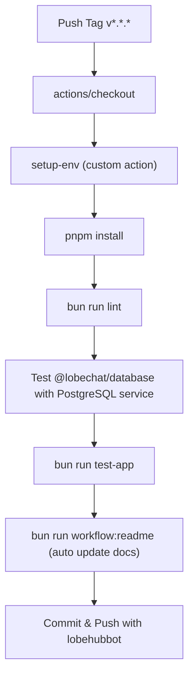
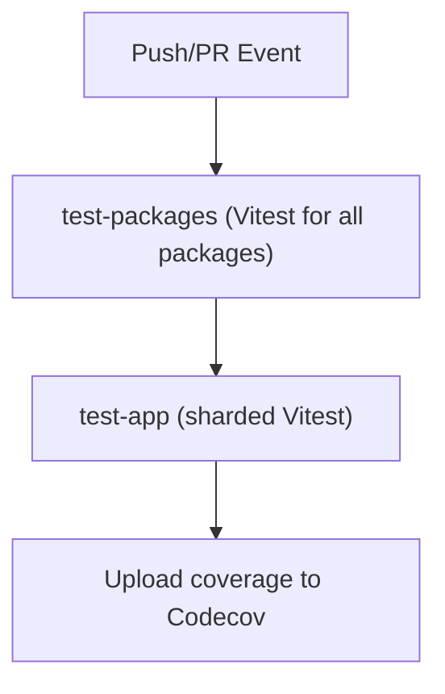
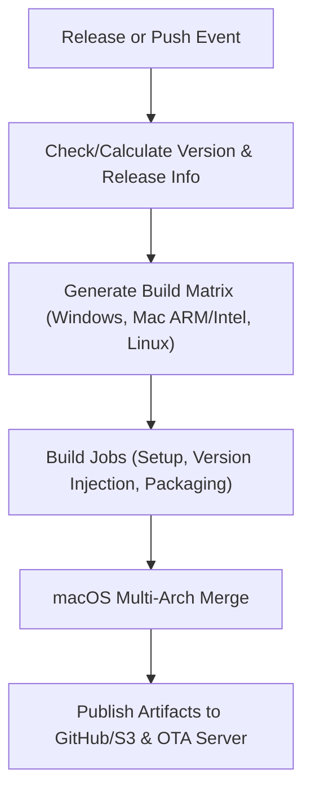
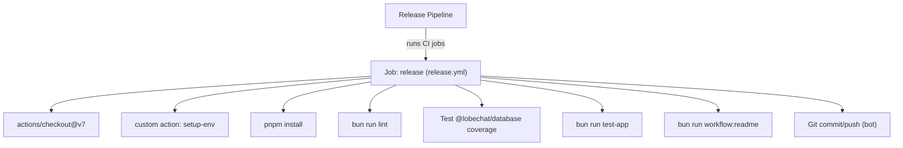
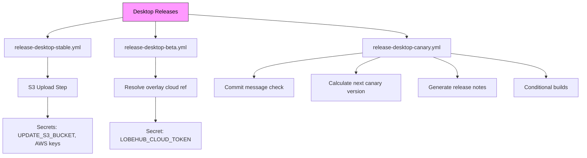

<!-- source: DeepWiki mcp.deepwiki.com · repo lobehub/lobehub · page 13.4 CI/CD Workflows Reference · fetched 2026-10-29 -->

# CI/CD Workflows Reference

Relevant source files

The following files were used as context for generating this wiki page:

- [.bunfig.toml](.bunfig.toml)
- [.github/actions/desktop-build-setup/action.yml](.github/actions/desktop-build-setup/action.yml)
- [.github/actions/desktop-publish-s3/action.yml](.github/actions/desktop-publish-s3/action.yml)
- [.github/actions/desktop-upload-artifacts/action.yml](.github/actions/desktop-upload-artifacts/action.yml)
- [.github/scripts/create-failure-issue.js](.github/scripts/create-failure-issue.js)
- [.github/workflows/auto-i18n.yml](.github/workflows/auto-i18n.yml)
- [.github/workflows/auto-tag-release.yml](.github/workflows/auto-tag-release.yml)
- [.github/workflows/lighthouse.yml](.github/workflows/lighthouse.yml)
- [.github/workflows/manual-build-desktop.yml](.github/workflows/manual-build-desktop.yml)
- [.github/workflows/pr-build-desktop.yml](.github/workflows/pr-build-desktop.yml)
- [.github/workflows/pr-build-docker.yml](.github/workflows/pr-build-docker.yml)
- [.github/workflows/release-desktop-beta.yml](.github/workflows/release-desktop-beta.yml)
- [.github/workflows/release-desktop-canary.yml](.github/workflows/release-desktop-canary.yml)
- [.github/workflows/release-desktop-stable.yml](.github/workflows/release-desktop-stable.yml)
- [.github/workflows/release-docker.yml](.github/workflows/release-docker.yml)
- [.github/workflows/release.yml](.github/workflows/release.yml)
- [.github/workflows/sync-database-schema.yml](.github/workflows/sync-database-schema.yml)
- [.github/workflows/sync-main-to-canary.yaml](.github/workflows/sync-main-to-canary.yaml)
- [.github/workflows/sync.yml](.github/workflows/sync.yml)
- [.github/workflows/test.yml](.github/workflows/test.yml)
- [.npmrc](.npmrc)
- [CHANGELOG.md](CHANGELOG.md)
- [README.md](README.md)
- [README.zh-CN.md](README.zh-CN.md)
- [apps/cli/.npmrc](apps/cli/.npmrc)
- [apps/cli/pnpm-workspace.yaml](apps/cli/pnpm-workspace.yaml)
- [apps/desktop/.npmrc](apps/desktop/.npmrc)
- [apps/desktop/package.json](apps/desktop/package.json)
- [apps/desktop/pnpm-lock.yaml](apps/desktop/pnpm-lock.yaml)
- [apps/desktop/pnpm-workspace.yaml](apps/desktop/pnpm-workspace.yaml)
- [apps/desktop/scripts/__tests__/buildCoreManifest.test.mjs](apps/desktop/scripts/__tests__/buildCoreManifest.test.mjs)
- [apps/desktop/scripts/__tests__/buildCoreV4.test.mjs](apps/desktop/scripts/__tests__/buildCoreV4.test.mjs)
- [apps/desktop/scripts/buildCoreManifest.mjs](apps/desktop/scripts/buildCoreManifest.mjs)
- [apps/desktop/scripts/buildCoreV4.mjs](apps/desktop/scripts/buildCoreV4.mjs)
- [apps/desktop/scripts/buildRendererManifest.mjs](apps/desktop/scripts/buildRendererManifest.mjs)
- [apps/desktop/src/main/__mocks__/node-mac-permissions.ts](apps/desktop/src/main/__mocks__/node-mac-permissions.ts)
- [apps/desktop/src/main/__mocks__/setup.ts](apps/desktop/src/main/__mocks__/setup.ts)
- [apps/desktop/src/main/appBrowsers.ts](apps/desktop/src/main/appBrowsers.ts)
- [apps/desktop/src/main/const/env.ts](apps/desktop/src/main/const/env.ts)
- [apps/desktop/src/main/const/store.ts](apps/desktop/src/main/const/store.ts)
- [apps/desktop/src/main/controllers/AuvCtr.ts](apps/desktop/src/main/controllers/AuvCtr.ts)
- [apps/desktop/src/main/controllers/BrowserWindowsCtr.ts](apps/desktop/src/main/controllers/BrowserWindowsCtr.ts)
- [apps/desktop/src/main/controllers/SystemCtr.ts](apps/desktop/src/main/controllers/SystemCtr.ts)
- [apps/desktop/src/main/controllers/__tests__/SystemCtr.test.ts](apps/desktop/src/main/controllers/__tests__/SystemCtr.test.ts)
- [apps/desktop/src/main/core/App.ts](apps/desktop/src/main/core/App.ts)
- [apps/desktop/src/main/core/__tests__/App.test.ts](apps/desktop/src/main/core/__tests__/App.test.ts)
- [apps/desktop/src/main/core/browser/Browser.ts](apps/desktop/src/main/core/browser/Browser.ts)
- [apps/desktop/src/main/core/browser/BrowserManager.ts](apps/desktop/src/main/core/browser/BrowserManager.ts)
- [apps/desktop/src/main/core/browser/WindowThemeManager.ts](apps/desktop/src/main/core/browser/WindowThemeManager.ts)
- [apps/desktop/src/main/core/browser/__tests__/Browser.test.ts](apps/desktop/src/main/core/browser/__tests__/Browser.test.ts)
- [apps/desktop/src/main/core/browser/__tests__/BrowserManager.test.ts](apps/desktop/src/main/core/browser/__tests__/BrowserManager.test.ts)
- [apps/desktop/src/main/core/browser/__tests__/WindowThemeManager.test.ts](apps/desktop/src/main/core/browser/__tests__/WindowThemeManager.test.ts)
- [apps/desktop/src/main/env.ts](apps/desktop/src/main/env.ts)
- [apps/desktop/src/main/services/__tests__/auvSrv.test.ts](apps/desktop/src/main/services/__tests__/auvSrv.test.ts)
- [apps/desktop/src/main/services/auvSrv.ts](apps/desktop/src/main/services/auvSrv.ts)
- [apps/desktop/src/main/types/store.ts](apps/desktop/src/main/types/store.ts)
- [apps/desktop/src/main/utils/permissions.ts](apps/desktop/src/main/utils/permissions.ts)
- [apps/desktop/tsconfig.json](apps/desktop/tsconfig.json)
- [apps/desktop/vitest.config.mts](apps/desktop/vitest.config.mts)
- [changelog/CHANGELOG.v0.md](changelog/CHANGELOG.v0.md)
- [changelog/CHANGELOG.v1.md](changelog/CHANGELOG.v1.md)
- [changelog/v0.json](changelog/v0.json)
- [changelog/v1.json](changelog/v1.json)
- [changelog/v2.json](changelog/v2.json)
- [codecov.yml](codecov.yml)
- [docs/changelog/2025-03-02-new-models.zh-CN.mdx](docs/changelog/2025-03-02-new-models.zh-CN.mdx)
- [docs/changelog/2025-06-08-claude-4.zh-CN.mdx](docs/changelog/2025-06-08-claude-4.zh-CN.mdx)
- [docs/changelog/2025-07-08-mcp-market.zh-CN.mdx](docs/changelog/2025-07-08-mcp-market.zh-CN.mdx)
- [docs/changelog/2025-09-08-gemini.zh-CN.mdx](docs/changelog/2025-09-08-gemini.zh-CN.mdx)
- [docs/changelog/2025-10-08-python.zh-CN.mdx](docs/changelog/2025-10-08-python.zh-CN.mdx)
- [docs/changelog/2025-12-20-mcp.zh-CN.mdx](docs/changelog/2025-12-20-mcp.zh-CN.mdx)
- [docs/changelog/schema.json](docs/changelog/schema.json)
- [next.config.ts](next.config.ts)
- [package.json](package.json)
- [packages/electron-client-ipc/src/events/system.ts](packages/electron-client-ipc/src/events/system.ts)
- [packages/electron-client-ipc/src/types/system.ts](packages/electron-client-ipc/src/types/system.ts)
- [packages/electron-client-ipc/src/types/window.ts](packages/electron-client-ipc/src/types/window.ts)
- [patches/@upstash__qstash.patch](patches/@upstash__qstash.patch)
- [pnpm-workspace.yaml](pnpm-workspace.yaml)
- [renovate.json](renovate.json)
- [scripts/changelogWorkflow/const.ts](scripts/changelogWorkflow/const.ts)
- [scripts/changelogWorkflow/generateChangelog.ts](scripts/changelogWorkflow/generateChangelog.ts)
- [scripts/dbmlWorkflow/index.ts](scripts/dbmlWorkflow/index.ts)
- [scripts/releaseWorkflow/index.ts](scripts/releaseWorkflow/index.ts)
- [src/business/client/features/NavPanelUpgradeEntry.tsx](src/business/client/features/NavPanelUpgradeEntry.tsx)
- [src/features/Electron/connection/DeviceGateway.tsx](src/features/Electron/connection/DeviceGateway.tsx)
- [src/features/Electron/system/macWindowFullscreen.ts](src/features/Electron/system/macWindowFullscreen.ts)
- [src/features/Electron/system/useMacWindowFullscreen.ts](src/features/Electron/system/useMacWindowFullscreen.ts)
- [src/features/NavPanel/components/NavPanelDraggable.tsx](src/features/NavPanel/components/NavPanelDraggable.tsx)
- [src/features/ShareModal/ShareImage/style.ts](src/features/ShareModal/ShareImage/style.ts)
- [src/layout/GlobalProvider/ElectronAppStateSync.desktop.tsx](src/layout/GlobalProvider/ElectronAppStateSync.desktop.tsx)
- [src/libs/next/config/define-config.test.ts](src/libs/next/config/define-config.test.ts)
- [src/libs/next/config/define-config.ts](src/libs/next/config/define-config.ts)
- [src/services/electron/gatewayConnection.ts](src/services/electron/gatewayConnection.ts)
- [src/services/electron/system.ts](src/services/electron/system.ts)
- [src/spa/BootShell/geometry.ts](src/spa/BootShell/geometry.ts)
- [src/store/electron/actions/app.ts](src/store/electron/actions/app.ts)
- [vercel.json](vercel.json)

This wiki page provides a detailed technical reference for all GitHub Actions workflows used by the LobeHub repository. It covers workflow triggers, job steps, critical gates such as bundle size and test coverage, secrets required, and explains their roles in the overall release pipeline for monorepo packages, Docker images, and desktop applications. The documentation also bridges natural language descriptions of release automation concepts with corresponding code entities and configuration files.

---

## Overview

LobeHub's CI/CD system uses GitHub Actions to automate testing, building, releasing, and publishing code artifacts in a large, monorepo setup. The continuous integration workflows enforce code quality via linting and unit tests on individual packages. The release workflows manage version tagging, changelog generation, desktop builds for multiple platforms, and Docker image deployment.

AI-powered automation through Claude Code is integrated to help with issue triaging, duplicates detection, and some testing automation. The workflows utilize various secrets for authentication, signing, token-based API access, and access to private repositories and cloud update servers.

---

## Release Automation Workflow (`release.yml`)

### Trigger
- Activated on pushed tags matching the semantic version pattern: `v*.*.*` ([.github/workflows/release.yml:9-11]()).

### Job Steps
- **Checkout:** Checkout the code from GitHub with token authorization.
- **Setup environment:** Uses a custom reusable action `.github/actions/setup-env` to setup Node.js and other dependents.
- **Install dependencies:** Installs all dependencies using `pnpm` ([.github/workflows/release.yml:50]()).
- **Lint:** Runs linting via `bun run lint` ([.github/workflows/release.yml:53]()).
- **Database coverage test:** Runs integration tests on the `@lobechat/database` package with a PostgreSQL service container (`paradedb/paradedb:latest`) for realistic testing ([.github/workflows/release.yml:55-63]()).
- **Application tests:** Runs `bun run test-app` to execute broader tests ([.github/workflows/release.yml:65]()).
- **Documentation sync:** Runs `bun run workflow:readme` to update the README files dynamically ([.github/workflows/release.yml:68]()).
- **Commit changes:** Commits any generated changes (e.g., updated docs) back to the repository with a bot user ([.github/workflows/release.yml:70-77]()).

### Concurrency
- Only one release job per tag is allowed; concurrent jobs get canceled ([.github/workflows/release.yml:13-15]()).

### Environment & Secrets
- Requires `GH_TOKEN` for checkout and bot commits ([.github/workflows/release.yml:79]()).
- Tests run with several environment variables to mimic production config (`DATABASE_DRIVER`, `KEY_VAULTS_SECRET`, etc.) ([.github/workflows/release.yml:57-62]()).

Sources: [.github/workflows/release.yml:1-73]().

---

## Test CI Workflow (`test.yml`)

### Trigger
- Runs on every push to `main` or `canary` branches, and on pull requests ([.github/workflows/test.yml:4-22]()).
- Ignores changes to markdown files, `docs/`, `.claude/`, `.github/ISSUE_TEMPLATE/`, and specific workflow files to optimize runs ([.github/workflows/test.yml:8-20]()).

### Jobs and Strategy

| Job | Role | Tools |
|---|---|---|
| `test-packages` | Runs all unit tests for 20+ monorepo packages, with coverage | Vitest + bun |
| `test-app` | Executes sharded (3 shards) Vitest tests on the main app folder | Vitest with sharding |

### Test Packages List
The `PACKAGES` environment variable defines the list of packages to be tested, including:
- `@lobechat/file-loaders`
- `@lobechat/prompts`
- `@lobechat/model-runtime`
- `@lobechat/web-crawler`
- `@lobechat/electron-server-ipc`
- `@lobechat/utils`
- `@lobechat/context-engine`
- `@lobechat/agent-runtime`
- `@lobechat/conversation-flow`
- `@lobechat/ssrf-safe-fetch`
- `@lobechat/memory-user-memory`
- `@lobechat/types`
- `@lobechat/trpc`
- `@lobechat/app-config`
- `@lobechat/locales`
- `@lobechat/env`
- `@lobechat/builtin-tool-lobe-agent`
- `@lobechat/builtin-tool-message`
- `model-bank`
- `@lobechat/agent-gateway-client`
- `@lobechat/agent-manager-runtime`
- `@lobechat/device-gateway-client`
- `@lobechat/device-identity`
- `@lobechat/eval-dataset-parser`
- `@lobechat/eval-rubric`
- `@lobechat/fetch-sse`
- `@lobechat/heterogeneous-agents`
- `@lobechat/openapi`
- `@lobechat/replica`
[.github/workflows/test.yml:49-51]()

### Coverage Upload
Coverage reports are uploaded to Codecov with custom flags to distinguish package reports. Some packages like `locales`, `env`, and `device-gateway-client` are explicitly skipped from Codecov upload ([.github/workflows/test.yml:165-168]()). The upload process is parallelized, with a maximum of 4 concurrent uploads ([.github/workflows/test.yml:171]()).

Sources: [.github/workflows/test.yml:1-196]().

---

## Desktop Application Release Workflows

LobeHub manages three release channels for the Desktop app:

| Channel | Trigger | Version Format | Target |
|---|---|---|---|
| Stable | Published Release without pre-release tag | `X.Y.Z` | GitHub + S3 update server |
| Beta | Published Release with pre-release tag | `X.Y.Z-beta.N`, `-alpha.N` | GitHub only |
| Canary | Push to `canary` branch | `X.Y.(Z+1)-canary.N` | GitHub only |

---

### 1. Beta Release Workflow (`release-desktop-beta.yml`)

- Triggered on published GitHub Releases with pre-release suffix (`beta`, `alpha`, `rc`) ([.github/workflows/release-desktop-beta.yml:13-15]()).
- Skips `nightly` releases ([.github/workflows/release-desktop-beta.yml:46-48]()).
- Resolves overlay cloud revision from private overlay repository using `LOBEHUB_CLOUD_TOKEN` ([.github/workflows/release-desktop-beta.yml:57-73]()).
- Publishes renderer OTA update on the `beta` channel.
- Runs lint and tests ([.github/workflows/release-desktop-beta.yml:75-93]()).
- Builds desktop packages for macOS (ARM & Intel), Windows, and Linux using a build matrix ([.github/workflows/release-desktop-beta.yml:98-101]()).
- Supports Apple code-signing and provisioning for macOS builds (requires secrets like `APPLE_CERTIFICATE_BASE64`, `APPLE_ID`) ([.github/workflows/release-desktop-beta.yml:127-134](), [.github/workflows/release-desktop-beta.yml:146-158]()).
- Uses `npm run workflow:set-desktop-version` to inject the version as `beta` ([.github/workflows/release-desktop-beta.yml:123-125]()).
- Environment variables like `UPDATE_CHANNEL`, `UPDATE_SERVER_URL`, and `RENDERER_OTA_PUBLIC_KEY` injected for update infrastructure ([.github/workflows/release-desktop-beta.yml:142-144](), [.github/workflows/release-desktop-beta.yml:165-167](), [.github/workflows/release-desktop-beta.yml:188-190]()).

---

### 2. Stable Release Workflow (`release-desktop-stable.yml`)

- Triggered on published GitHub Releases without any pre-release suffix ([.github/workflows/release-desktop-stable.yml:13-15]()).
- Supports manual trigger with explicit version input.
- Injects S3 secrets (`UPDATE_AWS_ACCESS_KEY_ID`, `UPDATE_S3_BUCKET`, etc.) for uploading desktop releases and update metadata to S3.
- Publishes renderer OTA update in `stable` channel.
- Builds desktop apps across multiple OS targets (Windows, macOS ARM & Intel, Linux) using dynamic build matrix configuration.
- Supports macOS notarization and code-signing with the relevant Apple secrets.
- Similar version injection and release notes generation scripts as Beta.

---

### 3. Canary Release Workflow (`release-desktop-canary.yml`)

- Triggered on `push` to `canary` branch or manual dispatch ([.github/workflows/release-desktop-canary.yml:4-5]()).
- Validates commit message type for automated build triggers (style/feat/fix/perf/refactor/release) ([.github/workflows/release-desktop-canary.yml:39-45]()).
- Calculates next canary version based on the latest stable tag by incrementing the patch number and appending a canary postfix ([.github/workflows/release-desktop-canary.yml:47-59]()).
- Generates release notes by comparing changes since the last canary or stable tag ([.github/workflows/release-desktop-canary.yml:61-70]()).
- Fetches cloud revision similarly to other desktop workflows ([.github/workflows/release-desktop-canary.yml:72-88]()).
- Publishes renderer OTA update on `canary` channel ([.github/workflows/release-desktop-canary.yml:130-132]()).
- Conditional build steps only execute if commit triggers match or when forced via dispatch ([.github/workflows/release-desktop-canary.yml:37]()).

---

### Desktop Build Flow Summary

---

### Build and Signing Details

- `desktop-build-setup` reusable action sets up Node environment and cloud state ([.github/actions/desktop-build-setup/action.yml]()).
- Build commands use `npm run desktop:package:app` ([apps/desktop/package.json:74]()) which wraps Electron Builder invocations.
- macOS builds support provisioning profile injection from base64 secret to sign app binaries ([.github/workflows/release-desktop-beta.yml:127-134]()).
- Windows and Linux builds use GitHub hosted runners with environment variables for update server URLs.
- For multi-architecture macOS releases, artifacts are merged to provide unified update manifests.

### Secrets Required for Desktop Releases

| Secret Name | Purpose |
|---|---|
| `LOBEHUB_CLOUD_TOKEN` | Access overlay cloud repository |
| `APPLE_CERTIFICATE_BASE64` | macOS code signing certificate (base64) |
| `APPLE_CERTIFICATE_PASSWORD` | macOS certificate password |
| `APPLE_ID` | Apple developer account email |
| `APPLE_APP_SPECIFIC_PASSWORD` | Apple app-specific password |
| `APPLE_TEAM_ID` | Apple developer team ID |
| `UPDATE_SERVER_URL` | URL where desktop clients check for updates |
| `RENDERER_OTA_PUBLIC_KEY` | Public key for secure OTA updates |
| `UPDATE_AWS_ACCESS_KEY_ID` | AWS credentials for S3 uploads (stable releases) |
| `UPDATE_AWS_SECRET_ACCESS_KEY`| AWS credentials for S3 uploads |
| `UPDATE_S3_BUCKET` | S3 bucket name for release uploads |
| `UPDATE_S3_REGION` | S3 region (optional) |
| `UPDATE_S3_ENDPOINT` | S3 endpoint for MinIO/R2 (optional) |
| `NEXT_PUBLIC_DESKTOP_UMAMI_BASE_URL` | Umami analytics server URL |
| `NEXT_PUBLIC_DESKTOP_PROJECT_ID` | Umami project ID |

Sources:
- [.github/workflows/release-desktop-beta.yml:1-180]()
- [.github/workflows/release-desktop-stable.yml]()
- [.github/workflows/release-desktop-canary.yml]()
- [.github/workflows/pr-build-desktop.yml]()

---

## Docker Release Workflow (`release-docker.yml`)

- Triggered by release tags or manual dispatch (`v*.*.*`).
- Builds Docker images for the server component.
- Pushes to container registry.
- May include database migration synchronization.
- Uses environment secrets for Docker credentials and registry access.
- Ensures image tags correspond with the semantic versioning scheme.

*(No full details from file; typical Docker release pattern.)*

Sources: [.github/workflows/release-docker.yml]()

---

## Branch Synchronization to Canary (`sync-main-to-canary.yaml`)

- Ensures `canary` branch stays up-to-date with `main`.
- Checks if `canary` is behind `main` and performs a hard reset (fast-forward) if possible.
- If merge conflicts or direct reset not possible, creates a pull request for manual merge.
- Runs on push to `main`.

Sources: [.github/workflows/sync-main-to-canary.yaml]()

---

## AI-Powered Automation with Claude Code

LobeHub employs the `anthropics/claude-code-action` to enhance automation in maintenance and testing workflows.

### Issue Triage (`claude-issue-triage.yml`)

- Triggered on new issues, performs semantic analysis with Claude.
- Filters out prompt-injection type attacks.
- Uses `.claude/prompts/team-assignment.md` to map feature labels to team members.
- Automatically assigns and labels issues for efficient triage.

### Deduplication (`claude-dedupe-issues.yml`)

- Identifies duplicate issues via Claude-powered analysis.
- Closes duplicates with comments linking original issue.

### Automated Testing (`claude-auto-testing.yml`)

- Generates test cases and coverage plans based on code areas changed.
- Uses prompt files like `.claude/prompts/e2e-coverage.md`.

### Team Assignment Mapping Example

| Feature Label | Assigned Team Member | Code Area |
|---|---|---|
| `feature:mcp` | `@arvinxx` | `packages/mcp` |
| `feature:knowledge-base`| `@Innei` | `src/services/knowledgeBase` |
| `feature:model-runtime` | `@tjx666` | `packages/model-runtime` |
| `platform:desktop` | `@Innei` | `apps/desktop` |
| `feature:memory` | `@nekomeowww` | `packages/memory-user-memory` |

Sources:
- [.github/workflows/auto-i18n.yml]()
- [.github/workflows/auto-tag-release.yml]()
- [.github/workflows/sync.yml]()

---

## Secrets and Environment Variables Overview

Below are key secrets utilized by the CI/CD workflows:

| Secret Name | Usage | Workflow Example |
|---|---|---|
| `GH_TOKEN` | Code checkout with bot push permissions | Release, Test workflows: [.github/workflows/release.yml:45]() |
| `CLAUDE_CODE_OAUTH_TOKEN` | Claude Code action authentication | Claude issue triage |
| `APPLE_CERTIFICATE_BASE64` | macOS build signing | Desktop beta/stable workflows: [.github/workflows/release-desktop-beta.yml:146]() |
| `UPDATE_S3_BUCKET` | S3 bucket for stable desktop release uploads | Desktop stable |
| `UPDATE_SERVER_URL` | URL to update server for desktop auto-updates | Desktop stable and beta builds |
| `CODECOV_TOKEN` | Upload Codecov test coverage reports | Test workflow: [.github/workflows/test.yml:98]() |
| `LOBEHUB_CLOUD_TOKEN` | Access overlay cloud repository for desktop builds | Desktop builds: [.github/workflows/release-desktop-beta.yml:62]() |

---

## Mapping of Natural Language Concepts to Code Entities

### 1. Release Pipeline Entities to Workflow Jobs

Sources: [.github/workflows/release.yml:1-73]().

### 2. Desktop Release Channels to Workflows and Secrets

Sources:
- [.github/workflows/release-desktop-stable.yml]()
- [.github/workflows/release-desktop-beta.yml]()
- [.github/workflows/release-desktop-canary.yml]()

---

## Summary Tables of Key Workflows

| Workflow | Purpose | Triggers | Key Secrets |
|---|---|---|---|
| `release.yml` | Final release automation and documentation sync| Tag push `v*.*.*` | `GH_TOKEN` |
| `test.yml` | Run comprehensive tests and coverage | Push, Pull Request | `CODECOV_TOKEN` |
| `release-desktop-beta.yml` | Beta channel desktop builds | Release published with pre-release | `LOBEHUB_CLOUD_TOKEN`, Apple signing secrets |
| `release-desktop-stable.yml` | Stable desktop channel with S3 upload | Release published stable tag | S3 bucket AWS keys, Apple signing secrets |
| `release-desktop-canary.yml` | Canary channel desktop continuous builds | Push to `canary` branch or manual | `LOBEHUB_CLOUD_TOKEN` |
| `release-docker.yml` | Build and publish Docker images | Tag push `v*.*.*` or manual | Docker credentials |
| `sync-main-to-canary.yaml` | Keep `canary` branch updated with `main` | Push to `main` branch | `GH_TOKEN` |

---

This completes the detailed reference of the CI/CD workflows in LobeHub.

---

**Sources:**
- [.github/workflows/release.yml:1-73]()
- [.github/workflows/test.yml:1-196]()
- [.github/workflows/release-desktop-beta.yml:1-180]()
- [.github/workflows/release-desktop-stable.yml]()
- [.github/workflows/release-desktop-canary.yml]()
- [.github/workflows/release-docker.yml]()
- [.github/workflows/sync-main-to-canary.yaml]()
- [package.json:44-112]()
- [apps/desktop/package.json:74]()

---

