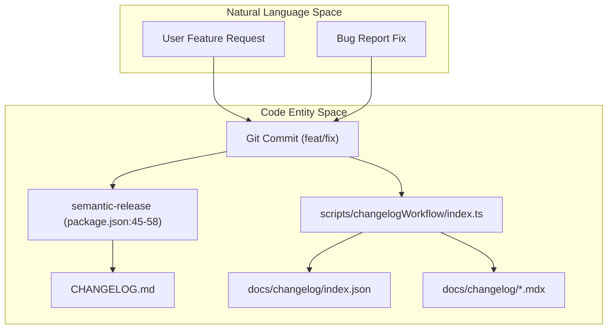
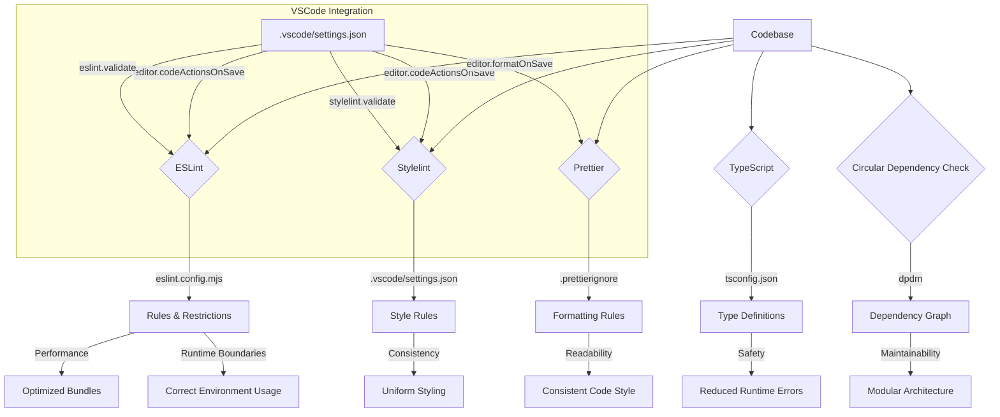
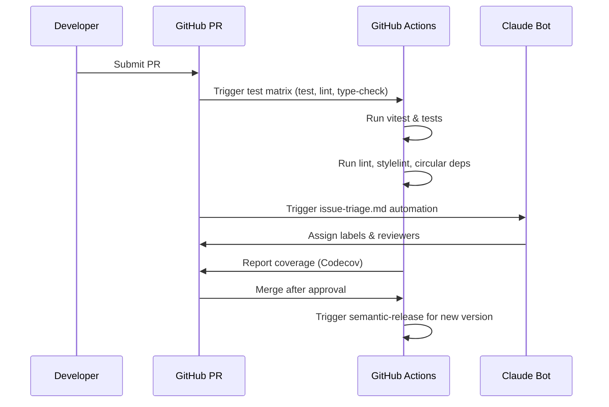
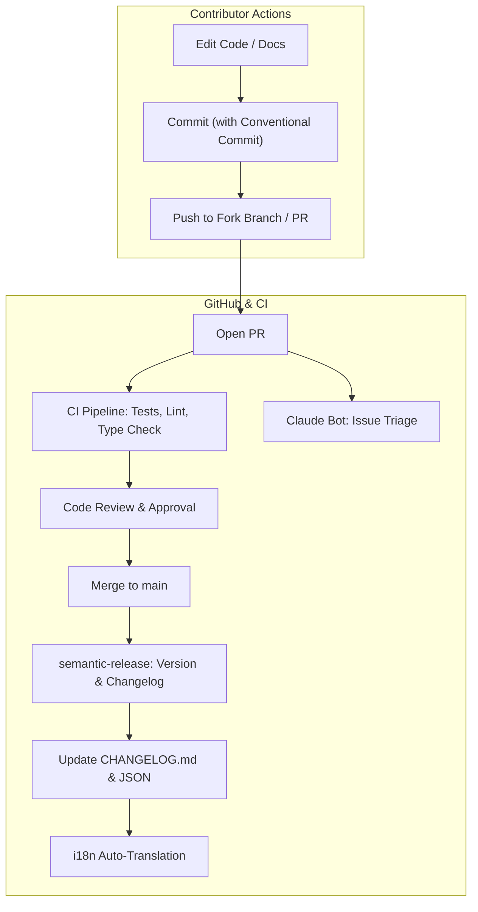

<!-- source: DeepWiki mcp.deepwiki.com · repo lobehub/lobehub · page 13.5 Contributing Guidelines · fetched 2026-10-29 -->

# Contributing Guidelines

<details>
<summary>Relevant source files</summary>

The following files were used as context for generating this wiki page:

- [.gitignore](.gitignore)
- [.prettierignore](.prettierignore)
- [.vscode/settings.json](.vscode/settings.json)
- [docs/.cdn.cache.json](docs/.cdn.cache.json)
- [docs/changelog/2026-03-23-media-memory.mdx](docs/changelog/2026-03-23-media-memory.mdx)
- [docs/changelog/2026-03-23-media-memory.zh-CN.mdx](docs/changelog/2026-03-23-media-memory.zh-CN.mdx)
- [docs/changelog/2026-03-30-agent-tasks.mdx](docs/changelog/2026-03-30-agent-tasks.mdx)
- [docs/changelog/2026-03-30-agent-tasks.zh-CN.mdx](docs/changelog/2026-03-30-agent-tasks.zh-CN.mdx)
- [docs/changelog/2026-04-06-auto-completion.mdx](docs/changelog/2026-04-06-auto-completion.mdx)
- [docs/changelog/2026-04-06-auto-completion.zh-CN.mdx](docs/changelog/2026-04-06-auto-completion.zh-CN.mdx)
- [docs/changelog/2026-04-13-gateway-sidebar.mdx](docs/changelog/2026-04-13-gateway-sidebar.mdx)
- [docs/changelog/2026-04-13-gateway-sidebar.zh-CN.mdx](docs/changelog/2026-04-13-gateway-sidebar.zh-CN.mdx)
- [docs/changelog/2026-05-04-task-scheduler.mdx](docs/changelog/2026-05-04-task-scheduler.mdx)
- [docs/changelog/2026-05-04-task-scheduler.zh-CN.mdx](docs/changelog/2026-05-04-task-scheduler.zh-CN.mdx)
- [docs/changelog/2026-05-11-agent-tasks-ga.mdx](docs/changelog/2026-05-11-agent-tasks-ga.mdx)
- [docs/changelog/2026-05-11-agent-tasks-ga.zh-CN.mdx](docs/changelog/2026-05-11-agent-tasks-ga.zh-CN.mdx)
- [docs/changelog/2026-05-19-chief-agent-operator.mdx](docs/changelog/2026-05-19-chief-agent-operator.mdx)
- [docs/changelog/2026-05-19-chief-agent-operator.zh-CN.mdx](docs/changelog/2026-05-19-chief-agent-operator.zh-CN.mdx)
- [docs/changelog/2026-05-31-drag-and-drop-skills.mdx](docs/changelog/2026-05-31-drag-and-drop-skills.mdx)
- [docs/changelog/2026-05-31-drag-and-drop-skills.zh-CN.mdx](docs/changelog/2026-05-31-drag-and-drop-skills.zh-CN.mdx)
- [docs/changelog/2026-06-08-connectors.mdx](docs/changelog/2026-06-08-connectors.mdx)
- [docs/changelog/2026-06-08-connectors.zh-CN.mdx](docs/changelog/2026-06-08-connectors.zh-CN.mdx)
- [docs/changelog/2026-06-15-browser-pairing.mdx](docs/changelog/2026-06-15-browser-pairing.mdx)
- [docs/changelog/2026-06-22-delivery-checks.mdx](docs/changelog/2026-06-22-delivery-checks.mdx)
- [docs/changelog/2026-06-22-delivery-checks.zh-CN.mdx](docs/changelog/2026-06-22-delivery-checks.zh-CN.mdx)
- [docs/changelog/2026-06-29-cleaner-conversations.mdx](docs/changelog/2026-06-29-cleaner-conversations.mdx)
- [docs/changelog/2026-06-29-cleaner-conversations.zh-CN.mdx](docs/changelog/2026-06-29-cleaner-conversations.zh-CN.mdx)
- [docs/changelog/2026-07-06-workspace-chat-controls.mdx](docs/changelog/2026-07-06-workspace-chat-controls.mdx)
- [docs/changelog/2026-07-06-workspace-chat-controls.zh-CN.mdx](docs/changelog/2026-07-06-workspace-chat-controls.zh-CN.mdx)
- [docs/changelog/index.json](docs/changelog/index.json)
- [docs/usage/getting-started/task.mdx](docs/usage/getting-started/task.mdx)
- [docs/usage/getting-started/task.zh-CN.mdx](docs/usage/getting-started/task.zh-CN.mdx)
- [docs/usage/providers/aihubmix.mdx](docs/usage/providers/aihubmix.mdx)
- [eslint-suppressions.json](eslint-suppressions.json)
- [eslint.config.mjs](eslint.config.mjs)
- [packages/builtin-tool-notebook/src/systemRole.ts](packages/builtin-tool-notebook/src/systemRole.ts)
- [packages/context-engine/src/providers/GroupContextInjector.ts](packages/context-engine/src/providers/GroupContextInjector.ts)
- [packages/context-engine/src/providers/__tests__/GroupContextInjector.test.ts](packages/context-engine/src/providers/__tests__/GroupContextInjector.test.ts)
- [packages/context-engine/src/providers/__tests__/__snapshots__/GroupContextInjector.test.ts.snap](packages/context-engine/src/providers/__tests__/__snapshots__/GroupContextInjector.test.ts.snap)
- [src/app/manifest.ts](src/app/manifest.ts)
- [src/components/StreamingMarkdown/index.tsx](src/components/StreamingMarkdown/index.tsx)
- [src/features/AgentTasks/features/TaskStatusCascadeModal.tsx](src/features/AgentTasks/features/TaskStatusCascadeModal.tsx)
- [src/features/Billboard/Carousel.tsx](src/features/Billboard/Carousel.tsx)
- [src/features/Billboard/index.tsx](src/features/Billboard/index.tsx)
- [src/features/Conversation/Messages/AgentCouncil/components/AutoScrollShadow.tsx](src/features/Conversation/Messages/AgentCouncil/components/AutoScrollShadow.tsx)
- [src/features/Conversation/Messages/AgentCouncil/components/CouncilMember.tsx](src/features/Conversation/Messages/AgentCouncil/components/CouncilMember.tsx)
- [src/features/Conversation/Messages/AssistantGroup/components/ContentBlocksScroll.test.tsx](src/features/Conversation/Messages/AssistantGroup/components/ContentBlocksScroll.test.tsx)
- [src/features/Conversation/Messages/AssistantGroup/components/ContentBlocksScroll.tsx](src/features/Conversation/Messages/AssistantGroup/components/ContentBlocksScroll.tsx)
- [src/features/Conversation/WorkingSidebar/Review/FileRow.tsx](src/features/Conversation/WorkingSidebar/Review/FileRow.tsx)
- [src/features/Conversation/components/Thinking/index.tsx](src/features/Conversation/components/Thinking/index.tsx)
- [src/features/Electron/HeterogeneousAgent/StatusGuide/states/AuthRequiredState.tsx](src/features/Electron/HeterogeneousAgent/StatusGuide/states/AuthRequiredState.tsx)
- [src/features/Electron/system/ZoomHUD/index.test.tsx](src/features/Electron/system/ZoomHUD/index.test.tsx)
- [src/features/Electron/system/ZoomHUD/index.tsx](src/features/Electron/system/ZoomHUD/index.tsx)
- [src/features/TaskDock/index.tsx](src/features/TaskDock/index.tsx)
- [src/utils/sanitizeFileName.ts](src/utils/sanitizeFileName.ts)

</details>


This page documents the technical standards and automated workflows required for contributing to the LobeHub codebase. It covers the Pull Request (PR) lifecycle, commit conventions, automated internationalization (i18n), changelog workflows, and linting configurations to ensure code quality and consistency across the monorepo.

---

## 1. Commit Message Conventions

LobeHub enforces structured commit messages using `commitlint` to facilitate automated changelog generation, semantic versioning, and better changelog automation.

### 1.1 Commit Message Format

Commits must adhere to the [Conventional Commits specification](https://www.conventionalcommits.org/en/v1.0.0/):

```
<type>(<scope>): <description>
```

| Type      | Description                                                       |
|-----------|-------------------------------------------------------------------|
| `feat`    | A new feature for the user.                                       |
| `fix`     | A bug fix.                                                        |
| `docs`    | Documentation-only changes.                                       |
| `style`   | Changes that do not affect the meaning of the code (formatting, whitespace, etc). |
| `refactor`| A code change that neither fixes a bug nor adds a feature.        |
| `perf`    | A code change that improves performance.                          |
| `test`    | Adding or fixing tests.                                           |
| `build`   | Changes that affect build system or external dependencies.        |
| `ci`      | Changes to CI configuration files and scripts.                    |
| `misc`    | Other changes that do not modify source or test files.            |

### 1.2 Automation Workflow

- `commitlint` is integrated using the `husky` Git hooks system.
- The `commit-msg` hook runs `commitlint` to enforce the above commit format.
- This setup is configured within `.githooks` and the `package.json` scripts.

---

## 2. Changelog Workflow

LobeHub uses a multi-layered changelog system that provides both a public-facing Markdown changelog and structured JSON changelog data powering the in-app changelog UI.

### 2.1 Markdown Changelog

- The primary `CHANGELOG.md` is managed and generated by `semantic-release`, which parses commit messages.
- It focuses on entries marked `feat`, `fix`, and `perf` to manage version bumps and entries automatically.

### 2.2 Structured JSON Changelogs

- The repository maintains JSON changelog files under `docs/changelog/` (e.g., `docs/changelog/index.json` [docs/changelog/index.json:1-258] and individual `.mdx` files like `docs/changelog/2026-05-04-task-scheduler.mdx` []). These files contain structured changelog data used inside the app UI for "What's New" features.
- The `docs/.cdn.cache.json` [docs/.cdn.cache.json:1-62] file maps CDN URLs to local blog assets, which are often referenced in changelog entries.
- The script `scripts/changelogWorkflow/index.ts` syncs Markdown entries to these JSON files.
- The script is invoked by the `workflow:changelog` command.

### 2.3 Changelog Data Flow


Sources:
- [docs/changelog/index.json:1-258]()
- [docs/.cdn.cache.json:1-62]()
- [docs/changelog/2026-05-04-task-scheduler.mdx]()
- [docs/changelog/2026-05-04-task-scheduler.zh-CN.mdx]()
- [docs/changelog/2026-03-30-agent-tasks.mdx]()
- [docs/changelog/2026-03-30-agent-tasks.zh-CN.mdx]()
- [docs/changelog/2026-06-29-cleaner-conversations.mdx]()
- [docs/changelog/2026-06-29-cleaner-conversations.zh-CN.mdx]()
- [docs/changelog/2026-06-08-connectors.mdx]()
- [docs/changelog/2026-06-08-connectors.zh-CN.mdx]()
- [docs/changelog/2026-05-19-chief-agent-operator.zh-CN.mdx]()
- [docs/changelog/2026-05-19-chief-agent-operator.mdx]()
- [docs/changelog/2026-06-22-delivery-checks.mdx]()
- [docs/changelog/2026-06-22-delivery-checks.zh-CN.mdx]()
- [docs/changelog/2026-04-13-gateway-sidebar.mdx]()
- [docs/changelog/2026-04-13-gateway-sidebar.zh-CN.mdx]()
- [docs/changelog/2026-04-06-auto-completion.zh-CN.mdx]()
- [docs/changelog/2026-04-06-auto-completion.mdx]()
- [docs/changelog/2026-05-11-agent-tasks-ga.zh-CN.mdx]()
- [docs/changelog/2026-05-11-agent-tasks-ga.mdx]()
- [docs/changelog/2026-03-23-media-memory.mdx]()
- [docs/changelog/2026-03-23-media-memory.zh-CN.mdx]()
- [docs/changelog/2026-07-06-workspace-chat-controls.mdx]()
- [docs/changelog/2026-07-06-workspace-chat-controls.zh-CN.mdx]()
- [docs/changelog/2026-06-15-browser-pairing.mdx]()
- [docs/changelog/2026-05-31-drag-and-drop-skills.mdx]()

---

## 3. i18n Auto-Translation Workflow

LobeHub supports an automated internationalization pipeline to maintain synced translations across 18 locales.

### 3.1 Workflow Steps

1. Developers update English locale files in `src/locales/default/`.
2. Running `npm run i18n` triggers the `workflow:i18n` script: it extracts translation keys, scans for unused keys, and prepares changes.
3. The `lobe-i18n` CLI, powered by AI translation, automatically translates new or modified keys into all supported locales.
4. Scripts such as `i18n:unused` and `i18n:unused-clean` analyze and clean obsolete keys.

### 3.2 GitHub Actions Integration

- The `auto-i18n.yml` workflow automates daily updates.
- It runs on cron schedules or manual dispatch and uses the `lobehubbot` to open PRs with label `i18n`.

```mermaid
graph TD
    Dev["Developer edits English locale"] --> Extract["Run `npm run i18n`"]
    Extract --> AutoTranslate["`lobe-i18n` auto-translation"]
    AutoTranslate --> CommitPR["Commit & open PR"]
    CommitPR --> Merge["Merge after review"]

    subgraph "GitHub Actions"
        cron["Daily i18n Update (cron)"]
        manual["Manual trigger"]
        cron --> AutoTranslate
        manual --> AutoTranslate
    end
```
Sources:
- [.github/workflows/auto-i18n.yml:1-69]()

---

## 4. Linting and Code Quality

LobeHub enforces code quality with ESLint, Stylelint, type checking, and circular dependency analysis.

### 4.1 Tools and Configuration

| Tool        | Script           | Targets                                | Notes                                   |
|-------------|------------------|----------------------------------------|-----------------------------------------|
| ESLint      | `lint:ts`        | `src/`, `tests/`                       | For TypeScript and JSX files             |
| Stylelint   | `lint:style`     | CSS-in-JS inside `.js`, `.tsx` files   | Fixes with `--fix` option                |
| TypeScript  | `type-check`     | Whole repository                       | Ensures full static type safety          |
| Circular Dep| `lint:circular`  | Detects circular dependencies          | Uses `dpdm` tool                         |

### 4.2 ESLint Rules and Exceptions

The ESLint configuration is defined in `eslint.config.mjs` [eslint.config.mjs:1-177] and uses `@lobehub/lint`.
It includes several custom rules and restricted imports to enforce performance and runtime boundaries:

- **Performance Restricted Imports**: Prevents direct imports of large modules like `@lobehub/icons` or `motion/react` to encourage lazy loading or subpath imports [eslint.config.mjs:15-53].
- **Shell Router Restricted Paths**: Restricts `react-router` hooks and `useQueryParam`/`useQueryState` in shell components to avoid issues with the frozen root router in desktop environments [eslint.config.mjs:62-81].
- **Heterogeneous Agents Browser Runtime Boundary**: Enforces that browser code only imports from specified entries in `@lobechat/heterogeneous-agents` to prevent Node.js-specific code from being bundled [eslint.config.mjs:89-105].
- **Browser Runtime Restricted Imports**: Prevents Node.js built-ins and server-only code (e.g., database models, TRPC services) from being imported into browser environments [eslint.config.mjs:115-159].
- **Redis Access Restrictions**: Limits direct Redis client access to specific service files [eslint.config.mjs:161-177].
- **Unused Keys**: The `i18n-unused-keys-report.json` [i18n-unused-keys-report.json:1-2] is generated to track unused i18n keys.
- **Suppression**: Specific known exceptions are recorded in `eslint-suppressions.json` [eslint-suppressions.json:1-2].

### 4.3 Stylelint Configuration

Stylelint is configured to validate CSS and PostCSS, including CSS-in-JS within TypeScript React files [vscode/settings.json:58-63]. It can fix issues on save [vscode/settings.json:5].

### 4.4 Formatting

- Uses `prettier` for consistent formatting including JSON and Markdown files. The `.prettierignore` file [prettierignore:1-1] specifies files to exclude from formatting.
- `lint` script aggregates all linting and formatting checks.

### 4.5 VSCode Settings

The `.vscode/settings.json` [vscode/settings.json:1-108] file configures VSCode to automatically fix ESLint and Stylelint issues on save, and sets up specific file watchers and search exclusions.


Sources:
- [eslint.config.mjs:1-177]()
- [eslint-suppressions.json:1]()
- [.vscode/settings.json:1-108]()
- [.prettierignore:1-1]()

---

## 5. PR and Release Pipeline

### 5.1 CI/CD Integration

- Contributions require a pull request on GitHub.
- GitHub Actions validate each PR by running:
  - Vitest tests (`vitest`, `test-app`).
  - ESLint and Stylelint.
  - TypeScript type checks.
  - Circular dependency linting.
- On PR open and update, the bot triggers Claude-powered issue triage for label assignment and reviewer recommendations.
- Coverage is reported to Codecov.
- Merging triggers `semantic-release` for version bump and release automation.



### 5.2 Automated Issue Triage & Schema Visualization

- `.claude/prompts/issue-triage.md` defines automated labeling and reviewer assignment [`.claude/prompts/issue-triage.md:1-40` (not shown here)].
- Database schema changes trigger schema visualization sync workflows to maintain up-to-date docs [`.github/workflows/sync-database-schema.yml:1-27`].

### 5.3 Upstream Sync for Forks

- A scheduled workflow runs every 6 hours on forked repositories to sync latest commits from `lobehub/lobehub:main` branch [`.github/workflows/sync.yml:1-30`].

---

## 6. Summary Diagram: From Contribution to Release



---

## Appendix

### Key Files and Locations

| Purpose                      | File / Location                                       |
|------------------------------|-----------------------------------------------------|
| Commit conventions           | `package.json` `[package.json:105-106]`             |
| Changelog generation         | `CHANGELOG.md`, `docs/changelog/index.json`, `docs/changelog/*.mdx`, `scripts/changelogWorkflow/index.ts` |
| i18n auto-translation        | `package.json` scripts, `.github/workflows/auto-i18n.yml` |
| ESLint / Stylelint / Prettier| `package.json`, `eslint.config.mjs`, `eslint-suppressions.json`, `.vscode/settings.json`, `.prettierignore` |
| CI/CD workflows              | `.github/workflows/` directory, especially `test.yml`, `release.yml`, `sync.yml` |
| Claude automation prompts    | `.claude/prompts/issue-triage.md`                    |

---

**Sources:**

- [package.json:44-110]()
- [CHANGELOG.md:1-54]()
- [docs/changelog/index.json:1-258]()
- [scripts/changelogWorkflow/index.ts]()
- [.github/workflows/auto-i18n.yml:1-69]()
- [.github/workflows/sync.yml:1-30]()
- [.github/workflows/sync-database-schema.yml:1-27]()
- [.github/workflows/release.yml:1-12]()
- [.github/workflows/test.yml:1-190]()
- [.claude/prompts/issue-triage.md]()
- [eslint.config.mjs:1-177]()
- [eslint-suppressions.json:1]()
- [.vscode/settings.json:1-108]()
- [.prettierignore:1-1]()

---

