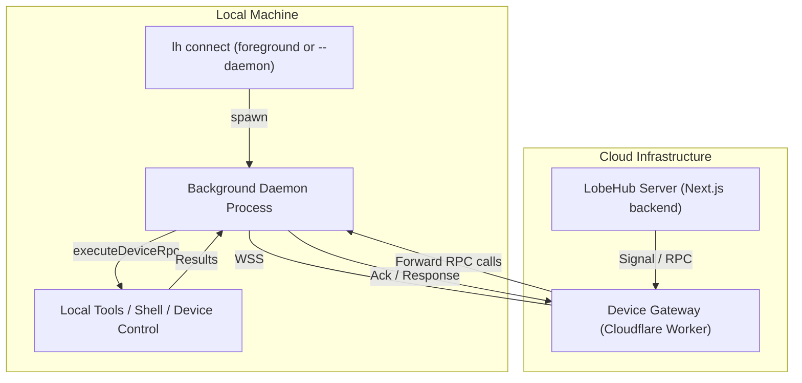
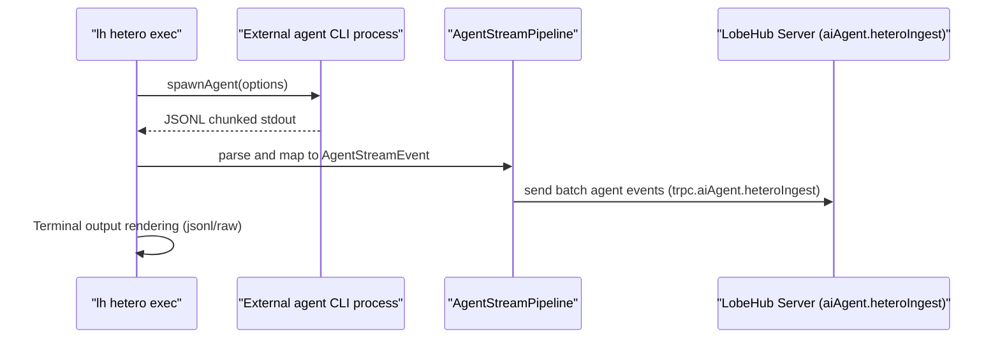

<!-- source: DeepWiki mcp.deepwiki.com · repo lobehub/lobehub · page 13.6 CLI Tool (lh) · fetched 2026-10-29 -->

# CLI Tool (lh)

<details>
<summary>Relevant source files</summary>

The following files were used as context for generating this wiki page:

- [apps/cli/man/man1/lh.1](apps/cli/man/man1/lh.1)
- [apps/cli/package.json](apps/cli/package.json)
- [apps/cli/src/api/client.test.ts](apps/cli/src/api/client.test.ts)
- [apps/cli/src/api/client.ts](apps/cli/src/api/client.ts)
- [apps/cli/src/api/http.test.ts](apps/cli/src/api/http.test.ts)
- [apps/cli/src/api/http.ts](apps/cli/src/api/http.ts)
- [apps/cli/src/auth/apiKey.test.ts](apps/cli/src/auth/apiKey.test.ts)
- [apps/cli/src/auth/apiKey.ts](apps/cli/src/auth/apiKey.ts)
- [apps/cli/src/auth/credentials.test.ts](apps/cli/src/auth/credentials.test.ts)
- [apps/cli/src/auth/credentials.ts](apps/cli/src/auth/credentials.ts)
- [apps/cli/src/auth/refresh.test.ts](apps/cli/src/auth/refresh.test.ts)
- [apps/cli/src/auth/refresh.ts](apps/cli/src/auth/refresh.ts)
- [apps/cli/src/auth/resolveToken.test.ts](apps/cli/src/auth/resolveToken.test.ts)
- [apps/cli/src/auth/resolveToken.ts](apps/cli/src/auth/resolveToken.ts)
- [apps/cli/src/commands/connect.test.ts](apps/cli/src/commands/connect.test.ts)
- [apps/cli/src/commands/connect.ts](apps/cli/src/commands/connect.ts)
- [apps/cli/src/commands/dashboard.ts](apps/cli/src/commands/dashboard.ts)
- [apps/cli/src/commands/login.test.ts](apps/cli/src/commands/login.test.ts)
- [apps/cli/src/commands/login.ts](apps/cli/src/commands/login.ts)
- [apps/cli/src/commands/status.test.ts](apps/cli/src/commands/status.test.ts)
- [apps/cli/src/commands/status.ts](apps/cli/src/commands/status.ts)
- [apps/cli/src/commands/widget.test.ts](apps/cli/src/commands/widget.test.ts)
- [apps/cli/src/commands/widget.ts](apps/cli/src/commands/widget.ts)
- [apps/cli/src/constants/urls.ts](apps/cli/src/constants/urls.ts)
- [apps/cli/src/device/register.ts](apps/cli/src/device/register.ts)
- [apps/cli/src/doctor/checks/credentials.test.ts](apps/cli/src/doctor/checks/credentials.test.ts)
- [apps/cli/src/doctor/checks/credentials.ts](apps/cli/src/doctor/checks/credentials.ts)
- [apps/cli/src/doctor/probes.ts](apps/cli/src/doctor/probes.ts)
- [apps/cli/src/program.ts](apps/cli/src/program.ts)
- [apps/cli/src/service/connect.test.ts](apps/cli/src/service/connect.test.ts)
- [apps/cli/src/service/connect.ts](apps/cli/src/service/connect.ts)
- [apps/cli/src/settings/index.test.ts](apps/cli/src/settings/index.test.ts)
- [apps/cli/src/settings/index.ts](apps/cli/src/settings/index.ts)
- [apps/desktop/src/main/services/__tests__/deviceArchitectureBackfill.test.ts](apps/desktop/src/main/services/__tests__/deviceArchitectureBackfill.test.ts)
- [apps/desktop/src/main/services/deviceArchitectureBackfill.ts](apps/desktop/src/main/services/deviceArchitectureBackfill.ts)
- [packages/builtin-skills/src/lobehub/content.ts](packages/builtin-skills/src/lobehub/content.ts)
- [packages/builtin-skills/src/lobehub/index.ts](packages/builtin-skills/src/lobehub/index.ts)
- [packages/builtin-skills/src/lobehub/references/dashboard.ts](packages/builtin-skills/src/lobehub/references/dashboard.ts)
- [packages/database/migrations/0166_device_architecture.sql](packages/database/migrations/0166_device_architecture.sql)
- [packages/database/migrations/meta/0166_snapshot.json](packages/database/migrations/meta/0166_snapshot.json)
- [packages/heterogeneous-agents/src/protocol/lobeHubCliGuide.ts](packages/heterogeneous-agents/src/protocol/lobeHubCliGuide.ts)

</details>


The LobeHub CLI (`lh`) is a comprehensive command-line interface located in the `apps/cli` package, designed to manage and connect to various LobeHub services. It provides authentication mechanisms, device gateway connectivity, resource CRUD operations, heterogeneous agent management, and facilitates shell completion and man page access. This tool is essential for power users and developers who want fine-grained control over LobeHub resources and who need to integrate local or remote tooling workflows seamlessly.

---

## Overview and Purpose

The `lh` CLI tool is bundled as the `@lobehub/cli` package [apps/cli/package.json:2-8](). It serves as a technical interface mostly used by developers and power users to:

- Authenticate with LobeHub via Device Code Flow or API Key.
- Connect to the device gateway for remote tool execution and daemonized listening.
- Manage agent lifecycles, bots, sessions, conversation topics, threads, and messages.
- Control models and AI providers, plugins, and heterogeneous agent CLI runners.
- Administer RAG (Retrieval-Augmented Generation) knowledge bases, files, user memories, tasks, goals, verification/acceptance flows, and evaluation workflows.
- Provide CLI shell autocompletion and access to man pages.

The CLI supports multiple invocation names (`lh`, `lobe`, `lobehub`) for user convenience [apps/cli/package.json:5-9]().

Sources:
- [apps/cli/package.json:2-9]()

---

## System Architecture and Data Flow

The `lh` CLI interfaces with three main service layers:

1.  **LobeHub Backend Server**: Using tRPC or REST API calls for resource management and agent execution.
2.  **Device Gateway**: A Cloudflare Worker-based gateway enabling persistent WebSocket connections for remote commands and tool executions.
3.  **Local Heterogeneous Agent Processes**: CLI wrappers executing external specialized agent CLIs (e.g., Claude Code, Codex) which integrate AI runtimes unavailable natively in LobeHub.

### Device Gateway Connectivity Flow



The `connect` command manages device registration, workspace enrollment, and maintains `daemon.pid`, `daemon.status`, and daemon logs within the CLI home directory (`~/.lobehub/`) [apps/cli/man/man1/lh.1:174-188](), [apps/cli/src/commands/connect.ts:35-47]().

Sources:
- [apps/cli/man/man1/lh.1:174-188]()
- [apps/cli/src/commands/connect.ts:35-47]()

---

## Core Command Modules

### 1. Authentication (`login`, `logout`, `whoami`)

-   **login**: Initiates Device Code Flow, opening the configured LobeHub instance in the browser and storing encrypted credentials in `~/.lobehub/credentials.json` [apps/cli/man/man1/lh.1:32-33, 175-176](). The `login` command also supports configuring an API key server [apps/cli/src/commands/login.ts:60-62]().
-   **logout**: Clears stored credentials and session tokens [apps/cli/man/man1/lh.1:34-36]().
-   **whoami**: Displays current authenticated user information and environment status [apps/cli/man/man1/lh.1:152-154]().

Sources:
- [apps/cli/man/man1/lh.1:32-36, 152-154, 175-176]()
- [apps/cli/src/commands/login.ts:60-62]()

### 2. Device Gateway Commands (`connect`, `disconnect`, `status`, `logs`, `restart`, and Linux `service`)

-   **connect**: Establishes persistent WebSocket connection with the device gateway. Supports daemon mode (`--daemon`), system service installation on Linux (`service install`), and workspace device enrollment [apps/cli/src/commands/connect.ts:106-122]().
-   **disconnect**: Alias for stopping the daemon process [apps/cli/man/man1/lh.1:47-49]().
-   **status**: Reports daemon PID and connection status [apps/cli/src/commands/connect.ts:151-171]().
-   **logs**: Tails daemon logs for diagnostic [apps/cli/src/commands/connect.ts:173-185]().
-   **service**: Manages user-level systemd service on Linux for auto-start [apps/cli/src/service/connect.ts:41-45]().

Sources:
- [apps/cli/man/man1/lh.1:47-49]()
- [apps/cli/src/commands/connect.ts:106-122, 151-185]()
- [apps/cli/src/service/connect.ts:41-45]()

### 3. Agents and Agent Groups (`agent`, `agent-group`, `agent-signal`)

Allow management of AI agents including creation, configuration, scheduling, signal inspection, and lifecycle control [apps/cli/man/man1/lh.1:71-79]().

Sources:
- [apps/cli/man/man1/lh.1:71-79]()

### 4. Bots (`bot`)

Integration commands for managing bot channels and platform connections [apps/cli/man/man1/lh.1:80-82]().

Sources:
- [apps/cli/man/man1/lh.1:80-82]()

### 5. Content Generation (`generate` / `gen`)

Invoke built-in LobeHub generation pipelines for text, image, video, and speech content [apps/cli/man/man1/lh.1:83-85]().

Sources:
- [apps/cli/man/man1/lh.1:83-85]()

### 6. Task and Goal Management (`task`, `goal`, `project`)

CRUD and orchestration commands for tasks, goals, and goal-oriented projects with deep AI integration [apps/cli/man/man1/lh.1:86-88, 104-106, 128-130]().

Sources:
- [apps/cli/man/man1/lh.1:86-88, 104-106, 128-130]()

### 7. Knowledge Base and Files (`kb`, `file`, `doc`)

Manage knowledge bases, documents, files, and folders used for retrieval-augmented generation [apps/cli/man/man1/lh.1:65-67, 89-91]().

Sources:
- [apps/cli/man/man1/lh.1:65-67, 89-91]()

### 8. Conversation System (`session`, `topic`, `thread`, `message`)

Full CRUD and navigation support for sessions, topics, threaded conversations, and individual messages [apps/cli/man/man1/lh.1:101-111, 116-118]().

Sources:
- [apps/cli/man/man1/lh.1:101-111, 116-118]()

### 9. Verification and Acceptance (`verify`, `acceptance`)

Support for Run verification criteria, rubrics, delivery acceptance workflows, and cross-round review loops [apps/cli/man/man1/lh.1:147-151]().

Sources:
- [apps/cli/man/man1/lh.1:147-151]()

### 10. Evaluation Workflows (`eval`)

Manage agent evaluation datasets, rubrics, and execution runs for benchmarking and quality assurance [apps/cli/man/man1/lh.1:158-160]().

Sources:
- [apps/cli/man/man1/lh.1:158-160]()

### 11. Heterogeneous Agents (`hetero`)

This command group runs external agent CLIs (e.g., Amplify, Claude Code, Codex) and streams their output to the terminal or LobeHub server [apps/cli/man/man1/lh.1:95-97]().

**Key Implementation Highlights:**

-   Spawns external CLI via `spawnAgent` wrapper [packages/heterogeneous-agents/src/protocol/lobeHubCliGuide.ts]().
-   Parses native JSONL or streaming output to unify with `AgentStreamEvent` format via `AgentStreamPipeline` [packages/heterogeneous-agents/src/protocol/lobeHubCliGuide.ts]().
-   Supports resuming previous conversation threads using native session IDs with retry logic when state is missing or context overflows detected [apps/cli/src/commands/connect.ts:50-51]().



Sources:
- [apps/cli/man/man1/lh.1:95-97]()
- [apps/cli/src/commands/connect.ts:50-51]()
- [packages/heterogeneous-agents/src/protocol/lobeHubCliGuide.ts]()

### 12. Artifacts (`artifact`)

Publish local pages as artifacts [apps/cli/man/man1/lh.1:92-94]().

Sources:
- [apps/cli/man/man1/lh.1:92-94]()

### 13. Model and Provider Management (`model`, `provider`)

Handle AI model definitions, runtime parameters, provider credentials, and runtime selection [apps/cli/man/man1/lh.1:119-121, 125-127]().

Sources:
- [apps/cli/man/man1/lh.1:119-121, 125-127]()

### 14. Plugin System (`plugin`, `skill`)

Manage MCP plugins and agent skills for extensibility [apps/cli/man/man1/lh.1:98-100, 138-140]().

Sources:
- [apps/cli/man/man1/lh.1:98-100, 138-140]()

### 15. Workspace and User Management (`workspace`, `user`)

Administration of workspace scopes, users, membership, and settings [apps/cli/man/man1/lh.1:141-144]().

Sources:
- [apps/cli/man/man1/lh.1:141-144]()

### 16. Shell Completion and Man Pages (`completion`, `man`)

-   Generates shell completion scripts compatible with various shells [apps/cli/man/man1/lh.1:38-40]().
-   Displays manual pages generated from the CLI's command tree [apps/cli/package.json:10-14](), [apps/cli/man/man1/lh.1:41-43]().

Sources:
- [apps/cli/package.json:10-14]()
- [apps/cli/man/man1/lh.1:38-43]()

---

## Configuration and Environment

The behavior of the `lh` CLI is configurable through local environment variables and settings files.

| Variable            | Description                                     | Default                 |
|:--------------------|:------------------------------------------------|:------------------------|
| `LOBEHUB_CLI_HOME`  | Base directory for CLI credentials and logs    | `~/.lobehub`            |
| `LOBEHUB_API_KEY`   | API key for non-interactive auth mode           | -                       |
| `LOBEHUB_DAEMON`    | Indicates daemon or service mode process         | `0`                     |

The following important files reside under the cli home directory (`~/.lobehub` by default):

| File                 | Purpose                                        |
|:---------------------|:-----------------------------------------------|
| `credentials.json`   | Encrypted OAuth2 device tokens                  |
| `settings.json`      | CLI settings such as server URLs and preferences|
| `daemon.pid`         | PID of the background daemon process            |
| `daemon.status`      | Metadata and status of the daemon                |
| `daemon.log`         | The daemon process's log output                   |

Sources:
- [apps/cli/man/man1/lh.1:174-192]()

---

## Internal Architecture and Technical Highlights

### Entry Point and Command Registration

The CLI entrypoint is set in `apps/cli/src/index.ts`, which bootstraps the `commander`-based command hierarchy defined across modules [apps/cli/src/program.ts:51-122]().

Sources:
- [apps/cli/src/program.ts:51-122]()

### API Client and Authentication Flow

Interactive commands use a tRPC client (`getTrpcClient`) to talk to the LobeHub backend with automatic token resolution and refreshing handled by the `resolveToken` utility, supporting Device Code Flow or API Key-based authentication [apps/cli/src/api/client.ts:72-91](), [apps/cli/src/auth/resolveToken.ts:43-122]().

Sources:
- [apps/cli/src/api/client.ts:72-91]()
- [apps/cli/src/auth/resolveToken.ts:43-122]()

### Device Gateway Daemon

The device gateway connection is managed by a daemon process that maintains a WebSocket connection to the gateway server. Support exists for daemon lifecycle (start, stop, restart) and systemd user service installation on Linux [apps/cli/src/commands/connect.ts:127-148](), [apps/cli/src/service/connect.ts:104-139]().

Sources:
- [apps/cli/src/commands/connect.ts:127-148]()
- [apps/cli/src/service/connect.ts:104-139]()

### Isolated Tool Execution

The CLI supports a `tool-worker` internal command which runs tool calls in an isolated subprocess space to maintain security and prevent CLI crashes from affecting the main daemon [apps/cli/man/man1/lh.1:29-30](), [apps/cli/src/program.ts:58-76]().

Sources:
- [apps/cli/man/man1/lh.1:29-30]()
- [apps/cli/src/program.ts:58-76]()

---

## Bridging Natural Language Commands to Code Entities

### Diagram 1: Command to Code Entity Mapping

```mermaid
graph TD
  subgraph CLICommands["Natural Language Commands"]
    L[login/logout/auth]
    C[connect/device daemon]
    A[agent management]
    B[bot control]
    CR[cron jobs]
    F[file management]
    K[kb knowledgebase]
    M[memory management]
    MP[model/provider config]
    S[session/topic/thread/message]
    T[task management]
    G[goal graphs]
    V[verify/acceptance]
    E[eval workflows]
    H[hetero agent CLIs]
    AR[artifacts]
    SC[Shell completion/man]
    W[widget/dashboard]
  end

  subgraph CodeEntities["Code Entities / Modules"]
    CmdConnect["connect.ts (ConnectOptions, registerConnectCommand)"]
    CmdAuth["login.ts, logout.ts (auth/resolveToken)"]
    CmdAgent["agent.ts (registerAgentCommand)"]
    CmdBot["bot.ts (registerBotCommand)"]
    CmdCron["agent-cron.ts (registerAgentCronCommand)"]
    CmdFile["file.ts (registerFileCommand)"]
    CmdKb["kb.ts (registerKbCommand)"]
    CmdMemory["memory.ts (registerMemoryCommand)"]
    CmdModel["model.ts (registerModelCommand), provider.ts (registerProviderCommand)"]
    CmdSession["session-group.ts (registerSessionGroupCommand), topic.ts (registerTopicCommand), thread.ts (registerThreadCommand), message.ts (registerMessageCommand)"]
    CmdTask["task.ts (registerTaskCommand)"]
    CmdGoal["goal.ts (registerGoalCommand)"]
    CmdVerify["verify.ts (registerVerifyCommand), verifyAcceptance.ts (registerAcceptanceCommands)"]
    CmdEval["eval.ts (registerEvalCommand)"]
    CmdHetero["hetero.ts (registerHeteroCommand)"]
    CmdArtifact["artifact.ts (registerArtifactCommand)"]
    CmdShell["completion.ts (registerCompletionCommand), man.ts (registerManCommand)"]
    CmdWidget["widget.ts (registerWidgetCommand), dashboard.ts (registerDashboardCommand)"]
  end

  L --> CmdAuth
  C --> CmdConnect
  A --> CmdAgent
  B --> CmdBot
  CR --> CmdCron
  F --> CmdFile
  K --> CmdKb
  M --> CmdMemory
  MP --> CmdModel
  S --> CmdSession
  T --> CmdTask
  G --> CmdGoal
  V --> CmdVerify
  E --> CmdEval
  H --> CmdHetero
  AR --> CmdArtifact
  SC --> CmdShell
  W --> CmdWidget
```



Sources:
- [apps/cli/man/man1/lh.1]()
- [apps/cli/src/commands/connect.ts]()
- [apps/cli/src/program.ts:51-122]()
- [apps/cli/src/commands/hetero.ts]()
- [packages/heterogeneous-agents/src/protocol/lobeHubCliGuide.ts]()
- [apps/cli/src/commands/dashboard.ts]()
- [apps/cli/src/commands/widget.ts]()

### Diagram 2: Runtime Flow - From CLI Command to Device Gateway and Agent Execution

```mermaid
flowchart TB
  subgraph CLI["lh CLI Tool"]
    cmd["User issues CLI command (e.g. `lh connect`, `lh hetero`)"]
    apiClient["tRPC Client (getTrpcClient)"]
    daemon["Device Gateway Daemon (WebSocket)"]
    heteroSpawn["Heterogeneous Agent Spawn (`spawnAgent`)"]
  end

  subgraph Server["LobeHub Backend Server"]
    apiHandlers["tRPC Handlers (agent, model, kb, etc.)"]
    heteroIngest["AI Agent heteroIngest Route"]
  end

  subgraph CloudGateway["Device Gateway (Cloudflare Worker)"]
    gatewayWS["WebSocket Endpoint"]
  end

  subgraph LocalTools["Local Machine Tools"]
    shellExec["Shell and Tool Execution"]
    toolWorker["Isolated Tool Worker Process"]
  end

  cmd -->|calls| apiClient
  cmd -->|spawn daemon connect| daemon
  daemon -->|WebSocket| gatewayWS
  Server -->|signals| gatewayWS
  gatewayWS -->|forwards requests| daemon
  daemon -->|exec RPC| shellExec
  shellExec -->|responses| daemon
  daemon -->|acknowledgement| gatewayWS

  cmd -->|spawn and pipe| heteroSpawn
  heteroSpawn -->|native stdout| cmd
  heteroSpawn -->|output stream| Server heteroIngest
```

Sources:
- [apps/cli/src/commands/connect.ts:127-148]()
- [apps/cli/src/commands/hetero.ts]()
- [packages/heterogeneous-agents/src/protocol/lobeHubCliGuide.ts]()
- [apps/cli/src/api/client.ts]()

---

## References and Sources

-   CLI package manifest: `apps/cli/package.json` [2-9]()
-   CLI man page: `apps/cli/man/man1/lh.1` [1-200]()
-   Connect command implementation: `apps/cli/src/commands/connect.ts` [1-199]()
-   Heterogeneous agent integration: `apps/cli/src/commands/hetero.ts` [full file](), `packages/heterogeneous-agents/src/protocol/lobeHubCliGuide.ts` [full file]()
-   CLI entry program and commands registration: `apps/cli/src/program.ts` [51-122]()
-   API client and authentication token logic: `apps/cli/src/api/client.ts` [1-161]()
-   Isolated tool execution detail: `apps/cli/src/program.ts` [58-76]()
-   Connect service implementation: `apps/cli/src/service/connect.ts` [1-306]()

This wiki page documents the current state and architecture of the LobeHub CLI tool (`lh`), explaining its command structure, internal data flow, and integration with LobeHub server infrastructure.

---

