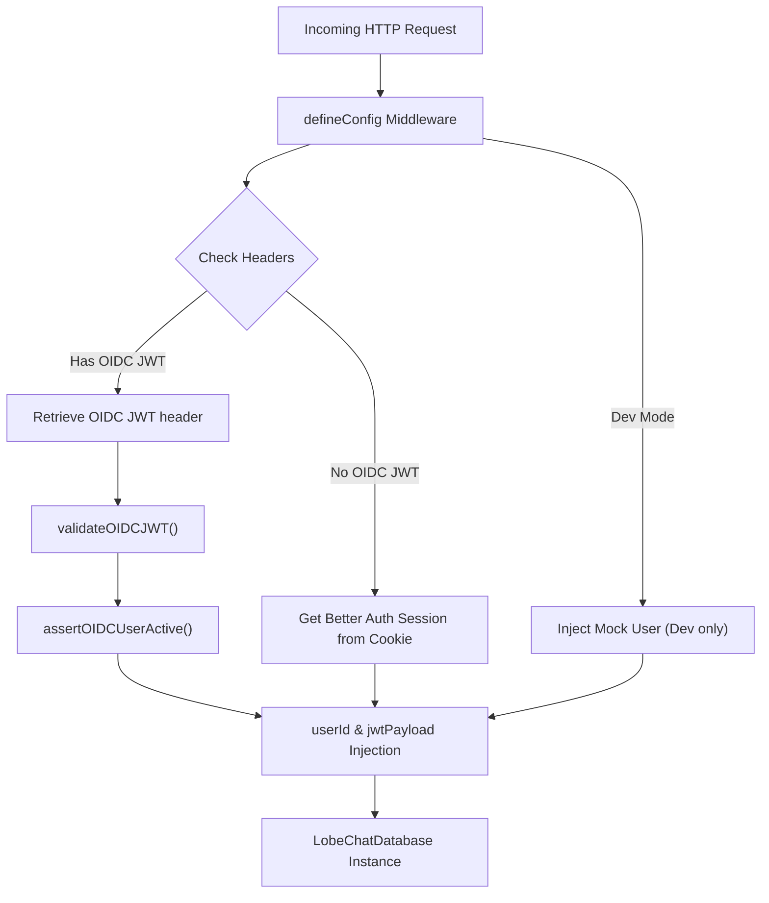
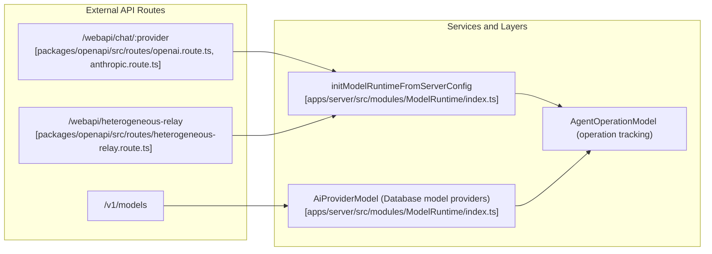
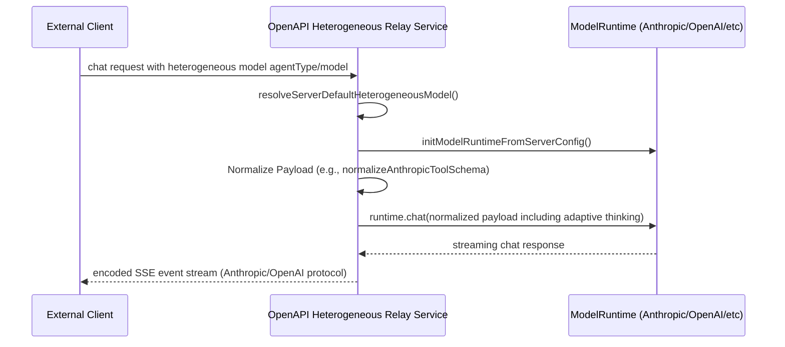
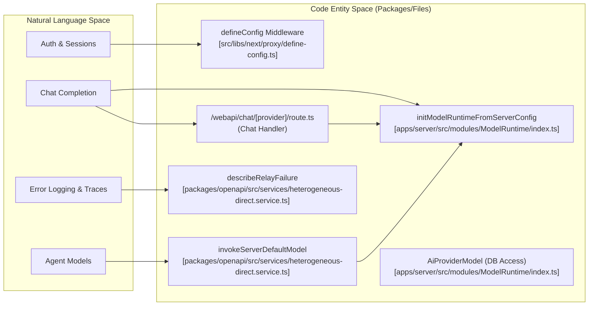

<!-- source: DeepWiki mcp.deepwiki.com · repo lobehub/lobehub · page 13.7 OpenAPI and External HTTP API · fetched 2026-10-29 -->

# OpenAPI and External HTTP API

Relevant source files

The following files were used as context for generating this wiki page:

- [apps/desktop/src/main/modules/heterogeneousAgent/drivers/codex.test.ts](apps/desktop/src/main/modules/heterogeneousAgent/drivers/codex.test.ts)
- [apps/desktop/src/main/modules/heterogeneousAgent/drivers/codex.ts](apps/desktop/src/main/modules/heterogeneousAgent/drivers/codex.ts)
- [apps/desktop/src/main/modules/heterogeneousAgent/drivers/trae.test.ts](apps/desktop/src/main/modules/heterogeneousAgent/drivers/trae.test.ts)
- [apps/desktop/src/main/modules/heterogeneousAgent/drivers/trae.ts](apps/desktop/src/main/modules/heterogeneousAgent/drivers/trae.ts)
- [apps/server/src/globalConfig/genServerAiProviderConfig.test.ts](apps/server/src/globalConfig/genServerAiProviderConfig.test.ts)
- [apps/server/src/globalConfig/genServerAiProviderConfig.ts](apps/server/src/globalConfig/genServerAiProviderConfig.ts)
- [apps/server/src/globalConfig/index.test.ts](apps/server/src/globalConfig/index.test.ts)
- [apps/server/src/modules/ModelRuntime/index.test.ts](apps/server/src/modules/ModelRuntime/index.test.ts)
- [apps/server/src/modules/ModelRuntime/index.ts](apps/server/src/modules/ModelRuntime/index.ts)
- [apps/server/src/routers/lambda/__tests__/aiAgent.serverDefaultCapability.test.ts](apps/server/src/routers/lambda/__tests__/aiAgent.serverDefaultCapability.test.ts)
- [apps/server/src/routers/lambda/__tests__/aiAgent.serverDefaultOperation.test.ts](apps/server/src/routers/lambda/__tests__/aiAgent.serverDefaultOperation.test.ts)
- [packages/database/src/server/models/__tests__/adapter.test.ts](packages/database/src/server/models/__tests__/adapter.test.ts)
- [packages/heterogeneous-agents/src/index.ts](packages/heterogeneous-agents/src/index.ts)
- [packages/heterogeneous-agents/src/providerBinding/index.ts](packages/heterogeneous-agents/src/providerBinding/index.ts)
- [packages/heterogeneous-agents/src/providerBinding/serverDefault.test.ts](packages/heterogeneous-agents/src/providerBinding/serverDefault.test.ts)
- [packages/heterogeneous-agents/src/providerBinding/serverDefault.ts](packages/heterogeneous-agents/src/providerBinding/serverDefault.ts)
- [packages/heterogeneous-agents/src/spawn/traeAcpSession.test.ts](packages/heterogeneous-agents/src/spawn/traeAcpSession.test.ts)
- [packages/model-bank/src/types/aiModel.test.ts](packages/model-bank/src/types/aiModel.test.ts)
- [packages/model-runtime/src/utils/getFallbackModelProperty.test.ts](packages/model-runtime/src/utils/getFallbackModelProperty.test.ts)
- [packages/model-runtime/src/utils/getFallbackModelProperty.ts](packages/model-runtime/src/utils/getFallbackModelProperty.ts)
- [packages/model-runtime/src/utils/routeFallback.ts](packages/model-runtime/src/utils/routeFallback.ts)
- [packages/openapi/src/middleware/hetero-operation-auth.test.ts](packages/openapi/src/middleware/hetero-operation-auth.test.ts)
- [packages/openapi/src/middleware/hetero-operation-auth.ts](packages/openapi/src/middleware/hetero-operation-auth.ts)
- [packages/openapi/src/routes/anthropic.route.ts](packages/openapi/src/routes/anthropic.route.ts)
- [packages/openapi/src/routes/heterogeneous-relay.route.test.ts](packages/openapi/src/routes/heterogeneous-relay.route.test.ts)
- [packages/openapi/src/routes/openai.route.ts](packages/openapi/src/routes/openai.route.ts)
- [packages/openapi/src/services/heterogeneous-direct.service.test.ts](packages/openapi/src/services/heterogeneous-direct.service.test.ts)
- [packages/openapi/src/services/heterogeneous-direct.service.ts](packages/openapi/src/services/heterogeneous-direct.service.ts)
- [packages/utils/src/server/index.ts](packages/utils/src/server/index.ts)
- [public/acceptance/skill.md](public/acceptance/skill.md)
- [src/app/(backend)/oidc/[...oidc]/route.test.ts](src/app/(backend)/oidc/[...oidc]/route.test.ts)
- [src/app/(backend)/oidc/[...oidc]/route.ts](src/app/(backend)/oidc/[...oidc]/route.ts)
- [src/app/(backend)/oidc/callback/desktop/route.ts](src/app/(backend)/oidc/callback/desktop/route.ts)
- [src/app/(backend)/oidc/clear-session/route.ts](src/app/(backend)/oidc/clear-session/route.ts)
- [src/app/(backend)/oidc/consent/route.test.ts](src/app/(backend)/oidc/consent/route.test.ts)
- [src/app/(backend)/oidc/consent/route.ts](src/app/(backend)/oidc/consent/route.ts)
- [src/business/client/hooks/useSwitchWorkspace.ts](src/business/client/hooks/useSwitchWorkspace.ts)
- [src/features/Acceptance/Workspace/AcceptanceOnboarding.tsx](src/features/Acceptance/Workspace/AcceptanceOnboarding.tsx)
- [src/features/User/__tests__/UserAvatar.test.tsx](src/features/User/__tests__/UserAvatar.test.tsx)
- [src/features/Workspace/__tests__/workspaceSlugHooks.test.tsx](src/features/Workspace/__tests__/workspaceSlugHooks.test.tsx)
- [src/features/Workspace/useWorkspaceUrlSync.ts](src/features/Workspace/useWorkspaceUrlSync.ts)
- [src/layout/GlobalProvider/useUserStateRedirect.ts](src/layout/GlobalProvider/useUserStateRedirect.ts)
- [src/libs/next/proxy/define-config.test.ts](src/libs/next/proxy/define-config.test.ts)
- [src/libs/next/proxy/define-config.ts](src/libs/next/proxy/define-config.ts)
- [src/libs/oidc-provider/adapter.ts](src/libs/oidc-provider/adapter.ts)
- [src/libs/oidc-provider/config.ts](src/libs/oidc-provider/config.ts)
- [src/libs/oidc-provider/cookies.ts](src/libs/oidc-provider/cookies.ts)
- [src/libs/oidc-provider/http-adapter.test.ts](src/libs/oidc-provider/http-adapter.test.ts)
- [src/libs/oidc-provider/http-adapter.ts](src/libs/oidc-provider/http-adapter.ts)
- [src/libs/oidc-provider/interaction-policy.ts](src/libs/oidc-provider/interaction-policy.ts)
- [src/libs/oidc-provider/jwt.test.ts](src/libs/oidc-provider/jwt.test.ts)
- [src/libs/oidc-provider/jwt.ts](src/libs/oidc-provider/jwt.ts)
- [src/libs/oidc-provider/provider.test.ts](src/libs/oidc-provider/provider.test.ts)
- [src/libs/oidc-provider/provider.ts](src/libs/oidc-provider/provider.ts)
- [src/libs/oidc-provider/selective-body.d.ts](src/libs/oidc-provider/selective-body.d.ts)
- [src/libs/oidc-provider/session-cleanup.test.ts](src/libs/oidc-provider/session-cleanup.test.ts)
- [src/libs/oidc-provider/session-cleanup.ts](src/libs/oidc-provider/session-cleanup.ts)
- [src/proxy.ts](src/proxy.ts)
- [src/store/serverConfig/selectors.ts](src/store/serverConfig/selectors.ts)
- [src/store/user/slices/auth/action.ts](src/store/user/slices/auth/action.ts)
- [src/store/user/slices/auth/initialState.ts](src/store/user/slices/auth/initialState.ts)
- [src/store/user/slices/auth/selectors.test.ts](src/store/user/slices/auth/selectors.test.ts)
- [src/store/user/slices/auth/selectors.ts](src/store/user/slices/auth/selectors.ts)
- [src/utils/server/parseModels.ts](src/utils/server/parseModels.ts)

LobeHub provides a comprehensive programmatic interface via a dedicated OpenAPI server that facilitates interaction with AI agents, conversation data, and model runtimes from external clients. This server, built using the **Hono** framework, exposes RESTful endpoints that mirror internal services, enabling seamless automation and integration beyond the web UI.

## Overview and Purpose

The `packages/openapi` directory houses the OpenAPI server, which serves as the external access layer for:

- **Programmatic Chat**: Invoking AI models and streaming responses using LobeHub's chat protocol.
- **Resource Management**: CRUD operations for entities like Agents, Sessions, Topics, and Files.
- **Authentication**: Supports both user authentication via OIDC JWT tokens and programmatic API key authorization.

This server bridges outside requests to internal business logic and runtime modules, ensuring authorization, request normalization, and response encoding aligned with LobeHub's architecture.

Sources: `packages/openapi/src/routes/openai.route.ts:1-40`(), `src/libs/next/proxy/define-config.ts:50-54`()

---

## Authentication Middleware

### Overview

The OpenAPI server uses a secure authentication middleware layer that supports two essential auth mechanisms:

- **OIDC JWT Authentication**: Primarily used by the `lh` CLI and other trusted clients. It validates tokens provided in the `LOBE_CHAT_OIDC_AUTH_HEADER` header (e.g., `X-Lobe-Chat-Auth`).
- **Session Authentication**: For web-originated requests, uses Better Auth's session management.
- **Development Bypass**: Allows optional mock user identity injection in local development.

### Authentication Flow

The `defineConfig` middleware [src/libs/next/proxy/define-config.ts:50-181]() enforces authentication as follows:

1.  **OIDC Token Check**
    The request headers are verified for an OIDC JWT token via `LOBE_CHAT_OIDC_AUTH_HEADER`. If present, the token is validated using `validateOIDCJWT`, and the user’s active status is asserted by `assertOIDCUserActive`.

2.  **Session Retrieval**
    If no OIDC token exists, the middleware retrieves the Better Auth session tied to the cookie header.

3.  **Mock User for Development**
    When running in development mode with the relevant env flag, a hardcoded mock user ID is injected for ease of testing.

4.  **Context Injection**
    Upon successful auth, the middleware wraps the request and injects `userId`, `jwtPayload`, and a `serverDB` instance for downstream handlers.

### Error Handling

- Unauthorized or inactive users result in early termination with structured error responses.
- OIDC validation failures are logged with decoded client info to aid troubleshooting.
- Unexpected errors produce generic internal server error responses.

#### Authentication Middleware Data Flow Diagram

Sources: `src/libs/next/proxy/define-config.ts:50-181`(), `src/libs/oidc-provider/jwt.ts:106-173`(), `src/libs/oidc-provider/provider.ts:148-168`()

---

## Route Structure and Service Layer

### Overview

The OpenAPI server routes are structured by API resource type and delegate to internal service layers for business logic execution. This maintains coherence between public REST endpoints and internal data models and runtime abstractions.

### Principal Route Categories

-   **Chat Completion API (`/webapi/chat/:provider`)**
    Routes user chat requests to the AI model runtime layer initialized from the database configuration, handling multi-provider dispatch and streaming responses.

-   **Model Metadata API (`/v1/models`)**
    Exposes AI model card listings and provider configurations for clients.

-   **Heterogeneous Relay Routes**
    Support agent models that require heterogeneous relaying across multiple runtime providers.

### Internal Service Bindings

-   **Model Runtime Initialization**
    The `initModelRuntimeFromServerConfig` function initializes the AI model runtime with user context and provider info for each request, enabling multi-provider support and adaptive thinking features [packages/openapi/src/services/heterogeneous-direct.service.ts:49-52]().

-   **AiInfra Repositories**
    Manage database queries for AI Providers, model visibility, and enabled server models.

-   **Agent Operations Model**
    Tracks the lifecycle and metadata of agent operations for tracing and observability.

### Route-to-Code Diagram

Sources: `packages/openapi/src/routes/openai.route.ts:1-40`(), `packages/openapi/src/routes/anthropic.route.ts:1-40`(), `packages/openapi/src/routes/heterogeneous-relay.route.ts:1-50`(), `apps/server/src/modules/ModelRuntime/index.ts:49-58`(), `apps/server/src/modules/ModelRuntime/index.ts:33`()

---

## Heterogeneous Relay Protocol and Service

LobeHub supports heterogeneous relay models that allow flexible routing and streaming across multiple AI providers. This is particularly important for advanced agent workflows and hybrid deployment models.

### Key Concepts

-   **Heterogeneous Models**
    These models use the `SERVER_DEFAULT_HETEROGENEOUS_MODEL_ALIAS` and leverage a relay protocol to dispatch AI chat requests to different providers dynamically [packages/openapi/src/services/heterogeneous-direct.service.ts:26](). The `invokeServerDefaultModel` function [packages/openapi/src/services/heterogeneous-direct.service.ts:35-112]() is central to this process.

-   **Adaptive Thinking Support**
    The relay service preserves advanced request fields like `thinking` for models that declare adaptive thinking support, enabling sophisticated multi-turn compositional AI workflows [packages/openapi/src/services/heterogeneous-direct.service.test.ts:103-147]().

-   **Payload Normalization**
    Requests are normalized for different target protocols, e.g., OpenAI-like or Anthropic-like content structures, translating rich message contents and tool call patterns appropriately [packages/openapi/src/services/heterogeneous-direct.service.ts:53-64]().

### Service Flow

1.  Client sends a chat payload via heterogeneous relay endpoint.
2.  The service resolves the default heterogeneous model for the agent type using `resolveServerDefaultHeterogeneousModel` [packages/openapi/src/services/heterogeneous-direct.service.ts:44-46]().
3.  It initializes the model runtime from server config using `initModelRuntimeFromServerConfig` [packages/openapi/src/services/heterogeneous-direct.service.ts:49-52]() and normalizes the request.
4.  The underlying `runtime.chat` method is invoked with adapted request payload [packages/openapi/src/services/heterogeneous-direct.service.ts:102]().
5.  The streaming response is encoded suitably and forwarded to the client.

### Relay Streaming Interaction Diagram

Sources: `packages/openapi/src/services/heterogeneous-direct.service.ts:26`(), `packages/openapi/src/services/heterogeneous-direct.service.ts:35-112`(), `packages/openapi/src/services/heterogeneous-direct.service.test.ts:103-147`(), `packages/openapi/src/services/heterogeneous-direct.service.ts:53-64`(), `packages/openapi/src/services/heterogeneous-direct.service.ts:44-46`(), `packages/openapi/src/services/heterogeneous-direct.service.ts:49-52`(), `packages/openapi/src/services/heterogeneous-direct.service.ts:102`()

---

## SDK Package and External Client Usage

The OpenAPI server is consumed primarily by:

-   The official `lh` CLI tool, which performs OIDC login, manages tokens, and invokes chat/model APIs programmatically.
-   Third-party integrations that authenticate via API keys or user tokens and utilize endpoints to query models, send chat messages, or manage agents/resources.
-   Automated scripts or clients that require programmatic long-running AI interactions (streaming enabled with `maxDuration` up to 300 seconds).

### Client SDK Features

-   **Authentication Handling**: Automatically attaches JWT tokens or API keys to requests.
-   **Streaming Response Parsing**: Processes SSE streams in Anthropic/OpenAI-compatible formats.
-   **Error Handling**: Normalizes structured error payloads for graceful retry and diagnostics.

### Example Interaction Flow

| Step | Description | Code Reference |
| :--- | :---------- | :------------- |
| 1 | CLI obtains OIDC JWT by `lh login`. | `src/libs/oidc-provider/config.ts:61-69` (client definition) |
| 2 | CLI sends chat request with `Oidc-Auth` header. | `src/libs/next/proxy/define-config.ts:63-66` (middleware check) |
| 3 | Server validates and routes to `initModelRuntimeFromServerConfig`. | `packages/openapi/src/services/heterogeneous-direct.service.ts:49-52` |
| 4 | Streaming result sent over SSE to CLI client. | `packages/openapi/src/services/heterogeneous-direct.service.ts:110-111` |

Sources: `src/libs/oidc-provider/config.ts:61-69`(), `src/libs/next/proxy/define-config.ts:63-66`(), `packages/openapi/src/services/heterogeneous-direct.service.ts:49-52`(), `packages/openapi/src/services/heterogeneous-direct.service.ts:110-111`()

---

## Error Handling and Observability

### Error Payload Structure

When an error occurs in chat completion or other endpoints, the OpenAPI server responds with a structured payload [packages/openapi/src/services/heterogeneous-direct.service.ts:129-165]():

-   `errorType`: Enum constant from `ChatErrorType` (e.g., `Unauthorized`, `InternalServerError`).
-   `error`: Detailed message or error object.
-   `provider`: AI provider involved for context.

### Observability Features

-   **Trace Context Propagation**: The middleware extracts incoming trace context headers and injects trace headers into responses, using OpenTelemetry conventions to enable full-stack observability.
-   **OIDC Failure Logging**: Failed OIDC authentications are logged with decoded JWT client IDs for more granular diagnostics [src/libs/oidc-provider/jwt.ts:163-172]().
-   **Agent Runtime Errors**: Common runtime errors are logged with warnings. Severe ones are logged as errors to alert support [packages/openapi/src/services/heterogeneous-direct.service.ts:129-165]().

Sources: `packages/openapi/src/services/heterogeneous-direct.service.ts:129-165`(), `src/libs/oidc-provider/jwt.ts:163-172`()

---

# Summary Diagram: From Natural Language Concepts to Core Code Entities

---

This concludes the technical overview for the OpenAPI and External HTTP API subsystem in LobeHub. It covers the architecture and implementation of auth middleware, route handling, heterogeneous relay service, SDK integration, and error observability to enable smooth external programmatic interaction with the AI Agent platform.

---

# References

-   `src/libs/next/proxy/define-config.ts:1-181`
-   `packages/openapi/src/routes/openai.route.ts:1-40`
-   `packages/openapi/src/routes/anthropic.route.ts:1-40`
-   `packages/openapi/src/routes/heterogeneous-relay.route.ts:1-50`
-   `packages/openapi/src/services/heterogeneous-direct.service.ts:1-187`
-   `packages/openapi/src/services/heterogeneous-direct.service.test.ts:1-194`
-   `apps/server/src/modules/ModelRuntime/index.ts:1-199`
-   `src/libs/oidc-provider/jwt.ts:1-184`
-   `src/libs/oidc-provider/config.ts:1-97`

---

