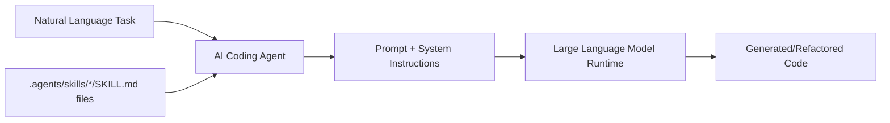
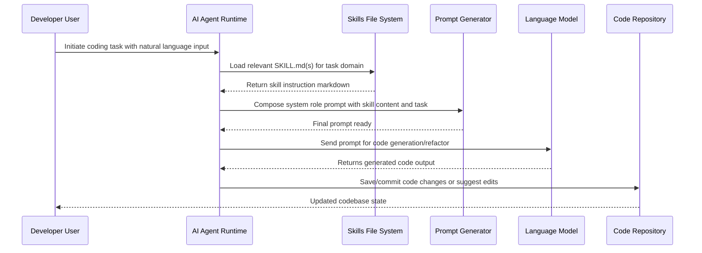
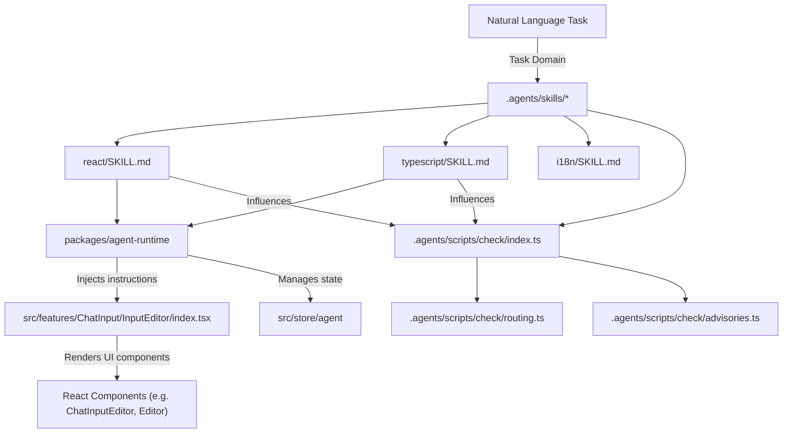
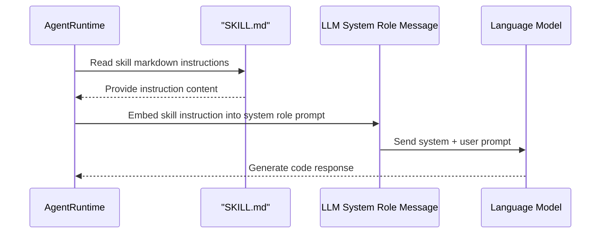

<!-- source: DeepWiki mcp.deepwiki.com · repo lobehub/lobehub · page 13.8 Agent Skills System (.agents) · fetched 2026-10-29 -->

# Agent Skills System (.agents)

Relevant source files

The following files were used as context for generating this wiki page:

- [.agents/acceptance/PROCESS.md](.agents/acceptance/PROCESS.md)
- [.agents/acceptance/PROJECT.md](.agents/acceptance/PROJECT.md)
- [.agents/acceptance/common-mistakes.md](.agents/acceptance/common-mistakes.md)
- [.agents/acceptance/probe-mock-patterns.md](.agents/acceptance/probe-mock-patterns.md)
- [.agents/acceptance/scripts/acceptance-guard.sh](.agents/acceptance/scripts/acceptance-guard.sh)
- [.agents/acceptance/scripts/acceptance-guard.test.sh](.agents/acceptance/scripts/acceptance-guard.test.sh)
- [.agents/acceptance/scripts/fixture.mjs](.agents/acceptance/scripts/fixture.mjs)
- [.agents/acceptance/scripts/report-init.sh](.agents/acceptance/scripts/report-init.sh)
- [.agents/acceptance/scripts/resource-guard.test.sh](.agents/acceptance/scripts/resource-guard.test.sh)
- [.agents/scripts/check/advisories.ts](.agents/scripts/check/advisories.ts)
- [.agents/scripts/check/base.ts](.agents/scripts/check/base.ts)
- [.agents/scripts/check/check.test.ts](.agents/scripts/check/check.test.ts)
- [.agents/scripts/check/fileSize.ts](.agents/scripts/check/fileSize.ts)
- [.agents/scripts/check/index.ts](.agents/scripts/check/index.ts)
- [.agents/scripts/check/pipelines.ts](.agents/scripts/check/pipelines.ts)
- [.agents/scripts/check/report.ts](.agents/scripts/check/report.ts)
- [.agents/scripts/check/routing.ts](.agents/scripts/check/routing.ts)
- [.agents/scripts/check/size-gate.ts](.agents/scripts/check/size-gate.ts)
- [.agents/scripts/check/sizeGate.ts](.agents/scripts/check/sizeGate.ts)
- [.agents/skills/acceptance/LICENSE](.agents/skills/acceptance/LICENSE)
- [.agents/skills/acceptance/SKILL.md](.agents/skills/acceptance/SKILL.md)
- [.agents/skills/acceptance/references/acceptance-checker.md](.agents/skills/acceptance/references/acceptance-checker.md)
- [.agents/skills/acceptance/references/agent-browser.md](.agents/skills/acceptance/references/agent-browser.md)
- [.agents/skills/acceptance/references/auth-web.md](.agents/skills/acceptance/references/auth-web.md)
- [.agents/skills/acceptance/references/axe.md](.agents/skills/acceptance/references/axe.md)
- [.agents/skills/acceptance/references/common-mistakes.md](.agents/skills/acceptance/references/common-mistakes.md)
- [.agents/skills/acceptance/references/computer-use.md](.agents/skills/acceptance/references/computer-use.md)
- [.agents/skills/acceptance/references/evidence.md](.agents/skills/acceptance/references/evidence.md)
- [.agents/skills/acceptance/references/plan-format.md](.agents/skills/acceptance/references/plan-format.md)
- [.agents/skills/acceptance/references/recording-cdp.md](.agents/skills/acceptance/references/recording-cdp.md)
- [.agents/skills/acceptance/references/recording-ios-simulator.md](.agents/skills/acceptance/references/recording-ios-simulator.md)
- [.agents/skills/acceptance/references/recording-native-macos.md](.agents/skills/acceptance/references/recording-native-macos.md)
- [.agents/skills/acceptance/references/report.md](.agents/skills/acceptance/references/report.md)
- [.agents/skills/acceptance/references/resource-guard.md](.agents/skills/acceptance/references/resource-guard.md)
- [.agents/skills/acceptance/references/sim-use.md](.agents/skills/acceptance/references/sim-use.md)
- [.agents/skills/acceptance/references/video-chapters.md](.agents/skills/acceptance/references/video-chapters.md)
- [.agents/skills/acceptance/scripts/resource-guard.sh](.agents/skills/acceptance/scripts/resource-guard.sh)
- [.agents/skills/acceptance/surfaces/ios-simulator.md](.agents/skills/acceptance/surfaces/ios-simulator.md)
- [.agents/skills/acceptance/surfaces/web.md](.agents/skills/acceptance/surfaces/web.md)
- [.agents/skills/desktop/SKILL.md](.agents/skills/desktop/SKILL.md)
- [.agents/skills/react/SKILL.md](.agents/skills/react/SKILL.md)
- [.agents/skills/testing/references/desktop-controller-test.md](.agents/skills/testing/references/desktop-controller-test.md)
- [AGENTS.md](AGENTS.md)

The **Agent Skills System** in the LobeHub codebase is a structured framework facilitating AI coding agents with reusable, domain-focused instruction sets. These instructions are authored as `SKILL.md` markdown files and stored within the `.agents/skills` directory. The system empowers AI agents to apply canonical best practices and conventions across diverse technical domains such as React, TypeScript, i18n, testing, desktop UI, UX, state management (zustand), and specialized pipelines like upstash-workflow.

This page documents the architecture and workflow of the system, covering the `.agents` directory structure, how skills manifest as instruction sets for agents, the skills-audit process to maintain quality, `.agents/acceptance` and `.agents/chaos` assets, and procedures for authoring new skills.

---

## 1. Purpose and Scope

The Agent Skills System centralizes reusable knowledge for AI coding agents working in the LobeHub repository. Instead of ad hoc prompt snippets or fragmented documentation, each skill is a standalone markdown manifest (`SKILL.md`) embodying explicit rules, best practices, and domain expertise agents use to generate or modify code.

Key objectives:

- **Reusable domain instructions**: Skills encapsulate domain-specific coding heuristics and architectural conventions.
- **Agent consistency**: Agents share a single source of truth for their behavior in complex coding domains.
- **Quality maintenance**: The **skills-audit** process continuously validates and updates skill content.
- **Extensibility**: New skills can be authored to encompass evolving technology areas or product features.

Sources:
- [AGENTS.md:14-16]()

---

## 2. Directory Layout and Skill Manifest Format

### `.agents` Directory Structure

- `.agents/skills/`
  Stores domain-specific skill folders each containing `SKILL.md` files. Examples of skill domains:

  - `react/`
  - `typescript/`
  - `i18n/`
  - `testing/`
  - `desktop/`
  - `ux/`
  - `zustand/`
  - `upstash-workflow/`

- `.agents/acceptance/`
  Contains the **LobeHub acceptance testing assets**: project-specific acceptance adapters, commands, environment setup scripts, and related documentation for the verification workflow.
  Sources:
  - [AGENTS.md:18-19]()
  - [.agents/acceptance/PROCESS.md:1-8]()
  - [.agents/acceptance/PROJECT.md:1-19]()

- `.agents/chaos/`
  Contains resources and declarative scenarios supporting chaos engineering to test resilience.

### Skill Manifest: `SKILL.md`

Each `SKILL.md` file is a markdown document that defines:

- **Instruction sets**: Clear rules and guidelines the AI agents use for their respective technical domain.
- **Best practices**: Architectural principles, coding conventions, and design rationales.
- **Operational details**: Examples, dos and don’ts, and heuristics specific to LobeHub’s technology stack.
- **Versioning**: Maintained via frontmatter in the markdown, enabling audit and update tracking.

This format is both **human-readable** for developer authors and **machine-consumable** by AI agent tooling.

Sources:
- [.agents/skills/react/SKILL.md:1-5]()
- [.agents/skills/acceptance/SKILL.md:1-17]()

---

## 3. How AI Agents Use Skills

At runtime, AI coding agents performing code synthesis, refactoring, or feature expansion load relevant skills from `.agents/skills` based on task domain or project context.

The process flow:

- The agent interprets the natural language task.
- It identifies related skill manifests containing domain-specific instructions.
- Skill `SKILL.md` content is incorporated into the **system-role messages** (or similar instruction messages) in the agent’s prompt configuration.
- When the agent calls the underlying language model (LLM), the skill content guides generation, enforcing the repository’s coding standards and conventions.
- Generated code outputs adhere to the expected patterns codified in the skills.

This approach bridges **natural language task descriptions** with **concrete code entities** by embedding explicit skill knowledge as grounding instructions.

Sources:
- [AGENTS.md:14-16]()

---

## 4. Skills-Audit Process

The skills-audit is a continuous validation workflow that:

- Parses all skill manifests under `.agents/skills`.
- Checks for content accuracy, adherence to current product conventions, and completeness.
- Detects outdated, conflicting, or unmaintained instruction sets.
- Produces audit reports for maintainers to update or deprecate skills.
- Ensures AI agents do not operate on stale or inconsistent knowledge.

This safeguard keeps AI agent outputs relevant, consistent, and aligned with team expectations.

Sources:
- [AGENTS.md:76-94]()

---

## 5. `.agents/acceptance` and `.agents/chaos` Assets

### Acceptance Subsystem (`.agents/acceptance`)

The `.agents/acceptance` directory provides the project-specific layer for LobeHub’s acceptance verification. It hosts repository-level acceptance commands, run process definitions, environment bootstrap scripts, and surface-specific testing instructions. This subsystem works in coordination with the generic `acceptance` skill, which is a committed, generated snapshot from `lobehub/acceptance` [AGENTS.md:18-19]().

Key components and their roles:

-   **`PROJECT.md`**: Defines LobeHub-specific commands, ports, services, surfaces, and probes for acceptance testing [.agents/acceptance/PROJECT.md:1-6](). It details how to start/stop dev servers, required services (Postgres, Redis, local S3, QStash), and environment/port resolution [.agents/acceptance/PROJECT.md:50-134]().
-   **`PROCESS.md`**: Outlines the workflow for a verification run, including planning, execution, publishing, and teardown [.agents/acceptance/PROCESS.md:1-15](). It emphasizes grounding the target, reading living logs (`common-mistakes.md`, `probe-mock-patterns.md`), preparing the plan, and setting up the environment and authentication [.agents/acceptance/PROCESS.md:21-129]().
-   **`common-mistakes.md`**: Lists project-specific acceptance mistakes and a checklist for evidence and publication, product and interaction contracts, and environment safety [.agents/acceptance/common-mistakes.md:1-21]().
-   **`probe-mock-patterns.md`**: Provides an index of patterns for probing and mocking, categorized by surface, runtime, and phase, specific to LobeHub [.agents/acceptance/probe-mock-patterns.md:1-23]().
-   **`scripts/init-dev-env.sh`**: A skill-owned bootstrap script for setting up the development environment, including database, S3, and user seeding [.agents/acceptance/PROJECT.md:54-70]().
-   **`scripts/test-env.sh`**: The source of truth for local test ports and environment variable resolution [.agents/acceptance/PROJECT.md:113-122]().
-   **`scripts/resource-guard.sh`**: A resource guard script to bound a run's memory cost, sampling host memory and stopping processes if thresholds are exceeded [.agents/skills/acceptance/references/resource-guard.md:1-105]().

This system enables end-to-end verification of delivery quality, managing plan-authoring, evidence capture, and publishing acceptance results. It supports multiple test surfaces: CLI, web, Electron desktop, and iOS Simulator.

Sources:
- [AGENTS.md:18-19]()
- [.agents/acceptance/PROCESS.md:1-129]()
- [.agents/acceptance/PROJECT.md:1-134]()
- [.agents/acceptance/common-mistakes.md:1-21]()
- [.agents/acceptance/probe-mock-patterns.md:1-23]()
- [.agents/skills/acceptance/references/resource-guard.md:1-105]()

### Chaos Engineering (`.agents/chaos`)

- Contains configuration and scenarios for injecting faults and perturbations into the system.
- Enables resilience testing through systematic chaos experiments.
- Works with the `@achaos/*` packages to control experiment lifecycle and effects.

---

## 6. Authoring New Skills

To create a new skill:

1.  Create a new directory under `.agents/skills` named for the target domain or technology.
2.  Author a `SKILL.md` describing:
    -   Clear, concise instructions the AI agents should follow.
    -   Relevant best practices or architectural rules.
    -   Examples, common mistakes, and verification heuristics as needed.
3.  Maintain versioning metadata in the skill frontmatter.
4.  Commit the skill manifest to the repository for audit and integration.

Once added, the skill automatically participates in:

-   Discovery by AI agent runtimes targeting that domain.
-   The skills-audit validation.
-   Prompt injection flows during agent execution.

Reference existing skills like `.agents/skills/react/SKILL.md` or `.agents/skills/acceptance/SKILL.md` for style and content conventions.

For example, the `desktop` skill provides guidelines for Electron desktop development, including IPC handlers, controllers, preload scripts, and window/menu management [.agents/skills/desktop/SKILL.md:1-14](). It details how to create new features by defining controllers, IPC types, renderer services, and store actions [.agents/skills/desktop/SKILL.md:19-73]().

Sources:
- [.agents/skills/desktop/SKILL.md:1-73]()
- [.agents/skills/react/SKILL.md:1-79]()

---

## 7. Data Flow Overview and Key Classes

### Data Flow: From Natural Language to Code via Skills

- Tasks entered by users in natural language are routed to the AI agent.
- The agent dynamically loads skill instructions from the `.agents/skills` file system.
- Skills augment the prompt as system-level instructions.
- The enhanced prompt is sent to the LLM, which emits code according to skill guidelines.

### Key Code Entities and Their Roles

| Entity/Class                | Responsibility                                                                                 | Location                                |
|-----------------------------|------------------------------------------------------------------------------------------------|-----------------------------------------|
| **Skill Loader**            | Locates and reads `SKILL.md` files from `.agents/skills`                                       | Implemented within agent CLI commands   |
| **AgentRuntime**            | Executes workflows using skills in system role prompts                                         | `packages/agent-runtime`                |
| **AcceptanceSkill**         | Builtin acceptance skill integrating `.agents/acceptance` project resources                    | `packages/builtin-skills/src/acceptance/index.ts` |
| **Skills-Audit Tooling**    | Validates skill manifest correctness, version, and content                                     | `apps/cli/src/index.ts` (via `check` command) [AGENTS.md:76-86]() |
| **Prompt Generator**        | Composes system role messages by injecting skill markdown content                              | Various frontend and runtime layers     |
| `runCli`                    | Entry point for the agent-oriented quality check engine, handling linting, testing, and type-checking based on configured pipelines and files. | `.agents/scripts/check/index.ts:70-171` |
| `pipelineFor`               | Maps file paths to appropriate linting/formatting pipelines based on file extensions.          | `.agents/scripts/check/routing.ts` (tested in `.agents/scripts/check/check.test.ts:50-72`) |
| `relatedTestCandidates`     | Identifies potential test files related to a given source file.                                | `.agents/scripts/check/routing.ts` (tested in `.agents/scripts/check/check.test.ts:116-152`) |
| `findNewComponentTestAdvisories` | Warns about new `.test.tsx` files, enforcing testing skill guidelines.                         | `.agents/scripts/check/advisories.ts` (tested in `.agents/scripts/check/check.test.ts:154-176`) |

Sources:
- [AGENTS.md:76-86]()
- [.agents/scripts/check/index.ts:70-171]()
- [.agents/scripts/check/routing.ts]()
- [.agents/scripts/check/check.test.ts:50-72]()
- [.agents/scripts/check/check.test.ts:116-152]()
- [.agents/scripts/check/advisories.ts]()
- [.agents/scripts/check/check.test.ts:154-176]()

### Sequence Diagram: Agent Skill Usage Lifecycle

---

## 8. Bridging Natural Language Space to Code Entities

The skills system acts as a bridge connecting the **abstract natural language domain knowledge** to **concrete code entities and runtime constructs**.

Key points:

-   Each skill directory represents a **domain namespace** (e.g., "react", "typescript").
-   The skill markdown content gets inserted into the **system role messages** guiding the LLM.
-   Instruction sets refer implicitly or explicitly to real code entities, e.g., React components, Next.js routes, Zustand stores, or CLI commands.
-   This layered approach ensures AI outputs respect coding standards and module boundaries.

### Diagram: Skill Domains to Code Entities in LobeHub

-   Variants of natural language tasks map to skill directories.
-   Skills are loaded and consumed by the agent runtime.
-   The runtime influences UI components and state stores as code-level artifacts.
-   The `check` script uses skills (e.g., `testing` skill via `findNewComponentTestAdvisories`) to enforce code quality and architectural guidelines.

Sources:
- [.agents/scripts/check/index.ts:70-171]()
- [.agents/scripts/check/routing.ts]()
- [.agents/scripts/check/advisories.ts]()

### Diagram: Skill Manifest Integration in AgentRuntime System Prompt

This sequence highlights how skill content is operationalized as **system-level instructions**, pivotal for consistent agent output.

---

## 9. Summary Table

| Aspect                  | Details                                                                                  |
|-------------------------|------------------------------------------------------------------------------------------|
| **Storage Location**    | `.agents/skills/` directory at repo root                                                |
| **File Format**         | Markdown files named `SKILL.md`                                                        |
| **Domains Covered**     | React, TypeScript, i18n, Testing, Desktop UI, UX, zustand, upstash-workflow, etc.      |
| **Agent Integration**   | Skills injected as system role messages in prompt sent to agent runtime                 |
| **Quality Control**     | Skills audited regularly via CLI commands (`bun run check`) and continuous integration [AGENTS.md:76-86]() |
| **Acceptance Assets**   | `.agents/acceptance/` holds project-specific verification scripts, commands, env setup  |
| **Chaos Engineering**   | `.agents/chaos/` contains chaos scenarios and fault injection assets                     |
| **Extensibility**       | New skills authored as new `.agents/skills/<domain>/SKILL.md` files                     |

The Agent Skills System is a **fundamental architectural layer** that encapsulates human expert knowledge as formalized, reusable prompts. It strengthens the reliability and consistency of AI-assisted coding workflows throughout LobeHub.

Sources:
- [AGENTS.md:76-86]()

---

## References

-   Skill content examples and acceptance skill manifest: `packages/builtin-skills/src/acceptance/SKILL.md`, `packages/builtin-skills/src/acceptance/index.ts`
-   Skill authoring and usage overview: `AGENTS.md` [AGENTS.md:14-29]()
-   Acceptance subsystem assets and project-layer adapter: `.agents/acceptance/PROJECT.md`, `.agents/acceptance/PROCESS.md`
-   CLI commands for skill install and acceptance run: `apps/cli/src/index.ts` (via `acceptance update` command) [AGENTS.md:18-19]()
-   Data flow and agent runtime integration in frontend components: `src/features/ChatInput/InputEditor/index.tsx`
-   Skills-audit process and acceptance integration: `packages/builtin-skills/src/acceptance/index.ts`
-   Acceptance flow model and verification: `packages/database/src/models/acceptanceFlow.ts`
-   Agent runtime core: `packages/agent-runtime` (implicit in usage)
-   Quality check engine: `.agents/scripts/check/index.ts` [.agents/scripts/check/index.ts:1-171]()
-   Testing skill guidelines: `.agents/skills/testing/SKILL.md`
-   Desktop skill guidelines: `.agents/skills/desktop/SKILL.md` [.agents/skills/desktop/SKILL.md:1-73]()

---

*This page is a leaf node under Development Guide (section 13.8). For broader agent system architecture and runtime details, consult section 4 and related subsections.*

---

