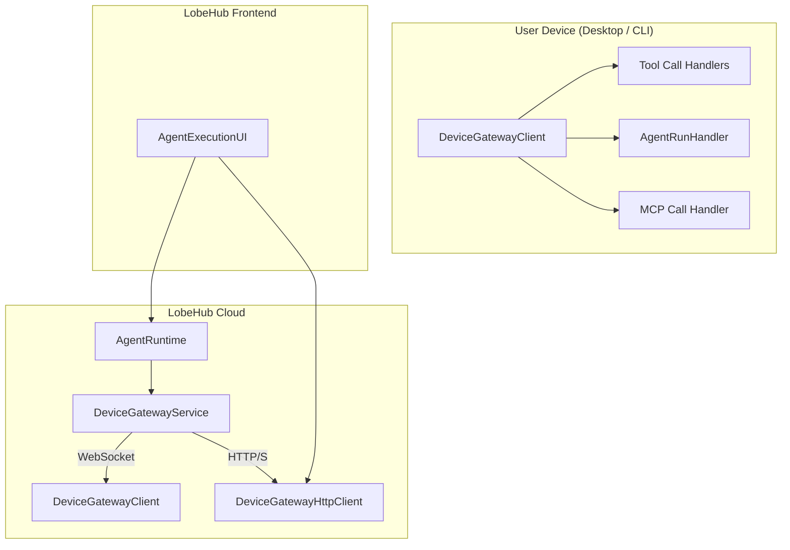
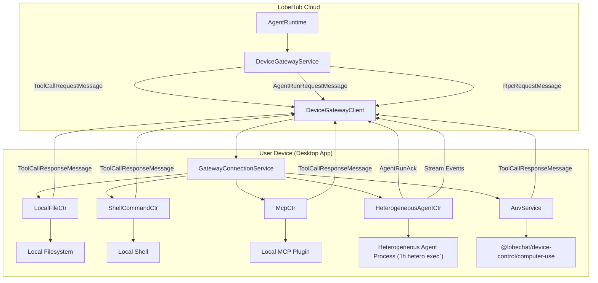

<!-- source: DeepWiki mcp.deepwiki.com · repo lobehub/lobehub · page 14 Device Gateway and Remote Execution · fetched 2026-10-29 -->

# Device Gateway and Remote Execution

<details>
<summary>Relevant source files</summary>

The following files were used as context for generating this wiki page:

- [.agents/skills/heterogeneous-agent/SKILL.md](.agents/skills/heterogeneous-agent/SKILL.md)
- [.agents/skills/heterogeneous-agent/references/debug-workflow.md](.agents/skills/heterogeneous-agent/references/debug-workflow.md)
- [apps/cli/src/doctor/checks/device.ts](apps/cli/src/doctor/checks/device.ts)
- [apps/cli/src/tools/__tests__/heteroTask.test.ts](apps/cli/src/tools/__tests__/heteroTask.test.ts)
- [apps/cli/src/tools/computerUse.test.ts](apps/cli/src/tools/computerUse.test.ts)
- [apps/cli/src/tools/computerUse.ts](apps/cli/src/tools/computerUse.ts)
- [apps/cli/src/tools/heteroTask.ts](apps/cli/src/tools/heteroTask.ts)
- [apps/desktop/src/main/controllers/GatewayConnectionCtr.ts](apps/desktop/src/main/controllers/GatewayConnectionCtr.ts)
- [apps/desktop/src/main/controllers/WorkspaceCtr.ts](apps/desktop/src/main/controllers/WorkspaceCtr.ts)
- [apps/desktop/src/main/controllers/__tests__/GatewayConnectionCtr.test.ts](apps/desktop/src/main/controllers/__tests__/GatewayConnectionCtr.test.ts)
- [apps/desktop/src/main/controllers/__tests__/HeteroSessionCtr.test.ts](apps/desktop/src/main/controllers/__tests__/HeteroSessionCtr.test.ts)
- [apps/desktop/src/main/controllers/__tests__/WorkspaceCtr.test.ts](apps/desktop/src/main/controllers/__tests__/WorkspaceCtr.test.ts)
- [apps/desktop/src/main/services/gatewayConnectionSrv.ts](apps/desktop/src/main/services/gatewayConnectionSrv.ts)
- [apps/server/src/services/aiAgent/helpers/heteroErrors.test.ts](apps/server/src/services/aiAgent/helpers/heteroErrors.test.ts)
- [apps/server/src/services/aiAgent/helpers/heteroErrors.ts](apps/server/src/services/aiAgent/helpers/heteroErrors.ts)
- [apps/server/src/services/deviceGateway/__tests__/clientKinds.test.ts](apps/server/src/services/deviceGateway/__tests__/clientKinds.test.ts)
- [apps/server/src/services/deviceGateway/authorizedToolCall.ts](apps/server/src/services/deviceGateway/authorizedToolCall.ts)
- [apps/server/src/services/toolExecution/serverRuntimes/__tests__/auv.test.ts](apps/server/src/services/toolExecution/serverRuntimes/__tests__/auv.test.ts)
- [apps/server/src/services/toolExecution/serverRuntimes/auv.ts](apps/server/src/services/toolExecution/serverRuntimes/auv.ts)
- [packages/builtin-tool-auv/src/manifest.ts](packages/builtin-tool-auv/src/manifest.ts)
- [packages/device-control/package.json](packages/device-control/package.json)
- [packages/device-control/src/workspace.ts](packages/device-control/src/workspace.ts)
- [packages/device-gateway-client/src/client.test.ts](packages/device-gateway-client/src/client.test.ts)
- [packages/device-gateway-client/src/client.ts](packages/device-gateway-client/src/client.ts)
- [packages/device-gateway-client/src/deviceTransportError.test.ts](packages/device-gateway-client/src/deviceTransportError.test.ts)
- [packages/device-gateway-client/src/deviceTransportError.ts](packages/device-gateway-client/src/deviceTransportError.ts)
- [packages/device-gateway-client/src/http.test.ts](packages/device-gateway-client/src/http.test.ts)
- [packages/device-gateway-client/src/http.ts](packages/device-gateway-client/src/http.ts)
- [packages/device-gateway-client/src/index.ts](packages/device-gateway-client/src/index.ts)
- [packages/device-gateway-client/src/tunnel.test.ts](packages/device-gateway-client/src/tunnel.test.ts)
- [packages/device-gateway-client/src/tunnel.ts](packages/device-gateway-client/src/tunnel.ts)
- [packages/device-gateway-client/src/types.ts](packages/device-gateway-client/src/types.ts)
- [packages/device-gateway-client/src/wsTunnel.test.ts](packages/device-gateway-client/src/wsTunnel.test.ts)
- [packages/device-gateway-client/src/wsTunnel.ts](packages/device-gateway-client/src/wsTunnel.ts)
- [packages/heterogeneous-agents/src/adapters/codeBuddy.test.ts](packages/heterogeneous-agents/src/adapters/codeBuddy.test.ts)

</details>


The Device Gateway system in LobeHub enables agents to execute tasks on remote, enrolled devices, extending the capabilities of the AI beyond the cloud environment. This system facilitates seamless interaction between the LobeHub platform and various device types, including desktop applications and command-line interface (CLI) tools. It encompasses the connection protocol, device registration, and mechanisms by which agents dispatch work to remote hardware.

The core concept is to allow LobeHub agents to leverage the local resources and capabilities of a user's machines. This enables scenarios such as accessing local files, running shell commands, and interacting with local applications or services, all within a secure and managed environment.

---

## Device Gateway Architecture Overview

The device gateway system comprises several key components:

- **Device Gateway Service**: A cloud-hosted service acting as a central hub for device connections, managing message routing between the cloud and devices.

- **Device Clients**: The applications running on user devices, such as the LobeHub Desktop app or the `lh connect` CLI, which establish and maintain WebSocket connections to the Device Gateway.

- **Agent Runtime**: Orchestrates agent execution workflows, dispatching tasks to remote devices when applicable.

- **Tool Call Handlers**: Device-side implementations that execute specific commands or operations requested by the agent, such as file system operations or shell commands.

This architecture enables flexible extension of AI agent capabilities by tapping into device-local resources and computation.



**Title: High-Level Device Gateway Architecture**

Sources:  
- [apps/desktop/src/main/controllers/GatewayConnectionCtr.ts:120-130]()  
- [apps/desktop/src/main/services/gatewayConnectionSrv.ts:134-138]()  
- [packages/device-gateway-client/src/http.ts:20-70]()  
- [packages/device-gateway-client/src/client.ts:10-50]()

---

## Gateway Connection and WebSocket Protocol

Device connections to the LobeHub cloud gateway rely on persistent WebSocket communications. These allow real-time task dispatch and results streaming between the cloud and devices.

- The `GatewayConnectionCtr` class in the desktop main process manages IPC for the connection and delegates to the `GatewayConnectionService`, which handles connecting, disconnecting, authentication, and message lifecycle.
- The `GatewayClient` component in the `device-gateway-client` package implements the low-level WebSocket client protocol, including authentication messages (`auth` with tokens), heartbeat messages to keep connections alive, and tubing messages such as tool calls and agent run requests.
- Authentication uses JWT or service tokens, with automatic token refresh and reconnect behavior to maintain a stable connection.
- Tool call requests, agent run requests, system info requests, and RPC messages are delivered over this protocol with specific typed messages, enabling flexible command and control.

For details, see the child page [Gateway Connection and WebSocket Protocol](#14.1).

```mermaid
graph TD
    subgraph "Desktop Main Process"
        GatewayCtr[GatewayConnectionCtr]
        GatewaySvc[GatewayConnectionService]
        GatewayCtr --> GatewaySvc
    end

    subgraph "Device Gateway Client"
        GatewayClient[GatewayClient (device-gateway-client)]
        GatewaySvc -- "Manages WS connection" --> GatewayClient
    end

    subgraph "LobeHub CLI"
        CLIConnect["lh connect CLI"]
        CLIConnect --> CLIClient[GatewayClient]
    end

    subgraph "LobeHub Cloud"
        DeviceGatewayService[Device Gateway Service]
        DeviceGatewayService <-- WebSocket --> GatewayClient
        DeviceGatewayService <-- WebSocket --> CLIClient
    end

    GatewaySvc -- "Handles Tool Calls" --> LocalFileCtr[LocalFileCtr]
    GatewaySvc -- "Handles Tool Calls" --> ShellCommandCtr[ShellCommandCtr]
    GatewaySvc -- "Handles MCP Calls" --> McpCtr[McpCtr]
    GatewaySvc -- "Handles Agent Runs" --> HeterogeneousAgentCtr[HeterogeneousAgentCtr]
```

**Title: Gateway Connection Flow**

Sources:  
- [apps/desktop/src/main/controllers/GatewayConnectionCtr.ts:144-158]()  
- [apps/desktop/src/main/services/gatewayConnectionSrv.ts:153-180]()  
- [packages/device-gateway-client/src/types.ts:57-218]()  
- [packages/device-gateway-client/src/client.ts:112-171]()

---

## Device Registration and Management

Before remote execution on a device can occur, the device must be securely registered ("enrolled") with the LobeHub platform:

- **Device Enrollment** occurs primarily via the `lh connect` CLI command, which establishes a secure WebSocket connection and authenticates the device.
- The device identity is deterministically derived or generated and is used to uniquely identify physical devices. This is handled by the `device-identity` package.
- On the server side, the `DeviceGatewayService` manages device registration, listing, and revocation, persisting device metadata in the `devices` database table and managing workspace-scoped device pools.
- The LobeHub UI displays registered devices to users via the device listing and revocation interface, and also provides device selection controls for targeting remote agent execution.
- Devices may be personal or shared within a workspace; permissions and visibility reflect these scopes.

For details, see the child page [Device Registration and Management](#14.2).

```mermaid
graph TD
    subgraph "User Device"
        CLIConnect[CLI: `lh connect`]
        DeviceIdentity[Device Identity Package]
        GatewayClient[GatewayClient (device-gateway-client)]
        CLIConnect --> DeviceIdentity
        DeviceIdentity --> GatewayClient
        GatewayClient --> DeviceGatewayService
    end

    subgraph "LobeHub Cloud"
        DeviceGatewayService[DeviceGatewayService]
        DeviceDB[devices table]
        DeviceGatewayService --> DeviceDB
        DeviceRouter[deviceRouter]
        DeviceRouter --> DeviceGatewayService
    end

    subgraph "LobeHub Frontend"
        DeviceListUI[Device Listing and Revocation UI]
        AgentExecutionUI[Agent Execution Target Selection UI]
        DeviceListUI --> DeviceRouter
        AgentExecutionUI --> DeviceRouter
    end
```

**Title: Device Registration and Management Flow**

Sources:  
- [apps/cli/src/doctor/checks/device.ts:1-2]()  
- [apps/desktop/src/main/services/gatewayConnectionSrv.ts:115-124]()  
- [packages/device-gateway-client/src/types.ts:19-27]()

---

## Remote Agent Execution

Once devices are connected and registered, LobeHub agents can dispatch different types of work to them:

- **Tool Calls**: Agent-initiated requests to invoke specific tools (e.g., `local_file_system`, `shell_command`) on the device. These are routed by the `GatewayConnectionCtr` and `GatewayConnectionService` to device-side handlers like `LocalFileCtr` or `ShellCommandCtr`.
- **MCP Plugin Calls**: Support for tunneling Model Context Protocol (MCP) calls through the gateway to a device's local MCP client. Managed by the `McpCtr` to allow execution of stdio or HTTP-based MCP plugins on the device.
- **Heterogeneous Agent Runs**: Execution of complex localized agent workflows through processes spawned on the device (e.g., via `lh hetero exec`). The `HeterogeneousAgentCtr` oversees spawning, communication, and lifecycle management of these heterogeneous agents.
- **AUV (Autonomous Universal Vision) Commands**: The `AuvService` handles requests for computer vision tasks, such as `click` or `type`, by interacting with the `computer-use` package. These commands are dispatched via the device gateway to the desktop application for execution.

Communication for all these executions utilize the WebSocket protocol managed by the `device-gateway-client`, with structured messages for requests and responses ensuring synchronized agent workflows.



**Title: Remote Agent Execution Flow**

Sources:  
- [apps/desktop/src/main/controllers/GatewayConnectionCtr.ts:120-158]()  
- [apps/desktop/src/main/services/gatewayConnectionSrv.ts:180-205]()  
- [packages/device-gateway-client/src/types.ts:150-180]()  
- [packages/device-gateway-client/src/http.ts:115-190]()  
- [apps/desktop/src/main/services/auvSrv.ts:25-30]()  
- [packages/device-control/computer-use.ts:8-10]()

---

# Summary

The Device Gateway and Remote Execution system in LobeHub enables fluid, secure, and extensible remote agent computation by securely registering user devices, maintaining persistent WebSocket connections via the gateway, and dispatching diverse tasks from the cloud to the user’s hardware. It bridges natural language agent intents with concrete device-side execution capabilities, allowing the AI to operate effectively across hybrid local/cloud environments.

For detailed implementation and API documentation, consult the child pages:

- [Gateway Connection and WebSocket Protocol](#14.1)  
- [Device Registration and Management](#14.2)

---

# References

- `GatewayConnectionCtr` manages the desktop IPC interface and delegates to `GatewayConnectionService` [apps/desktop/src/main/controllers/GatewayConnectionCtr.ts:144-158]()
- `GatewayConnectionService` implements WebSocket lifecycle, auth, and message handlings [apps/desktop/src/main/services/gatewayConnectionSrv.ts:153-180]()
- `GatewayHttpClient` handles HTTP calls from the cloud to the gateway [packages/device-gateway-client/src/http.ts:103-112]()
- `GatewayClient` implements the WebSocket client for device connections [packages/device-gateway-client/src/client.ts:112-171]()
- `HETERO_DISPATCH_ERROR_HEADLINES` defines human-readable error messages for dispatch failures [apps/server/src/services/aiAgent/helpers/heteroErrors.ts:17-36]()
- `buildNotifyProtocol` function for CLI and Desktop to inject notification instructions [apps/cli/src/tools/heteroTask.ts:166-181](), [apps/desktop/src/main/controllers/GatewayConnectionCtr.ts:72-97]()

---

This page provides a high-level overview; please refer to the child pages for deep technical details on connection protocols, device lifecycle, and remote execution internals.

---

