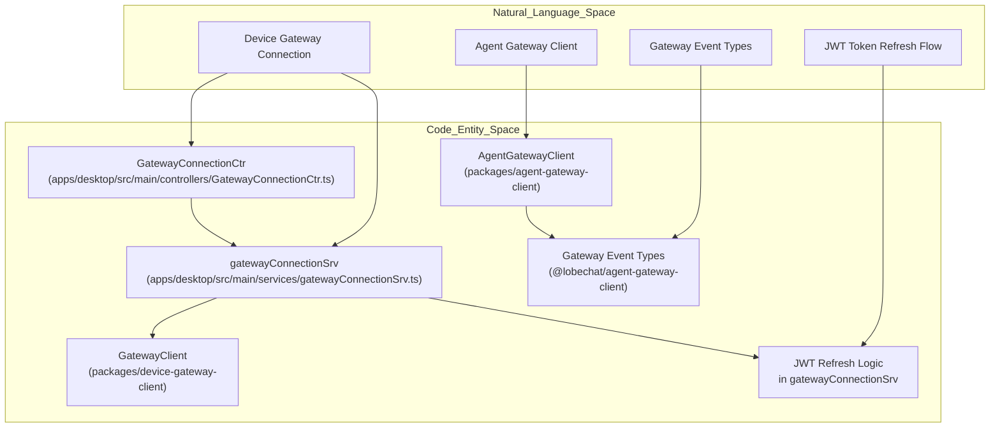

<!-- source: DeepWiki mcp.deepwiki.com · repo lobehub/lobehub · page 14.1 Gateway Connection and WebSocket Protocol · fetched 2026-10-29 -->

# Gateway Connection and WebSocket Protocol

<details>
<summary>Relevant source files</summary>

The following files were used as context for generating this wiki page:

- [.agents/skills/heterogeneous-agent/SKILL.md](.agents/skills/heterogeneous-agent/SKILL.md)
- [.agents/skills/heterogeneous-agent/references/debug-workflow.md](.agents/skills/heterogeneous-agent/references/debug-workflow.md)
- [apps/cli/src/doctor/checks/device.ts](apps/cli/src/doctor/checks/device.ts)
- [apps/cli/src/tools/__tests__/heteroTask.test.ts](apps/cli/src/tools/__tests__/heteroTask.test.ts)
- [apps/cli/src/tools/computerUse.test.ts](apps/cli/src/tools/computerUse.test.ts)
- [apps/cli/src/tools/computerUse.ts](apps/cli/src/tools/computerUse.ts)
- [apps/cli/src/tools/heteroTask.ts](apps/cli/src/tools/heteroTask.ts)
- [apps/desktop/src/main/controllers/GatewayConnectionCtr.ts](apps/desktop/src/main/controllers/GatewayConnectionCtr.ts)
- [apps/desktop/src/main/controllers/WorkspaceCtr.ts](apps/desktop/src/main/controllers/WorkspaceCtr.ts)
- [apps/desktop/src/main/controllers/__tests__/GatewayConnectionCtr.test.ts](apps/desktop/src/main/controllers/__tests__/GatewayConnectionCtr.test.ts)
- [apps/desktop/src/main/controllers/__tests__/HeteroSessionCtr.test.ts](apps/desktop/src/main/controllers/__tests__/HeteroSessionCtr.test.ts)
- [apps/desktop/src/main/controllers/__tests__/WorkspaceCtr.test.ts](apps/desktop/src/main/controllers/__tests__/WorkspaceCtr.test.ts)
- [apps/desktop/src/main/services/gatewayConnectionSrv.ts](apps/desktop/src/main/services/gatewayConnectionSrv.ts)
- [apps/server/src/modules/AgentRuntime/AgentRuntimeCoordinator.ts](apps/server/src/modules/AgentRuntime/AgentRuntimeCoordinator.ts)
- [apps/server/src/modules/AgentRuntime/AgentStateManager.ts](apps/server/src/modules/AgentRuntime/AgentStateManager.ts)
- [apps/server/src/modules/AgentRuntime/GatewayStreamNotifier.ts](apps/server/src/modules/AgentRuntime/GatewayStreamNotifier.ts)
- [apps/server/src/modules/AgentRuntime/InMemoryAgentStateManager.ts](apps/server/src/modules/AgentRuntime/InMemoryAgentStateManager.ts)
- [apps/server/src/modules/AgentRuntime/__tests__/AgentRuntimeCoordinator.test.ts](apps/server/src/modules/AgentRuntime/__tests__/AgentRuntimeCoordinator.test.ts)
- [apps/server/src/modules/AgentRuntime/__tests__/AgentStateManager.test.ts](apps/server/src/modules/AgentRuntime/__tests__/AgentStateManager.test.ts)
- [apps/server/src/modules/AgentRuntime/__tests__/GatewayStreamNotifier.test.ts](apps/server/src/modules/AgentRuntime/__tests__/GatewayStreamNotifier.test.ts)
- [apps/server/src/modules/AgentRuntime/__tests__/InMemoryAgentStateManager.test.ts](apps/server/src/modules/AgentRuntime/__tests__/InMemoryAgentStateManager.test.ts)
- [apps/server/src/modules/AgentRuntime/context.ts](apps/server/src/modules/AgentRuntime/context.ts)
- [apps/server/src/modules/AgentRuntime/types.ts](apps/server/src/modules/AgentRuntime/types.ts)
- [apps/server/src/routers/lambda/__tests__/aiAgent.test.ts](apps/server/src/routers/lambda/__tests__/aiAgent.test.ts)
- [apps/server/src/services/agentRuntime/__tests__/agentSignalHooks.integration.test.ts](apps/server/src/services/agentRuntime/__tests__/agentSignalHooks.integration.test.ts)
- [apps/server/src/services/agentRuntime/__tests__/executeStep.test.ts](apps/server/src/services/agentRuntime/__tests__/executeStep.test.ts)
- [apps/server/src/services/agentRuntime/__tests__/hooksIntegration.test.ts](apps/server/src/services/agentRuntime/__tests__/hooksIntegration.test.ts)
- [apps/server/src/services/aiAgent/__tests__/execAgent.modelOverride.test.ts](apps/server/src/services/aiAgent/__tests__/execAgent.modelOverride.test.ts)
- [apps/server/src/services/aiAgent/helpers/heteroErrors.test.ts](apps/server/src/services/aiAgent/helpers/heteroErrors.test.ts)
- [apps/server/src/services/aiAgent/helpers/heteroErrors.ts](apps/server/src/services/aiAgent/helpers/heteroErrors.ts)
- [apps/server/src/services/deviceGateway/__tests__/clientKinds.test.ts](apps/server/src/services/deviceGateway/__tests__/clientKinds.test.ts)
- [apps/server/src/services/deviceGateway/authorizedToolCall.ts](apps/server/src/services/deviceGateway/authorizedToolCall.ts)
- [apps/server/src/services/toolExecution/serverRuntimes/__tests__/auv.test.ts](apps/server/src/services/toolExecution/serverRuntimes/__tests__/auv.test.ts)
- [apps/server/src/services/toolExecution/serverRuntimes/auv.ts](apps/server/src/services/toolExecution/serverRuntimes/auv.ts)
- [packages/agent-gateway-client/PROTOCOL_V2.md](packages/agent-gateway-client/PROTOCOL_V2.md)
- [packages/agent-gateway-client/src/client.test.ts](packages/agent-gateway-client/src/client.test.ts)
- [packages/agent-gateway-client/src/client.ts](packages/agent-gateway-client/src/client.ts)
- [packages/agent-gateway-client/src/index.ts](packages/agent-gateway-client/src/index.ts)
- [packages/agent-gateway-client/src/mux/GatewayMuxClient.test.ts](packages/agent-gateway-client/src/mux/GatewayMuxClient.test.ts)
- [packages/agent-gateway-client/src/mux/GatewayMuxClient.ts](packages/agent-gateway-client/src/mux/GatewayMuxClient.ts)
- [packages/agent-gateway-client/src/mux/createOperationClient.test.ts](packages/agent-gateway-client/src/mux/createOperationClient.test.ts)
- [packages/agent-gateway-client/src/mux/createOperationClient.ts](packages/agent-gateway-client/src/mux/createOperationClient.ts)
- [packages/agent-gateway-client/src/mux/types.ts](packages/agent-gateway-client/src/mux/types.ts)
- [packages/agent-gateway-client/src/types.ts](packages/agent-gateway-client/src/types.ts)
- [packages/builtin-tool-auv/src/manifest.ts](packages/builtin-tool-auv/src/manifest.ts)
- [packages/device-control/package.json](packages/device-control/package.json)
- [packages/device-control/src/workspace.ts](packages/device-control/src/workspace.ts)
- [packages/device-gateway-client/src/client.test.ts](packages/device-gateway-client/src/client.test.ts)
- [packages/device-gateway-client/src/client.ts](packages/device-gateway-client/src/client.ts)
- [packages/device-gateway-client/src/deviceTransportError.test.ts](packages/device-gateway-client/src/deviceTransportError.test.ts)
- [packages/device-gateway-client/src/deviceTransportError.ts](packages/device-gateway-client/src/deviceTransportError.ts)
- [packages/device-gateway-client/src/http.test.ts](packages/device-gateway-client/src/http.test.ts)
- [packages/device-gateway-client/src/http.ts](packages/device-gateway-client/src/http.ts)
- [packages/device-gateway-client/src/index.ts](packages/device-gateway-client/src/index.ts)
- [packages/device-gateway-client/src/tunnel.test.ts](packages/device-gateway-client/src/tunnel.test.ts)
- [packages/device-gateway-client/src/tunnel.ts](packages/device-gateway-client/src/tunnel.ts)
- [packages/device-gateway-client/src/types.ts](packages/device-gateway-client/src/types.ts)
- [packages/device-gateway-client/src/wsTunnel.test.ts](packages/device-gateway-client/src/wsTunnel.test.ts)
- [packages/device-gateway-client/src/wsTunnel.ts](packages/device-gateway-client/src/wsTunnel.ts)
- [packages/heterogeneous-agents/src/adapters/codeBuddy.test.ts](packages/heterogeneous-agents/src/adapters/codeBuddy.test.ts)
- [packages/tool-view-model/package.json](packages/tool-view-model/package.json)
- [packages/tool-view-model/src/index.ts](packages/tool-view-model/src/index.ts)
- [packages/tool-view-model/src/project.test.ts](packages/tool-view-model/src/project.test.ts)
- [packages/tool-view-model/src/project.ts](packages/tool-view-model/src/project.ts)
- [packages/tool-view-model/src/projectToolEvent.test.ts](packages/tool-view-model/src/projectToolEvent.test.ts)
- [packages/tool-view-model/src/projectToolEvent.ts](packages/tool-view-model/src/projectToolEvent.ts)
- [packages/tool-view-model/src/projectors/agentDocuments.ts](packages/tool-view-model/src/projectors/agentDocuments.ts)
- [packages/tool-view-model/src/projectors/grepContent.ts](packages/tool-view-model/src/projectors/grepContent.ts)
- [packages/tool-view-model/src/projectors/localSystem.ts](packages/tool-view-model/src/projectors/localSystem.ts)
- [packages/tool-view-model/src/projectors/projectors.test.ts](packages/tool-view-model/src/projectors/projectors.test.ts)
- [packages/tool-view-model/src/projectors/readFile.ts](packages/tool-view-model/src/projectors/readFile.ts)
- [packages/tool-view-model/src/registry.ts](packages/tool-view-model/src/registry.ts)
- [src/store/chat/slices/agentRun/actions/__tests__/gatewayEventHandler.test.ts](src/store/chat/slices/agentRun/actions/__tests__/gatewayEventHandler.test.ts)
- [src/store/chat/slices/agentRun/actions/transports/gateway/gatewayEventHandler.test.ts](src/store/chat/slices/agentRun/actions/transports/gateway/gatewayEventHandler.test.ts)
- [src/store/chat/slices/agentRun/actions/transports/gateway/gatewayEventHandler.ts](src/store/chat/slices/agentRun/actions/transports/gateway/gatewayEventHandler.ts)

</details>


This section documents the architecture and implementation details of the Gateway connection system within the LobeHub repository, enabling real-time communication between enrolled device clients (desktop app, CLI) and the cloud device gateway server via HTTP and WebSocket protocols. It covers the key desktop IPC controller and service, client packages for HTTP and WebSocket communication, agent SDK abstractions, gateway event types, and the JWT token refresh with automatic reconnect flow.

---

## 14.1.1 Purpose and Scope

The Gateway connection subsystem is essential for LobeHub’s device enrollment and remote agent execution infrastructure. It maintains persistent, secure WebSocket connections from enrolled devices to the cloud device gateway server. This connection enables:

- Receiving commands such as agent run requests, tool call requests, and messaging API calls.
- Sending asynchronous results and status updates back to the server.
- Handling reconnection transparently, especially through JWT expiry token refreshes.

This page documents:

- `GatewayConnectionCtr` — the desktop IPC controller managing the gateway connection.
- `gatewayConnectionSrv` — the desktop service managing the WebSocket lifecycle and token refresh.
- The `device-gateway-client` package for device HTTP and WebSocket client management.
- The `agent-gateway-client` package for agent runtime event streaming over the gateway.
- Gateway event types and their client/server semantics.
- The JWT token refresh and automatic reconnect flow.

---

## 14.1.2 GatewayConnectionCtr — Desktop Controller

`GatewayConnectionCtr` is an IPC controller in the desktop app responsible for managing the device gateway WebSocket connection lifecycle and delegating communication to the `gatewayConnectionSrv` service.

### Key Responsibilities

- Maintains an in-memory registry (`platformTasks`) tracking running heterogeneous agent tasks by `operationId`.
- Maps topic IDs to Hermes agent session IDs for multi-turn conversation continuity (`hermesSessionMap`).
- Interfaces with local runtime command execution (`LocalSystemExecutionRuntime`) and the heterogeneous agent controller (`HeterogeneousAgentCtr`).
- Exposes IPC methods to the renderer for connecting/disconnecting, fetching status, and forwarding tool call or message API responses.
- Handles incoming gateway events such as:
  - `agent_run_request` - triggers agent execution.
  - `tool_call_request` - dispatches local tool calls.
  - `message_api_request` - handles platform messaging API calls.
  - `auth_expired` - triggers token refresh and reconnect.
- Sets up token refresh hooks post-initialization.
- Injects the `lh notify` protocol into the first turn of hetero-agent sessions for progressive UI feedback (see `buildNotifyProtocol`).

### Implementation Details

- Uses `platformTasks: Map<string, PlatformTaskEntry>` to hold task metadata including `agentType`, `topicId`, `operationId`, `pid`, and workspace ID to track the lifecycle of spawned processes.
- Manages a `hermesSessionMap` for mapping conversation topics to agent session IDs for protocol continuity.
- Delegates WebSocket connection operations to `gatewayConnectionSrv`.
- Handles IPC channels with custom device protocol handling (`deviceProtocolHandler`).
- Maintains support for local system commands and heterogeneous agents via injected runtime and controllers.
- Provides a static readonly `groupName = 'gatewayConnection'` to identify this IPC group.

### Notify Protocol Injection

The method `buildNotifyProtocol(lhPath: string, topicId: string): string` returns a multi-line string instructing platform agents how to send incremental progress back to the UI using the CLI `lh notify` command:

- Step 1: Open the message bubble and capture the `messageId`.
- Step 2: Update the bubble with intermediate results.
- Step 3: Submit the final answer.

This enables hetero-agents dispatched via CLI to push live updates visible as a single mutable message bubble in the UI.

---

## 14.1.3 gatewayConnectionSrv — Desktop Service

`gatewayConnectionSrv` (`apps/desktop/src/main/services/gatewayConnectionSrv.ts`) is a service class exposing the core business logic for managing the WebSocket connection to the cloud device gateway.

### Primary Responsibilities

- Hold a single `GatewayClient` WebSocket client instance managing connection state.
- Connect and authenticate with the gateway using a JWT token.
- Support auto-reconnect with exponential backoff.
- Maintain identity metadata including `deviceId` and `identitySource`.
- Register the device on startup via a device registrar callback.
- Accept and invoke handlers for:
  - Tool call execution
  - MCP calls (stdio or HTTP tunneled)
  - Messaging API calls
  - Agent run requests
  - General RPC calls
- Manage power-save blockers to prevent OS sleep during active connection.
- Support workspace-scoped clients with token refresh keyed by workspace, serializing enroll restore attempts to prevent races.
- Emit connection status updates to IPC consumers.

### Token Refresh and Reconnect

- The service holds a `tokenProvider` (function returning the current valid JWT) and a `tokenRefresher` (function refreshing the JWT on expiry).
- Upon receiving an `auth_expired` event from the gateway, the service triggers the `tokenRefresher`.
- If success, it re-establishes the WebSocket connection with the new JWT token transparently.
- This flow ensures persistent connections without manual user intervention despite JWT expiry.

---

## 14.1.4 device-gateway-client Package

The `device-gateway-client` package provides the client HTTP and WebSocket implementations for interacting with the cloud device gateway.

### Key Classes

- **GatewayHttpClient**  
  - Supports REST endpoints for:
    - Querying device status (`/api/device/status`).
    - Listing devices (`/api/device/devices`).
    - Executing tool or MCP calls via HTTP POST (tunneled through the device gateway).
  - Handles tool call timeouts and device offline conditions.
  - Translates device transport failures into structured retryable results.

- **GatewayClient**  
  - WebSocket client managing persistent connection with the gateway server.
  - Sends authentication via an `auth` message including JWT token.
  - Handles core WebSocket events:
    - `tool_call_request`
    - `agent_run_request`
    - `message_api_request`
    - `auth_expired`
    - `status_changed`
    - `connected`
    - `disconnected`
    - `error`
  - Emits connection status changes and handles heartbeats and reconnect logic.
  - Supports HTTP tunnel hosting for local loopback connections forwarded by the gateway.
  - Maintains stable per-install UUID identifiers for deduplication.

---

## 14.1.5 agent-gateway-client Package

The `agent-gateway-client` package builds on `device-gateway-client` providing higher-level abstractions over the gateway connection specific to AI Agent runtime.

### Features

- Defines agent stream events and typed data structures for signaling:
  - Agent lifecycle (`agent_runtime_init`, `agent_runtime_end`)
  - Stream start, chunks, and end (`stream_start`, `stream_chunk`, `stream_end`)
  - Tool execution lifecycle (`tool_start`, `tool_end`, `tool_execute`)
  - Intervention requests/responses (`agent_intervention_request`, `agent_intervention_response`)
  - Message patches and runtime step completions
  - Specialized events such as `llm_execute`, `llm_cancel`, and `notify_update`
- Provides typed client event handlers for seamless processing of agent run operations over the gateway.
- Supports complex agent workflows with multiple steps, tool integrations, and user interventions.

---

## 14.1.6 Gateway Event Types

The device gateway WebSocket protocol defines typed message events exchanged between the cloud server and enrolled devices.

| Event Type             | Direction       | Description                                                             |
|------------------------|-----------------|-------------------------------------------------------------------------|
| `auth`                 | Client → Server | Initial authentication message containing token and optional metadata  |
| `auth_success`         | Server → Client | Authentication accepted confirmation                                   |
| `auth_failed`          | Server → Client | Authentication failure reason                                          |
| `auth_expired`         | Server → Client | Authentication token (JWT) expired, client must refresh and reconnect  |
| `heartbeat`            | Client → Server | Periodic keep-alive ping                                                |
| `heartbeat_ack`        | Server → Client | Acknowledgment for heartbeat                                           |
| `tool_call_request`    | Server → Client | Request to execute a tool call on the device                           |
| `tool_call_response`   | Client → Server | Response containing tool call result                                   |
| `agent_run_request`    | Server → Client | Request to run an AI agent operation                                  |
| `message_api_request`  | Server → Client | Request to call a platform messaging API                              |
| `message_api_response` | Client → Server | Response to messaging API call                                         |
| `status_changed`       | System          | Emits connection status changes (connecting, connected, disconnecting)|
| `connected`            | System          | Connection established event                                          |
| `disconnected`         | System          | Connection closed or lost event                                        |
| `error`                | System          | Emitted on connection or protocol error                               |

Device clients handle these events to trigger execution flows, update UI status, or initiate token refresh.

---

## 14.1.7 JWT Token Refresh and Reconnection Flow

LobeHub uses JWT tokens to authenticate WebSocket connections to the device gateway. These tokens have expiration lifetimes, necessitating a refresh flow to maintain persistent connections.

### Flow Steps:

1. **Connection**  
   Client initiates a WebSocket connection to the gateway using the current JWT token sent in an `auth` message.

2. **Token Expiry**  
   When the server detects the JWT token has expired, it sends an `auth_expired` event to the client.

3. **Token Refresh**  
   Upon receiving `auth_expired`, the client invokes the configured `tokenRefresher` function to obtain a fresh JWT token via HTTP or another secure mechanism.

4. **Reconnect**  
   The client cleanly closes the old WebSocket and reconnects using the refreshed JWT token.

5. **Resumption**  
   The connection resumes transparently, preserving device enrollment and session continuity without requiring user re-login.

This flow is orchestrated inside `gatewayConnectionSrv`, with the event propagated and bridged to the desktop controller `GatewayConnectionCtr`.

---

## 14.1.8 Mermaid Diagrams

### Diagram 1: Natural Language to Code Entities — Gateway Connection Subsystem



### Diagram 2: Gateway WebSocket Connection and Event Flow

```mermaid
sequenceDiagram
  participant Desktop as GatewayConnectionCtr
  participant Service as gatewayConnectionSrv
  participant GatewayClient as GatewayClient (device-gateway-client)
  participant Server as Cloud Gateway Server

  Desktop->>Service: Initialize; provide tokenProvider and tokenRefresher
  Service->>GatewayClient: Connect with JWT auth
  GatewayClient->>Server: WebSocket connect (auth with JWT)
  Server->>GatewayClient: connection accepted (auth_success)
  GatewayClient->>Service: emit connected event
  Service->>Desktop: emit status_changed connected
  
  Server->>GatewayClient: send 'agent_run_request'
  GatewayClient->>Service: forward 'agent_run_request'
  Service->>Desktop: handle agent_run_request
  
  Server-->>GatewayClient: send 'auth_expired' on token expiry
  GatewayClient->>Service: emit auth_expired
  Service->>Server: call tokenRefresher to get new JWT
  Service->>GatewayClient: reconnect with new JWT
  GatewayClient->>Server: reconnect with refreshed JWT
```

---

## 14.1.9 Summary Table of Key Classes and Packages

| Name                    | Location / Package                                               | Description                                                                                     |
|-------------------------|-----------------------------------------------------------------|-------------------------------------------------------------------------------------------------|
| `GatewayConnectionCtr`  | `apps/desktop/src/main/controllers/GatewayConnectionCtr.ts`    | Desktop IPC controller managing connection lifecycle and heterogeneous agent platform tasks      |
| `gatewayConnectionSrv`  | `apps/desktop/src/main/services/gatewayConnectionSrv.ts`       | Service managing WebSocket connection, event dispatch, token refresh, and power-save blocking    |
| `GatewayClient`         | `packages/device-gateway-client`                               | WebSocket client for the device gateway; emits connection and protocol events                    |
| `agent-gateway-client`  | `packages/agent-gateway-client`                                | Agent runtime client abstractions for event streaming over the gateway connection               |
| Gateway Event Types     | `@lobechat/agent-gateway-client`                              | Typed definitions of gateway socket message events                                              |
| JWT Token Refresh Flow  | Impl. in `gatewayConnectionSrv` with token provider & refresher | Transparent JWT refresh and reconnect logic for maintaining persistent WebSocket connection      |

---

## 14.1.10 References to Code

- `GatewayConnectionCtr` class and methods: [apps/desktop/src/main/controllers/GatewayConnectionCtr.ts:1-151]()  
- `gatewayConnectionSrv` service implementation: [apps/desktop/src/main/services/gatewayConnectionSrv.ts:1-180]()  
- `GatewayClient` WebSocket client and event types: [packages/device-gateway-client/src/client.ts:1-186]()  
- `agent-gateway-client` agent event types: [packages/agent-gateway-client/src/types.ts:1-184]()  
- Gateway event handler functions in chat store: [src/store/chat/slices/agentRun/actions/transports/gateway/gatewayEventHandler.ts:1-170]()  
- GatewayStreamNotifier handling event push: [apps/server/src/modules/AgentRuntime/GatewayStreamNotifier.ts:1-170]()  
- `GatewayHttpClient` REST client for device gateway: [packages/device-gateway-client/src/http.ts:1-185]()  

---

# End of Section 14.1 "Gateway Connection and WebSocket Protocol"

---

### Sources

- `apps/desktop/src/main/controllers/GatewayConnectionCtr.ts:1-151`  
- `apps/desktop/src/main/services/gatewayConnectionSrv.ts:1-180`  
- `packages/device-gateway-client/src/client.ts:1-186`  
- `packages/device-gateway-client/src/http.ts:1-185`  
- `packages/agent-gateway-client/src/types.ts:1-184`  
- `src/store/chat/slices/agentRun/actions/transports/gateway/gatewayEventHandler.ts:1-170`  
- `apps/server/src/modules/AgentRuntime/GatewayStreamNotifier.ts:1-170`

---

