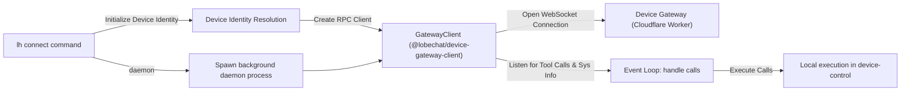
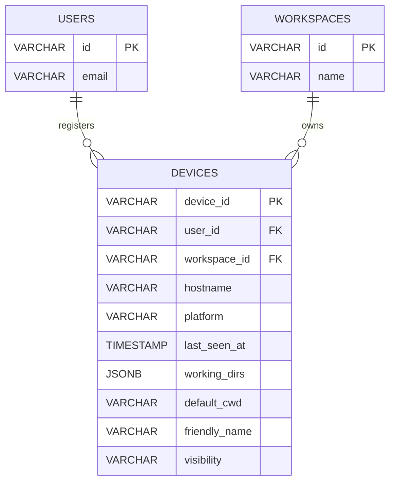
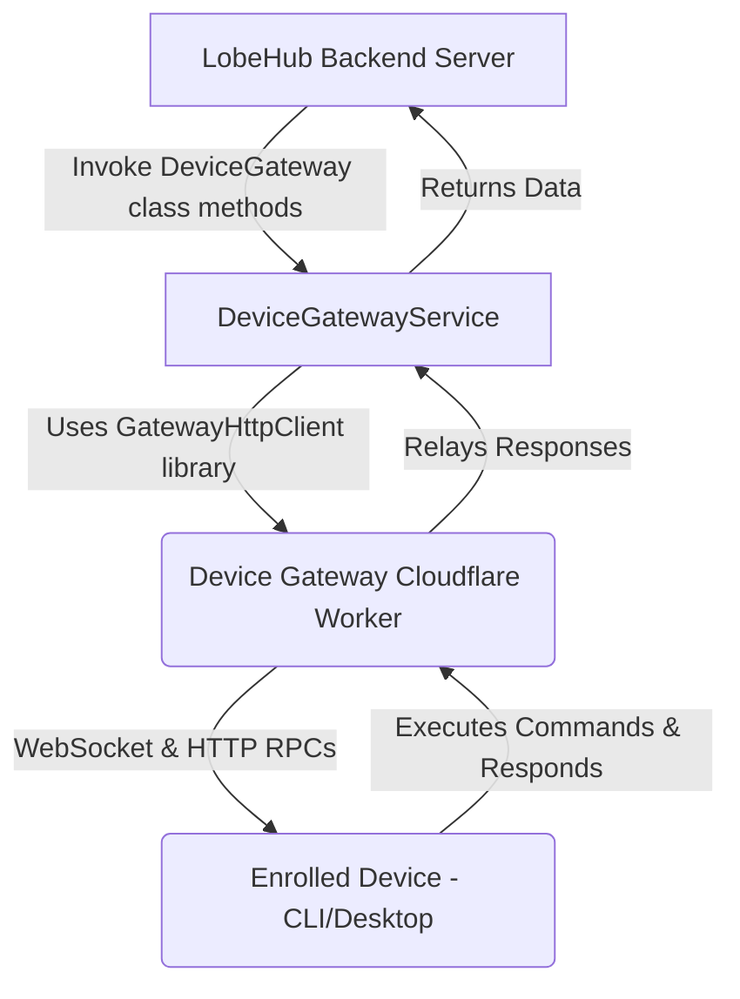

<!-- source: DeepWiki mcp.deepwiki.com · repo lobehub/lobehub · page 14.2 Device Registration and Management · fetched 2026-10-29 -->

# Device Registration and Management

<details>
<summary>Relevant source files</summary>

The following files were used as context for generating this wiki page:

- [apps/cli/src/api/client.test.ts](apps/cli/src/api/client.test.ts)
- [apps/cli/src/api/client.ts](apps/cli/src/api/client.ts)
- [apps/cli/src/api/http.test.ts](apps/cli/src/api/http.test.ts)
- [apps/cli/src/api/http.ts](apps/cli/src/api/http.ts)
- [apps/cli/src/auth/apiKey.test.ts](apps/cli/src/auth/apiKey.test.ts)
- [apps/cli/src/auth/apiKey.ts](apps/cli/src/auth/apiKey.ts)
- [apps/cli/src/auth/credentials.test.ts](apps/cli/src/auth/credentials.test.ts)
- [apps/cli/src/auth/credentials.ts](apps/cli/src/auth/credentials.ts)
- [apps/cli/src/auth/refresh.test.ts](apps/cli/src/auth/refresh.test.ts)
- [apps/cli/src/auth/refresh.ts](apps/cli/src/auth/refresh.ts)
- [apps/cli/src/auth/resolveToken.test.ts](apps/cli/src/auth/resolveToken.test.ts)
- [apps/cli/src/auth/resolveToken.ts](apps/cli/src/auth/resolveToken.ts)
- [apps/cli/src/commands/connect.test.ts](apps/cli/src/commands/connect.test.ts)
- [apps/cli/src/commands/connect.ts](apps/cli/src/commands/connect.ts)
- [apps/cli/src/commands/login.test.ts](apps/cli/src/commands/login.test.ts)
- [apps/cli/src/commands/login.ts](apps/cli/src/commands/login.ts)
- [apps/cli/src/commands/status.test.ts](apps/cli/src/commands/status.test.ts)
- [apps/cli/src/commands/status.ts](apps/cli/src/commands/status.ts)
- [apps/cli/src/constants/urls.ts](apps/cli/src/constants/urls.ts)
- [apps/cli/src/device/register.ts](apps/cli/src/device/register.ts)
- [apps/cli/src/doctor/checks/credentials.test.ts](apps/cli/src/doctor/checks/credentials.test.ts)
- [apps/cli/src/doctor/checks/credentials.ts](apps/cli/src/doctor/checks/credentials.ts)
- [apps/cli/src/doctor/probes.ts](apps/cli/src/doctor/probes.ts)
- [apps/cli/src/service/connect.test.ts](apps/cli/src/service/connect.test.ts)
- [apps/cli/src/service/connect.ts](apps/cli/src/service/connect.ts)
- [apps/cli/src/settings/index.test.ts](apps/cli/src/settings/index.test.ts)
- [apps/cli/src/settings/index.ts](apps/cli/src/settings/index.ts)
- [apps/desktop/src/main/controllers/GitCtr.ts](apps/desktop/src/main/controllers/GitCtr.ts)
- [apps/desktop/src/main/services/__tests__/deviceArchitectureBackfill.test.ts](apps/desktop/src/main/services/__tests__/deviceArchitectureBackfill.test.ts)
- [apps/desktop/src/main/services/deviceArchitectureBackfill.ts](apps/desktop/src/main/services/deviceArchitectureBackfill.ts)
- [apps/server/src/routers/lambda/__tests__/deviceWorkspaceGuard.test.ts](apps/server/src/routers/lambda/__tests__/deviceWorkspaceGuard.test.ts)
- [apps/server/src/routers/lambda/__tests__/deviceWorkspaceWorkingDirs.test.ts](apps/server/src/routers/lambda/__tests__/deviceWorkspaceWorkingDirs.test.ts)
- [apps/server/src/routers/lambda/device.ts](apps/server/src/routers/lambda/device.ts)
- [apps/server/src/routers/lambda/deviceWorkingDirs.ts](apps/server/src/routers/lambda/deviceWorkingDirs.ts)
- [apps/server/src/routers/lambda/deviceWorkspaceGuard.ts](apps/server/src/routers/lambda/deviceWorkspaceGuard.ts)
- [apps/server/src/routers/lambda/deviceWorkspaceWorkingDirs.ts](apps/server/src/routers/lambda/deviceWorkspaceWorkingDirs.ts)
- [apps/server/src/services/deviceGateway/__tests__/index.test.ts](apps/server/src/services/deviceGateway/__tests__/index.test.ts)
- [apps/server/src/services/deviceGateway/index.ts](apps/server/src/services/deviceGateway/index.ts)
- [packages/database/migrations/0166_device_architecture.sql](packages/database/migrations/0166_device_architecture.sql)
- [packages/database/migrations/meta/0166_snapshot.json](packages/database/migrations/meta/0166_snapshot.json)
- [packages/database/src/models/__tests__/device.test.ts](packages/database/src/models/__tests__/device.test.ts)
- [packages/database/src/models/device.ts](packages/database/src/models/device.ts)
- [packages/device-control/src/__tests__/dispatch.test.ts](packages/device-control/src/__tests__/dispatch.test.ts)
- [packages/device-control/src/dispatch.ts](packages/device-control/src/dispatch.ts)
- [packages/device-control/src/index.ts](packages/device-control/src/index.ts)
- [packages/device-control/src/types.ts](packages/device-control/src/types.ts)
- [packages/electron-client-ipc/src/types/git.ts](packages/electron-client-ipc/src/types/git.ts)
- [packages/local-file-shell/src/git/__tests__/info.test.ts](packages/local-file-shell/src/git/__tests__/info.test.ts)
- [packages/local-file-shell/src/git/__tests__/upstream.test.ts](packages/local-file-shell/src/git/__tests__/upstream.test.ts)
- [packages/local-file-shell/src/git/index.ts](packages/local-file-shell/src/git/index.ts)
- [packages/local-file-shell/src/git/info.ts](packages/local-file-shell/src/git/info.ts)
- [packages/local-file-shell/src/git/types.ts](packages/local-file-shell/src/git/types.ts)
- [packages/local-file-shell/src/git/upstream.ts](packages/local-file-shell/src/git/upstream.ts)
- [packages/local-file-shell/src/git/worktrees.ts](packages/local-file-shell/src/git/worktrees.ts)
- [packages/types/src/device.ts](packages/types/src/device.ts)
- [src/services/device.ts](src/services/device.ts)
- [src/services/electron/git.ts](src/services/electron/git.ts)
- [src/services/git.ts](src/services/git.ts)
- [src/store/chat/slices/agentRun/actions/lifecycle/snapshotWorkingDirGit.ts](src/store/chat/slices/agentRun/actions/lifecycle/snapshotWorkingDirGit.ts)
- [src/store/chat/utils/topicWorkingDirGit.ts](src/store/chat/utils/topicWorkingDirGit.ts)
- [src/store/device/action.test.ts](src/store/device/action.test.ts)
- [src/store/device/action.ts](src/store/device/action.ts)
- [src/store/device/gitHooks.ts](src/store/device/gitHooks.ts)

</details>


This page details the process of registering and managing devices within the LobeHub ecosystem. It covers device enrollment via the `lh connect` CLI command, the underlying device identity and control packages, the device table schema, the backend `DeviceGatewayService`, the device listing and revocation UI, and how these enrolled devices are presented as execution targets for agents.

---

## Device Enrollment via CLI (`lh connect`)

Devices are enrolled into LobeHub primarily through the command-line interface (CLI) using the `lh connect` command. This command establishes a connection to the LobeHub device gateway, enabling the device to receive and execute tool calls from agents.

### CLI Command Overview

The `lh connect` command is implemented in `apps/cli/src/commands/connect.ts`. The function `registerConnectCommand` registers the command and its options [apps/cli/src/commands/connect.ts:90-135]():

- `--token <jwt>`: JWT access token for authenticating with the device gateway.
- `--gateway <url>`: URL of the LobeHub device gateway.
- `--device-id <id>`: Identifier for the device; autogenerated if omitted.
- `--workspace <id>`: Enroll device under a workspace, making it accessible to workspace members.
- `--public`: With `--workspace`, enrolls device as visible to *all* workspace members (default is private).
- `--auv <binary>`: Offers Computer Use functionality by running the specified AUV binary.
- `--daemon`: Runs the connection as a background daemon.
- Internal flags like `--daemon-child` and `--service-child` support daemon service processes.

Subcommands include `stop`, `status`, and `logs` for controlling the running connection daemon [apps/cli/src/commands/connect.ts:146-185]().

### Connection Flow

Upon start, `lh connect` initializes device identity (generating or loading a stable device ID), creates a `GatewayClient` (from `@lobechat/device-gateway-client`) to connect to the device gateway, and listens for remote tool calls and system info requests. Execution of tool calls is dispatched via `@lobechat/device-control` handlers.

Daemon mode runs this connection in the background, tracking process status and logs for reliability and user visibility.

### CLI Connection Lifecycle Diagram



Sources:
- [apps/cli/src/commands/connect.ts:90-135]()
- [apps/cli/src/daemon/manager.ts:5-80]()
- [@lobechat/device-gateway-client]()
- [@lobechat/device-control]()

---

## Device Identity and Control Packages

Device registration and communication are powered by a trio of core packages, reusable across CLI and desktop:

- **`@lobechat/device-identity`**: Handles generating and persisting a stable unique device identity (device ID), ensuring devices can be reliably recognized across sessions. Used as a developer dependency by CLI and desktop apps [apps/cli/package.json:37-39](), [apps/desktop/package.json:67-69]().

- **`@lobechat/device-gateway-client`**: Implements the client-side WebSocket and HTTP communication to the LobeHub device gateway server, managing authentication, reconnects, event dispatching, and message protocols for tool invocation and system messaging [apps/cli/package.json:38](), [apps/desktop/package.json:68]().

- **`@lobechat/device-control`**: Includes logic and helpers to perform actions on the local device — e.g., filesystem browsing, executing commands, sampling metrics — in response to remote tool calls received over the gateway connection [apps/cli/package.json:37](), [apps/desktop/package.json:67]().

The `lh connect` CLI integrates these packages for end-to-end device enrollment, persistent identity management, connection lifecycle, and command execution delivery.

Sources:
- [apps/cli/package.json:37-39]()
- [apps/desktop/package.json:67-69]()
- [apps/cli/src/commands/connect.ts:40-150]()

---

## Device Table Schema

The backend stores device metadata and ownership details in the PostgreSQL `devices` table designed to support both personal and workspace-scoped devices.

| Column            | Type             | Description                                                                                 |
|-------------------|------------------|---------------------------------------------------------------------------------------------|
| `device_id` (PK)  | `varchar` (UUID) | Stable device ID, unique per physical machine                                              |
| `user_id` (FK)    | `varchar`        | User ID owning or enrolling the device                                                    |
| `workspace_id`    | `varchar`        | Workspace association, nullable for personal devices                                      |
| `hostname`        | `varchar`        | Device hostname                                                                           |
| `platform`        | `varchar`        | Device operating system/platform (e.g., macOS, Windows, Linux)                            |
| `last_seen_at`    | `timestamp`      | Last time device connected                                                                |
| `working_dirs`    | `jsonb`          | Array of approved working directories for secure file operations                           |
| `default_cwd`     | `varchar`        | Default working directory on device                                                       |
| `friendly_name`   | `varchar`        | User-assigned device nickname                                                             |
| `visibility`      | enum             | `'private'` or `'public'` visibility within workspace device pool                         |

In addition to metadata, devices maintain arrays of approved working directories (`workingDirs`) which restrict remote agent file operations to a bounded subset of the filesystem for security.

Device records are segregated into two groups:
- **Personal devices** (`workspace_id` is `NULL`): Specific to a single user and private to them [packages/database/src/models/device.ts:56-138]().
- **Workspace devices** (`workspace_id` set): Shared machines enrolled to a workspace available to all members [packages/database/src/models/device.ts:56-138]().

The `DeviceModel` abstraction provides CRUD operations and enrollment under both scopes.

### Device Table ER Diagram



Sources:
- [packages/database/src/models/device.ts:56-138]()
- [apps/server/src/routers/lambda/device.ts:1-200]()
- [packages/types/src/device.ts:1-180]()

---

## DeviceGatewayService

The `DeviceGatewayService` is a backend service layer implementing device communication through the LobeHub device gateway, enabling status queries, device listing, system info retrieval, workspace initialization (scanning device skills), tool call execution, and agent discovery.

### Implementation

- **Class**: `DeviceGateway` in `apps/server/src/services/deviceGateway/index.ts` is the primary implementation [apps/server/src/services/deviceGateway/index.ts:180-523]().

- It uses `GatewayHttpClient` from `@lobechat/device-gateway-client` for HTTP and WebSocket communication to the Cloudflare-hosted device gateway.

### Key Methods and Responsibilities

| Method                 | Responsibility                                                                                         |
|------------------------|------------------------------------------------------------------------------------------------------|
| `isConfigured()`       | Checks whether device gateway URL is configured in environment                                        |
| `queryDeviceStatus()`  | Returns online status counts of devices for a user or workspace                                        |
| `queryDeviceList()`    | Fetches all device metadata (including connection channels) for a user or workspace                   |
| `queryDeviceSystemInfo()` | Retrieves detailed system info from a specific device (hostname, platform, uptime, etc.)            |
| `initWorkspace()`      | Scans device's bound project directory for LobeHub agent instructions and filesystem skills          |
| `executeToolCall()`    | Sends a tool call RPC to a device to execute a remote action and awaits the result                     |
| `scanHeterogeneousAgents()` | Probes device for installed heterogeneous AI agent platforms                                      |
| `getHeterogeneousAgentProfile()` | Retrieves detailed profile info of a particular heterogeneous agent on the device            |
| `getClaudeCodeQuota()` | Fetches Claude Code licensing quota snapshot from device                                              |
| File and Git RPCs      | Methods to securely browse directories, read/write files, and manage Git branches/worktrees remotely |

### DeviceGatewayService Communication Flow



Sources:
- [apps/server/src/services/deviceGateway/index.ts:180-523]()
- [@lobechat/device-gateway-client]()

---

## Device Listing and Revocation UI

Users can manage their enrolled devices via a dedicated UI, supported by backend procedures exposing device management APIs.

### Backend Device Router

- Located in `apps/server/src/routers/lambda/device.ts` under `deviceRouter`, it exposes procedures for device management [apps/server/src/routers/lambda/device.ts:135-312]():

  - `checkCapability`: Queries if a device supports specific heterogeneous agent platforms.
  - `scanAgents`: Lists heterogeneous agents available on a device.
  - `getHeterogeneousAgentProfile`: Retrieves detailed heterogeneous agent profile.
  - `getClaudeCodeQuota`: Shows Claude Code quota status.
  - `listDevices`: Lists all devices for a user or workspace with metadata and presence info.
  - `getDeviceSystemInfo`: Fetches detailed system info for a device.
  - `renameDevice`: Allows renaming a device for easier identification.
  - `removeDevice`: Revokes device enrollment, with safeguards against revoking devices bound to fixed workspace agents.
  - `updateWorkingDir`: Updates approved working directories on a device.

### Permissions and Validation

Device editing and operation permissions are strictly enforced:

- `canEditWorkspaceDevice` allows edits by workspace owners or the enrolling user only.
- `assertDeviceNotBoundToFixedAgent` blocks deletion if a device is bound to workspace agents with fixed execution target policy.
- Middleware guards (`assertWorkspaceDeviceVisible`, `assertWorkspaceRootApproved`) validate access and workspace visibility on each operation to prevent unauthorized use [apps/server/src/routers/lambda/deviceWorkspaceGuard.ts]().

### Frontend UI

The LobeHub Web and Desktop UI includes the `DeviceManager` feature where users see:

- List of enrolled devices, showing hostname, platform, last seen time, and online status.
- Controls to rename devices and revoke access.
- Management of device-approved working directories (safe paths for agent file operations).

These UI components integrate backend device APIs for real-time updates and control.

Sources:
- [apps/server/src/routers/lambda/device.ts:135-312]()
- [apps/server/src/routers/lambda/deviceWorkspaceGuard.ts:1-146]()
- [src/features/DeviceManager]()

---

## Enrolled Devices in Agent Execution Target Selection

Enrolled devices appear as potential execution targets for agents that need to run tool calls or commands remotely.

### Device Capability and Agent Discovery

- Backend calls `checkCapability` to verify whether a device supports running heterogeneous agents such as `openclaw` or `hermes`.
- `scanAgents` provides a detailed list of agent runtimes on the device.
- Supported agent platforms are enumerated in `HeterogeneousAgentType` from `@lobechat/heterogeneous-agents` [apps/server/src/routers/lambda/device.ts:3-39]().

The `remotePlatformEnum` Zod enum validates platforms in device APIs.

### Agent Execution Dispatch

- Agent execution targeting a device dispatches a tool call via `DeviceGateway.executeToolCall()`.
- The call is transmitted through the device gateway, received on the device side (`lh connect` daemon), and executed with results returned to the server for client consumption [apps/server/src/services/deviceGateway/index.ts:186-208]().

### Device Selection and Agent Execution Diagram

```mermaid
graph TD
    User[User] -->|Configure Agent| AgentConfig[Agent Configuration UI]
    AgentConfig -->|Select Device Target| DeviceSelection[Device Selection Component]
    DeviceSelection -->|Call DeviceRouter API (checkCapability/scanAgents)| Backend[Backend Server]
    Backend -->|Invoke DeviceGatewayService| GatewaySvc[DeviceGatewayService]
    GatewaySvc -->|Communicate over WebSocket| Device[Enrolled Device (CLI/Desktop)]
    Device -->|Report Agent Capabilities| GatewaySvc
    GatewaySvc --> Backend
    Backend --> DeviceSelection
    DeviceSelection --> AgentConfig

    subgraph AgentExecution
      AgentRuntime[Agent Runtime] -->|Dispatch Tool Call| Backend
      Backend -->|DeviceGateway.executeToolCall| GatewaySvc
      GatewaySvc --> Device
      Device -->|Execute & Return Result| GatewaySvc
      GatewaySvc --> Backend
      Backend --> AgentRuntime
    end
```

Sources:
- [apps/server/src/routers/lambda/device.ts:3-39]()
- [apps/server/src/routers/lambda/device.ts:141-190]()
- [apps/server/src/services/deviceGateway/index.ts:186-208]()
- [@lobechat/heterogeneous-agents]()

---

This page consolidates comprehensive details about device registration and management in LobeHub, spanning CLI enrollment, core identity/control packages, device backend schema, communication service, UI for lifecycle management, and integration into agent execution. The combination of `lh connect` CLI, `device-identity`, `device-control`, `DeviceGatewayService`, and frontend UIs forms a unified ecosystem for secure and flexible remote device enrollment and agent workload dispatch.

---

