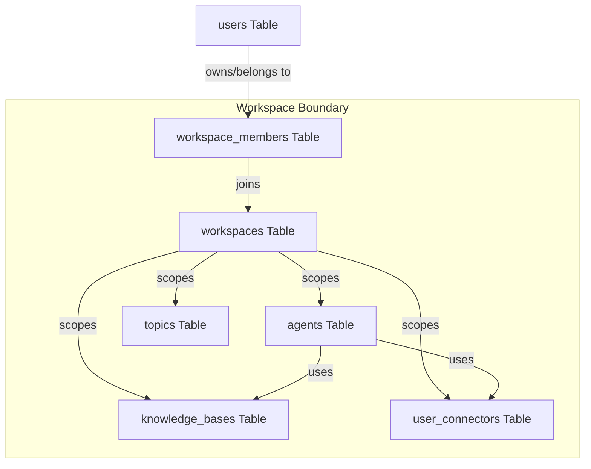
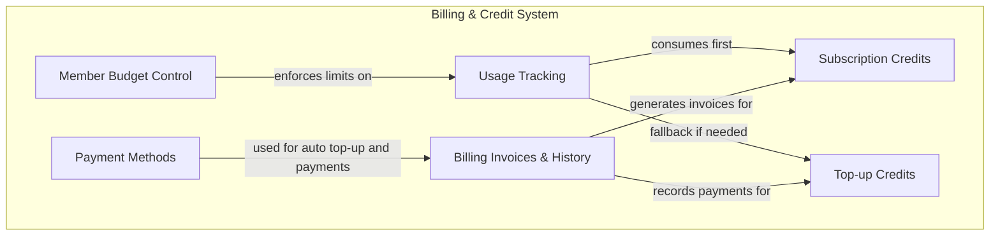

<!-- source: DeepWiki mcp.deepwiki.com · repo lobehub/lobehub · page 15 Workspace and Subscription · fetched 2026-10-29 -->

# Workspace and Subscription

Relevant source files

The following files were used as context for generating this wiki page:

- [locales/en-US/subscription.json](locales/en-US/subscription.json)
- [locales/zh-CN/subscription.json](locales/zh-CN/subscription.json)
- [packages/locales/src/default/subscription.ts](packages/locales/src/default/subscription.ts)

The LobeHub platform implements a multi-tenant workspace system combined with a comprehensive subscription and billing framework. This infrastructure ensures data isolation and secure collaboration while providing flexible management of subscriptions, credit balances, and usage controls.

---

## Workspace System Overview

Workspaces are the primary organizational and isolation unit within LobeHub. Each significant entity such as AI agents, topics, threads, files, and knowledge bases is scoped under a workspace via a `workspace_id` field, enforcing strict multi-tenancy boundaries between different teams or personal projects [docs/development/database-schema.dbml:10-40](). 

Routing reflects this scoping by using a `[workspaceSlug]` dynamic segment, enabling clean URLs like `/{workspaceSlug}/agent/...` which isolate user navigation and UI context to a specific workspace. The workspace-aware route prefixing respects personal-only and reserved route segments to avoid conflicts with account-level paths (e.g., `/settings`, `/me`, `/invite`) [src/features/Workspace/workspaceAwarePath.ts:1-137](), [src/features/Workspace/__tests__/workspaceAwarePath.test.ts:1-133]().

Role-Based Access Control (RBAC) governs workspace membership and permissions. Members can have roles such as Owner, Member, or Viewer, defining their ability to manage workspace settings, invite new users, and enforce credit consumption policies within that workspace [packages/database/src/schemas/rbac.ts:1-30](), [packages/database/src/schemas/workspace.ts:1-40]().

### Workspace Scoping Diagram

This architecture enables strict data isolation and scoped administrative controls per workspace.

Sources:  
[docs/development/database-schema.dbml:10-40](), [packages/database/src/schemas/workspace.ts:1-40](), [packages/database/src/schemas/rbac.ts:1-30](), [src/features/Workspace/workspaceAwarePath.ts:1-137]()

---

## Subscription and Billing Concepts

LobeHub provides a dual-credit system to efficiently handle resource consumption and billing:

- **Subscription Credits**: These are recurring monthly credits included with paid subscription plans such as Starter, Premium, and Ultimate. Subscription credits are consumed on priority for API usage and feature accesses [packages/locales/src/default/subscription.ts:7-8]().
  
- **Top-up Credits**: Non-expiring credits that can be manually purchased or replenished automatically through auto-top-up rules when subscription credits are exhausted [packages/locales/src/default/subscription.ts:2-5]().

Workspace owners and administrators can manage subscription plans, billing history, payment methods, and usage monitoring per-member and per-agent basis. Budget governance allows setting limits on credit consumption per member to prevent overspending [locales/zh-CN/subscription.json:137-140]().

### Billing and Credit Flow Diagram

This system supports transparent billing and flexible management of recurrent and one-time payments associated with workspaces.

Sources:  
[packages/locales/src/default/subscription.ts:1-125](), [locales/en-US/subscription.json:1-105](), [locales/zh-CN/subscription.json:1-143]()

---

## Workspace Scope in Routing and UI

To maintain consistent context and data isolation, the platform enforces workspace scoping in routing paths and UI navigation:

- The function `buildWorkspaceAwarePath(to, activeSlug, options?)` prepends workspace slugs to navigational paths unless the path is marked personal-only, already prefixed, or the `escape` option is set [src/features/Workspace/workspaceAwarePath.ts:121-137]().
  
- Reserved top-level segments such as `/settings`, `/me`, `/share`, `/invite`, and others remain unprefixed to indicate personal context separate from workspace scope.

- The workspace slug from the URL is synchronized with application state to activate the corresponding workspace context, or fall back to personal context when none is specified. Unknown slugs trigger workspace-specific 404 handling [src/features/Workspace/useWorkspaceUrlSync.ts:50-112]().

---

## Workspace Settings UI Categories

Settings related to workspaces and subscriptions are organized for users based on permissions:

- **Account-level tabs** (profile, appearance, hotkeys, messenger) are always accessible and follow the user context but are mirrored within workspace routes for seamless access [src/features/WorkspaceSetting/hooks/useCategory.tsx:50-190]().

- **Workspace General and Admin tabs** cover workspace details, member and device management, audit logs, notifications, and statistics.

- **Subscription-related tabs** include plan selection, usage reports, credits overview, budget control, and billing history, gated by billing permissions.

This grouping helps users navigate complex administration and billing workflows while respecting RBAC restrictions.

Sources:  
[src/features/WorkspaceSetting/hooks/useCategory.tsx:50-194]()

---

## Child Pages for Details

This page provides a high-level introduction. Detailed technical documentation is available on child pages:

- [Workspace Management](#15.1) — Covers workspaces and membership tables, route handling of `[workspaceSlug]`, RBAC roles and permissions, workspace settings UI, audit logging, device management, and the invitation flow.

- [Subscription and Billing](#15.2) — Covers subscription plans and types, credit balance management, billing history records, payment method interfaces, usage tracking per member, and backend business-server API routes supporting billing.

---

## Summary Table of Key Code Entities

| Entity                | Description                                              | Location                                     |
|-----------------------|----------------------------------------------------------|----------------------------------------------|
| `workspaces`          | Table defining workspace containers                      | [packages/database/src/schemas/workspace.ts]()     |
| `workspace_members`   | Join table linking users to workspaces with roles       | [packages/database/src/schemas/workspace.ts]()     |
| `buildWorkspaceAwarePath` | Function to generate workspace-scoped navigation paths | [src/features/Workspace/workspaceAwarePath.ts]() |
| Role-Based Access Control | RBAC roles and permissions on workspace members       | [packages/database/src/schemas/rbac.ts]()           |
| Subscription Credits  | Monthly recurring credits in subscription plans          | [packages/locales/src/default/subscription.ts:7-8]()|
| Top-up Credits        | Purchased credits usable when subscription credits empty | [packages/locales/src/default/subscription.ts:2-5]()|
| Billing & Payments    | UI strings and logic for plans, credits, billing history | [locales/en-US/subscription.json]()                  |

Sources:  
[docs/development/database-schema.dbml:10-40](),  
[packages/database/src/schemas/workspace.ts:1-40](),  
[packages/database/src/schemas/rbac.ts:1-30](),  
[src/features/Workspace/workspaceAwarePath.ts:1-137](),  
[src/features/Workspace/useWorkspaceUrlSync.ts:50-112](),  
[packages/locales/src/default/subscription.ts:1-125](),  
[locales/en-US/subscription.json:1-105]()

---

This overview contextualizes LobeHub's workspace isolation and billing mechanisms and how they interoperate within routing and UI layers. For deep dives and implementation specifics, please proceed to the child pages.

---

