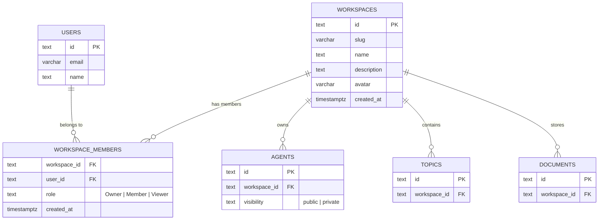
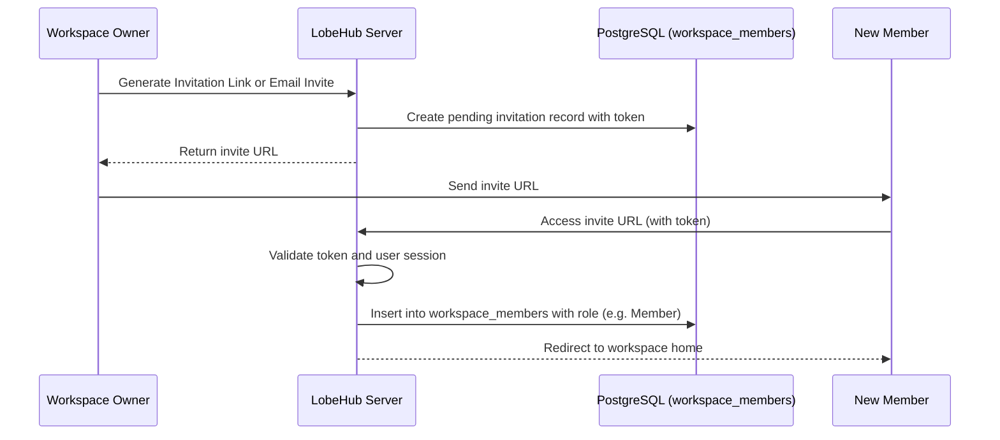

<!-- source: DeepWiki mcp.deepwiki.com · repo lobehub/lobehub · page 15.1 Workspace Management · fetched 2026-10-29 -->

# Workspace Management

<details>
<summary>Relevant source files</summary>

The following files were used as context for generating this wiki page:

- [apps/server/src/services/document/__tests__/index.test.ts](apps/server/src/services/document/__tests__/index.test.ts)
- [apps/server/src/services/document/index.ts](apps/server/src/services/document/index.ts)
- [docs/development/database-schema.dbml](docs/development/database-schema.dbml)
- [locales/en-US/setting.json](locales/en-US/setting.json)
- [locales/zh-CN/setting.json](locales/zh-CN/setting.json)
- [packages/database/migrations/0086_video_generation_schema.sql](packages/database/migrations/0086_video_generation_schema.sql)
- [packages/database/migrations/0177_agent_accounts_live_unique_and_goal_subscriptions.sql](packages/database/migrations/0177_agent_accounts_live_unique_and_goal_subscriptions.sql)
- [packages/database/migrations/0180_task_archived_at.sql](packages/database/migrations/0180_task_archived_at.sql)
- [packages/database/migrations/meta/0086_snapshot.json](packages/database/migrations/meta/0086_snapshot.json)
- [packages/database/migrations/meta/0177_snapshot.json](packages/database/migrations/meta/0177_snapshot.json)
- [packages/database/migrations/meta/0180_snapshot.json](packages/database/migrations/meta/0180_snapshot.json)
- [packages/database/migrations/meta/_journal.json](packages/database/migrations/meta/_journal.json)
- [packages/database/src/models/__tests__/agentAccount.test.ts](packages/database/src/models/__tests__/agentAccount.test.ts)
- [packages/database/src/models/__tests__/document.test.ts](packages/database/src/models/__tests__/document.test.ts)
- [packages/database/src/models/__tests__/drizzleMigration.test.ts](packages/database/src/models/__tests__/drizzleMigration.test.ts)
- [packages/database/src/models/__tests__/topics/topic.create.test.ts](packages/database/src/models/__tests__/topics/topic.create.test.ts)
- [packages/database/src/models/agentAccount.ts](packages/database/src/models/agentAccount.ts)
- [packages/database/src/models/document.ts](packages/database/src/models/document.ts)
- [packages/database/src/schemas/agent.ts](packages/database/src/schemas/agent.ts)
- [packages/database/src/schemas/agentAccount.ts](packages/database/src/schemas/agentAccount.ts)
- [packages/database/src/schemas/agentCronJob.ts](packages/database/src/schemas/agentCronJob.ts)
- [packages/database/src/schemas/apiKey.ts](packages/database/src/schemas/apiKey.ts)
- [packages/database/src/schemas/asyncTask.ts](packages/database/src/schemas/asyncTask.ts)
- [packages/database/src/schemas/chatGroup.ts](packages/database/src/schemas/chatGroup.ts)
- [packages/database/src/schemas/file.ts](packages/database/src/schemas/file.ts)
- [packages/database/src/schemas/generation.ts](packages/database/src/schemas/generation.ts)
- [packages/database/src/schemas/goalSubscription.ts](packages/database/src/schemas/goalSubscription.ts)
- [packages/database/src/schemas/index.ts](packages/database/src/schemas/index.ts)
- [packages/database/src/schemas/message.ts](packages/database/src/schemas/message.ts)
- [packages/database/src/schemas/rag.ts](packages/database/src/schemas/rag.ts)
- [packages/database/src/schemas/relations.ts](packages/database/src/schemas/relations.ts)
- [packages/database/src/schemas/session.ts](packages/database/src/schemas/session.ts)
- [packages/database/src/schemas/task.ts](packages/database/src/schemas/task.ts)
- [packages/database/src/schemas/topic.ts](packages/database/src/schemas/topic.ts)
- [packages/database/src/utils/idGenerator.ts](packages/database/src/utils/idGenerator.ts)
- [packages/locales/src/default/setting.ts](packages/locales/src/default/setting.ts)
- [packages/types/src/goalSubscription.ts](packages/types/src/goalSubscription.ts)
- [packages/types/src/index.ts](packages/types/src/index.ts)

</details>


LobeHub implements a multi-tenant workspace architecture enabling users to organize agents, files, conversations, and resources within isolated or shared environments. This section documents the detailed implementation of workspace management, covering the database schemas for workspaces and members, routing with `[workspaceSlug]`, workspace-aware path construction, member roles with RBAC, the workspace settings UI, invitation flow, and the WorkspaceModel service.

---

## Database Schema

The workspace multi-tenancy foundation rests on two core PostgreSQL tables: `workspaces` and `workspace_members`. These tables define workspace entities, user membership with roles, and provide the data scaffolding for scoping workspace-related entities.

### Workspace Tables

| Table               | Purpose                                   | Key Columns                          |
|---------------------|-------------------------------------------|------------------------------------|
| `workspaces`        | Represents a workspace entity             | `id`, `name`, `slug`, `description`, `avatar`, `created_at` |
| `workspace_members` | Maps users to workspaces with roles       | `workspace_id`, `user_id`, `role`, `created_at`               |

Each workspace is uniquely identified by `id` and slug, which is URL-friendly. Users are connected to the workspace via `workspace_members` table, assigning roles that govern access.

### Workspace Membership Roles and Relations

- Roles typically include **Owner**, **Member**, and **Viewer**.
- Each member entry has timestamps to track creation and updates.
- Workspace ownership allows managing memberships and settings.

### Workspace Data Isolation via Foreign Keys

Many entities reference the workspace to enforce data isolation and scoping. Significant examples include:

- `agents` with a `workspace_id` foreign key constrain agents within a workspace.
- `topics` and `threads` belong to a workspace.
- Files and documents reference the workspace as well.
- Deleting a workspace cascades deletions of these related entities, maintaining referential integrity.

### Entity Relationship Diagram for Workspace



**Sources:**  
- [packages/database/src/schemas/workspace.ts]()  
- [packages/database/src/schemas/agent.ts:35-110]()  
- [packages/database/src/schemas/topic.ts:25-86]()  
- [packages/database/src/schemas/file.ts:70-166]()  

---

## Routing and Workspace Slugs

LobeHub uses Next.js dynamic routing with `[workspaceSlug]` as a dynamic segment to scope URLs and UI state to a specific workspace.

### Workspace Routes vs Personal Routes

- **Personal Routes**: Top-level routes without a workspace prefix, like `/me/profile`, `/settings`.
- **Workspace Routes**: Routes prefixed with a workspace slug to scope context and data, e.g., `/acme/agent/inbox`, `/acme/settings/members`.

The workspace slug is the first path segment indicating the workspace scope.

### Route Prefixes Scoped within Workspace

A set of route prefixes (`sharedMainAreaChildren`) is mapped under `[workspaceSlug]` routes. Common scoped sections include:

- `agent`
- `projects`
- `group`
- `settings`
  
These are defined in the desktop router config, e.g. [src/spa/router/desktopRouter.config.tsx:46-54]().

### workspaceAwarePath Utility

`buildWorkspaceAwarePath` is a pure utility that prepends the active workspace slug to absolute paths, with exceptions to honor personal and escaped paths, ensuring:

- Workspace-aware navigation for linking.
- Exceptions for personal-only routes like `/settings/llm`, `/apps`, `/invite`, etc.
- Avoids double prefixing if path already includes a workspace slug.

Example:

| Input Path          | Active Workspace Slug | Output Path         |
|---------------------|----------------------|---------------------|
| `/memory`           | `acme`               | `/acme/memory`       |
| `/settings/general` | `acme`               | `/acme/settings/general` |
| `/settings/llm`     | `acme`               | `/settings/llm`       |

This is implemented in `src/features/Workspace/workspaceAwarePath.ts` and covered by unit tests [src/features/Workspace/__tests__/workspaceAwarePath.test.ts]().

### Hook: useWorkspaceUrlSync

This React hook detects the workspace slug in the URL pathname and syncs it with the workspace context store without forcing user selection. It avoids reserved first path segments like `agent`, `settings`, `me`, `share`.

This hook ensures UI state respects the current URL workspace slug. See [src/features/Workspace/useWorkspaceUrlSync.ts:20-112]().

### Middleware URL Rewrites and Locale Handling

The Next.js middleware defined in `defineConfig` uses logic to:

- Detect workspace slugs dynamically in the URL.
- Apply intelligent rewrites to localized SPA entrypoints.
- Differentiate between SPA apps (Auth, Share, Workbench), API routes, static assets.
- Maintain workspace slug context across locales and device types.

This supports smooth workspace-aware navigation and locale support on the frontend [src/libs/next/proxy/define-config.ts:56-181]().

**Sources:**  
- [src/features/Workspace/workspaceAwarePath.ts]()  
- [src/features/Workspace/useWorkspaceUrlSync.ts]()  
- [src/libs/next/proxy/define-config.ts]()  
- [src/spa/router/desktopRouter.config.tsx:46-54]()  

---

## Member Roles and RBAC

Workspace access control is managed via roles assigned per user per workspace in `workspace_members`. These roles govern permissions across the workspace data.

### Roles

| Role   | Permissions Summary                                                    |
|--------|------------------------------------------------------------------------|
| Owner  | Full control: manage members, workspace settings, delete workspace    |
| Member | Can create/edit agents, topics, files; participate actively           |
| Viewer | Read-only access to workspace-shared data                             |

### Visibility Flags on Entities

Entities have a `visibility` field to refine access inside workspaces:

- `public`: Visible to all workspace members.
- `private`: Only visible to the creator (`user_id`), even if member of workspace.

This mixes RBAC with per-item visibility to enable granular sharing and data privacy.

### Code Manifestation

- In the `agents` table, `visibility` is an enum (`public` | `private`) controlling member visibility [packages/database/src/schemas/agent.ts:109-110]().
- Files and documents similarly define visibility controlling access inside workspace boundaries [packages/database/src/schemas/file.ts:138-140]().

---

## Workspace Settings UI

The workspace settings UI offers a segmented interface for configuring workspace-level settings scoped to the current workspace slug.

### Major Settings Tabs

| Tab          | Description                                                   |
|--------------|---------------------------------------------------------------|
| General      | Edit workspace name, slug, description, and avatar           |
| Members      | Manage invitations, assign roles, view member list           |
| Audit Log    | View audit logs and security events                           |
| Devices      | Manage connected trusted devices (desktop, CLI clients)      |
| Storage      | Manage file and storage usage within workspace                |
| Billing      | View and manage subscription plans, billing, credit balances |
| Connectors   | Manage workspace-shared external tool credentials             |

These tabs are defined as keys in `WorkspaceSettingsTabs` and grouped for rendering by hooks such as `useWorkspaceSettingCategory` [src/features/WorkspaceSetting/hooks/useCategory.tsx:63-194]().

Account-level settings like user profile and appearance are accessible from the workspace context but are user-global.

**Sources:**  
- [src/features/WorkspaceSetting/hooks/useCategory.tsx]()  
- [src/spa/router/desktopRouter.config.desktop.tsx:39-49]()  

---

## Workspace Invitation Flow

Workspaces support inviting users via invitation tokens or links that map to controlled member onboarding flows.

### Invitation Flow Sequence



- Invitation tokens are generated and stored in an invitations table (not shown in detail here).
- Tokens are validated on use to ensure integrity and expiration.
- Upon acceptance, the user is added to `workspace_members` with the assigned role.

This provides auditability and controlled workspace membership.

---

## WorkspaceModel Service Operations

The `WorkspaceModel` encapsulates workspace lifecycle operations and membership management at the server-side service/model layer.

### Key Methods and Responsibilities

| Method               | Description                                                        |
|----------------------|--------------------------------------------------------------------|
| `createWorkspace`    | Create a new workspace row and assign the creator as Owner         |
| `getWorkspaceBySlug` | Lookup workspace details given a slug                              |
| `addMember`           | Add a user to a workspace with a specified role                    |
| `updateMemberRole`    | Change the role assigned to a member within a workspace           |
| `deleteWorkspace`     | Delete a workspace and cascade deletions for all associated entities |

Foreign key `ON DELETE CASCADE` ensure safe removal of workspace-scoped entities such as agents, topics, files, maintaining data integrity.

### Data Isolation Enforcement

Entity schemas reference workspace IDs, e.g., `agents.workspaceId`, `topics.workspaceId`. Queries and service logic enforce filtering by workspace ID and member permissions.

**Sources:**  
- [packages/database/src/schemas/agent.ts:81-110]()  
- [packages/database/src/schemas/topic.ts:92]()  

---

# Summary Diagram: Natural Language to Code Entities Mapping for Workspace Management

```mermaid
graph LR
  subgraph WorkspaceDB[PostgreSQL Schema]
    W[workspaces]
    WM[workspace_members]
    AG[agents (workspace_id FK)]
    TP[topics (workspace_id FK)]
    FI[files (workspace_id FK)]
  end

  subgraph FrontendRouting
    WAPath[buildWorkspaceAwarePath()]
    UseSync[useWorkspaceUrlSync()]
    DefineConf[defineConfig() Middleware]
    RouteSlugs["[workspaceSlug] routing"]
  end

  subgraph RBACScopes
    Roles[Owner, Member, Viewer roles]
    Visibility[Agent/File visibility: public/private]
  end

  subgraph WorkspaceUI
    SettingsTabs[workspaceSettings tabs: General, Members, Audit Log, Devices, Storage]
    InvFlow[Invitation Flow UI]
    UseCategory[useWorkspaceSettingCategory() sidebar]
  end

  subgraph BackendModel
    WSModel[WorkspaceModel class/service]
  end

  %% Edges
  W -->|FK| WM
  W -->|FK| AG
  W -->|FK| TP
  W -->|FK| FI

  WAPath --> RouteSlugs
  UseSync --> RouteSlugs
  DefineConf --> RouteSlugs

  WM --> Roles
  AG --> Visibility
  FI --> Visibility

  Roles --> RBACScopes
  Visibility --> RBACScopes

  WM --> WSModel
  W --> WSModel
  WSModel -->|Manage workspace lifecycle| W
  WSModel -->|Manage member roles| WM

  RouteSlugs --> WorkspaceUI
  RBACScopes --> WorkspaceUI
  WorkspaceUI --> InvFlow
  WorkspaceUI --> SettingsTabs
  WorkspaceUI --> UseCategory
```

---

# Summary

LobeHub's workspace management system facilitates secure multi-tenant collaboration by defining explicit workspace entities and scoped user membership roles. The implementation is comprehensive, spanning PostgreSQL schema design with foreign keys and cascading deletes, dynamic Next.js routing to scope UI and API traffic via workspace slugs, and granular RBAC controlling member permissions and visibility of agents and files. The workspace settings UI presents a tabbed interface for managing general info, members, audit logs, devices, and storage, while the invitation flow handles onboarding new members securely. Server-side WorkspaceModel services provide lifecycle and role management, ensuring consistent data isolation throughout the system.

This architecture ensures a clean and secure multi-tenant experience for both users and developers.

---

**Sources:**  
- [packages/database/src/schemas/workspace.ts]()  
- [packages/database/src/schemas/agent.ts:35-110]()  
- [packages/database/src/schemas/topic.ts:25-86]()  
- [packages/database/src/schemas/file.ts:70-166]()  
- [src/features/Workspace/workspaceAwarePath.ts]()  
- [src/features/Workspace/useWorkspaceUrlSync.ts]()  
- [src/libs/next/proxy/define-config.ts]()  
- [src/features/WorkspaceSetting/hooks/useCategory.tsx]()  
- [src/spa/router/desktopRouter.config.desktop.tsx:39-49]()  
- [src/features/Workspace/__tests__/workspaceAwarePath.test.ts]()

---

