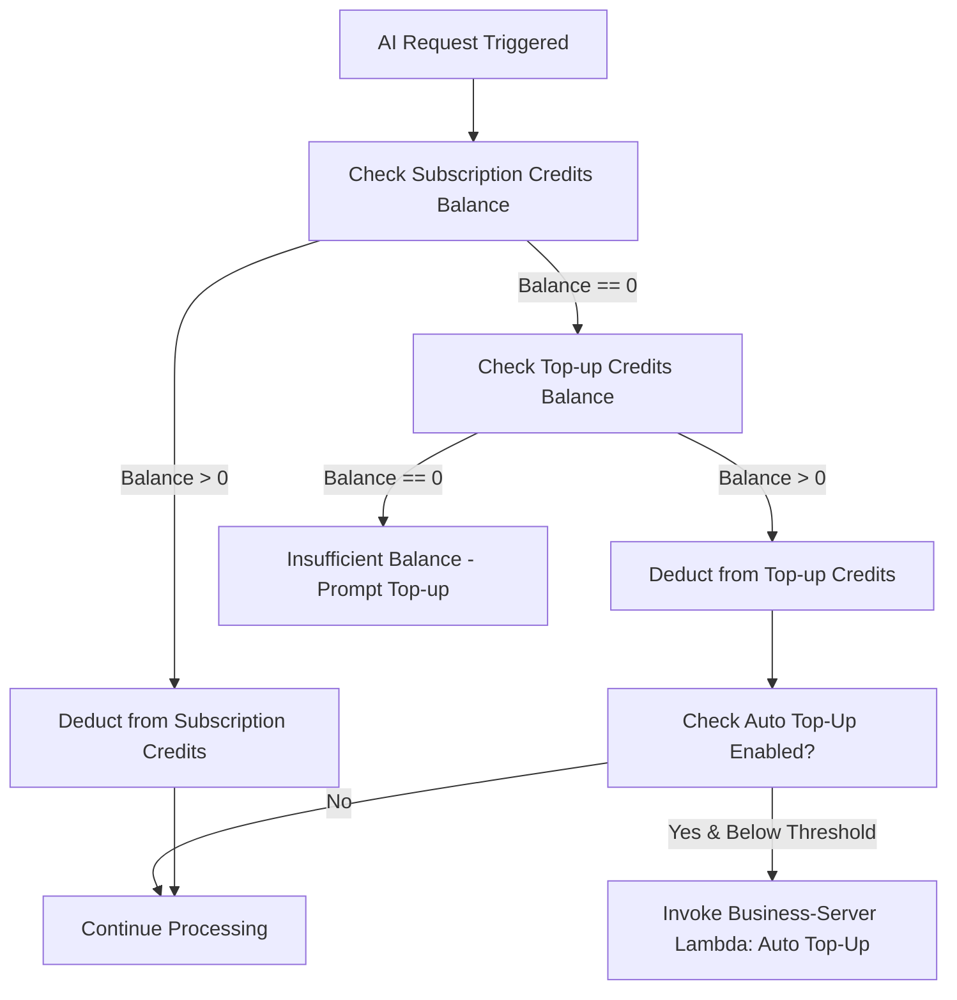
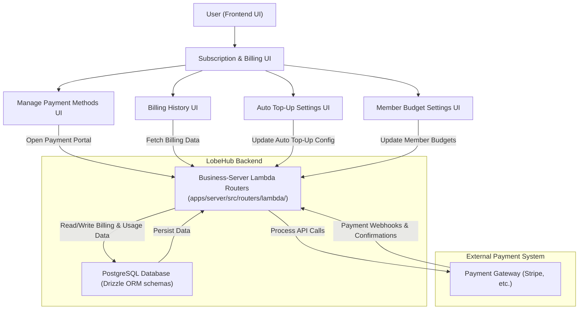
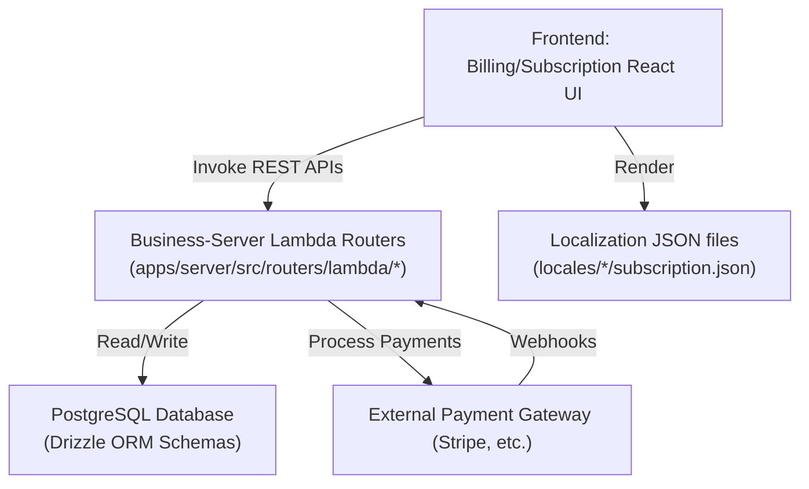

<!-- source: DeepWiki mcp.deepwiki.com · repo lobehub/lobehub · page 15.2 Subscription and Billing · fetched 2026-10-29 -->

# Subscription and Billing

Relevant source files

The following files were used as context for generating this wiki page:

- [locales/ar/subscription.json](locales/ar/subscription.json)
- [locales/bg-BG/subscription.json](locales/bg-BG/subscription.json)
- [locales/de-DE/subscription.json](locales/de-DE/subscription.json)
- [locales/en-US/subscription.json](locales/en-US/subscription.json)
- [locales/es-ES/subscription.json](locales/es-ES/subscription.json)
- [locales/fa-IR/subscription.json](locales/fa-IR/subscription.json)
- [locales/fr-FR/subscription.json](locales/fr-FR/subscription.json)
- [locales/it-IT/subscription.json](locales/it-IT/subscription.json)
- [locales/ja-JP/subscription.json](locales/ja-JP/subscription.json)
- [locales/ko-KR/subscription.json](locales/ko-KR/subscription.json)
- [locales/nl-NL/subscription.json](locales/nl-NL/subscription.json)
- [locales/pl-PL/subscription.json](locales/pl-PL/subscription.json)
- [locales/zh-CN/subscription.json](locales/zh-CN/subscription.json)
- [packages/locales/src/default/subscription.ts](packages/locales/src/default/subscription.ts)

LobeHub implements a comprehensive subscription and billing system designed for multi-tenant workspaces. It supports tiered subscription plans, a dual-credit balance system (subscription vs. top-up), granular member budget controls, and automated billing workflows backed by a business-server architecture.

---

## Subscription Plans

LobeHub defines multiple subscription tiers, each offering different resource access levels and credit allocations:

| Plan        | Description                                         | Credit Type                     |
|-------------|----------------------------------------------------|---------------------------------|
| **Free**    | Basic access for individual users                   | Limited or no subscription credits |
| **Hobby**   | Personal projects; requires self-configured API keys or top-ups | No subscription credits          |
| **Starter** | Entry-level paid tier for small teams               | Monthly subscription credits     |
| **Premium** | Professional tier with higher limits and features  | Monthly subscription credits     |
| **Ultimate**| Highest tier with maximum resource allocation       | Monthly subscription credits     |

Subscription plans govern monthly credit allocations used for AI usage and access privileges. Users can upgrade, downgrade, or cancel plans via the UI. Plan changes usually take effect after the current billing cycle ends. Cancellation retains active benefits until expiry. Subscriptions purchased through mobile apps are managed via those platforms rather than web UI.

UI messages and behaviors are localized in files such as `locales/en-US/subscription.json` and `packages/locales/src/default/subscription.ts` covering cancellation alerts, existing subscription notifications, and payment recovery prompts [locales/en-US/subscription.json:1-60](), [packages/locales/src/default/subscription.ts:1-97]().

---

## Credit Balance System

LobeHub manages AI usage costs via a two-tier credit system:

- **Subscription Credits**: Allocated according to the active subscription plan monthly. Always consumed first.
- **Top-up Credits**: Purchased manually or automatically as a fallback, consumed when subscription credits are exhausted.

This hierarchy allows predictable monthly resource usage and billing cycles [locales/en-US/subscription.json:6-7](), [locales/en-US/subscription.json:2-7]().

### Automated Credit Features

- **Auto Top-Up**: When enabled, monitors credit balance and triggers automated purchases to replenish top-up credits when the balance falls below a configured threshold, restoring balance up to a target value. A monthly limit can restrict the total auto-charging amount.
- **Cost Estimate Alerts**: Lightweight warnings shown if the estimated model usage cost approaches user-defined thresholds.
- **Card Binding Gift**: Upon first adding a payment method, users automatically receive a free credit bonus (e.g., 1 million credits), to incentivize saving payment details.

These features are reflected in UI strings and enable better user credit management [locales/en-US/subscription.json:73-94]().

### Credit Consumption Flow

The backend implements a credit deduction sequence on AI usage requests, ensuring subscription credits are used first, falling back to top-up credits, and potentially triggering auto top-up:

---

## Member Budget Control

Within multi-tenant workspaces, administrators can fine-tune spending limits down to individual members.

### Budget Rules

- **Default Budget**: A workspace-wide default limit applies to members without specific overrides.
- **Custom Budgets**: Individual members can have assigned, custom credit budgets.
- **Unlimited Access**: Certain roles (e.g., Owners) can be exempted from budget constraints.

### Dedicated Budgets

Dedicated budgets are special shared credit pools allocated to groups of members, consumed before individual member budgets:

| Feature                | Description                                           |
|------------------------|------------------------------------------------------|
| Budget Amount          | Total credit allocation in the dedicated budget       |
| Shared Members         | Members sharing this credit pool                       |

Member budget constraints have statuses:

- `inherit`: Uses workspace default limit
- `custom`: Has a custom per-member limit
- `unlimited`: No spending limit

This setup enables secure, organized cost control in collaborative contexts [locales/en-US/subscription.json:108-144]().

---

## Billing and Payment Management

The billing system tracks and manages financial transactions, credit usage, and payment methods with full transparency.

### Key Entities

- **Billing History**: Lists invoices with statuses such as `Paid`, `Unpaid`, `Draft`, and `Closed`.
- **Payment Methods**: Interface to manage payment instruments including credit card or external gateways.
- **Usage Tracking**: Per-member and model-level usage reports for billing accountability.

### System Architecture

The billing UI is backed by business-server Lambda routers that handle sensitive operations:

- Payment method management
- Subscription plan changes
- Billing history queries

The database stores billing records, usage logs, and subscription data. External payment gateways (e.g., Stripe) interact with the server via secure APIs and webhooks.

In the codebase, these routers include subscription-related Lambda files under the `apps/server/src/routers/lambda/` directory that expose APIs consumed by the React frontend for billing and subscription UI.

---

## Localization

All user-facing subscription and billing messages are centralized in the i18n system under the `locales/*/subscription.json` files. These provide consistent multilingual support for labels, alerts, instructions, and error messages in the billing UI.

Major supported locales with translations include:

- English: `locales/en-US/subscription.json`
- Chinese: `locales/zh-CN/subscription.json`
- Japanese: `locales/ja-JP/subscription.json`
- German: `locales/de-DE/subscription.json`
- Korean: `locales/ko-KR/subscription.json`
- Spanish, French, Italian, Dutch, Polish, Arabic, Persian, and more.

This ensures international usability of billing features.

---

# Summary Table of Key Code Areas and Concepts

---

# Detailed Implementation Notes

- **Subscription plans** are configured with monthly credit allocations and determine resource entitlements.
- **Credit balances** are dual-layered: subscription credits are allocated per plan monthly, with top-up credits purchased separately.
- **Auto top-up** settings provide automated backup credit purchasing with configurable limits and thresholds.
- **Member budget rules** give workspace admins fine-grained spending control per member or groups.
- **Billing history and payment method data** are stored and managed in the database via the business-server backend.
- **The business-server Lambda routes** encapsulate key billing workflows and securely integrate with payment gateways.
- **Localization** is integral for user-friendly billing UI, supporting many languages and regions.

Drizzle ORM manages database schema migrations reflected in `_journal.json` under `packages/database/migrations/meta/` containing billing-related versions and changes.

---

This completes the comprehensive technical documentation for Subscription and Billing in LobeHub.

---

**Sources:**  
- [locales/en-US/subscription.json:1-125]()  
- [locales/zh-CN/subscription.json:1-145]()  
- [packages/locales/src/default/subscription.ts:1-97]()  
- [packages/database/migrations/meta/_journal.json:1-309]()

---

