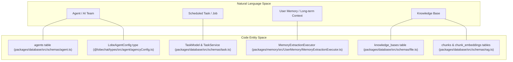
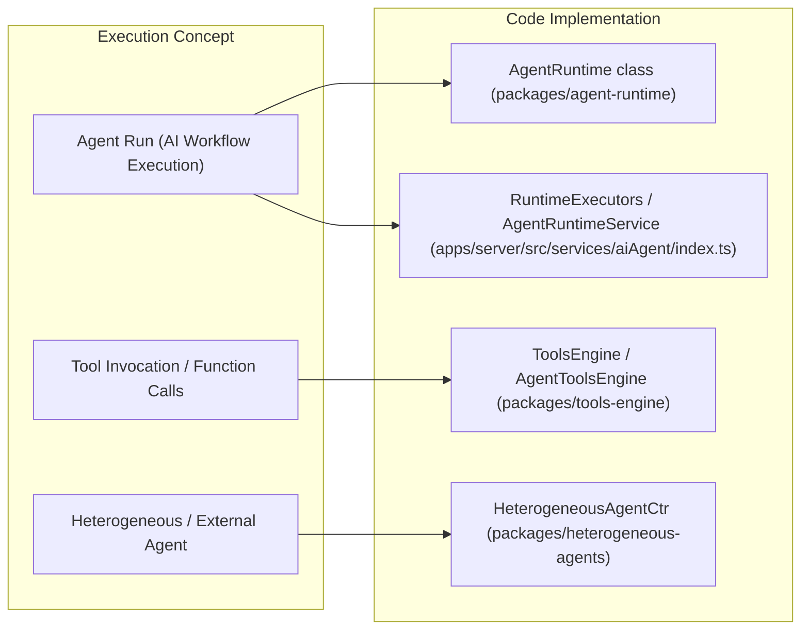

<!-- source: DeepWiki mcp.deepwiki.com · repo lobehub/lobehub · page 16 Glossary · fetched 2026-10-29 -->

# Glossary

Relevant source files

The following files were used as context for generating this wiki page:

- [.bunfig.toml](.bunfig.toml)
- [.github/scripts/create-failure-issue.js](.github/scripts/create-failure-issue.js)
- [.github/workflows/auto-i18n.yml](.github/workflows/auto-i18n.yml)
- [.github/workflows/auto-tag-release.yml](.github/workflows/auto-tag-release.yml)
- [.github/workflows/lighthouse.yml](.github/workflows/lighthouse.yml)
- [.github/workflows/release.yml](.github/workflows/release.yml)
- [.github/workflows/sync-database-schema.yml](.github/workflows/sync-database-schema.yml)
- [.github/workflows/sync-main-to-canary.yaml](.github/workflows/sync-main-to-canary.yaml)
- [.github/workflows/sync.yml](.github/workflows/sync.yml)
- [.github/workflows/test.yml](.github/workflows/test.yml)
- [.npmrc](.npmrc)
- [CHANGELOG.md](CHANGELOG.md)
- [README.md](README.md)
- [README.zh-CN.md](README.zh-CN.md)
- [apps/cli/.npmrc](apps/cli/.npmrc)
- [apps/cli/pnpm-workspace.yaml](apps/cli/pnpm-workspace.yaml)
- [apps/desktop/.npmrc](apps/desktop/.npmrc)
- [apps/desktop/package.json](apps/desktop/package.json)
- [apps/desktop/pnpm-lock.yaml](apps/desktop/pnpm-lock.yaml)
- [apps/desktop/pnpm-workspace.yaml](apps/desktop/pnpm-workspace.yaml)
- [apps/desktop/src/main/controllers/AuvCtr.ts](apps/desktop/src/main/controllers/AuvCtr.ts)
- [apps/desktop/src/main/services/__tests__/auvSrv.test.ts](apps/desktop/src/main/services/__tests__/auvSrv.test.ts)
- [apps/desktop/src/main/services/auvSrv.ts](apps/desktop/src/main/services/auvSrv.ts)
- [changelog/CHANGELOG.v0.md](changelog/CHANGELOG.v0.md)
- [changelog/CHANGELOG.v1.md](changelog/CHANGELOG.v1.md)
- [changelog/v0.json](changelog/v0.json)
- [changelog/v1.json](changelog/v1.json)
- [changelog/v2.json](changelog/v2.json)
- [codecov.yml](codecov.yml)
- [docs/changelog/2025-03-02-new-models.zh-CN.mdx](docs/changelog/2025-03-02-new-models.zh-CN.mdx)
- [docs/changelog/2025-06-08-claude-4.zh-CN.mdx](docs/changelog/2025-06-08-claude-4.zh-CN.mdx)
- [docs/changelog/2025-07-08-mcp-market.zh-CN.mdx](docs/changelog/2025-07-08-mcp-market.zh-CN.mdx)
- [docs/changelog/2025-09-08-gemini.zh-CN.mdx](docs/changelog/2025-09-08-gemini.zh-CN.mdx)
- [docs/changelog/2025-10-08-python.zh-CN.mdx](docs/changelog/2025-10-08-python.zh-CN.mdx)
- [docs/changelog/2025-12-20-mcp.zh-CN.mdx](docs/changelog/2025-12-20-mcp.zh-CN.mdx)
- [docs/changelog/schema.json](docs/changelog/schema.json)
- [locales/en-US/chat.json](locales/en-US/chat.json)
- [locales/zh-CN/chat.json](locales/zh-CN/chat.json)
- [next.config.ts](next.config.ts)
- [package.json](package.json)
- [packages/heterogeneous-agents/src/models/index.ts](packages/heterogeneous-agents/src/models/index.ts)
- [packages/heterogeneous-agents/src/models/listHeterogeneousAgentModels.test.ts](packages/heterogeneous-agents/src/models/listHeterogeneousAgentModels.test.ts)
- [packages/heterogeneous-agents/src/models/listHeterogeneousAgentModels.ts](packages/heterogeneous-agents/src/models/listHeterogeneousAgentModels.ts)
- [packages/locales/src/default/chat.ts](packages/locales/src/default/chat.ts)
- [packages/types/src/agent/agencyConfig.test.ts](packages/types/src/agent/agencyConfig.test.ts)
- [packages/types/src/agent/agencyConfig.ts](packages/types/src/agent/agencyConfig.ts)
- [packages/types/src/agent/heteroSelectorCapabilities.test.ts](packages/types/src/agent/heteroSelectorCapabilities.test.ts)
- [packages/types/src/agent/heteroSelectorCapabilities.ts](packages/types/src/agent/heteroSelectorCapabilities.ts)
- [patches/@upstash__qstash.patch](patches/@upstash__qstash.patch)
- [pnpm-workspace.yaml](pnpm-workspace.yaml)
- [renovate.json](renovate.json)
- [scripts/changelogWorkflow/const.ts](scripts/changelogWorkflow/const.ts)
- [scripts/changelogWorkflow/generateChangelog.ts](scripts/changelogWorkflow/generateChangelog.ts)
- [scripts/dbmlWorkflow/index.ts](scripts/dbmlWorkflow/index.ts)
- [scripts/releaseWorkflow/index.ts](scripts/releaseWorkflow/index.ts)
- [src/features/AgentTasks/AgentTaskDetail/TaskRunReport.tsx](src/features/AgentTasks/AgentTaskDetail/TaskRunReport.tsx)
- [src/features/AgentTasks/AgentTaskDetail/TopicCard.test.tsx](src/features/AgentTasks/AgentTaskDetail/TopicCard.test.tsx)
- [src/features/AgentTasks/AgentTaskDetail/TopicCard.tsx](src/features/AgentTasks/AgentTaskDetail/TopicCard.tsx)
- [src/features/AgentTasks/AgentTaskDetail/useRunFollowUp.test.ts](src/features/AgentTasks/AgentTaskDetail/useRunFollowUp.test.ts)
- [src/features/AgentTasks/AgentTaskDetail/useRunFollowUp.ts](src/features/AgentTasks/AgentTaskDetail/useRunFollowUp.ts)
- [src/features/ChatInput/ControlBar/HeteroModel/useModelCatalog.test.ts](src/features/ChatInput/ControlBar/HeteroModel/useModelCatalog.test.ts)
- [src/features/ShareModal/ShareImage/style.ts](src/features/ShareModal/ShareImage/style.ts)
- [src/libs/next/config/define-config.test.ts](src/libs/next/config/define-config.test.ts)
- [src/libs/next/config/define-config.ts](src/libs/next/config/define-config.ts)
- [src/routes/(main)/agent/features/Conversation/HeterogeneousChatInput/shouldShowHeteroModelSelector.test.ts](src/routes/(main)/agent/features/Conversation/HeterogeneousChatInput/shouldShowHeteroModelSelector.test.ts)
- [vercel.json](vercel.json)

This page provides a high-level glossary of codebase-specific terms, jargon, and domain concepts essential for onboarding engineers. LobeHub is a comprehensive open-source AI Agent framework designed to coordinate AI agents, tools, and knowledge bases. Understanding these terms is key to navigating the monorepo and its subsystems effectively.

---

## Core Concepts Overview

LobeHub revolves around the concept of **Agents**, which are configurable AI entities interacting within a layered conversation hierarchy and communicating with external systems through plugins, MCP, and heterogeneous agent bridges. The system’s architectural components include chat sessions, workflows, knowledge management, and multi-agent orchestration.

### Mapping Natural Language Concepts to Code Entities

The following diagrams illustrate how core product concepts map to concrete code constructs and database schemas.

#### Product Entity Mapping: Concepts to Database and Types

#### Agent Execution Flow: Runtime and Tools Integration

Sources: [packages/database/src/schemas/agent.ts:1-180](), [@lobechat/types/src/agent/agencyConfig.ts:1-100](), [packages/database/src/schemas/task.ts:1-50](), [packages/memory/src/UserMemory/MemoryExtractionExecutor.ts:1-50](), [packages/database/src/schemas/file.ts:50-170](), [packages/database/src/schemas/rag.ts:1-135](), [apps/server/src/services/aiAgent/index.ts:1-60]()

---

## Key Subsystems

This glossary is organized around the primary subsystems of LobeHub, each of which corresponds to a significant functional area in the codebase.

### 1. Agents and Orchestration

- **Agent:** A configurable AI entity that acts as an assistant or "team member." Agents have profiles, conversation behaviors, assigned skills (plugins), and runtime configurations. They are represented in the database by the `agents` table and correspond to `LobeAgentConfig` types in code [packages/database/src/schemas/agent.ts:1-180](), [@lobechat/types/src/agent/agencyConfig.ts:1-100]().

- **Agent Runtime:** The execution engine that runs agent workflows, handling LLM calls, tool invocation, and managing multi-step agent logic. Implemented primarily in the `agent-runtime` package with service orchestration in the server located at `apps/server/src/services/aiAgent/index.ts` [packages/agent-runtime/src](), [apps/server/src/services/aiAgent/index.ts:1-60]().

- **Heterogeneous Agent:** Integration adapters for external AI agents (e.g., Claude Code, Codex) that run outside the core runtime but can participate in workflows. Managed via the `heterogeneous-agents` package, offering commands, runtime bindings, and quota/status UI [packages/heterogeneous-agents/src](), [apps/server/src/services/aiAgent/index.ts:20-50]().

- **Agent Task:** Units of work that agents execute, complete with lifecycle management, dependencies, and task-topic linkage. Tasks are stored in the `tasks` table and managed through TaskService [packages/database/src/schemas/task.ts:1-100]().

- **Agent Group and Multi-Agent Collaboration:** Systems for grouping agents into teams or chat groups to enable cooperative task execution and collective responses. Implemented via `chatGroups` tables and associated collaborative UI.

### 2. Chat and Conversation Hierarchy

- **Session:** The top-level container representing a single conversational context with an agent or group [packages/database/src/schemas/session.ts:1-90]().

- **Topic:** Intermediate-level conversation segments often scoped to specific subjects or tasks [packages/database/src/schemas/topic.ts:1-130]().

- **Thread:** Fine-grained conversation streams within topics, supporting branching dialogs and evaluation threads [packages/database/src/schemas/topic.ts:127-175]().

- **Message Group:** Logical groupings of related messages, used for managing multi-agent conversations or channel routing [packages/database/migrations/meta/_journal.json:255-265]().

### 3. AI Infrastructure and Model Providers

- **Model Bank:** Static model definitions capturing model capabilities, pricing, parameter sets, and supported providers. Implemented in the `model-bank` package [packages/model-bank/src](), [packages/types/src/model.ts]().

- **Model Runtime:** Dynamic runtime implementations wrapping model provider APIs like OpenAI, Anthropic, and others. This layer handles streaming, error taxonomy, and dispatching provider requests [packages/model-runtime/src](), [packages/model-runtime/src/router-runtime.ts]().

- **Model Card:** Data entities describing each AI model's properties and supported features (e.g., multimodality, function call support) used in UI and runtime logic.

### 4. Knowledge Base and Retrieval-Augmented Generation (RAG)

- **Knowledge Base (KB):** Collections of documents and files that agents use as reference sources to answer queries. Knowledge bases are recorded in the `knowledge_bases` table and linked with documents and chunks [packages/database/src/schemas/file.ts:50-180]().

- **RAG:** The retrieval-augmented generation pipeline that indexes documents by chunking text, embedding them into vector databases, and retrieving context to ground AI responses [packages/database/src/schemas/rag.ts:1-135]().

- **File and Document:** File uploads (PDFs, markdown, etc.) go through parsing pipelines to produce documents and chunked embeddings for retrieval [packages/file-loaders](), [packages/database/src/schemas/file.ts]().

### 5. User Memory System

- **User Memory:** A layered memory system capturing long-term context extracted from user-agent interactions, which agents use for personalized conversations. Managed via `MemoryExtractionExecutor` and stored persistently in the database [packages/memory/src/UserMemory/MemoryExtractionExecutor.ts:1-50]().

- **Memory Layers:** Structured into several layers such as activity logs, context snapshots, experiences, identity details, and user preferences for granular recall and reasoning.

### 6. Plugins and Tools (MCP Integration)

- **MCP (Model Context Protocol):** A protocol enabling standardized integration of external plugins and tools with AI agents. Supports one-click plugin installation, multiple transports (stdio, HTTP), and a marketplace for community tools [src/libs/mcp](), [CHANGELOG.md:40-80]().

- **Built-in and Third-Party Tools:** Includes calculator, artifact manager, document editor, web browsing, and many other utilities. Tools are declared with manifests and integrated into the `ToolsEngine` for runtime invocation [packages/builtin-tool-*](), [packages/tools-engine/src](), [src/features/AgentBuilder]()

- **Connector System:** Manages user-installed connector plugins, credential encryption, OIDC/OAuth flows, UI modals for setup, and legacy plugin migration [packages/connector](), [src/features/ConnectorSetup/CustomConnectorModal.tsx]().

### 7. Deployment and Runtime Environments

- **Monorepo Structure:** LobeHub uses a pnpm workspace monorepo layout with packages under `packages/*` and applications under `apps/*`. This structure facilitates modular development and deployment.

- **Deployment Modes:** Supports Next.js serverless web deployments, standalone Docker containers, and Electron desktop applications. Electron manages local file protocol, IPC, and native menus [README.md](), [apps/desktop/package.json](), [next.config.ts](), [Dockerfile]()

- **Desktop and CLI:** The desktop app is built with Electron, supporting OTA updates and platform-specific packaging. The CLI tool (`lh`) provides commands for auth, agents, devices, tasks, verification, and more [apps/desktop/src/main](), [apps/cli/src]()

---

## Development and Glossary Maintenance

For instructions on how to keep this glossary current, add new terms, or select canonical code pointers, see the child page:

- **[Glossary Maintenance Guide](#16.1)**

For an indexed list of all terms with deep links into relevant code and grouped by subsystem/domain, see:

- **[Glossary Term Index](#16.2)**

---

## Summary Table of Key Terms and Their Code Artifacts

| Term                  | Description                                             | Key Code Locations / Files                                         |
|-----------------------|---------------------------------------------------------|-------------------------------------------------------------------|
| Agent                 | AI entity configured in `agents` table                 | `packages/database/src/schemas/agent.ts`                          |
| Agent Runtime         | Executes agent instruction lifecycle                    | `packages/agent-runtime/`, `apps/server/src/services/aiAgent/`   |
| Heterogeneous Agent   | External AI adapters with runtime bridges               | `packages/heterogeneous-agents/`                                  |
| Task                  | Units of agent work with lifecycle                       | `packages/database/src/schemas/task.ts`                           |
| Session               | Conversation root container                              | `packages/database/src/schemas/session.ts`                        |
| Topic                 | Conversation segment within a session                    | `packages/database/src/schemas/topic.ts`                          |
| Thread                | Branching conversation stream inside a topic            | `packages/database/src/schemas/topic.ts`                          |
| Knowledge Base (KB)   | Document repository scoped per user / agent             | `packages/database/src/schemas/file.ts`                           |
| RAG                   | Retrieval-augmented generation pipeline                  | `packages/database/src/schemas/rag.ts`                            |
| User Memory           | Multi-layer contextual memory for personalization       | `packages/memory/src/UserMemory/MemoryExtractionExecutor.ts`      |
| Model Bank            | Static AI model descriptions                             | `packages/model-bank/`                                            |
| Model Runtime         | Provider API implementations                             | `packages/model-runtime/`                                         |
| MCP                   | Model Context Protocol for tool and plugin integration  | `src/libs/mcp/` and related packages                               |
| ToolsEngine           | Manages tool manifests and tool invocation              | `packages/tools-engine/`                                          |
| Connector System      | Manages connector plugins and OAuth flows               | `packages/connector/`                                             |
| Desktop App           | Electron-based desktop shell with UI and IPC            | `apps/desktop/src/main/`                                          |
| CLI                   | Command-line tool for controlling agents and workflows  | `apps/cli/src/`                                                  |

---

For detailed explanations, code pointers, and domain-specific terminology beyond this high-level overview, please explore the glossary child pages and the referenced source files.

**Sources:**  
- [packages/database/src/schemas/agent.ts:1-180]()  
- [@lobechat/types/src/agent/agencyConfig.ts:1-100]()  
- [packages/database/src/schemas/task.ts:1-100]()  
- [packages/memory/src/UserMemory/MemoryExtractionExecutor.ts:1-50]()  
- [packages/database/src/schemas/file.ts:50-180]()  
- [packages/database/src/schemas/rag.ts:1-135]()  
- [apps/server/src/services/aiAgent/index.ts:1-60]()  
- [packages/agent-runtime/src](), [packages/heterogeneous-agents/src](), [packages/model-bank/src](), [packages/model-runtime/src](), [packages/tools-engine/src](), [src/libs/mcp](), [apps/desktop/package.json](), [apps/cli/src]()  
- [README.md]()  
- [CHANGELOG.md]()

---

