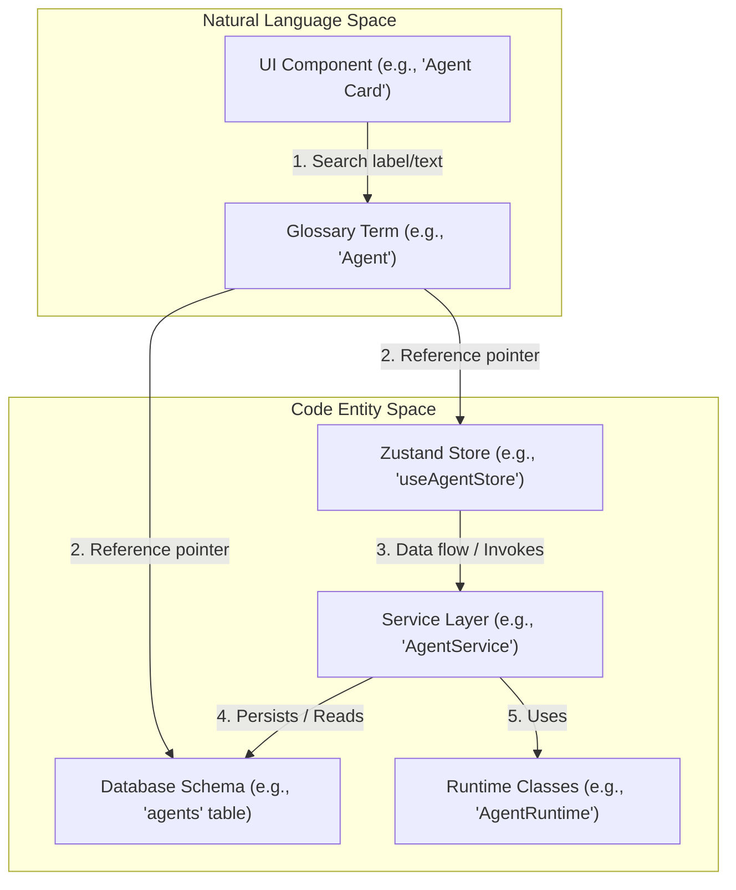
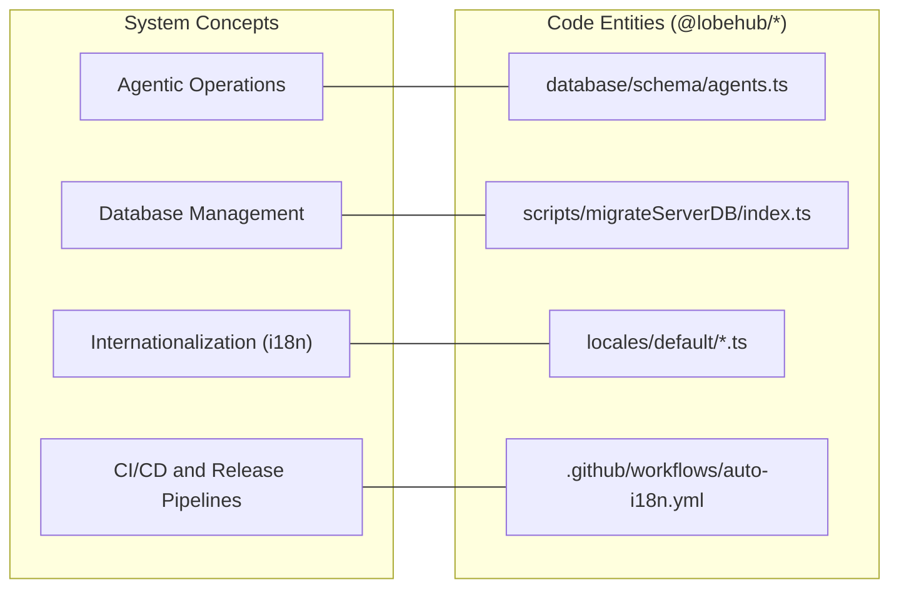
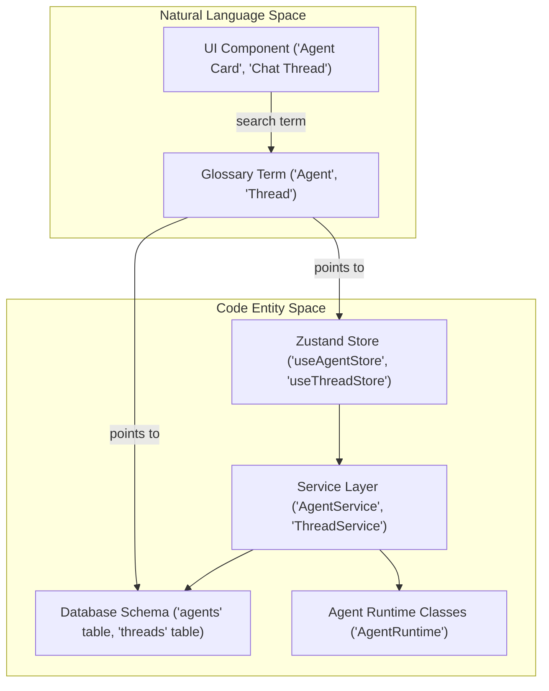
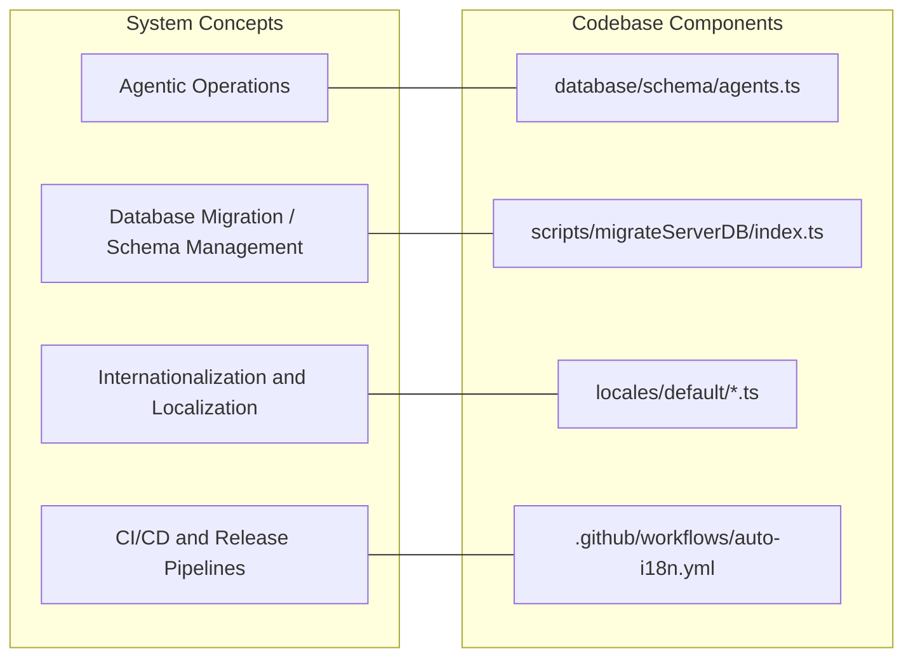

<!-- source: DeepWiki mcp.deepwiki.com · repo lobehub/lobehub · page 16.1 Glossary Maintenance Guide · fetched 2026-10-29 -->

# Glossary Maintenance Guide

<details>
<summary>Relevant source files</summary>

The following files were used as context for generating this wiki page:

- [.agents/scripts/check/advisories.ts](.agents/scripts/check/advisories.ts)
- [.agents/scripts/check/base.ts](.agents/scripts/check/base.ts)
- [.agents/scripts/check/check.test.ts](.agents/scripts/check/check.test.ts)
- [.agents/scripts/check/fileSize.ts](.agents/scripts/check/fileSize.ts)
- [.agents/scripts/check/index.ts](.agents/scripts/check/index.ts)
- [.agents/scripts/check/report.ts](.agents/scripts/check/report.ts)
- [.agents/scripts/check/routing.ts](.agents/scripts/check/routing.ts)
- [.agents/scripts/check/size-gate.ts](.agents/scripts/check/size-gate.ts)
- [.agents/scripts/check/sizeGate.ts](.agents/scripts/check/sizeGate.ts)
- [.agents/skills/desktop/SKILL.md](.agents/skills/desktop/SKILL.md)
- [.agents/skills/react/SKILL.md](.agents/skills/react/SKILL.md)
- [.agents/skills/testing/references/desktop-controller-test.md](.agents/skills/testing/references/desktop-controller-test.md)
- [AGENTS.md](AGENTS.md)

</details>


This guide outlines the procedures for adding, updating, and maintaining glossary terms within the LobeHub wiki. The glossary serves as the bridge between natural language domain concepts and the technical implementation details found in the codebase, providing onboarding engineers with clear, actionable references.

---

## 1. Glossary Entry Structure

Each glossary term must adhere to a uniform structure to maintain clarity and enable efficient knowledge transfer.

### Required Fields

1. **Term**  
   The canonical name of the concept (e.g., *Agent*, *Topic*, *Session*).

2. **Definition**  
   A concise, technically precise explanation of the term's role within LobeHub.

3. **Code Pointers**  
   Explicit references to source code locations that embody or implement the concept, including:  
   - File paths  
   - Relevant classes, interfaces, functions  
   - Database schemas or tables  

4. **Relationships**  
   Links or references to related terms or higher-level wiki pages to help build semantic context and navigation between concepts.

---

### Example Entry

| Field        | Example                                                                                          |
|--------------|-------------------------------------------------------------------------------------------------|
| Term         | Agent                                                                                           |
| Definition   | An AI-driven autonomous unit that executes tasks and interacts in chat workflows.              |
| Code Pointers| - `packages/agent-runtime/src/AgentRuntime.ts` <br>- `apps/server/src/services/agent.ts` <br>- `packages/database/src/schemas/agents.ts`  |
| Relationships| Related: Task, Message, AgentRuntime System                                                     |

---

### Data Flow for Term Discovery

Developers often start with a UI term and need to trace it to canonical definitions and implementations. The following diagram shows this discovery flow from natural language concepts through the system to code.



This flow assists in identifying stable, authoritative code references from transient UI elements, enabling the glossary to serve as the authoritative mapping layer.

---

## 2. Choosing Canonical Code Pointers

When selecting code pointers for glossary entries, prioritize stable and high-level code that defines or manages the lifecycle and data of the concept over UI components or transient logic.

### Preferred Pointer Types and Hierarchy

| Priority | Code Entity Type                   | Description                                                                                   | Example File Reference                                               |
|----------|-----------------------------------|----------------------------------------------------------------------------------------------|----------------------------------------------------------------------|
| 1        | Database Schemas                  | Drizzle ORM-managed tables defining persistent data models and constraints.                  | `packages/database/src/schemas/agents.ts` [packages/database/src/schemas/agents.ts:1-60]() |
| 2        | Zustand Stores                   | Client-side reactive state containers synchronizing with backend state.                      | `src/store/agent/store.ts` [src/store/agent/store.ts:1-71]()        |
| 3        | Server Services / Business Logic  | Backend service modules encapsulating domain logic, API routes, and integration.             | `apps/server/src/services/agent.ts` [apps/server/src/services/agent.ts:1-80]()             |
| 4        | Runtime / Agent Execution Classes | Core orchestrators, workflows, and execution engines for AI agents or subsystems.           | `packages/agent-runtime/src/AgentRuntime.ts` [packages/agent-runtime/src/AgentRuntime.ts:1-120]() |

### Avoid

- Transient UI components subject to frequent refactor and variability across platforms.
- Temporary internal or private helpers unless no better stable reference exists.
- External libraries without tight integration into the project codebase.

---

### Example Canonical Code Pointers

| Domain       | Term                 | Canonical Code Pointer                                                       |
|--------------|----------------------|-------------------------------------------------------------------------------|
| Database     | `Agents Table`       | `packages/database/src/schemas/agents.ts` [packages/database/src/schemas/agents.ts:1-60]() |
| State Store  | `Agent Zustand Store`| `src/store/agent/store.ts` [src/store/agent/store.ts:1-60]()                    |
| Service Layer| `AgentService`       | `apps/server/src/services/agent.ts` [apps/server/src/services/agent.ts:1-80]() |
| Runtime      | `AgentRuntime`       | `packages/agent-runtime/src/AgentRuntime.ts` [packages/agent-runtime/src/AgentRuntime.ts:1-120]() |

---

## 3. New Term vs. Wiki Link

Choosing when to create a new glossary entry term versus linking to existing wiki pages depends on the nature and complexity of the concept.

| Condition                           | Action                    | Explanation                                                      |
|-----------------------------------|---------------------------|------------------------------------------------------------------|
| Discrete domain term or entity     | Create a new glossary term | Examples: *Message*, *Thread*, *Agent*, protocol identifiers.    |
| Complex subsystem or broad concept | Link to existing wiki     | Examples: *RAG System*, *Plugin System*, *CI/CD Pipeline*.        |

---

### System-to-Code Package Association Diagram

This diagram links complex system concepts with their core implementation code packages or automation workflows: 



This helps maintain semantic clarity and standardizes the term-to-code mapping across large domains.

---

## 4. Maintenance Workflow

### Adding a Term

1. **Identify the domain** to which the term belongs (e.g., Chat, Model Integration, Memory, Deployment).
2. **Locate stable code pointers**, prioritizing database schemas, stores, server services, then runtime implementations.
3. **Verify code pointer correctness** by examining referenced files, ensuring they represent the authoritative implementation of the concept.
4. **Cross-reference UI localization keys** if the term appears in user-facing text to maintain consistency.
5. **Write a concise, technically precise definition** that captures the essence and role of the term.
6. **Link related terms or subsystems** for context and to aid navigation.

### Updating a Term

Update glossary entries when:

- There is refactoring or relocation of implementing code (e.g., logic moved between packages).
- Database schema changes affect the term (adding new columns or modifying relationships).
- The feature/domain concept evolves, requiring adapted or expanded explanation.
- Terminology updates or discovered aliases require canonicalization or cross-linking.

---

## Appendix: Example Glossary Entry Format (Markdown)

```markdown
### Agent

**Definition:**  
An autonomous AI-driven entity capable of performing tasks, interacting within chat conversations, and collaborating in user-defined workflows.

**Code Pointers:**  
- `packages/agent-runtime/src/AgentRuntime.ts`  
- `apps/server/src/services/agent.ts`  
- `packages/database/src/schemas/agents.ts`

**Relationships:**  
- See also: Task, Thread, Agent Runtime System
```

---

# Diagrams Bridging Natural Language Terms to Implementation Domains

### 1. Concept-to-Code Mapping Flow (Detailed)



### 2. System-Level Concepts to Code Entity Mapping



---

# Sources

- [AGENTS.md:1-94]()
- [src/store/agent/store.ts:1-71]()
- [packages/agent-runtime/src/AgentRuntime.ts:1-120]()
- [apps/server/src/services/agent.ts:1-80]()
- [packages/database/src/schemas/agents.ts:1-60]()
- [scripts/migrateServerDB/index.ts:1-50]()
- [.github/workflows/auto-i18n.yml:1-40]()

---

This completes the Glossary Maintenance Guide, providing technical and procedural details on terminology upkeep and canonical code referencing in LobeHub.

---

