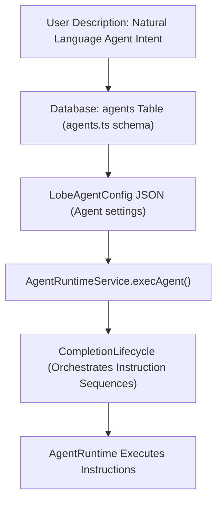
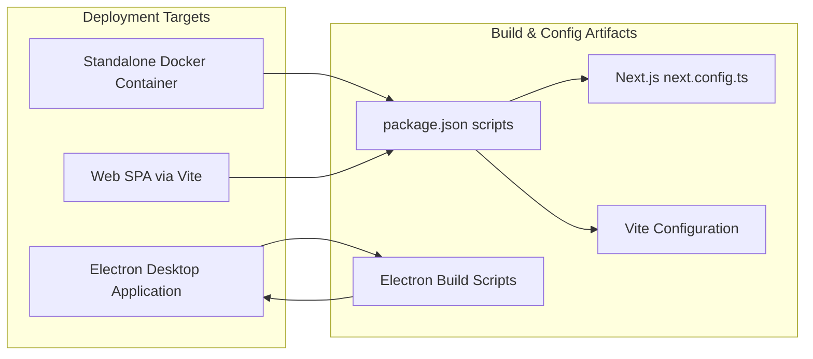
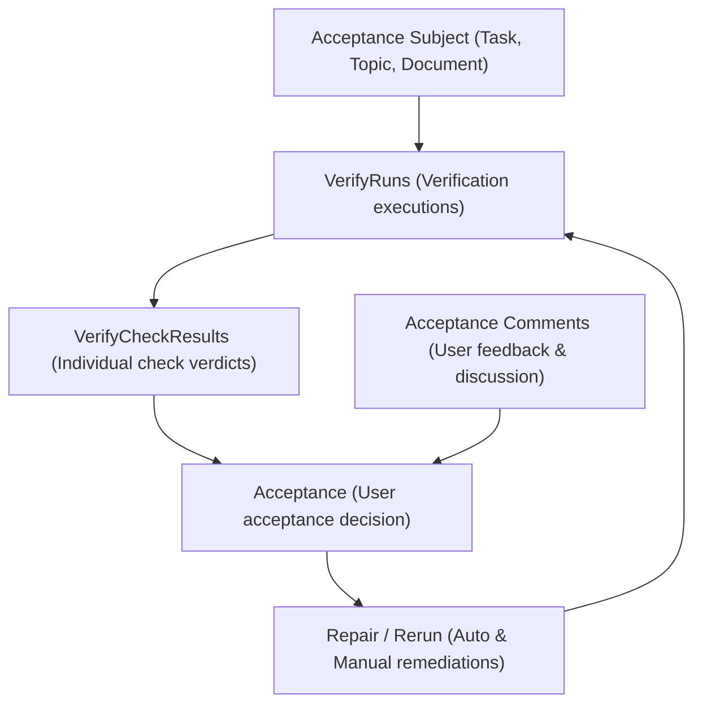
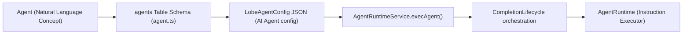
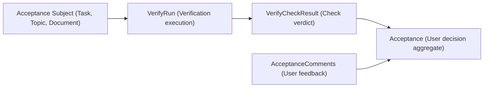

<!-- source: DeepWiki mcp.deepwiki.com · repo lobehub/lobehub · page 16.2 Glossary Term Index · fetched 2026-10-29 -->

# Glossary Term Index

Relevant source files

The following files were used as context for generating this wiki page:

- [apps/server/src/services/document/__tests__/index.test.ts](apps/server/src/services/document/__tests__/index.test.ts)
- [apps/server/src/services/document/index.ts](apps/server/src/services/document/index.ts)
- [docs/development/database-schema.dbml](docs/development/database-schema.dbml)
- [locales/en-US/setting.json](locales/en-US/setting.json)
- [locales/zh-CN/setting.json](locales/zh-CN/setting.json)
- [packages/database/migrations/0086_video_generation_schema.sql](packages/database/migrations/0086_video_generation_schema.sql)
- [packages/database/migrations/0177_agent_accounts_live_unique_and_goal_subscriptions.sql](packages/database/migrations/0177_agent_accounts_live_unique_and_goal_subscriptions.sql)
- [packages/database/migrations/0180_task_archived_at.sql](packages/database/migrations/0180_task_archived_at.sql)
- [packages/database/migrations/meta/0086_snapshot.json](packages/database/migrations/meta/0086_snapshot.json)
- [packages/database/migrations/meta/0177_snapshot.json](packages/database/migrations/meta/0177_snapshot.json)
- [packages/database/migrations/meta/0180_snapshot.json](packages/database/migrations/meta/0180_snapshot.json)
- [packages/database/migrations/meta/_journal.json](packages/database/migrations/meta/_journal.json)
- [packages/database/src/models/__tests__/agentAccount.test.ts](packages/database/src/models/__tests__/agentAccount.test.ts)
- [packages/database/src/models/__tests__/document.test.ts](packages/database/src/models/__tests__/document.test.ts)
- [packages/database/src/models/__tests__/drizzleMigration.test.ts](packages/database/src/models/__tests__/drizzleMigration.test.ts)
- [packages/database/src/models/__tests__/topics/topic.create.test.ts](packages/database/src/models/__tests__/topics/topic.create.test.ts)
- [packages/database/src/models/agentAccount.ts](packages/database/src/models/agentAccount.ts)
- [packages/database/src/models/document.ts](packages/database/src/models/document.ts)
- [packages/database/src/schemas/agent.ts](packages/database/src/schemas/agent.ts)
- [packages/database/src/schemas/agentAccount.ts](packages/database/src/schemas/agentAccount.ts)
- [packages/database/src/schemas/agentCronJob.ts](packages/database/src/schemas/agentCronJob.ts)
- [packages/database/src/schemas/apiKey.ts](packages/database/src/schemas/apiKey.ts)
- [packages/database/src/schemas/asyncTask.ts](packages/database/src/schemas/asyncTask.ts)
- [packages/database/src/schemas/chatGroup.ts](packages/database/src/schemas/chatGroup.ts)
- [packages/database/src/schemas/file.ts](packages/database/src/schemas/file.ts)
- [packages/database/src/schemas/generation.ts](packages/database/src/schemas/generation.ts)
- [packages/database/src/schemas/goalSubscription.ts](packages/database/src/schemas/goalSubscription.ts)
- [packages/database/src/schemas/index.ts](packages/database/src/schemas/index.ts)
- [packages/database/src/schemas/message.ts](packages/database/src/schemas/message.ts)
- [packages/database/src/schemas/rag.ts](packages/database/src/schemas/rag.ts)
- [packages/database/src/schemas/relations.ts](packages/database/src/schemas/relations.ts)
- [packages/database/src/schemas/session.ts](packages/database/src/schemas/session.ts)
- [packages/database/src/schemas/task.ts](packages/database/src/schemas/task.ts)
- [packages/database/src/schemas/topic.ts](packages/database/src/schemas/topic.ts)
- [packages/database/src/utils/idGenerator.ts](packages/database/src/utils/idGenerator.ts)
- [packages/locales/src/default/setting.ts](packages/locales/src/default/setting.ts)
- [packages/types/src/goalSubscription.ts](packages/types/src/goalSubscription.ts)
- [packages/types/src/index.ts](packages/types/src/index.ts)

This page provides a technical index of core concepts, architectural components, and domain-specific terminology used within the LobeHub codebase. It is curated to help onboarding engineers and developers bridge from high-level product features and domain knowledge to concrete code implementation and key entrypoints.

---

## 1. AI Agents & Execution

The AI Agents subsystem forms the foundation of LobeHub's autonomous AI entities, including agent configuration, execution lifecycle, orchestration, and integration with multi-modal models and external tools.

| Term               | Definition                                                                                     | Key Code Entities & Locations                                                                                           |
|--------------------|-------------------------------------------------------------------------------------------------|-------------------------------------------------------------------------------------------------------------------------|
| **Agent**          | Configured AI assistant entity with a role, chat config, tools, profiles, and capabilities.    | `agents` table schema [[packages/database/src/schemas/agent.ts:30-130]()], `LobeAgentConfig` types [[apps/server/src/services/aiAgent/index.ts:40-110]()] |
| **Agent Builder**  | UI and logic to define and configure agents, including natural language prompts and presets.   | Agent store slice [[packages/agent-runtime/src/index.ts:5-9]()], frontend UI components in `apps/web/src/features/agent-builder` |
| **System Agent**   | Built-in internal agents (e.g., summarization, translation, memory analysis) configured by constants. | `BUILTIN_AGENT_SLUGS` [[apps/server/src/services/aiAgent/index.ts:4-30]()], System Agent settings UI                     |
| **Agent Runtime**  | Core execution engine for running instructions, orchestrating multi-step workflows and tool calls. | `AgentRuntime` and `AgentRuntimeService` [[packages/agent-runtime/src/index.ts:5-9]()]                                   |
| **Agent Task**     | Task entity linked to agents, representing actions with lifecycle events and planning.          | `tasks` model [[packages/database/src/models/task.ts:1-150]()], and `TaskService` [[apps/server/src/services/task/index.ts:10-90]()] |
| **Heterogeneous Agent** | External or non-native agents integrated into LobeHub (e.g., ClaudeCode) via adapters and persistence handlers. | `heterogeneous-agents` package [[apps/server/src/services/heterogeneousAgent/index.ts:1-100]()]                           |
| **Instruction**    | Atomic executable commands (e.g., `call_llm`, `call_tool`) processed by the Agent Runtime.     | Instruction enums and processing [[packages/agent-runtime/src/index.ts:5-9]()]                                          |

### Agent Data Flow Diagram: From Natural Language Intent to Execution

Sources:  
[packages/database/src/schemas/agent.ts:30-130](), [apps/server/src/services/aiAgent/index.ts:40-110](), [packages/agent-runtime/src/index.ts:1-9]()

---

## 2. Chat & Conversation

LobeHub models conversations hierarchically: sessions contain topics; topics contain threads; threads group messages. Supports multi-agent group chat and streaming AI responses.

| Term               | Definition                                                                                     | Key Code Entities & Locations                                                                                           |
|--------------------|-------------------------------------------------------------------------------------------------|-------------------------------------------------------------------------------------------------------------------------|
| **Session**        | Top-level user conversation container.                                                        | `sessions` schema [[packages/database/src/schemas/session.ts:1-40]()], Zustand chat store slices                        |
| **Topic**          | Group of related messages in a conversation, can be linked to agents, projects, or groups.    | `topics` schema and model [[packages/database/src/schemas/topic.ts:20-130]()], Chat UI components                        |
| **Thread**         | Branching conversation within a topic to track parallel message lines.                         | `threads` schema [[packages/database/src/schemas/topic.ts:140-175]()], threaded chat UI                                  |
| **Message**        | Single message record with content, metadata and threading.                                   | `messages` schema, `MessageModel` [[packages/database/src/models/message.ts:1-100]()], AssistantGroup renderer          |
| **Group Chat**     | Shared chat contexts allowing multiple users or agents in a conversation.                     | `chatGroups` table [[packages/database/src/schemas/chatGroup.ts:1-50]()], Group Settings UI                             |
| **Stream Event**   | Server-Sent Events (SSE) stream protocol for incremental LLM response and tool data delivery. | `StreamingExecutor`, `StreamingHandler` [[packages/chat/src/streaming.ts:10-90]()]                                      |

Sources:  
[packages/database/src/schemas/session.ts:1-40](), [packages/database/src/schemas/topic.ts:20-130](), [packages/chat/src/services/chatService.ts:10-90](), [packages/chat/src/streaming.ts:10-90]()

---

## 3. Tools & Model Context Protocol (MCP)

An extensible, unified tool system enabling integration of internal and external tool plugins for enhanced AI agent functionality.

| Term               | Definition                                                                                     | Key Code Entities & Locations                                                                                           |
|--------------------|-------------------------------------------------------------------------------------------------|-------------------------------------------------------------------------------------------------------------------------|
| **MCP**            | Model Context Protocol - standard plugin interface for external AI tools.                      | `mcpClient` [[packages/libs/mcp/src/client.ts:1-90]()], MCP Marketplace UI components                                   |
| **Built-in Tool**  | Internal tool implementations such as Calculator, Memory Inspector, Notebooks, etc.            | `builtinTools` array [[packages/builtin-tools/src/index.ts:1-120]()], tool renderers and streaming handlers             |
| **Skills Engine**  | Aggregates skill manifests and orchestrates calls to plugins and built-in tools.               | `AgentToolsEngine` and skill loader [[apps/server/src/services/skillEngine/index.ts:10-60]()]                            |
| **Connector**      | User-configured connection bridges to third-party services with credential management.         | `ConnectorModel` [[packages/database/src/models/connector.ts:1-90]()], credential encryption via `KeyVaultsGateKeeper`  |
| **Artifacts**      | Rich UI components rendering complex outputs from tools and LLM artifacts.                     | `HtmlPreview` and artifact handlers [[packages/builtin-tools/src/artifact/components/HtmlPreview.tsx:1-40]()]            |

Sources:  
[packages/libs/mcp/src/client.ts:1-90](), [packages/builtin-tools/src/index.ts:1-120](), [packages/database/src/models/connector.ts:1-90]()

---

## 4. RAG & Knowledge Base

Retrieval-Augmented Generation pipeline encompassing document ingestion, chunking, embedding storage, and semantic search.

| Term               | Definition                                                                                     | Key Code Entities & Locations                                                                                           |
|--------------------|-------------------------------------------------------------------------------------------------|-------------------------------------------------------------------------------------------------------------------------|
| **Knowledge Base** | Collection of documents scoped to a user or workspace providing contextual data for AI queries.| `knowledgeBases` table [[packages/database/src/schemas/knowledgeBase.ts:1-70]()], Knowledge Base UI                      |
| **Document**       | Unit of content that can be parsed, chunked, and indexed for retrieval.                        | `DocumentModel` [[apps/server/src/services/document/index.ts:50-200]()], `documents` schema [[packages/database/src/schemas/file.ts:90-180]()]|
| **Chunk**          | Segmented piece of document for fine-grained similarity search indexing.                       | `chunks` table and chunking strategy [[packages/database/src/schemas/rag.ts:1-90]()], chunk embedding                   |
| **Embedding**      | Vector representation of chunks enabling approximate nearest neighbor search.                  | `chunk_embeddings` table [[packages/database/src/schemas/chunkEmbedding.ts:1-40]()], embedding config                    |

Sources:  
[apps/server/src/services/document/index.ts:10-110](), [packages/database/src/schemas/file.ts:90-180](), [packages/database/src/schemas/rag.ts:1-90]()

---

## 5. Deployment & Infrastructure

Multiple deployment modes supported: serverless, Docker, Electron desktop, and SPA with tailored build configurations.

| Term               | Definition                                                                                     | Key Code Entities & Locations                                                                                           |
|--------------------|-------------------------------------------------------------------------------------------------|-------------------------------------------------------------------------------------------------------------------------|
| **Standalone Mode** | Docker-optimized container deployment that bundles all required components.                     | Dockerfile, `build:docker` npm script [[package.json:34-55]()], environment config                                      |
| **Vercel Build**   | Serverless-optimized Next.js build for deployment on Vercel and similar platforms.              | `next.config.ts` [[apps/server/next.config.ts:1-40]()], build scripts                                                 |
| **Electron App**   | Desktop application shell embedding the React frontend with native OS integration.              | `App`, `BrowserManager` classes, Electron entry [[apps/desktop/src/main.ts:1-120]()], tray and updater scripts           |
| **Single Page Application (SPA)** | Web-only build using Vite, optimized for mobile or standalone browser use.                  | Vite plugins and build scripts [[package.json:45-55]()], frontend SPA entry                                            |

### Deployment Infrastructure Diagram

Sources:  
[package.json:30-80](), [apps/server/next.config.ts:1-40](), [apps/desktop/src/main.ts:1-120](), [package.json:40-60]()

---

## 6. Auth, Workspace & Subscription

Manages user identity, team spaces, role-based access controls, and subscription billing features.

| Term               | Definition                                                                                     | Key Code Entities & Locations                                                                                           |
|--------------------|-------------------------------------------------------------------------------------------------|-------------------------------------------------------------------------------------------------------------------------|
| **Workspace**      | Multi-tenant team environment organizing users, agents, data, access, and billing.             | `workspaces` schema [[packages/database/src/schemas/workspace.ts:1-40]()], workspace-aware routing middleware           |
| **Subscription**   | Paid plans linked to workspaces controlling feature gating and rate limits.                    | Subscription plans and history [[packages/database/src/schemas/subscriptionPlan.ts:1-50]()], billing routers            |
| **Credits**        | Currency used for tracking usage and limiting API or service consumption.                      | Credit balance models and UI [[packages/database/src/schemas/creditBalance.ts:1-60]()], credit management in UI         |
| **Member Budget**  | Per-user usage caps within a workspace to control spending and quota.                          | Billing and workspace member tracking [[apps/server/src/services/workspace/index.ts:70-120]()]                            |

Sources:  
[packages/database/src/schemas/workspace.ts:1-40](), [packages/database/src/schemas/subscriptionPlan.ts:1-50](), [apps/server/src/services/billing/index.ts:1-100]()

---

## 7. Goal & Task

Defines long-term planning with goal graphs and manages tasks with automation lifecycles.

| Term               | Definition                                                                                     | Key Code Entities & Locations                                                                                           |
|--------------------|-------------------------------------------------------------------------------------------------|-------------------------------------------------------------------------------------------------------------------------|
| **Goal Graph**     | Directed graph structure representing hierarchical goals and dependencies.                     | `goalGraphs` schema [[packages/database/src/schemas/goalGraph.ts:1-50]()], `GoalService` [[apps/server/src/services/goal/criteriaGenerator.ts:1-50]()] |
| **Task**           | Unit of work assigned to agents or users, tracking status and dependencies.                    | `TaskModel` [[packages/database/src/models/task.ts:10-150]()], `TaskService` [[apps/server/src/services/task/index.ts:10-90]()] |
| **Task Lifecycle** | Manages task states, triggers workflows, and automates completion and handoffs.                | `TaskLifecycleService` [[apps/server/src/services/taskLifecycle/index.ts:1-80]()], task-topic relations                 |
| **Agent Cron Job** | Scheduled tasks for agent automation using cron expressions and frequency controls.            | `agent_cron_jobs` schema and service [[packages/database/src/schemas/agentCronJob.ts:1-40]()]                            |

Sources:  
[packages/database/src/models/task.ts:1-150](), [apps/server/src/services/taskLifecycle/index.ts:1-80](), [packages/database/src/schemas/agentCronJob.ts:1-40]()

---

## 8. Verification & Acceptance

Subsystems for ensuring delivery correctness and user acceptance through criteria, rubrics, runs, reporting, and review workflows.

| Term               | Definition                                                                                     | Key Code Entities & Locations                                                                                           |
|--------------------|-------------------------------------------------------------------------------------------------|-------------------------------------------------------------------------------------------------------------------------|
| **Verify (Verification)** | Automated check execution against defined criteria verifying correctness of outputs.          | `VerifyRunModel` [[packages/database/src/models/verifyRun.ts:10-80]()], `VerifyExecutorService` [[apps/server/src/services/verify/index.ts:40-60]()] |
| **Acceptance**     | Business-level user approval based on verification results, aggregating pass/fail outcomes.    | `AcceptanceService` [[apps/server/src/services/verify/acceptanceService.ts:1-120]()], `acceptances` table               |
| **Rubric**         | Template grouping verification checks, defining evaluation policies.                           | `VerifyRubricModel` [[packages/database/src/models/verifyRubric.ts:10-60]()], Rubric APIs [[apps/server/src/routers/lambda/verify.ts:40-110]()]  |
| **Check**          | Individual verification unit with pass/fail logic and possible evidence requirements.          | `VerifyCheckResultModel` [[packages/database/src/models/verifyCheckResult.ts:10-90]()], check logic types               |
| **Verification Run** | An execution instance of verification aligned to a specific deliverable or iteration.          | `VerifyRunModel` tracing [[packages/database/src/models/verifyRun.ts:1-80]()], run lifecycle tracking                   |
| **Acceptance Comment** | User or reviewer feedback discussing acceptance rounds and verification outcomes.             | `acceptance_comments` table [[docs/development/database-schema.dbml:1-35]()], Review UI components                       |

### Verify/Acceptance Workflow Diagram

Sources:  
[apps/server/src/services/verify/acceptanceService.ts:1-120](), [apps/server/src/routers/lambda/verify.ts:1-100](), [packages/database/src/models/verifyRun.ts:1-80](), [docs/development/database-schema.dbml:1-35]()

---

## 9. Memory System

Handles extraction, organization, and persistence of persistent user memory across conversations and agent runs.

| Term               | Definition                                                                                     | Key Code Entities & Locations                                                                                           |
|--------------------|-------------------------------------------------------------------------------------------------|-------------------------------------------------------------------------------------------------------------------------|
| **Memory Extraction** | Process that analyzes messages and conversation data to identify useful knowledge to store.   | `MemoryExtractionExecutor` [[apps/server/src/services/memory/index.ts:10-80]()], Upstash workflow integration            |
| **Memory Layers**  | Five granular memory layers from short-term to long-term configurable per agent.                | `LayersEnum` [[packages/memory/src/layers.ts:1-25]()], memory configuration UI and tools                               |
| **Memory Persistence** | Stores extracted memories in database for retrieval to enhance AI contexts.                   | `userMemories` table and models [[packages/database/src/models/memory.ts:1-70]()]                                      |

Sources:  
[apps/server/src/services/memory/index.ts:1-80](), [packages/database/src/models/memory.ts:1-70]()

---

## 10. Desktop & CLI Application

Local desktop Electron app and CLI tooling enabling agent control, file management, and debugging workflows.

| Term               | Definition                                                                                     | Key Code Entities & Locations                                                                                           |
|--------------------|-------------------------------------------------------------------------------------------------|-------------------------------------------------------------------------------------------------------------------------|
| **Electron Shell** | Desktop application shell with embedded React UI, native OS integration and local IPC.          | `App`, `BrowserManager` classes [[apps/desktop/src/main.ts:1-120]()], tray, menus, updater modules                        |
| **CLI Tool (lh)**  | Command line interface with subcommands for auth, agent execution, file/kb management, verification. | CLI commands directory [[apps/cli/src/commands/verify.ts:1-160]()], CLI parser registration                              |
| **Device Gateway** | Remote device enrollment and remote agent/task execution controller via WebSocket gateways.     | `GatewayConnectionCtr`, device-gateway-client [[packages/device-gateway/src/index.ts:1-120]()]                            |

Sources:  
[apps/desktop/src/main.ts:1-120](), [apps/cli/src/commands/verify.ts:1-160](), [packages/device-gateway/src/index.ts:1-120]()

---

## 11. Auth & Workspaces

User and team identity management with role-based access control and workspace-scoped data isolation.

| Term               | Definition                                                                                     | Key Code Entities & Locations                                                                                           |
|--------------------|-------------------------------------------------------------------------------------------------|-------------------------------------------------------------------------------------------------------------------------|
| **User Account**   | Individual user profile and authentication credentials.                                        | `users` and `accounts` tables [[packages/database/src/schemas/user.ts:1-80]()], OAuth/OIDC handlers                      |
| **Workspace Member** | User association to workspace with roles and permissions.                                     | `workspace_members` table [[packages/database/src/schemas/workspaceMember.ts:1-60]()], RBAC middleware                   |
| **Auth Middleware** | Middleware enforcing authentication, session validation, and RBAC on services and APIs.        | `authMiddleware` [[apps/server/src/libs/trpc/lambda/middleware.ts:1-60]()]                                              |

Sources:  
[packages/database/src/schemas/user.ts:1-80](), [packages/database/src/schemas/workspaceMember.ts:1-60](), [apps/server/src/libs/trpc/lambda/middleware.ts:1-60]()

---

## 12. Subscription & Billing

Manages paid plan definitions, credit accounting, usage tracking, and billing UI integrations.

| Term               | Definition                                                                                     | Key Code Entities & Locations                                                                                           |
|--------------------|-------------------------------------------------------------------------------------------------|-------------------------------------------------------------------------------------------------------------------------|
| **Subscription Plan** | Defines paid tiers and feature access levels.                                                | Subscription plan schema [[packages/database/src/schemas/subscriptionPlan.ts:1-50]()], billing services API             |
| **Credit Balance** | User or workspace credit account tracking usage and top-up.                                   | `creditBalance` tables and UI [[packages/database/src/schemas/creditBalance.ts:1-60]()], credit management features      |
| **Usage Tracking** | Records detailed consumption metrics for billing and quota enforcement.                        | Usage and billing aggregation [[apps/server/src/services/billing/index.ts:1-100]()]                                     |

Sources:  
[packages/database/src/schemas/subscriptionPlan.ts:1-50](), [apps/server/src/services/billing/index.ts:1-100]() 

---

# Summary

This glossary index arranges the fundamental terms relevant to the LobeHub system by domain, providing direct links to canonical definitions and code implementations. It is intended as a quick lookup and navigation aid for technical users engaging with the codebase.

---

### Diagram 1: Mapping "AI Agent" Concepts to Code Entities

---

### Diagram 2: Mapping "Verify/Acceptance" Concepts to Code Entities

---

# References

- Agent subsystem: [packages/database/src/schemas/agent.ts:30-130](), [apps/server/src/services/aiAgent/index.ts:40-110](), [packages/agent-runtime/src/index.ts:1-9]()
- Chat system: [packages/database/src/schemas/session.ts:1-40](), [packages/database/src/schemas/topic.ts:20-130](), [packages/chat/src/services/chatService.ts:10-90]()
- Tools & MCP: [packages/libs/mcp/src/client.ts:1-90](), [packages/builtin-tools/src/index.ts:1-120](), [packages/database/src/models/connector.ts:1-90]()
- RAG & Knowledge Base: [apps/server/src/services/document/index.ts:10-110](), [packages/database/src/schemas/file.ts:90-180](), [packages/database/src/schemas/rag.ts:1-90]()
- Deployment: [package.json:30-80](), [apps/server/next.config.ts:1-40](), [apps/desktop/src/main.ts:1-120]()
- Verify & Acceptance: [apps/server/src/services/verify/acceptanceService.ts:1-120](), [apps/server/src/routers/lambda/verify.ts:1-100](), [packages/database/src/models/verifyRun.ts:1-80](), [docs/development/database-schema.dbml:1-35]()
- Task & Goal: [packages/database/src/models/task.ts:1-150](), [apps/server/src/services/taskLifecycle/index.ts:1-80](), [packages/database/src/schemas/agentCronJob.ts:1-40]()
- Memory: [apps/server/src/services/memory/index.ts:1-80](), [packages/database/src/models/memory.ts:1-70]()
- Desktop & CLI: [apps/desktop/src/main.ts:1-120](), [apps/cli/src/commands/verify.ts:1-160](), [packages/device-gateway/src/index.ts:1-120]()
- Auth & Workspaces: [packages/database/src/schemas/user.ts:1-80](), [packages/database/src/schemas/workspaceMember.ts:1-60](), [apps/server/src/libs/trpc/lambda/middleware.ts:1-60]()
- Subscription & Billing: [packages/database/src/schemas/subscriptionPlan.ts:1-50](), [apps/server/src/services/billing/index.ts:1-100]()