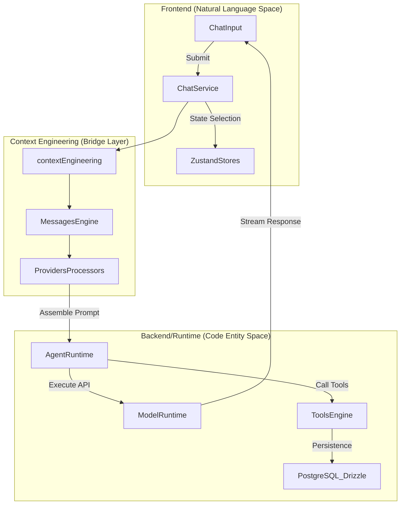
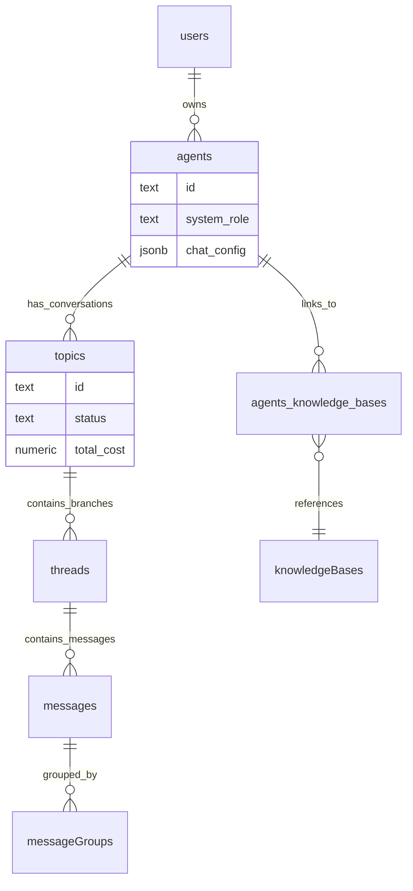

<!-- source: DeepWiki mcp.deepwiki.com · repo lobehub/lobehub · page 2 System Architecture · fetched 2026-10-29 -->

# System Architecture

Relevant source files

The following files were used as context for generating this wiki page:

- [.bunfig.toml](.bunfig.toml)
- [.github/scripts/create-failure-issue.js](.github/scripts/create-failure-issue.js)
- [.github/workflows/auto-i18n.yml](.github/workflows/auto-i18n.yml)
- [.github/workflows/auto-tag-release.yml](.github/workflows/auto-tag-release.yml)
- [.github/workflows/lighthouse.yml](.github/workflows/lighthouse.yml)
- [.github/workflows/release.yml](.github/workflows/release.yml)
- [.github/workflows/sync-database-schema.yml](.github/workflows/sync-database-schema.yml)
- [.github/workflows/sync-main-to-canary.yaml](.github/workflows/sync-main-to-canary.yaml)
- [.github/workflows/sync.yml](.github/workflows/sync.yml)
- [.github/workflows/test.yml](.github/workflows/test.yml)
- [.npmrc](.npmrc)
- [CHANGELOG.md](CHANGELOG.md)
- [README.md](README.md)
- [README.zh-CN.md](README.zh-CN.md)
- [apps/cli/.npmrc](apps/cli/.npmrc)
- [apps/cli/pnpm-workspace.yaml](apps/cli/pnpm-workspace.yaml)
- [apps/desktop/.npmrc](apps/desktop/.npmrc)
- [apps/desktop/package.json](apps/desktop/package.json)
- [apps/desktop/pnpm-lock.yaml](apps/desktop/pnpm-lock.yaml)
- [apps/desktop/pnpm-workspace.yaml](apps/desktop/pnpm-workspace.yaml)
- [apps/desktop/src/main/controllers/AuvCtr.ts](apps/desktop/src/main/controllers/AuvCtr.ts)
- [apps/desktop/src/main/services/__tests__/auvSrv.test.ts](apps/desktop/src/main/services/__tests__/auvSrv.test.ts)
- [apps/desktop/src/main/services/auvSrv.ts](apps/desktop/src/main/services/auvSrv.ts)
- [changelog/CHANGELOG.v0.md](changelog/CHANGELOG.v0.md)
- [changelog/CHANGELOG.v1.md](changelog/CHANGELOG.v1.md)
- [changelog/v0.json](changelog/v0.json)
- [changelog/v1.json](changelog/v1.json)
- [changelog/v2.json](changelog/v2.json)
- [codecov.yml](codecov.yml)
- [docs/changelog/2025-03-02-new-models.zh-CN.mdx](docs/changelog/2025-03-02-new-models.zh-CN.mdx)
- [docs/changelog/2025-06-08-claude-4.zh-CN.mdx](docs/changelog/2025-06-08-claude-4.zh-CN.mdx)
- [docs/changelog/2025-07-08-mcp-market.zh-CN.mdx](docs/changelog/2025-07-08-mcp-market.zh-CN.mdx)
- [docs/changelog/2025-09-08-gemini.zh-CN.mdx](docs/changelog/2025-09-08-gemini.zh-CN.mdx)
- [docs/changelog/2025-10-08-python.zh-CN.mdx](docs/changelog/2025-10-08-python.zh-CN.mdx)
- [docs/changelog/2025-12-20-mcp.zh-CN.mdx](docs/changelog/2025-12-20-mcp.zh-CN.mdx)
- [docs/changelog/schema.json](docs/changelog/schema.json)
- [next.config.ts](next.config.ts)
- [package.json](package.json)
- [patches/@upstash__qstash.patch](patches/@upstash__qstash.patch)
- [pnpm-workspace.yaml](pnpm-workspace.yaml)
- [renovate.json](renovate.json)
- [scripts/changelogWorkflow/const.ts](scripts/changelogWorkflow/const.ts)
- [scripts/changelogWorkflow/generateChangelog.ts](scripts/changelogWorkflow/generateChangelog.ts)
- [scripts/dbmlWorkflow/index.ts](scripts/dbmlWorkflow/index.ts)
- [scripts/releaseWorkflow/index.ts](scripts/releaseWorkflow/index.ts)
- [src/features/ShareModal/ShareImage/style.ts](src/features/ShareModal/ShareImage/style.ts)
- [src/libs/next/config/define-config.test.ts](src/libs/next/config/define-config.test.ts)
- [src/libs/next/config/define-config.ts](src/libs/next/config/define-config.ts)
- [vercel.json](vercel.json)

LobeHub is built as a modular, full-stack AI Agent framework. It leverages a Next.js monorepo structure to provide a seamless transition between web, serverless, and desktop environments. The architecture is designed to bridge natural language instructions into executable code entities through a robust context engineering and tool execution pipeline.

## High-Level Subsystems Interaction

The system is composed of several major layers that interact to fulfill a chat request. The frontend captures user input and manages local state, while the backend (or edge runtime) handles the complex orchestration of AI models, database persistence, and tool invocation.

### Request Lifecycle Diagram
The following diagram illustrates how a user request flows through the system, mapping high-level concepts to specific code entities across the natural language and code entity spaces.

**Diagram: Request Flow and Code Entities**

Sources: `src/services/chat/index.ts:116-126`(), `packages/context-engine/src/engine/messages/MessagesEngine.ts:95-102`(), `apps/server/src/services/aiAgent/index.ts:87-100`()

---

## Core Subsystems

### 1. Frontend and State Management
The frontend is built with Next.js and React, using **Zustand** for state management. It employs a "slice" pattern to organize complex domains like chat history, agent configuration, and tool manifests.
*   **Key Components**: `ChatItem` [src/features/Conversation/ChatItem/index.tsx](), `AssistantMessage` [src/features/Conversation/Messages/Assistant/index.tsx:38-41](), and `UserMessage` [src/features/Conversation/Messages/User/index.tsx]().
*   **State**: Managed via stores such as `useChatStore`, `useAgentStore`, and `useToolStore` [src/services/chat/index.ts:27-35](). The global state also tracks system status such as panel widths and sidebar visibility [src/store/global/initialState.ts:124-235]().
*   **Initialization**: The `StoreInitialization` component manages the hydration of user state, server configuration, and system status upon app launch [src/layout/GlobalProvider/StoreInitialization.tsx:20-84]().

Sources: `src/features/Conversation/ChatItem/index.tsx:1-10`(), `src/services/chat/index.ts:27-35`(), `src/store/global/initialState.ts:124-235`(), `src/layout/GlobalProvider/StoreInitialization.tsx:20-84`()

### 2. Chat Pipeline and Context Engineering
This is the "brain" of LobeHub. It transforms a simple message into a rich prompt containing system roles, knowledge base snippets, user memories, and tool definitions.
*   **`contextEngineering`**: The primary entry point for assembling the LLM payload [src/services/chat/mecha/contextEngineering.ts:129-151]().
*   **`MessagesEngine`**: A pipeline-based engine that runs various "processors" (e.g., `HistoryTruncateProcessor`) and "providers" (e.g., `KnowledgeInjector`) to refine the context [packages/context-engine/src/engine/messages/MessagesEngine.ts:139-180]().

Sources: `src/services/chat/mecha/contextEngineering.ts:129-151`(), `packages/context-engine/src/engine/messages/MessagesEngine.ts:139-180`()

### 3. AI Model and Agent Runtime
LobeHub abstracts AI providers through a dual-package approach:
*   **`model-bank`**: Defines static model metadata and capabilities.
*   **`model-runtime`**: Handles the actual API communication with providers like OpenAI, Anthropic, and Google [src/services/chat/index.ts:12-13]().
*   **`AgentRuntime`**: Manages the execution lifecycle of an agent, including multi-step tool calls and self-iteration [apps/server/src/services/aiAgent/index.ts:99-102]().

Sources: `src/services/chat/index.ts:12-13`(), `apps/server/src/services/aiAgent/index.ts:99-102`()

### 4. Database and Persistence
The system uses **PostgreSQL** with **Drizzle ORM** for schema management and migrations.
*   **Conversation Schema**: Topics, Threads, and Messages are linked in a hierarchical structure [packages/database/src/schemas/topic.ts:24-110]().
*   **Agent Schema**: Stores agent configurations, including `systemRole`, `model`, and `chatConfig` [packages/database/src/schemas/agent.ts:32-88]().
*   **Migrations**: Managed via a JSON journal system [packages/database/migrations/meta/_journal.json:1-10]().

Sources: `packages/database/src/schemas/topic.ts:24-110`(), `packages/database/src/schemas/agent.ts:32-88`(), `packages/database/migrations/meta/_journal.json:1-10`()

---

## Technical Details and Deployment Architecture

LobeHub supports multiple deployment modes and specialized runtime environments. Since this is a parent overview page, detailed implementation specifics are documented in the respective child pages:

| Subsystem | Responsibility | Child Page Reference |
| :--- | :--- | :--- |
| **Build System and Scripts** | Manages Turbo pipeline, Vite SPA plugins, changelog workflows, and package scripts. | For details, see [Build System and Scripts](#2.1) |
| **CI/CD and Release Pipeline** | Automates GitHub Actions workflows, version guards, Docker publishing, and database sync. | For details, see [CI/CD and Release Pipeline](#2.2) |
| **Next.js Configuration and Middleware** | Configures `next.config.ts`, standalone/serverless outputs, security headers, and auth guards. | For details, see [Next.js Configuration and Middleware](#2.3) |
| **Route Variants and Desktop Mode** | Implements dynamic segment routing (`[variants]`) and Electron shell integration. | For details, see [Route Variants and Desktop Mode](#2.4) |
| **Satellite Micro-Apps** | Coordinates separate Cloudflare and Next.js micro-apps (`apps/auth`, `apps/share`, `apps/workbench`). | For details, see [Satellite Micro-Apps (auth, share, workbench)](#2.5) |

Sources: `package.json:45-58`(), `next.config.ts:1-25`(), `vercel.json:1-63`()

### Database Entity Relationship (Simplified)
The following diagram bridges the high-level concepts of the chat system to the underlying database tables managed via Drizzle ORM.

**Diagram: Data Entity Mapping**

Sources: `packages/database/src/schemas/agent.ts:32-102`(), `packages/database/src/schemas/topic.ts:24-164`(), `package.json:61-65`()

### System Navigation and Layout
The UI is organized around a primary sidebar with tabs for Chat, Knowledge, Memory, and Settings [src/store/global/initialState.ts:10-23](). Navigation is handled via a thin routing layer in `src/routes/` that delegates to business logic in `src/features/`. Next.js configuration manages environment-specific optimizations, such as excluding `musl` binaries for Vercel serverless functions [next.config.ts:9-19]().

Sources: `src/store/global/initialState.ts:10-23`(), `src/store/global/selectors/systemStatus.ts:175-186`(), `next.config.ts:9-19`()

---

