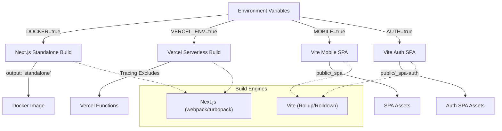
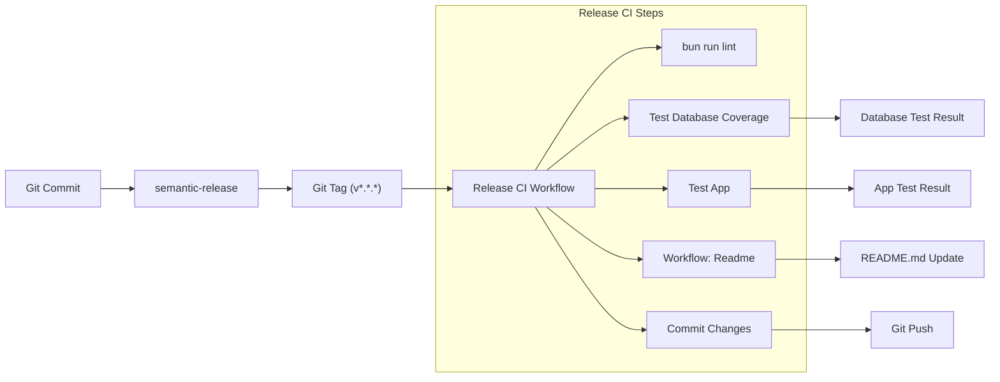

<!-- source: DeepWiki mcp.deepwiki.com · repo lobehub/lobehub · page 2.1 Build System and Scripts · fetched 2026-10-29 -->

# Build System and Scripts

Relevant source files

The following files were used as context for generating this wiki page:

- [.bunfig.toml](.bunfig.toml)
- [.github/scripts/create-failure-issue.js](.github/scripts/create-failure-issue.js)
- [.github/workflows/auto-i18n.yml](.github/workflows/auto-i18n.yml)
- [.github/workflows/auto-tag-release.yml](.github/workflows/auto-tag-release.yml)
- [.github/workflows/lighthouse.yml](.github/workflows/lighthouse.yml)
- [.github/workflows/release.yml](.github/workflows/release.yml)
- [.github/workflows/sync-database-schema.yml](.github/workflows/sync-database-schema.yml)
- [.github/workflows/sync-main-to-canary.yaml](.github/workflows/sync-main-to-canary.yaml)
- [.github/workflows/sync.yml](.github/workflows/sync.yml)
- [.github/workflows/test.yml](.github/workflows/test.yml)
- [.npmrc](.npmrc)
- [CHANGELOG.md](CHANGELOG.md)
- [README.md](README.md)
- [README.zh-CN.md](README.zh-CN.md)
- [apps/cli/.npmrc](apps/cli/.npmrc)
- [apps/cli/pnpm-workspace.yaml](apps/cli/pnpm-workspace.yaml)
- [apps/desktop/.npmrc](apps/desktop/.npmrc)
- [apps/desktop/Development.md](apps/desktop/Development.md)
- [apps/desktop/README.md](apps/desktop/README.md)
- [apps/desktop/README.zh-CN.md](apps/desktop/README.zh-CN.md)
- [apps/desktop/package.json](apps/desktop/package.json)
- [apps/desktop/pnpm-lock.yaml](apps/desktop/pnpm-lock.yaml)
- [apps/desktop/pnpm-workspace.yaml](apps/desktop/pnpm-workspace.yaml)
- [apps/desktop/scripts/dev.mjs](apps/desktop/scripts/dev.mjs)
- [apps/desktop/src/main/controllers/AuvCtr.ts](apps/desktop/src/main/controllers/AuvCtr.ts)
- [apps/desktop/src/main/services/__tests__/auvSrv.test.ts](apps/desktop/src/main/services/__tests__/auvSrv.test.ts)
- [apps/desktop/src/main/services/auvSrv.ts](apps/desktop/src/main/services/auvSrv.ts)
- [apps/desktop/vite.main.config.ts](apps/desktop/vite.main.config.ts)
- [apps/desktop/vite.preload.config.ts](apps/desktop/vite.preload.config.ts)
- [apps/desktop/vite.renderer.config.ts](apps/desktop/vite.renderer.config.ts)
- [apps/desktop/vite.shared.test.ts](apps/desktop/vite.shared.test.ts)
- [apps/desktop/vite.shared.ts](apps/desktop/vite.shared.ts)
- [changelog/CHANGELOG.v0.md](changelog/CHANGELOG.v0.md)
- [changelog/CHANGELOG.v1.md](changelog/CHANGELOG.v1.md)
- [changelog/v0.json](changelog/v0.json)
- [changelog/v1.json](changelog/v1.json)
- [changelog/v2.json](changelog/v2.json)
- [codecov.yml](codecov.yml)
- [docs/changelog/2025-03-02-new-models.zh-CN.mdx](docs/changelog/2025-03-02-new-models.zh-CN.mdx)
- [docs/changelog/2025-06-08-claude-4.zh-CN.mdx](docs/changelog/2025-06-08-claude-4.zh-CN.mdx)
- [docs/changelog/2025-07-08-mcp-market.zh-CN.mdx](docs/changelog/2025-07-08-mcp-market.zh-CN.mdx)
- [docs/changelog/2025-09-08-gemini.zh-CN.mdx](docs/changelog/2025-09-08-gemini.zh-CN.mdx)
- [docs/changelog/2025-10-08-python.zh-CN.mdx](docs/changelog/2025-10-08-python.zh-CN.mdx)
- [docs/changelog/2025-12-20-mcp.zh-CN.mdx](docs/changelog/2025-12-20-mcp.zh-CN.mdx)
- [docs/changelog/schema.json](docs/changelog/schema.json)
- [next.config.ts](next.config.ts)
- [package.json](package.json)
- [patches/@upstash__qstash.patch](patches/@upstash__qstash.patch)
- [plugins/vite/envRestartKeys.ts](plugins/vite/envRestartKeys.ts)
- [plugins/vite/lobeUiImports.test.ts](plugins/vite/lobeUiImports.test.ts)
- [plugins/vite/lobeUiImports.ts](plugins/vite/lobeUiImports.ts)
- [plugins/vite/sharedRendererConfig.test.ts](plugins/vite/sharedRendererConfig.test.ts)
- [plugins/vite/sharedRendererConfig.ts](plugins/vite/sharedRendererConfig.ts)
- [plugins/vite/watchOptions.test.ts](plugins/vite/watchOptions.test.ts)
- [plugins/vite/watchOptions.ts](plugins/vite/watchOptions.ts)
- [pnpm-workspace.yaml](pnpm-workspace.yaml)
- [renovate.json](renovate.json)
- [scripts/changelogWorkflow/const.ts](scripts/changelogWorkflow/const.ts)
- [scripts/changelogWorkflow/generateChangelog.ts](scripts/changelogWorkflow/generateChangelog.ts)
- [scripts/dbmlWorkflow/index.ts](scripts/dbmlWorkflow/index.ts)
- [scripts/releaseWorkflow/index.ts](scripts/releaseWorkflow/index.ts)
- [src/features/Settings/provider/index.tsx](src/features/Settings/provider/index.tsx)
- [src/features/ShareModal/ShareImage/style.ts](src/features/ShareModal/ShareImage/style.ts)
- [src/layout/GlobalProvider/Editor.tsx](src/layout/GlobalProvider/Editor.tsx)
- [src/libs/next/config/define-config.test.ts](src/libs/next/config/define-config.test.ts)
- [src/libs/next/config/define-config.ts](src/libs/next/config/define-config.ts)
- [vercel.json](vercel.json)
- [vite.config.ts](vite.config.ts)

LobeHub utilizes a modern build system based on **Turborepo** with **pnpm workspaces** managing a complex monorepo that includes packages and apps [package.json:35-42](). The build system supports multiple deployment targets and modes tailored for cloud, local Docker, and various SPA needs including desktop, mobile, and micro-apps such as auth and share.

---

## 1. Build Modes and Deployment Targets

LobeHub supports three primary build modes designed to cover different deployment scenarios: Next.js serverless for cloud hosting, standalone/Docker for self-hosted environments, and SPA builds for specialized frontend targets including desktop Electron shells and micro-apps.

### 1.1 Next.js Serverless (Vercel)

- This mode targets automatic deployment to Vercel’s serverless environment.
- It uses Next.js with output tracing to exclude heavy native binaries (e.g., `sharp-musl`) and SPA artifacts, reducing function sizes to conform to Vercel limits [next.config.ts:5-20]().
- **Build Script**: `bun run build:vercel` runs a raw Next.js build followed by database migrations [package.json:61]().
- The `defineConfig` in `src/libs/next/config/define-config.ts` applies an environment variable check for `VERCEL_ENV` and excludes SPA (`public/_spa`), desktop, and mobile build artifacts from serverless build tracing [src/libs/next/config/define-config.ts:3-24](), [next.config.ts:5-20]().

### 1.2 Standalone / Docker

- Generates a standalone build folder holding all required Node.js files and modules for fully self-contained deployment.
- Useful when running in Docker containers or on standalone servers without serverless platform constraints.
- Controlled by environment variable `DOCKER=true` or `NEXT_BUILD_STANDALONE=1`.
- Uses the Next.js output mode `'standalone'` which bundles only necessary files and assets including public/ and `.next/static` [src/libs/next/config/define-config.ts:26-49]().
- **Build Script**: `pnpm run build:docker` triggers SPA builds plus a Next.js standalone build [package.json:50]().

### 1.3 SPA Builds (Desktop, Mobile, Auth, Share, Workbench)

- SPA mode targets specialized static builds that produce pure client-side artifacts usually served from `public/_spa*` directories or consumed in Electron desktop shells.
- Built with **Vite** and used for smaller micro-apps and frontends such as auth, mobile, share, and workbench.
- SPA builds clean their respective output dirs (`public/_spa`, `public/_spa-auth`, etc.) before building.
- Custom scripts then copy SPA output and generate HTML template TypeScript files for Next.js hosting.
- **Build Scripts**:
  - `build:spa` (default web SPA) [package.json:54]()
  - `build:spa:auth` (Auth SPA) [package.json:55]()
  - `build:spa:mobile` (Mobile SPA) [package.json:57]()
  - `build:spa:share` (Share micro-app) [package.json:59]()
  - `build:spa:workbench` (Workbench micro-app) [package.json:60]()
- Each SPA build outputs to respective dist folders like `dist/desktop` or `dist/auth`, which are then copied to `public/_spa*` locations [package.json:55-60]().

---

### Build Mode Selection Flow

This graph summarizes how environment variables steer LobeHub’s multi-mode build pipeline with Next.js and Vite as two core build engines.

Sources: [src/libs/next/config/define-config.ts:17-50](), [package.json:50-60](), [next.config.ts:3-23]()

---

## 2. Turborepo and Monorepo Build Pipeline

Although the explicit Turborepo pipeline configuration files are not shown, the carefully composed `package.json` scripts and workspace entries indicate use of Turborepo's pipeline to orchestrate builds across multiple packages and apps.

The monorepo layout includes:

- Packages under `packages/*` and `packages/business/*`
- Apps under `apps/desktop/src/main`, `apps/share`, and `apps/workbench` [package.json:37-42]()

This allows parallel builds of SPA microapps and desktop apps alongside core packages, reusing dependencies centrally.

Sources: [package.json:37-42]()

---

## 3. Key package.json Scripts Overview

Below we classify and detail the most important scripts declared in `package.json` pertinent to building, developing, releasing, and managing database or desktop tasks.

| Category         | Script                 | Description                                                                                         |
|------------------|------------------------|-----------------------------------------------------------------------------------------------------|
| **Build**        | `build`                | Compound build that runs SPA builds (all targets) followed by Next.js raw build [package.json:48]() |
|                  | `build:docker`         | SPA builds plus standalone Next.js build with `DOCKER=true` env for Docker image creation [package.json:50]() |
|                  | `build:next`           | Runs raw Next.js build with memory limits [package.json:51]()                                       |
|                  | `build:spa:*`          | SPA builds per platform/micro-app: auth, mobile, share, workbench, raw [package.json:54-60]()       |
| **Development**  | `dev`                  | Runs the main development startup sequence `scripts/devStartupSequence.mts` [package.json:78]()     |
|                  | `dev:next`             | Runs Next.js dev server on port 3010 [package.json:84]()                                            |
|                  | `dev:spa` variants     | Runs Vite dev server for SPA auth, mobile, share, workbench [package.json:85-89]()                  |
|                  | `dev:docker`           | Starts local dev environment services with Docker Compose [package.json:80]()                       |
|                  | `dev:desktop`          | Runs the Electron desktop app in dev mode [package.json:81]()                                       |
| **Database**     | `db:migrate`           | Drizzle ORM migration runner using TSX script [package.json:67]()                                   |
|                  | `db:generate`          | Generates Drizzle client schema and runs DBML workflow [package.json:65]()                          |
|                  | `db:studio`            | Opens Drizzle ORM database GUI [package.json:68]()                                                  |
|                  | `db:visualize`         | Generates DB schema docs in DBML format [package.json:69]()                                         |
|                  | `fts-search:sync`      | Syncs full-text search indices [package.json:98]()                                                  |
|                  | `fts-search:reindex`   | Reindexes elasticsearch [package.json:97]()                                                         |
| **Desktop**      | `desktop:build:main`   | Builds Electron main process [package.json:71]()                                                    |
|                  | `desktop:build:all`    | Builds entire Electron app [package.json:70]()                                                      |
|                  | `desktop:package:app`  | Packages Electron app per platform [package.json:73]()                                              |
| **Release**      | `release`              | Runs `semantic-release` for versioning and changelog [package.json:114]()                           |
| **Testing**      | `check`                | Runs lint and check CLI [package.json:63]()                                                         |
|                  | `e2e`                  | Runs end-to-end tests [package.json:93]()                                                           |

Many scripts utilize environment variables (`AUTH=true`, `MOBILE=true`, etc.) to selectively build or run target modes.

Sources: [package.json:44-113]()

---

## 4. CDN and Caching Configuration: Vercel & SPA Assets

LobeHub serves SPA assets under defined URLs such as `/_spa/` (for main SPA) and `/_spa-auth/` (for auth SPA). The `vercel.json` configures cache headers optimally for CDN edge caching.

- Cache-control headers permit up to one day in the browser and one week stale-while-revalidate on CDN edges for SPA assets [vercel.json:3-16]().
- CDN cache control ensures fast delivery of static SPA assets globally.
- Some routes related to local development proxies have no cache headers to disable caching, aiding debugging [vercel.json:18-50]().

This mechanism supports serving SPA static builds efficiently alongside Next.js serverless functions.

Sources: [vercel.json:3-50]()

---

## 5. Changelog and Release Workflow Scripts

### 5.1 Changelog Management

- Primary changelog source is the markdown file `CHANGELOG.md` that summarizes notable version changes [CHANGELOG.md:1-20]().
- Detailed version history and changelog data are also stored in JSON files `changelog/v1.json` and `changelog/v2.json`, facilitating automation [changelog/v1.json:1-40](), [changelog/v2.json:1-95]().
- The script `scripts/changelogWorkflow/generateChangelog.ts` generates changelogs from commit or release data.

### 5.2 Release Automation Pipeline

- The `release` script in `package.json` is configured to run `semantic-release` [package.json:114](). This tool automates semantic versioning, changelog generation, and publishing based on commit messages.
- GitHub workflows orchestrate the release steps including linting, tests, readme updates, and DB migration [package.json:114](), [.github/workflows/release.yml:1-79]().
- Diagram below illustrates the data flow of commits through the release pipeline:

Sources: [package.json:114](), [CHANGELOG.md:1-20](), [changelog/v1.json:1-40](), [changelog/v2.json:1-95](), [.github/workflows/release.yml:1-79]()

---

## 6. Vite Plugins and SPA Build Configuration

LobeHub leverages Vite for all SPA builds, including desktop Electron renderer and micro-app SPAs. The build process uses several custom plugins located under `plugins/vite/` providing shared logic and renderer-specific configuration.

### 6.1 Shared Renderer Configuration

- `plugins/vite/sharedRendererConfig.ts` exports shared renderer Vite plugins and manual chunking strategies tuned for performance and i18n support [plugins/vite/sharedRendererConfig.ts:1-190]().
- It uses plugins to handle emotion CSS-in-JS speedy compilation, Markdown imports, code inspection, and platform resolution.
- It defines custom manual chunk rules to optimize chunk splitting, especially for i18n namespaces, React, AI runtime modules, and UI components.

### 6.2 Environment Variable Watching

- Plugin `plugins/vite/envRestartKeys.ts` specifies environment variable keys that trigger Vite server restarts to support dynamic config changes during development [plugins/vite/envRestartKeys.ts:1-5]().

### 6.3 Vite Build Config Details (`vite.config.ts`)

- The config selects build targets based on env variables like `AUTH`, `MOBILE` and chooses appropriate input HTML templates (`index.auth.html`, `index.mobile.html`, or default `index.html`) [vite.config.ts:27-120]().
- Output dirs are `dist/auth`, `dist/mobile`, or `dist/desktop` per target [vite.config.ts:110-115]().
- Injects shared define config and resolves modules to deduplicate shared libraries.
- Inserts custom plugins:
  - `vercelSkewProtection` protects against time skew issues on Vercel.
  - `customBrandingLoadingScreen` likely modifies loading UI.
  - `viteEnvRestartKeys` manages env var restarts.
  - Optional devtools plugin enabled by `LOBE_VITE_DEVTOOLS=true`.
- A custom middleware resolves `index.html` to `index.mobile.html` for mobile SPA dev server [vite.config.ts:136-153]().

Sources: [plugins/vite/sharedRendererConfig.ts:1-190](), [plugins/vite/envRestartKeys.ts:1-5](), [vite.config.ts:27-153]()

---

## 7. SPA Build Output Management Scripts

### 7.1 Copying SPA Build Artifacts

- Script `scripts/copySpaBuild.mts` copies static files from SPA build output `dist` folders into appropriate Next.js public directories like `public/_spa` or `public/_spa-auth` so Next.js can serve them as static assets [package.json:56]().

### 7.2 Generating SPA HTML Templates

- Script `scripts/generateSpaTemplates.mts` auto-generates TypeScript files containing HTML templates for SPA entry points that Next.js routes render.
- These templates include injected script tags configured for different SPA modes and are crucial for integrating purely static SPA builds with dynamic routing in Next.js [package.json:56]().

Sources: [package.json:56]()

---

## Summary

LobeHub's build system effectively supports the complexity of its multi-package, multi-platform monorepo with the following key points:

- **Three main build modes** addressing cloud serverless, Docker standalone, and SPA desktop/mobile micro-apps.
- **Turborepo and pnpm workspace orchestration** ensuring consistent builds of packages and apps.
- Precise **package.json scripts** organize build, dev, database, desktop, and release workflows.
- **Vercel and CDN caching** policies optimally serve SPA static assets.
- Custom **release pipelines** automate CI/CD with changelog and DB migrations.
- Rich **Vite plugins and configurations** enhance SPA builds with performance and i18n optimizations.
- Dedicated **post-build scripts** manage SPA artifact placement and template generation for runtime consumption.

These elements together create a flexible, efficient, and maintainable build and release system essential for LobeHub’s diverse deployment environments.

---

Sources:  
[package.json:1-113](), [CHANGELOG.md:1-40](), [changelog/v1.json:1-40](), [changelog/v2.json:1-95](), [next.config.ts:3-23](), [src/libs/next/config/define-config.ts:1-50](), [vercel.json:1-63](), [plugins/vite/sharedRendererConfig.ts:1-190](), [plugins/vite/envRestartKeys.ts:1-5](), [vite.config.ts:1-197](), [.github/workflows/release.yml:1-79]()

---

