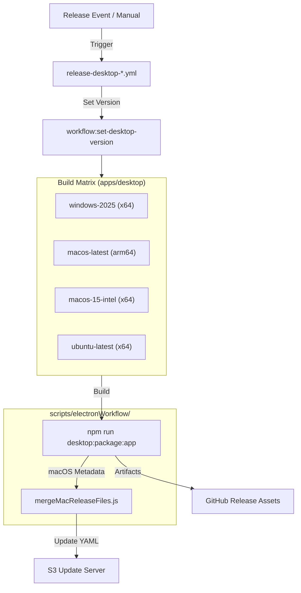
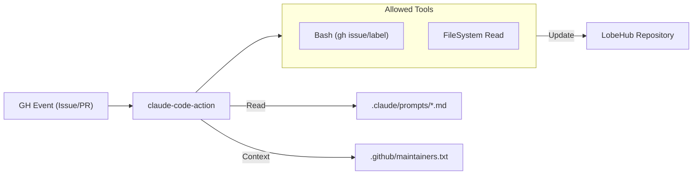

<!-- source: DeepWiki mcp.deepwiki.com · repo lobehub/lobehub · page 2.2 CI/CD and Release Pipeline · fetched 2026-10-29 -->

# CI/CD and Release Pipeline

Relevant source files

The following files were used as context for generating this wiki page:

- [.bunfig.toml](.bunfig.toml)
- [.github/actions/desktop-build-setup/action.yml](.github/actions/desktop-build-setup/action.yml)
- [.github/actions/desktop-publish-s3/action.yml](.github/actions/desktop-publish-s3/action.yml)
- [.github/actions/desktop-upload-artifacts/action.yml](.github/actions/desktop-upload-artifacts/action.yml)
- [.github/scripts/create-failure-issue.js](.github/scripts/create-failure-issue.js)
- [.github/workflows/auto-i18n.yml](.github/workflows/auto-i18n.yml)
- [.github/workflows/auto-tag-release.yml](.github/workflows/auto-tag-release.yml)
- [.github/workflows/lighthouse.yml](.github/workflows/lighthouse.yml)
- [.github/workflows/manual-build-desktop.yml](.github/workflows/manual-build-desktop.yml)
- [.github/workflows/pr-build-desktop.yml](.github/workflows/pr-build-desktop.yml)
- [.github/workflows/pr-build-docker.yml](.github/workflows/pr-build-docker.yml)
- [.github/workflows/release-desktop-beta.yml](.github/workflows/release-desktop-beta.yml)
- [.github/workflows/release-desktop-canary.yml](.github/workflows/release-desktop-canary.yml)
- [.github/workflows/release-desktop-stable.yml](.github/workflows/release-desktop-stable.yml)
- [.github/workflows/release-docker.yml](.github/workflows/release-docker.yml)
- [.github/workflows/release.yml](.github/workflows/release.yml)
- [.github/workflows/sync-database-schema.yml](.github/workflows/sync-database-schema.yml)
- [.github/workflows/sync-main-to-canary.yaml](.github/workflows/sync-main-to-canary.yaml)
- [.github/workflows/sync.yml](.github/workflows/sync.yml)
- [.github/workflows/test.yml](.github/workflows/test.yml)
- [.npmrc](.npmrc)
- [CHANGELOG.md](CHANGELOG.md)
- [README.md](README.md)
- [README.zh-CN.md](README.zh-CN.md)
- [apps/cli/.npmrc](apps/cli/.npmrc)
- [apps/cli/pnpm-workspace.yaml](apps/cli/pnpm-workspace.yaml)
- [apps/desktop/.npmrc](apps/desktop/.npmrc)
- [apps/desktop/package.json](apps/desktop/package.json)
- [apps/desktop/pnpm-lock.yaml](apps/desktop/pnpm-lock.yaml)
- [apps/desktop/pnpm-workspace.yaml](apps/desktop/pnpm-workspace.yaml)
- [apps/desktop/scripts/__tests__/buildCoreManifest.test.mjs](apps/desktop/scripts/__tests__/buildCoreManifest.test.mjs)
- [apps/desktop/scripts/__tests__/buildCoreV4.test.mjs](apps/desktop/scripts/__tests__/buildCoreV4.test.mjs)
- [apps/desktop/scripts/buildCoreManifest.mjs](apps/desktop/scripts/buildCoreManifest.mjs)
- [apps/desktop/scripts/buildCoreV4.mjs](apps/desktop/scripts/buildCoreV4.mjs)
- [apps/desktop/scripts/buildRendererManifest.mjs](apps/desktop/scripts/buildRendererManifest.mjs)
- [apps/desktop/src/main/__mocks__/node-mac-permissions.ts](apps/desktop/src/main/__mocks__/node-mac-permissions.ts)
- [apps/desktop/src/main/__mocks__/setup.ts](apps/desktop/src/main/__mocks__/setup.ts)
- [apps/desktop/src/main/appBrowsers.ts](apps/desktop/src/main/appBrowsers.ts)
- [apps/desktop/src/main/const/env.ts](apps/desktop/src/main/const/env.ts)
- [apps/desktop/src/main/const/store.ts](apps/desktop/src/main/const/store.ts)
- [apps/desktop/src/main/controllers/AuvCtr.ts](apps/desktop/src/main/controllers/AuvCtr.ts)
- [apps/desktop/src/main/controllers/BrowserWindowsCtr.ts](apps/desktop/src/main/controllers/BrowserWindowsCtr.ts)
- [apps/desktop/src/main/controllers/SystemCtr.ts](apps/desktop/src/main/controllers/SystemCtr.ts)
- [apps/desktop/src/main/controllers/__tests__/SystemCtr.test.ts](apps/desktop/src/main/controllers/__tests__/SystemCtr.test.ts)
- [apps/desktop/src/main/core/App.ts](apps/desktop/src/main/core/App.ts)
- [apps/desktop/src/main/core/__tests__/App.test.ts](apps/desktop/src/main/core/__tests__/App.test.ts)
- [apps/desktop/src/main/core/browser/Browser.ts](apps/desktop/src/main/core/browser/Browser.ts)
- [apps/desktop/src/main/core/browser/BrowserManager.ts](apps/desktop/src/main/core/browser/BrowserManager.ts)
- [apps/desktop/src/main/core/browser/WindowThemeManager.ts](apps/desktop/src/main/core/browser/WindowThemeManager.ts)
- [apps/desktop/src/main/core/browser/__tests__/Browser.test.ts](apps/desktop/src/main/core/browser/__tests__/Browser.test.ts)
- [apps/desktop/src/main/core/browser/__tests__/BrowserManager.test.ts](apps/desktop/src/main/core/browser/__tests__/BrowserManager.test.ts)
- [apps/desktop/src/main/core/browser/__tests__/WindowThemeManager.test.ts](apps/desktop/src/main/core/browser/__tests__/WindowThemeManager.test.ts)
- [apps/desktop/src/main/env.ts](apps/desktop/src/main/env.ts)
- [apps/desktop/src/main/services/__tests__/auvSrv.test.ts](apps/desktop/src/main/services/__tests__/auvSrv.test.ts)
- [apps/desktop/src/main/services/auvSrv.ts](apps/desktop/src/main/services/auvSrv.ts)
- [apps/desktop/src/main/types/store.ts](apps/desktop/src/main/types/store.ts)
- [apps/desktop/src/main/utils/permissions.ts](apps/desktop/src/main/utils/permissions.ts)
- [apps/desktop/tsconfig.json](apps/desktop/tsconfig.json)
- [apps/desktop/vitest.config.mts](apps/desktop/vitest.config.mts)
- [changelog/CHANGELOG.v0.md](changelog/CHANGELOG.v0.md)
- [changelog/CHANGELOG.v1.md](changelog/CHANGELOG.v1.md)
- [changelog/v0.json](changelog/v0.json)
- [changelog/v1.json](changelog/v1.json)
- [changelog/v2.json](changelog/v2.json)
- [codecov.yml](codecov.yml)
- [docs/changelog/2025-03-02-new-models.zh-CN.mdx](docs/changelog/2025-03-02-new-models.zh-CN.mdx)
- [docs/changelog/2025-06-08-claude-4.zh-CN.mdx](docs/changelog/2025-06-08-claude-4.zh-CN.mdx)
- [docs/changelog/2025-07-08-mcp-market.zh-CN.mdx](docs/changelog/2025-07-08-mcp-market.zh-CN.mdx)
- [docs/changelog/2025-09-08-gemini.zh-CN.mdx](docs/changelog/2025-09-08-gemini.zh-CN.mdx)
- [docs/changelog/2025-10-08-python.zh-CN.mdx](docs/changelog/2025-10-08-python.zh-CN.mdx)
- [docs/changelog/2025-12-20-mcp.zh-CN.mdx](docs/changelog/2025-12-20-mcp.zh-CN.mdx)
- [docs/changelog/schema.json](docs/changelog/schema.json)
- [next.config.ts](next.config.ts)
- [package.json](package.json)
- [packages/electron-client-ipc/src/events/system.ts](packages/electron-client-ipc/src/events/system.ts)
- [packages/electron-client-ipc/src/types/system.ts](packages/electron-client-ipc/src/types/system.ts)
- [packages/electron-client-ipc/src/types/window.ts](packages/electron-client-ipc/src/types/window.ts)
- [patches/@upstash__qstash.patch](patches/@upstash__qstash.patch)
- [pnpm-workspace.yaml](pnpm-workspace.yaml)
- [renovate.json](renovate.json)
- [scripts/changelogWorkflow/const.ts](scripts/changelogWorkflow/const.ts)
- [scripts/changelogWorkflow/generateChangelog.ts](scripts/changelogWorkflow/generateChangelog.ts)
- [scripts/dbmlWorkflow/index.ts](scripts/dbmlWorkflow/index.ts)
- [scripts/releaseWorkflow/index.ts](scripts/releaseWorkflow/index.ts)
- [src/business/client/features/NavPanelUpgradeEntry.tsx](src/business/client/features/NavPanelUpgradeEntry.tsx)
- [src/features/Electron/connection/DeviceGateway.tsx](src/features/Electron/connection/DeviceGateway.tsx)
- [src/features/Electron/system/macWindowFullscreen.ts](src/features/Electron/system/macWindowFullscreen.ts)
- [src/features/Electron/system/useMacWindowFullscreen.ts](src/features/Electron/system/useMacWindowFullscreen.ts)
- [src/features/NavPanel/components/NavPanelDraggable.tsx](src/features/NavPanel/components/NavPanelDraggable.tsx)
- [src/features/ShareModal/ShareImage/style.ts](src/features/ShareModal/ShareImage/style.ts)
- [src/layout/GlobalProvider/ElectronAppStateSync.desktop.tsx](src/layout/GlobalProvider/ElectronAppStateSync.desktop.tsx)
- [src/libs/next/config/define-config.test.ts](src/libs/next/config/define-config.test.ts)
- [src/libs/next/config/define-config.ts](src/libs/next/config/define-config.ts)
- [src/services/electron/gatewayConnection.ts](src/services/electron/gatewayConnection.ts)
- [src/services/electron/system.ts](src/services/electron/system.ts)
- [src/spa/BootShell/geometry.ts](src/spa/BootShell/geometry.ts)
- [src/store/electron/actions/app.ts](src/store/electron/actions/app.ts)
- [vercel.json](vercel.json)

This page documents the automation infrastructure of LobeHub, powered by GitHub Actions. It covers the release lifecycle, testing matrices, cross-platform desktop builds, Docker orchestration, and AI-enhanced repository management.

## Release Automation and Versioning

LobeHub utilizes a multi-stage release process that distinguishes between core application releases and specialized distribution channels (Desktop, Docker).

### Core Release Workflow
The primary release trigger is a version tag push (e.g., `v*.*.*`) [package.json:3](). The `Release CI` workflow handles final validation, database coverage testing, and documentation synchronization before a release is finalized [.github/workflows/release.yml:1-11]().

| Step | Action | Description |
| --- | --- | --- |
| **Linting** | `bun run lint` | Executes ESLint, Stylelint, and circular dependency checks [.github/workflows/release.yml:53](). |
| **DB Validation** | `bun run --filter @lobechat/database test` | Runs database migrations and schema tests against a `paradedb` service container [.github/workflows/release.yml:24-34, 55-60](). |
| **App Testing** | `bun run test-app` | Executes Vitest unit and integration tests [.github/workflows/release.yml:62](). |
| **Documentation** | `bun run workflow:readme` | Synchronizes latest agent and plugin metadata into `README.md` [.github/workflows/release.yml:65]().

### Auto-Tagging and Branch Sync
LobeHub implements an automated tagging strategy for PRs merged into `main` [.github/workflows/auto-tag-release.yml:1-11]().
- **Release PRs**: Detected by title `🚀 release: v{x.x.x}`, triggering a formal release tag [.github/workflows/auto-tag-release.yml:35]().
- **Patch PRs**: PRs from `hotfix/*` or `release/*` branches automatically trigger a patch version bump (e.g., `2.2.11` -> `2.2.12`) [.github/workflows/auto-tag-release.yml:56-60, 99]().
- **Branch Sync**: A dedicated workflow synchronizes `main` to `canary`. If conflicts occur, it automatically creates a PR for manual resolution [.github/workflows/sync-main-to-canary.yaml:32-126]().

Sources: `package.json`, `.github/workflows/release.yml`, `.github/workflows/auto-tag-release.yml`, `.github/workflows/sync-main-to-canary.yaml`

---

## Test Matrix and Quality Guard

The `Test CI` and `E2E CI` workflows implement a sharded testing strategy to optimize runner resources.

### Package and App Testing
The pipeline splits testing into package-level and application-level jobs [.github/workflows/test.yml:44-196]().

1.  **Package Matrix**: Tests 20+ internal packages (e.g., `@lobechat/agent-runtime`, `@lobechat/model-runtime`) in a single job [.github/workflows/test.yml:50, 62-68]().
2.  **App Sharding**: Main application tests are sharded into two concurrent runners using Vitest's `--shard` flag [.github/workflows/test.yml:190-193]().
3.  **E2E Testing**: Executes Playwright tests against a production build running on port `3006`, with a local `paradedb` instance.
4.  **Coverage Reporting**: Coverage blobs are merged and uploaded to Codecov using the `codecov` CLI [.github/workflows/test.yml:95-187]().

### Version Guard
To prevent accidental version conflicts, the system uses `fkirc/skip-duplicate-actions` to skip redundant CI cycles if the content has not changed [.github/workflows/test.yml:40-43]().

Sources: `.github/workflows/test.yml`

---

## Desktop Build Pipeline

LobeHub distributes a cross-platform Electron application with distinct channels: Stable, Beta, and Canary.

### Multi-Platform Build Strategy
The build process uses a matrix strategy to compile artifacts for Windows, macOS (Intel/Silicon), and Linux.

Title: "Desktop Release Entity Mapping"

Sources: `.github/workflows/release-desktop-stable.yml`, `.github/workflows/release-desktop-beta.yml`, `.github/workflows/release-desktop-canary.yml`, `apps/desktop/package.json`

### Release Channels
- **Stable**: Triggered by stable tags (no hyphen). Injects `UPDATE_SERVER_URL` for S3-based auto-updates.
- **Beta**: Triggered by pre-release tags (e.g., `-beta.1`). Excludes nightly builds [.github/workflows/release-desktop-beta.yml:48-55]().
- **Canary**: Automated builds from the `canary` branch for `feat`/`fix` commits, using a `X.Y.(Z+1)-canary.N` versioning scheme [.github/workflows/release-desktop-canary.yml:15, 79]().
- **PR Previews**: PRs labeled `trigger:build-desktop` generate `0.0.0-nightly.pr{N}` builds for verification.
- **OTA Updates**: The `renderer-ota` job publishes renderer updates for the desktop app via a shared workflow [.github/workflows/release-desktop-beta.yml:74-81]().

Sources: `.github/workflows/release-desktop-stable.yml`, `.github/workflows/release-desktop-beta.yml`, `.github/workflows/release-desktop-canary.yml`, `.github/workflows/pr-build-desktop.yml`

---

## AI-Powered Repository Automation

LobeHub integrates Anthropic's Claude via `anthropics/claude-code-action` to automate repository maintenance tasks using prompts defined in `.claude/prompts/`.

### AI Workflow Matrix
| Workflow | Prompt File | Purpose |
| --- | --- | --- |
| **Issue Triage** | `issue-triage.md` | Analyzes new issues, applies labels, and assigns team members. |
| **Team Assignment**| `team-assignment.md`| Determines the responsible team member based on issue category. |
| **Auto-Testing** | `auto-testing.md` | Analyzes code changes to generate or suggest E2E test cases. |
| **Security Rules** | `security-rules.md` | Provides guardrails to prevent prompt injection in automated issue handling. |

Title: "Claude Automation Flow"

Sources: `.github/workflows/claude-issue-triage.yml`, `.claude/prompts/team-assignment.md`, `.github/maintainers.txt`

---

## Specialized Infrastructure

### Docker Orchestration
- **Release**: `release-docker.yml` publishes multi-arch images to Docker Hub and GHCR upon release tags.
- **Build Command**: The `build:docker` script in `package.json` handles the complex SPA asset copying and Next.js standalone build [package.json:50]().

### Database and Sync
- **Schema Migration**: Migrations are executed via `bun run db:migrate` which targets the PostgreSQL instance defined by `DATABASE_URL`.
- **Schema Sync**: `sync-database-schema.yml` ensures that Drizzle schema changes are reflected in the repository's DBML documentation [package.json:65, 69]().

### i18n and Performance
- **Auto Translation**: `auto-i18n.yml` uses the `lobe-i18n` tool to automatically translate locale files in `src/locales`.
- **Lighthouse**: `lighthouse.yml` runs automated audits to ensure frontend performance and accessibility standards are met.
- **Upstream Sync**: `sync.yml` automates the process of keeping fork repositories up to date with the main LobeHub repository.

Sources: `package.json`, `.github/workflows/release-docker.yml`, `.github/workflows/sync-database-schema.yml`

---

