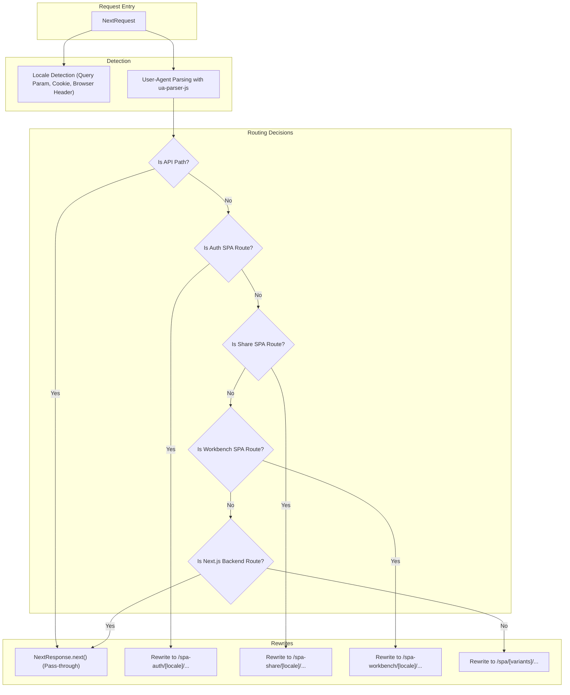
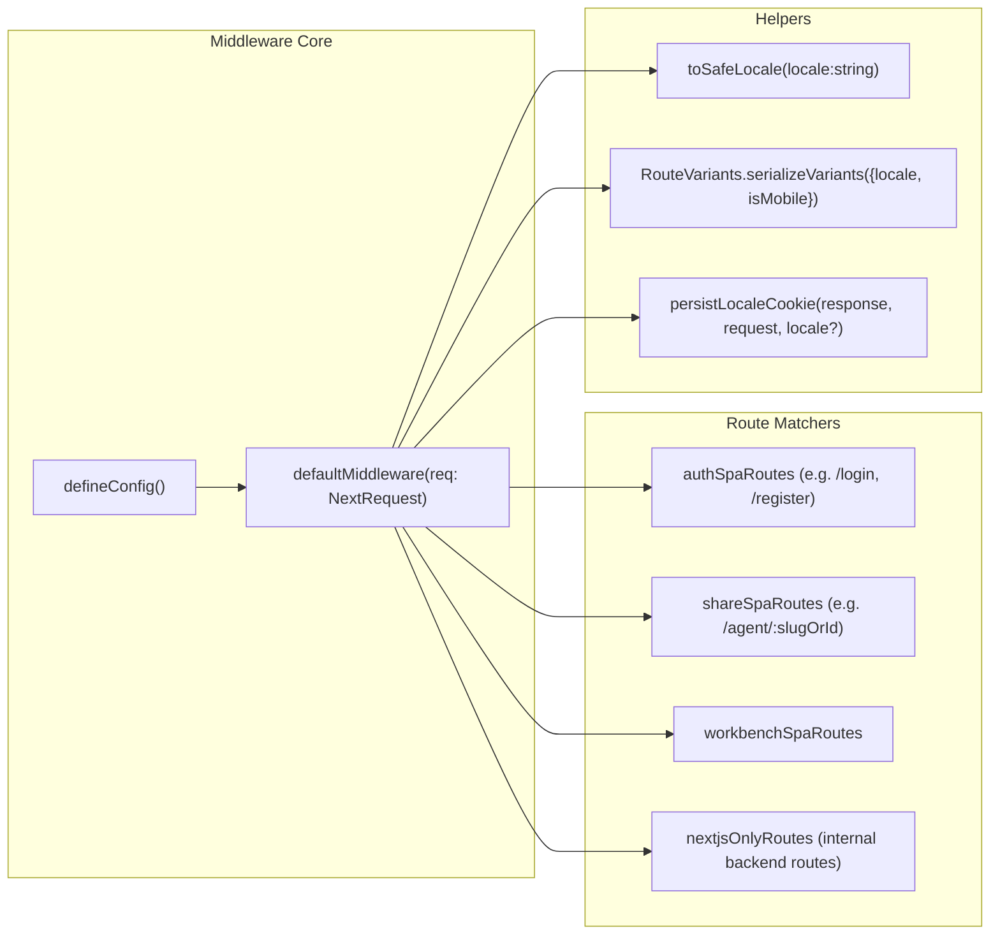
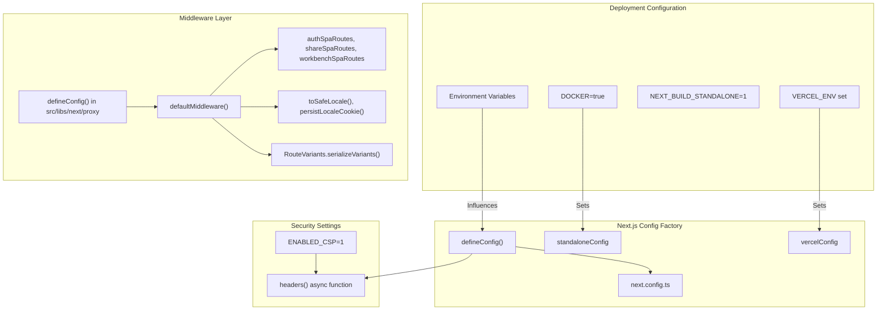

<!-- source: DeepWiki mcp.deepwiki.com · repo lobehub/lobehub · page 2.3 Next.js Configuration and Middleware · fetched 2026-10-29 -->

# Next.js Configuration and Middleware

<details>
<summary>Relevant source files</summary>

The following files were used as context for generating this wiki page:

- [.bunfig.toml](.bunfig.toml)
- [.github/scripts/create-failure-issue.js](.github/scripts/create-failure-issue.js)
- [.github/workflows/auto-i18n.yml](.github/workflows/auto-i18n.yml)
- [.github/workflows/auto-tag-release.yml](.github/workflows/auto-tag-release.yml)
- [.github/workflows/lighthouse.yml](.github/workflows/lighthouse.yml)
- [.github/workflows/release.yml](.github/workflows/release.yml)
- [.github/workflows/sync-database-schema.yml](.github/workflows/sync-database-schema.yml)
- [.github/workflows/sync-main-to-canary.yaml](.github/workflows/sync-main-to-canary.yaml)
- [.github/workflows/sync.yml](.github/workflows/sync.yml)
- [.github/workflows/test.yml](.github/workflows/test.yml)
- [.npmrc](.npmrc)
- [CHANGELOG.md](CHANGELOG.md)
- [README.md](README.md)
- [README.zh-CN.md](README.zh-CN.md)
- [apps/cli/.npmrc](apps/cli/.npmrc)
- [apps/cli/pnpm-workspace.yaml](apps/cli/pnpm-workspace.yaml)
- [apps/desktop/.npmrc](apps/desktop/.npmrc)
- [apps/desktop/package.json](apps/desktop/package.json)
- [apps/desktop/pnpm-lock.yaml](apps/desktop/pnpm-lock.yaml)
- [apps/desktop/pnpm-workspace.yaml](apps/desktop/pnpm-workspace.yaml)
- [apps/desktop/src/main/controllers/AuvCtr.ts](apps/desktop/src/main/controllers/AuvCtr.ts)
- [apps/desktop/src/main/services/__tests__/auvSrv.test.ts](apps/desktop/src/main/services/__tests__/auvSrv.test.ts)
- [apps/desktop/src/main/services/auvSrv.ts](apps/desktop/src/main/services/auvSrv.ts)
- [changelog/CHANGELOG.v0.md](changelog/CHANGELOG.v0.md)
- [changelog/CHANGELOG.v1.md](changelog/CHANGELOG.v1.md)
- [changelog/v0.json](changelog/v0.json)
- [changelog/v1.json](changelog/v1.json)
- [changelog/v2.json](changelog/v2.json)
- [codecov.yml](codecov.yml)
- [docs/changelog/2025-03-02-new-models.zh-CN.mdx](docs/changelog/2025-03-02-new-models.zh-CN.mdx)
- [docs/changelog/2025-06-08-claude-4.zh-CN.mdx](docs/changelog/2025-06-08-claude-4.zh-CN.mdx)
- [docs/changelog/2025-07-08-mcp-market.zh-CN.mdx](docs/changelog/2025-07-08-mcp-market.zh-CN.mdx)
- [docs/changelog/2025-09-08-gemini.zh-CN.mdx](docs/changelog/2025-09-08-gemini.zh-CN.mdx)
- [docs/changelog/2025-10-08-python.zh-CN.mdx](docs/changelog/2025-10-08-python.zh-CN.mdx)
- [docs/changelog/2025-12-20-mcp.zh-CN.mdx](docs/changelog/2025-12-20-mcp.zh-CN.mdx)
- [docs/changelog/schema.json](docs/changelog/schema.json)
- [next.config.ts](next.config.ts)
- [package.json](package.json)
- [packages/database/src/server/models/__tests__/adapter.test.ts](packages/database/src/server/models/__tests__/adapter.test.ts)
- [packages/utils/src/server/index.ts](packages/utils/src/server/index.ts)
- [patches/@upstash__qstash.patch](patches/@upstash__qstash.patch)
- [pnpm-workspace.yaml](pnpm-workspace.yaml)
- [public/acceptance/skill.md](public/acceptance/skill.md)
- [renovate.json](renovate.json)
- [scripts/changelogWorkflow/const.ts](scripts/changelogWorkflow/const.ts)
- [scripts/changelogWorkflow/generateChangelog.ts](scripts/changelogWorkflow/generateChangelog.ts)
- [scripts/dbmlWorkflow/index.ts](scripts/dbmlWorkflow/index.ts)
- [scripts/releaseWorkflow/index.ts](scripts/releaseWorkflow/index.ts)
- [src/app/(backend)/oidc/[...oidc]/route.test.ts](src/app/(backend)/oidc/[...oidc]/route.test.ts)
- [src/app/(backend)/oidc/[...oidc]/route.ts](src/app/(backend)/oidc/[...oidc]/route.ts)
- [src/app/(backend)/oidc/callback/desktop/route.ts](src/app/(backend)/oidc/callback/desktop/route.ts)
- [src/app/(backend)/oidc/clear-session/route.ts](src/app/(backend)/oidc/clear-session/route.ts)
- [src/app/(backend)/oidc/consent/route.test.ts](src/app/(backend)/oidc/consent/route.test.ts)
- [src/app/(backend)/oidc/consent/route.ts](src/app/(backend)/oidc/consent/route.ts)
- [src/business/client/hooks/useSwitchWorkspace.ts](src/business/client/hooks/useSwitchWorkspace.ts)
- [src/features/Acceptance/Workspace/AcceptanceOnboarding.tsx](src/features/Acceptance/Workspace/AcceptanceOnboarding.tsx)
- [src/features/ShareModal/ShareImage/style.ts](src/features/ShareModal/ShareImage/style.ts)
- [src/features/User/__tests__/UserAvatar.test.tsx](src/features/User/__tests__/UserAvatar.test.tsx)
- [src/features/Workspace/__tests__/workspaceSlugHooks.test.tsx](src/features/Workspace/__tests__/workspaceSlugHooks.test.tsx)
- [src/features/Workspace/useWorkspaceUrlSync.ts](src/features/Workspace/useWorkspaceUrlSync.ts)
- [src/layout/GlobalProvider/useUserStateRedirect.ts](src/layout/GlobalProvider/useUserStateRedirect.ts)
- [src/libs/next/config/define-config.test.ts](src/libs/next/config/define-config.test.ts)
- [src/libs/next/config/define-config.ts](src/libs/next/config/define-config.ts)
- [src/libs/next/proxy/define-config.test.ts](src/libs/next/proxy/define-config.test.ts)
- [src/libs/next/proxy/define-config.ts](src/libs/next/proxy/define-config.ts)
- [src/libs/oidc-provider/adapter.ts](src/libs/oidc-provider/adapter.ts)
- [src/libs/oidc-provider/config.ts](src/libs/oidc-provider/config.ts)
- [src/libs/oidc-provider/cookies.ts](src/libs/oidc-provider/cookies.ts)
- [src/libs/oidc-provider/http-adapter.test.ts](src/libs/oidc-provider/http-adapter.test.ts)
- [src/libs/oidc-provider/http-adapter.ts](src/libs/oidc-provider/http-adapter.ts)
- [src/libs/oidc-provider/interaction-policy.ts](src/libs/oidc-provider/interaction-policy.ts)
- [src/libs/oidc-provider/jwt.test.ts](src/libs/oidc-provider/jwt.test.ts)
- [src/libs/oidc-provider/jwt.ts](src/libs/oidc-provider/jwt.ts)
- [src/libs/oidc-provider/provider.test.ts](src/libs/oidc-provider/provider.test.ts)
- [src/libs/oidc-provider/provider.ts](src/libs/oidc-provider/provider.ts)
- [src/libs/oidc-provider/selective-body.d.ts](src/libs/oidc-provider/selective-body.d.ts)
- [src/libs/oidc-provider/session-cleanup.test.ts](src/libs/oidc-provider/session-cleanup.test.ts)
- [src/libs/oidc-provider/session-cleanup.ts](src/libs/oidc-provider/session-cleanup.ts)
- [src/proxy.ts](src/proxy.ts)
- [src/store/serverConfig/selectors.ts](src/store/serverConfig/selectors.ts)
- [src/store/user/slices/auth/action.ts](src/store/user/slices/auth/action.ts)
- [src/store/user/slices/auth/initialState.ts](src/store/user/slices/auth/initialState.ts)
- [src/store/user/slices/auth/selectors.test.ts](src/store/user/slices/auth/selectors.test.ts)
- [src/store/user/slices/auth/selectors.ts](src/store/user/slices/auth/selectors.ts)
- [vercel.json](vercel.json)

</details>


This page documents the Next.js build configuration and middleware layer responsible for request routing, security enforcement, and authentication guarding in the LobeHub codebase.

---

## Next.js Configuration

LobeHub builds upon Next.js with a centralized configuration factory `defineConfig()` that adapts to multiple build and deployment environments such as Vercel serverless, standalone mode, and Docker containers.

### `defineConfig()` Implementation

The core configuration factory is implemented in `src/libs/next/config/define-config.ts`. It dynamically controls settings based on environment variables:

- `DOCKER`: Enables Docker-specific standalone configuration.
- `VERCEL_ENV`: Indicates a Vercel deployment environment.
- `NEXT_BUILD_STANDALONE`: Forces standalone output mode.
- `ENABLED_CSP`: Enables strict Content Security Policy headers.

Key environment detections and flags are at [src/libs/next/config/define-config.ts:18-26]().

The configuration applies these rules:

| Feature | Description | Code Location |
| --- | --- | --- |
| **Output Mode** | Uses `'standalone'` output for containerized or standalone builds | [src/libs/next/config/define-config.ts:26-30]() |
| **Output File Tracing Includes/Excludes** | Includes public assets and static files; selectively excludes SPA and desktop artifacts for serverless builds | [src/libs/next/config/define-config.ts:31-47]() |
| **Asset Prefix** | Can be customized via env vars `ASSET_BASE_URL` or `NEXT_PUBLIC_ASSET_PREFIX` | [src/libs/next/config/define-config.ts:52-55]() |
| **Compression** | Enabled for production builds | [src/libs/next/config/define-config.ts:69]() |
| **SWC Server Minification** | Disabled to preserve constructor names critical for OIDC providers | [src/libs/next/config/define-config.ts:79-83]() |
| **Compiler Config** | Emotion enabled for CSS-in-JS | [src/libs/next/config/define-config.ts:66-68]() |
| **Package Import Optimization** | Uses `optimizePackageImports` for heavy UI and emoji libraries | [src/libs/next/config/define-config.ts:70-78]() |

Notable settings include disabling automatic injection of `nextjs-agent-rules` and setting appropriate `crossOrigin` policies if an asset prefix is used.

### Output Mode Selection

LobeHub supports three main deployment output modes:

#### 1. Serverless Mode (Vercel)

- Excludes musl-related native binaries such as Alpine-optimized `sharp` which are unnecessary on AWS Lambda-like Amazon Linux environments.
- Excludes SPA, desktop, mobile, and migration artifacts from serverless bundles to minimize package size.
- Configuration visible in `next.config.ts` at [next.config.ts:5-20]().

#### 2. Standalone Mode (Docker and Standalone builds)

- Sets Next.js output to `'standalone'`.
- Includes all public static assets and `.next/static`.
- When building for Docker (signaled by `DOCKER=true`), includes additional SPA, desktop, and migrations files for completeness.
- Defined in `src/libs/next/config/define-config.ts`, lines [28-50]().

### Security Headers and Caching

The Next.js `headers()` async function configures various HTTP headers for security and performance:

- Adds a global `x-robots-tag: all` header.
- If CSP is enabled (`ENABLED_CSP=1`), adds:
  - `X-Frame-Options: DENY`
  - `Content-Security-Policy: frame-ancestors 'none';`
- For share pages under `/agent/:path*`, disables indexing with `x-robots-tag: noindex, nofollow`.
- Long-term immutable caching (max-age=31536000) is set for asset folders like:
  - `/app-icons/`, `/app-images/`, `/videos/`, `/screenshots/`, `/og/`
- Cache control for SPA builds is also configured in `vercel.json` for caching optimization at the CDN edge [vercel.json:3-16]().

This layered cache and security header arrangement is designed for privacy, performance, and protecting embedded SPA and share assets.

### Webpack and Additional Build Details (Summary)

- `optimizePackageImports` is used to reduce bundle size and speed compilation by optimizing imports from heavy libraries (`emoji-mart`, `@lobehub/ui`).
- Native modules and WASM binaries are traced appropriately for Docker standalone builds.
- Server minification via SWC is disabled due to OIDC provider dependencies on constructor names.

---

## Middleware and Routing

The LobeHub Next.js Middleware is implemented primarily at `src/libs/next/proxy/define-config.ts`. It handles:

- Locale resolution and persistence.
- Device type detection for variant routing.
- Route pattern matching for selective rewrite.
- Authentication route detection.
- Bypassing for API and backend routes.
- Docker-specific host rewriting for local container networking.
- Enforces routing variants to load SPA bundles adaptive to locale and platform (web, mobile, workbench).

### Middleware Routing Logic

#### Overview Flow



This processing routes requests into appropriate bundles or backend handlers, adapting for locale and device.

### Middleware Implementation Details

- **API Endpoint Bypass:** Requests to `/api`, `/trpc`, `/webapi`, `/oidc`, and `/oauth/connector` are passed through without rewrites to ensure backend APIs and OAuth flows remain intact [src/libs/next/proxy/define-config.ts:54-68]().

- **Locale Detection and Persistence:**
  - First, locale is taken from the `hl` query parameter if set.
  - Next fallback is cookie `LOBE_LOCALE_COOKIE`.
  - Last fallback is browser language parsed by `accept-language`.
  - A safe allowlist ensures only supported locales are used.
  - New locale preferences are persisted via cookies for 90 days.
  
- **Device Type Detection** using `ua-parser-js`:
  - Determines if client is a mobile device.
  - Affects route variant serialization and SPA bundle selection.

- **Routing Variant Serialization:**
  - Combines locale and device type into a route variant string used to build SPA bundle paths.

- **Special SPA Route Handling:**
  - Auth SPA routes `/spa-auth` are distinct and get own bundles.
  - Share SPA routes `/spa-share` are served without device variant splits.
  - Workbench SPA routes `/spa-workbench` serve desktop or mobile variants.
  - Other routes fall back to `/spa` bundles with device/locale variants.

- **Docker Local Rewrites:**
  - When `MIDDLEWARE_REWRITE_THROUGH_LOCAL` env is set, middleware rewrites requests to `http://127.0.0.1:[PORT]` to address networking quirks in Docker deployments.

- **Skipping Dangerous Proxy Route:**
  - Requests beginning with `/_dangerous_local_dev_proxy` are exempt from middleware rewrites.

---

### Middleware Entity Map



This map shows how the defined constants, route matchers, and helper utilities interact within the middleware routing function.

---

## Summary of Key Functions and Data Flow

| Function / Class | Purpose | Description |
| --- | --- | --- |
| `defineConfig()` ([src/libs/next/config/define-config.ts]) | Central Next.js configuration factory | Builds Next.js config adjusting for output mode, security headers, asset caching, and package optimizations dynamically based on env variables like `DOCKER`, `VERCEL_ENV`. |
| `defaultMiddleware(request: NextRequest)` ([src/libs/next/proxy/define-config.ts]) | Middleware entrypoint | Detects locale and device, then selectively rewrites URLs to SPA bundles or passes API routes directly. Enforces auth SPA path rewrites and handles Docker local rewrites. |
| `toSafeLocale(locale)` ([src/libs/next/proxy/define-config.ts]) | Locale sanitizer | Ensures only supported locales are accepted and passed downstream, defaulting fallback otherwise. |
| `persistLocaleCookie(response, request, explicitlyLocale)` | Locale cookie setter | Writes locale cookie if not present to persist user preference for 90 days. |
| `RouteVariants.serializeVariants()` | Encodes locale and device info | Produces route variants like `en/m` or `zh` for SPA routing. |

---

## Summary Diagram: Natural Language to Config Entities

This diagram bridges natural language concepts (deployment modes, security, routing) to their exact code artifacts.



---

## Summary Table: Output Modes and Middleware Responsibilities

| Aspect | Serverless Mode (Vercel) | Standalone Mode (Docker) | Middleware Responsibilities |
| --- | --- | --- | --- |
| Output mode | Default (no standalone) | `output: 'standalone'` specified | N/A |
| File tracing | Exclude native musl binaries, SPA and desktop artifacts | Include public assets, static files, SPA and migrations | Route requests, locale and device detection |
| Cache control | Defined via vercel.json and headers() for SPA and static assets | Same, with additional inclusions | Rewrites SPA requests to correct locale/device variants |
| Security | CSP optionally enforced via headers() | Same | Bypass API/backend requests, apply SPA rewrites |
| Platform rewrites for SPA | `/spa` bundles split by locale/device | `/spa` bundles plus additional desktop/mobile SPA | Rewrites to `/spa-auth`, `/spa-share`, `/spa-workbench` based on path |

---

## References

| File | Lines/Sections |
| --- | --- |
| `next.config.ts` | [next.config.ts:1-25]() |
| `src/libs/next/config/define-config.ts` | [src/libs/next/config/define-config.ts:1-230]() |
| `vercel.json` | [vercel.json:1-63]() |
| `src/libs/next/proxy/define-config.ts` | [src/libs/next/proxy/define-config.ts:1-181]() |
| `src/proxy.ts` | [src/proxy.ts:1-64]() |

---

# Appendix: Highlights of Security Header Configuration

- Global header:

  ```http
  x-robots-tag: all
  ```

- Share pages `/agent/:path*`:

  ```http
  x-robots-tag: noindex, nofollow
  ```

- `Content-Security-Policy` (when CSP enabled):

  ```
  frame-ancestors 'none';
  ```

- Caching header example for app icons:

  ```http
  Cache-Control: public, max-age=31536000, immutable
  ```

These settings enhance SEO control, avoid clickjacking, and optimize caching on static assets.

---

This concludes the "Next.js Configuration and Middleware" wiki page documenting build configuration, output modes, security headers, and middleware routing logic in full technical detail.  
Sources:  
- [next.config.ts:1-25]()  
- [src/libs/next/config/define-config.ts:1-230]()  
- [vercel.json:1-63]()  
- [src/libs/next/proxy/define-config.ts:1-181]()  
- [src/proxy.ts:1-64]()

---

