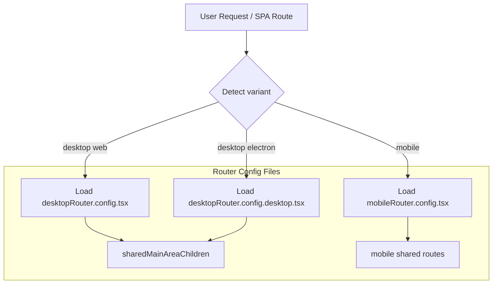

<!-- source: DeepWiki mcp.deepwiki.com · repo lobehub/lobehub · page 2.4 Route Variants and Desktop Mode · fetched 2026-10-29 -->

# Route Variants and Desktop Mode

<details>
<summary>Relevant source files</summary>

The following files were used as context for generating this wiki page:

- [apps/desktop/src/main/controllers/RendererOtaCtr.ts](apps/desktop/src/main/controllers/RendererOtaCtr.ts)
- [locales/en-US/electron.json](locales/en-US/electron.json)
- [locales/zh-CN/electron.json](locales/zh-CN/electron.json)
- [packages/locales/src/default/electron.ts](packages/locales/src/default/electron.ts)
- [src/components/Skeleton/Delayed.tsx](src/components/Skeleton/Delayed.tsx)
- [src/components/Skeleton/RouteSegment.tsx](src/components/Skeleton/RouteSegment.tsx)
- [src/components/Skeleton/index.ts](src/components/Skeleton/index.ts)
- [src/features/Electron/updater/UpdateNotification.tsx](src/features/Electron/updater/UpdateNotification.tsx)
- [src/features/Electron/updater/coreVersion.test.ts](src/features/Electron/updater/coreVersion.test.ts)
- [src/features/Electron/updater/coreVersion.ts](src/features/Electron/updater/coreVersion.ts)
- [src/features/Settings/about/features/otaVersion.test.ts](src/features/Settings/about/features/otaVersion.test.ts)
- [src/features/Settings/about/features/otaVersion.ts](src/features/Settings/about/features/otaVersion.ts)
- [src/features/Workspace/WorkspaceSlugBoundary.tsx](src/features/Workspace/WorkspaceSlugBoundary.tsx)
- [src/routes/(main)/agent/features/Conversation/index.tsx](src/routes/(main)/agent/features/Conversation/index.tsx)
- [src/routes/(main)/agent/profile/index.tsx](src/routes/(main)/agent/profile/index.tsx)
- [src/routes/(main)/group/profile/index.tsx](src/routes/(main)/group/profile/index.tsx)
- [src/routes/(main)/page/[id]/index.tsx](src/routes/(main)/page/[id]/index.tsx)
- [src/routes/(main)/page/index.tsx](src/routes/(main)/page/index.tsx)
- [src/services/electron/rendererOta.ts](src/services/electron/rendererOta.ts)
- [src/spa/router/desktopRouter.config.desktop.tsx](src/spa/router/desktopRouter.config.desktop.tsx)
- [src/spa/router/desktopRouter.config.tsx](src/spa/router/desktopRouter.config.tsx)
- [src/spa/router/desktopRouter.meta.desktop.test.ts](src/spa/router/desktopRouter.meta.desktop.test.ts)
- [src/spa/router/desktopRouter.shared.tsx](src/spa/router/desktopRouter.shared.tsx)
- [src/spa/router/desktopRouter.sync.test.tsx](src/spa/router/desktopRouter.sync.test.tsx)
- [src/spa/router/mobileRouter.config.tsx](src/spa/router/mobileRouter.config.tsx)
- [src/spa/router/mobileRouter.test.tsx](src/spa/router/mobileRouter.test.tsx)

</details>


LobeHub employs an advanced routing and platform adaptation framework that tailors the user interface experience based on the execution environment (Web, Desktop Electron app, or Mobile). This is achieved through a flexible dynamic segment routing strategy combined with SPA routers that enable different layout structures, and a robust desktop integration layer powered by Electron.

---

## 1. Route Variants System

The route variants system allows LobeHub's Next.js frontend to serve distinct layouts and feature sets customized for desktop web, mobile, and Electron desktop clients, while preserving a single shared codebase with smooth code reuse.

### 1.1 Dynamic Segment `[variants]` Routing

- The Next.js App Router defines a dynamic route segment `[variants]` under the SPA entry paths (e.g., `/spa/[variants]/...`). This segment encodes the user's variant environment to select appropriate UI bundles and layouts.
- The serialization of variants into a string (e.g., `"zh-CN"`, `"en-US-mobile"`) is done by the utility `RouteVariants.serializeVariants` [src/utils/server/routeVariants.ts:1-20]().
- Middleware rewrites incoming requests transparently to their respective `[variants]` routes internally without affecting the URL in the browser. This is crucial for managing multiple layouts under one deployment.

### 1.2 Router Configurations for Desktop, Web and Mobile

LobeHub defines distinct routers for each platform variant, sharing common route definitions while also allowing platform-specific route trees and components.

- **Desktop Router (Web)**: Located in `src/spa/router/desktopRouter.config.tsx`, it configures a multi-pane experience for desktop browsers, including sidebars for agents, groups, and workspace management [src/spa/router/desktopRouter.config.tsx:1-69]().

- **Desktop Router (Electron)**: In `src/spa/router/desktopRouter.config.desktop.tsx`, specialized routes like `DesktopHomeRoute` initialize the Electron shell UX. It uses route factories to delay component instantiation for performance [src/spa/router/desktopRouter.config.desktop.tsx:1-49]().

- **Mobile Router**: Found in `src/spa/router/mobileRouter.config.tsx`, this router adopts a single-column layout optimized for smaller touch devices [src/spa/router/mobileRouter.config.tsx:1-199]().

- **Shared Desktop Routes**: Common routes for all desktop variants (Electron and Web) are defined in `src/spa/router/desktopRouter.shared.tsx`. This includes shared business logic and structural routes to avoid duplication [src/spa/router/desktopRouter.shared.tsx:1-151]().

#### Variant Routing Diagram: Environment to Router Config Mapping



**Sources:**
- [src/spa/router/desktopRouter.config.tsx:1-69]()
- [src/spa/router/desktopRouter.config.desktop.tsx:1-49]()
- [src/spa/router/desktopRouter.shared.tsx:1-151]()
- [src/spa/router/mobileRouter.config.tsx:1-199]()
- [src/utils/server/routeVariants.ts:1-20]()

---

## 2. Desktop Mode: Electron Integration

The LobeHub Desktop application is implemented as an Electron app that wraps the web UI inside native OS windows. This integration is centered around the `BrowserManager` and `Browser` classes that handle lifecycle, theming, window state, and secure navigation.

### 2.1 `Browser` Class: Window Lifecycle and Creation

- The `Browser` class (defined in `apps/desktop/src/main/core/browser/Browser.ts`) manages a single Electron `BrowserWindow` instance.
- The `retrieveOrInitialize()` method ensures a window instance exists, either returning an existing window or creating a new one if destroyed [apps/desktop/src/main/core/browser/Browser.ts:134-147]().
- Window creation (`createBrowserWindow()`) configures the Electron `BrowserWindow` with options:
  - Native window state persistence via `WindowStateManager`
  - Theming and vibrancy handled by `WindowThemeManager`
  - `webPreferences` including `contextIsolation`, preload script, and `webviewTag` enabled for advanced renderer use [apps/desktop/src/main/core/browser/Browser.ts:160-204]().
- The class also provides hooks for navigation security and external link handling, ensuring only safe protocols open inside the app while external URLs open in the system browser.

### 2.2 Native Navigation and Security Management

- Functions like `isExternallyOpenableUrl` and `shouldOpenTopLevelNavigationExternally` restrict navigation to safe protocols (`http`, `https`, `mailto`) and external hosts configured in environment [apps/desktop/src/main/core/browser/Browser.ts:37-63]().

- The Electron app enforces these external navigation rules, preventing unclaimed renderer URLs from silently failing or opening insecurely.

- The desktop `App` class registers privileged protocols such as `app://` and manages interceptors like `backendProxyProtocolManager` for backend request routing [apps/desktop/src/main/core/App.ts:114-129]().

### 2.3 BrowserManager Loading the Web UI

The `BrowserManager` is responsible for:

- Instantiating and managing multiple `Browser` instances.
- Building renderer URLs using `RendererUrlManager`.
- Coordinating window state persistence and renderer updates.

### 2.4 Desktop UI Loading Flow Diagram

```mermaid
graph TD
    subgraph "Electron Main Process"
        A[App]
        B[BrowserManager]
        C[Browser]
        D[BrowserWindow]
        E[WindowStateManager]
        F[WindowThemeManager]
        G[RemoteServerConfigCtr]

        A --> B
        B --> C
        C --> D
        C --> E
        C --> F
        G --> C
    end

    subgraph "Renderer Process"
        H[SPA Web UI Renderer]
        I[desktopRouter.config.desktop.tsx]
        J[Electron Preload Script (electronApi.ts)]
    end

    D -->|loadURL/loadFile| H
    J -->|IPC Bridge| D
```

- The main process (`App`) initializes the `BrowserManager`.
- `BrowserManager` creates `Browser` windows, which instantiate Electron `BrowserWindow`.
- Browser windows load the SPA web UI with the Electron-specific desktop router.
- Preload scripts like `electronApi.ts` facilitate secure IPC communication between Renderer and Main processes.
- The `RemoteServerConfigCtr` supplies identity and config needed by the Browser for authenticated cloud sync.

**Sources:**
- [apps/desktop/src/main/core/browser/Browser.ts:82-204]()
- [apps/desktop/src/main/core/App.ts:60-172]()
- [apps/desktop/src/main/core/browser/BrowserManager.ts]()
- [apps/desktop/src/preload/electronApi.ts]()

---

## 3. Router Architecture with Variants

The router system uses deferred factories and platform guards to conditionally compose route trees and lazily load components.

### 3.1 Route Factories

- Desktop routers employ `createMainAreaRouteFactory` with options, deferring the instantiation of screens like home or workspace settings until render time [src/spa/router/desktopRouter.shared.tsx:135-140]().

- This lazy loading optimizes initial load performance, crucial for Electron where multiple windows and tabs may spawn dynamically.

### 3.2 Shared Routes and Deep Linking

- Routes shared between the root path `/` and workspace-scoped path `/:workspaceSlug` leverage relative redirects to maintain consistent user flow.

- Legacy agent statistics and self-learning deep links maintain compatibility via specific match routes and redirects [src/spa/router/desktopRouter.sync.test.tsx:112-156]().

### 3.3 Platform-Specific Routes and Onboarding Screens

- The desktop (Electron) router includes onboarding routes and specialized layouts inaccessible on the web or mobile variants. For example, `desktop-onboarding` is specific to Electron [src/spa/router/desktopRouter.config.desktop.tsx:41-48]().

- Web-only routes like `/verify-im` or acceptance report pages are included conditionally in the desktop router config [src/spa/router/desktopRouter.config.tsx:21-59]().

**Sources:**
- [src/spa/router/desktopRouter.shared.tsx:135-140]()
- [src/spa/router/desktopRouter.sync.test.tsx:112-156]()
- [src/spa/router/desktopRouter.config.desktop.tsx:41-48]()
- [src/spa/router/desktopRouter.config.tsx:21-59]()

---

## 4. Summary Table: Route Variants and Layout Roles

| Variant | Router Config File | Primary Layout Type | Notes |
|---|---|---|---|
| Desktop Web | `desktopRouter.config.tsx` | Multi-pane desktop UI | Sidebars, tabs, with workspace view |
| Desktop Electron | `desktopRouter.config.desktop.tsx` | Electron shell & tabs | Tab host with Electron-specific tweaks |
| Mobile | `mobileRouter.config.tsx` | Single stack | Touch optimized, limited navigation |
| Shared (Desktop) | `desktopRouter.shared.tsx` | Common routes | Common routes used by desktop variants |

---

## 5. Integration with Electron Main App (`App` class)

- The Desktop app's main process `App` class manages subsystem lifecycles and initializes controllers like `RemoteServerConfigCtr`.

- Crucially, it initializes `BrowserManager`, which orchestrates BrowserWindow creation and loading the proper SPA route with variant-specific configuration [apps/desktop/src/main/core/App.ts:60-172]().

- Supporting infrastructure like protocol managers (`LocalFileProtocolManager`, `RendererUrlManager`), file servers, IPC, and theming live here.

**Sources:**
- [apps/desktop/src/main/core/App.ts:60-172]()

---

# Conclusion

LobeHub's routing subsystem employs a sophisticated dynamic `[variants]` segment approach combined with SPA route factories to provide highly customized UI layouts for web, desktop Electron, and mobile platforms from a single codebase. The Electron desktop shell leverages the `Browser` and `BrowserManager` classes to integrate native window management and theming while loading the fully-featured web UI under the `desktop` variant routing. This architecture enables unified development and elegant adaptation across environments.

---

**Complete Source List:**

- [src/spa/router/desktopRouter.config.tsx:1-69]()
- [src/spa/router/desktopRouter.config.desktop.tsx:1-49]()
- [src/spa/router/desktopRouter.shared.tsx:1-151]()
- [src/spa/router/mobileRouter.config.tsx:1-199]()
- [src/spa/router/desktopRouter.sync.test.tsx:112-156]()
- [src/utils/server/routeVariants.ts:1-20]()
- [apps/desktop/src/main/core/browser/Browser.ts:82-204]()
- [apps/desktop/src/main/core/App.ts:60-172]()
- [apps/desktop/src/main/core/browser/BrowserManager.ts]()
- [apps/desktop/src/preload/electronApi.ts]()

---

