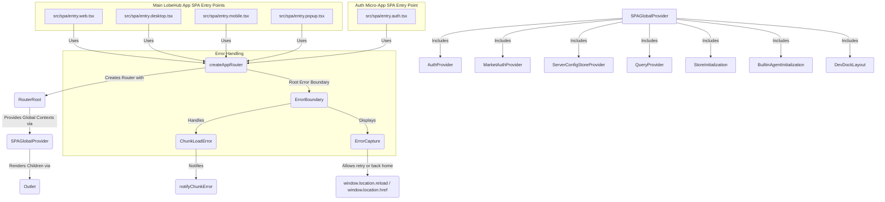
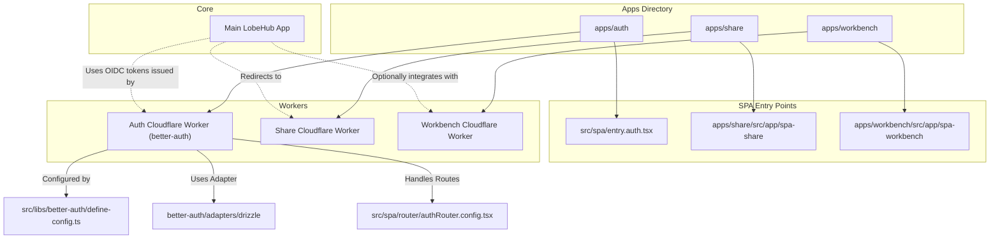

<!-- source: DeepWiki mcp.deepwiki.com · repo lobehub/lobehub · page 2.5 Satellite Micro-Apps (auth, share, workbench) · fetched 2026-10-29 -->

# Satellite Micro-Apps (auth, share, workbench)

<details>
<summary>Relevant source files</summary>

The following files were used as context for generating this wiki page:

- [.stylelintignore](.stylelintignore)
- [apps/desktop/src/overlay/entry.tsx](apps/desktop/src/overlay/entry.tsx)
- [docs/self-hosting/auth.mdx](docs/self-hosting/auth.mdx)
- [docs/self-hosting/auth.zh-CN.mdx](docs/self-hosting/auth.zh-CN.mdx)
- [docs/self-hosting/auth/providers/microsoft.mdx](docs/self-hosting/auth/providers/microsoft.mdx)
- [docs/self-hosting/auth/providers/microsoft.zh-CN.mdx](docs/self-hosting/auth/providers/microsoft.zh-CN.mdx)
- [docs/self-hosting/environment-variables/auth.mdx](docs/self-hosting/environment-variables/auth.mdx)
- [docs/self-hosting/environment-variables/auth.zh-CN.mdx](docs/self-hosting/environment-variables/auth.zh-CN.mdx)
- [docs/self-hosting/migration/v2/auth/nextauth-to-betterauth.mdx](docs/self-hosting/migration/v2/auth/nextauth-to-betterauth.mdx)
- [docs/self-hosting/migration/v2/auth/nextauth-to-betterauth.zh-CN.mdx](docs/self-hosting/migration/v2/auth/nextauth-to-betterauth.zh-CN.mdx)
- [packages/env/src/__tests__/auth.test.ts](packages/env/src/__tests__/auth.test.ts)
- [packages/env/src/auth.ts](packages/env/src/auth.ts)
- [packages/python-interpreter/src/__tests__/interpreter.test.ts](packages/python-interpreter/src/__tests__/interpreter.test.ts)
- [packages/python-interpreter/src/__tests__/worker.test.ts](packages/python-interpreter/src/__tests__/worker.test.ts)
- [packages/python-interpreter/src/index.ts](packages/python-interpreter/src/index.ts)
- [packages/python-interpreter/src/interpreter.ts](packages/python-interpreter/src/interpreter.ts)
- [packages/python-interpreter/src/types.ts](packages/python-interpreter/src/types.ts)
- [packages/python-interpreter/src/worker.ts](packages/python-interpreter/src/worker.ts)
- [packages/python-interpreter/vitest.config.mts](packages/python-interpreter/vitest.config.mts)
- [plugins/vite/vercelSkewProtection.ts](plugins/vite/vercelSkewProtection.ts)
- [public/_dangerous_local_dev_proxy.html](public/_dangerous_local_dev_proxy.html)
- [scripts/copySpaBuild.test.ts](scripts/copySpaBuild.test.ts)
- [scripts/copySpaBuildCore.ts](scripts/copySpaBuildCore.ts)
- [src/auth.test.ts](src/auth.test.ts)
- [src/components/BootErrorBoundary/index.test.tsx](src/components/BootErrorBoundary/index.test.tsx)
- [src/components/BootErrorBoundary/index.tsx](src/components/BootErrorBoundary/index.tsx)
- [src/components/DebugNode.tsx](src/components/DebugNode.tsx)
- [src/components/Error/index.tsx](src/components/Error/index.tsx)
- [src/features/AgentMockDevtools/index.tsx](src/features/AgentMockDevtools/index.tsx)
- [src/features/SkillStore/index.tsx](src/features/SkillStore/index.tsx)
- [src/initialize.test.ts](src/initialize.test.ts)
- [src/initialize.ts](src/initialize.ts)
- [src/layout/GlobalProvider/FaviconProvider.tsx](src/layout/GlobalProvider/FaviconProvider.tsx)
- [src/layout/SPAGlobalProvider/index.test.tsx](src/layout/SPAGlobalProvider/index.test.tsx)
- [src/layout/SPAGlobalProvider/index.tsx](src/layout/SPAGlobalProvider/index.tsx)
- [src/libs/better-auth/define-config.test.ts](src/libs/better-auth/define-config.test.ts)
- [src/libs/better-auth/define-config.ts](src/libs/better-auth/define-config.ts)
- [src/libs/better-auth/utils/config.test.ts](src/libs/better-auth/utils/config.test.ts)
- [src/libs/better-auth/utils/config.ts](src/libs/better-auth/utils/config.ts)
- [src/libs/better-auth/utils/host-only-cookies.test.ts](src/libs/better-auth/utils/host-only-cookies.test.ts)
- [src/libs/better-auth/utils/host-only-cookies.ts](src/libs/better-auth/utils/host-only-cookies.ts)
- [src/spa/entry.auth.tsx](src/spa/entry.auth.tsx)
- [src/spa/entry.desktop.tsx](src/spa/entry.desktop.tsx)
- [src/spa/entry.mobile.tsx](src/spa/entry.mobile.tsx)
- [src/spa/entry.popup.tsx](src/spa/entry.popup.tsx)
- [src/spa/entry.web.tsx](src/spa/entry.web.tsx)
- [src/spa/initialize/bootstrap.ts](src/spa/initialize/bootstrap.ts)
- [src/spa/router/authRouter.config.tsx](src/spa/router/authRouter.config.tsx)
- [src/utils/chunkError.ts](src/utils/chunkError.ts)
- [src/utils/router.tsx](src/utils/router.tsx)
- [tsconfig.json](tsconfig.json)
- [vitest.config.mts](vitest.config.mts)

</details>


This section documents the satellite micro-applications within the LobeHub monorepo, specifically the `auth`, `share`, and `workbench` micro-apps. Each is a separately buildable and deployable Next.js or Cloudflare worker app, residing under `apps/auth`, `apps/share`, and `apps/workbench`. This page explains their architecture, SPA entry points, workers, builds, deployment, and integration with the main LobeHub application.

---

## 1. Purpose and Scope

LobeHub structures these functional areas as satellite micro-apps to enable modular deployment and scalability:

- **`auth`**: Handles authentication flows through an OIDC (OpenID Connect) Provider.
- **`share`**: Enables sharing of agents or resources with visitors, often as simplified SPA interfaces served by a Cloudflare Worker.
- **`workbench`**: Provides a lightweight environment for user workspaces or experimental tools.

This page details where their SPA entry points live, how workers are structured, and how these apps are built and deployed alongside the monolithic or serverless main app.

---

## 2. Repository Layout and SPA Entry Points

The satellite micro-apps are located under the `apps` directory:

| Micro-App   | Directory         | SPA Entry Point                     | Description                    |
|-------------|-------------------|-----------------------------------|--------------------------------|
| Auth        | `apps/auth`       | `src/app/spa-auth`                 | Authentication SPA and OIDC server |
| Share       | `apps/share`      | `src/app/spa-share`                | SPA for sharing agents/resources |
| Workbench   | `apps/workbench`  | `src/app/spa-workbench`            | SPA for workspace tools and utilities |

Each SPA is a standalone client-side application using React with Next.js app-router conventions. These SPAs are modern Single Page Applications designed for specific use cases:

- **SPA Auth** manages login, consent, and callback routes.
- **SPA Share** serves publicly shareable views for agents or threads.
- **SPA Workbench** hosts interactive user workspace tools and experimental features.

Sources:
- `tsconfig.json:40-45`()

---

## 3. SPA Entry Points Structure

The SPA entry points are found in each app's respective `src/app` subdirectory:

- **Auth SPA**: `apps/auth/src/app/spa-auth`
- **Share SPA**: `apps/share/src/app/spa-share`
- **Workbench SPA**: `apps/workbench/src/app/spa-workbench`

Each SPA folder contains the minimal set of React components, routes, and logic to serve the respective functionality independently from the main app.

These folders implement the Next.js app router conventions (`page.tsx`, `layout.tsx`, route folders), often with client-only React components and dynamic loading.

The main LobeHub application also has several SPA entry points, such as `src/spa/entry.web.tsx`(), `src/spa/entry.desktop.tsx`(), `src/spa/entry.mobile.tsx`(), and `src/spa/entry.popup.tsx`(). The `auth` micro-app's SPA entry point is `src/spa/entry.auth.tsx`(). These entry points are responsible for bootstrapping the React application and setting up the router. For example, `src/spa/entry.auth.tsx`() uses `createAppRouter` to define the routes for the authentication flow [src/spa/router/authRouter.config.tsx:1-70]().

The `SPAGlobalProvider` component [src/layout/SPAGlobalProvider/index.tsx:78-141]() wraps the entire SPA application, providing global contexts such as `AuthProvider`, `MarketAuthProvider`, `ServerConfigStoreProvider`, and `QueryProvider`. It also handles the initialization of stores and analytics.

The `createAppRouter` function [src/utils/router.tsx:195]() is used to create a React Router data router with a root error boundary. It takes an array of `RouteObject` and an optional `basename`. The `RouterRoot` component [src/utils/router.tsx:172-181]() serves as the root layout for all SPA routes, providing global providers and an `Outlet` for nested routes.


Title: SPA Entry Point and Global Provider Structure
Sources:
- `src/spa/entry.web.tsx`()
- `src/spa/entry.desktop.tsx`()
- `src/spa/entry.mobile.tsx`()
- `src/spa/entry.popup.tsx`()
- `src/spa/entry.auth.tsx`()
- `src/spa/router/authRouter.config.tsx:1-70`()
- `src/layout/SPAGlobalProvider/index.tsx:78-141`()
- `src/utils/router.tsx:195`()
- `src/utils/router.tsx:172-181`()
- `src/utils/router.tsx:140-166`()
- `src/components/Error/index.tsx:15-85`()
- `src/initialize.ts:8-38`()

---

## 4. Workers and Server Logic

Alongside the SPAs, the satellite apps expose Cloudflare Workers to handle the server side of their flows, suitable for edge deployment:

- In **`apps/auth`**, a Cloudflare Worker provides the OIDC Provider endpoints (authorization, token, logout, userinfo). This worker instantiates the OIDC provider server with appropriate configuration, database adapter, and session handling. The `defineConfig` function [src/libs/better-auth/define-config.ts:128]() is central to configuring the `better-auth` library, which powers the authentication service. It sets up various authentication methods like email and password, social OAuth providers, and passkeys. It also configures email verification, password reset, and session management. The `AUTH_SECRET` environment variable [docs/self-hosting/environment-variables/auth.mdx:21-26]() is crucial for encrypting session tokens.
- In **`apps/share`**, the worker serves public static SPA pages and supports lightweight API endpoints for visitor interaction without user authentication.
- In **`apps/workbench`**, the worker may deliver workspace-specific backend APIs or proxy requests.

These workers are defined by entry scripts often located at the root of the micro-app directory or within dedicated folders like `workers/`.

The `better-auth` configuration also includes `trustedOrigins` [src/libs/better-auth/define-config.ts:142]() and `passkey` settings [src/libs/better-auth/define-config.ts:125](). The `getTrustedOrigins` function [src/libs/better-auth/utils/config.ts:88]() dynamically builds a list of trusted origins, including `APP_URL`, Vercel deployment URLs, mobile app schemes, and Apple SSO origins. Similarly, `getPasskeyOrigins` [src/libs/better-auth/utils/config.ts:76]() determines the WebAuthn origins for passkeys, integrating with Android Credential Manager via Digital Asset Links.

For development, `EnvHttpProxyAgent` [src/libs/better-auth/define-config.ts:62]() is used to configure HTTP/HTTPS proxies for OAuth provider requests, respecting `NO_PROXY` settings [src/libs/better-auth/define-config.ts:67]().

```mermaid
graph TD
    subgraph "Auth Micro-App Worker"
        A[Cloudflare Worker] --> B(defineConfig)
        B -- "Configures" --> C(betterAuth)
        C -- "Uses" --> D(drizzleAdapter)
        C -- "Integrates" --> E(emailAndPassword)
        C -- "Integrates" --> F(socialProviders)
        C -- "Integrates" --> G(passkey)
        C -- "Integrates" --> H(emailOTP)
        C -- "Integrates" --> I(magicLink)
        C -- "Integrates" --> J(admin)
        C -- "Integrates" --> K(expo)
        C -- "Integrates" --> L(emailWhitelist)
        C -- "Uses" --> M(getTrustedOrigins)
        C -- "Uses" --> N(getPasskeyOrigins)
        C -- "Uses" --> O(createSecondaryStorage)
        O -- "Backed by" --> P(Redis)
        C -- "Sends emails via" --> Q(EmailService)
        C -- "Manages users via" --> R(UserService)
    end

    subgraph "Environment Variables"
        S(AUTH_SECRET)
        T(AUTH_SSO_PROVIDERS)
        U(AUTH_TRUSTED_ORIGINS)
        V(AUTH_ADDITIONAL_TRUSTED_ORIGINS)
        W(AUTH_EMAIL_VERIFICATION)
        X(AUTH_DISABLE_EMAIL_PASSWORD)
        Y(AUTH_ENABLE_MAGIC_LINK)
        Z(APP_URL)
        AA(HTTP_PROXY/HTTPS_PROXY/NO_PROXY)
    end

    S --> B
    T --> B
    U --> M
    V --> M
    W --> B
    X --> B
    Y --> B
    Z --> M
    Z --> N
    AA --> A

    M -- "Merges" --> U
    M -- "Merges" --> V
    M -- "Includes defaults from" --> Z
    N -- "Includes" --> Z
    N -- "Integrates with" --> AB(Android Credential Manager)
    AB -- "Via" --> AC(assetlinks.json)

    A -- "Handles" --> AD(OIDC Endpoints)
    AD -- "Includes" --> AE(Authorization)
    AD -- "Includes" --> AF(Token)
    AD -- "Includes" --> AG(Logout)
    AD -- "Includes" --> AH(Userinfo)

    style A fill:#f9f,stroke:#333,stroke-width:2px
    style B fill:#bbf,stroke:#333,stroke-width:2px
    style C fill:#ccf,stroke:#333,stroke-width:2px
    style D fill:#cfc,stroke:#333,stroke-width:2px
    style E fill:#cfc,stroke:#333,stroke-width:2px
    style F fill:#cfc,stroke:#333,stroke-width:2px
    style G fill:#cfc,stroke:#333,stroke-width:2px
    style H fill:#cfc,stroke:#333,stroke-width:2px
    style I fill:#cfc,stroke:#333,stroke-width:2px
    style J fill:#cfc,stroke:#333,stroke-width:2px
    style K fill:#cfc,stroke:#333,stroke-width:2px
    style L fill:#cfc,stroke:#333,stroke-width:2px
    style M fill:#fcc,stroke:#333,stroke-width:2px
    style N fill:#fcc,stroke:#333,stroke-width:2px
    style O fill:#fcc,stroke:#333,stroke-width:2px
    style P fill:#ffc,stroke:#333,stroke-width:2px
    style Q fill:#fcf,stroke:#333,stroke-width:2px
    style R fill:#fcf,stroke:#333,stroke-width:2px
    style S fill:#eee,stroke:#333,stroke-width:2px
    style T fill:#eee,stroke:#333,stroke-width:2px
    style U fill:#eee,stroke:#333,stroke-width:2px
    style V fill:#eee,stroke:#333,stroke-width:2px
    style W fill:#eee,stroke:#333,stroke-width:2px
    style X fill:#eee,stroke:#333,stroke-width:2px
    style Y fill:#eee,stroke:#333,stroke-width:2px
    style Z fill:#eee,stroke:#333,stroke-width:2px
    style AA fill:#eee,stroke:#333,stroke-width:2px
    style AB fill:#ddf,stroke:#333,stroke-width:2px
    style AC fill:#ddf,stroke:#333,stroke-width:2px
    style AD fill:#f9f,stroke:#333,stroke-width:2px
    style AE fill:#f9f,stroke:#333,stroke-width:2px
    style AF fill:#f9f,stroke:#333,stroke-width:2px
    style AG fill:#f9f,stroke:#333,stroke-width:2px
    style AH fill:#f9f,stroke:#333,stroke-width:2px
```


Title: Auth Micro-App Worker Configuration and Data Flow
Sources:
- `src/libs/better-auth/define-config.ts:128`()
- `src/libs/better-auth/define-config.ts:125`()
- `src/libs/better-auth/utils/config.ts:88`()
- `src/libs/better-auth/utils/config.ts:76`()
- `src/libs/better-auth/define-config.ts:62`()
- `src/libs/better-auth/define-config.ts:67`()
- `docs/self-hosting/environment-variables/auth.mdx:21-26`()
- `src/libs/better-auth/define-config.test.ts:151-160`()
- `src/libs/better-auth/define-config.test.ts:210-223`()
- `src/libs/better-auth/utils/config.ts:116-151`()
- `src/libs/better-auth/define-config.ts:170-176`()
- `src/libs/better-auth/define-config.ts:145-146`()
- `src/libs/better-auth/define-config.ts:10-11`()
- `src/libs/better-auth/define-config.ts:147-148`()
- `src/libs/better-auth/define-config.ts:115`()
- `src/libs/better-auth/define-config.ts:113`()
- `src/libs/better-auth/define-config.ts:10`()
- `src/libs/better-auth/define-config.ts:10`()
- `src/libs/better-auth/define-config.ts:10`()
- `src/libs/better-auth/define-config.ts:1`()
- `src/libs/better-auth/plugins/email-whitelist.ts`
- `src/libs/better-auth/define-config.ts:170-176`()
- `src/libs/better-auth/define-config.ts:170-176`()

---

## 5. Building and Deployment

### 5.1 Building

The satellite micro-apps use Vite and Next.js build processes coordinated by `pnpm` workspace tooling, enabling independent builds and incremental iteration.

- Each app defines its own `package.json` and build commands.
- SPA directories are built using Next.js static or standalone modes, often with content output optimized for Cloudflare Workers or static hosting.
- Workers are bundled and deployed with Wrangler or equivalent Cloudflare deployment tools.

The build pipelines ensure that:

- SPAs are built with minimal dependencies to optimize edge delivery.
- Worker scripts are transpiled and bundled separately.
- The main monolithic app can coexist without conflicts.

The `tsconfig.json` file [tsconfig.json:40-45]() explicitly excludes `apps/desktop`, `apps/mobile`, `apps/share`, and `apps/workbench` from the main project's TypeScript compilation, indicating their independent build processes.

The `vitest.config.mts` file [vitest.config.mts:35-37]() includes a specific alias for `@/server/utils/serializeForHtml` pointing to `apps/server/src/utils/serializeForHtml`, noting that `apps/auth` sits outside the root tsconfig's include. This highlights the independent nature of these micro-apps and the need for explicit path mapping when shared utilities are used.

### 5.2 Deployment

Satellite apps are deployed alongside or independently from the main app:

- **Cloudflare Workers** serve each micro-app's SPA and server endpoints globally with low latency.
- The main app may reference or redirect to these satellite apps depending on route and context (e.g., `/auth/login` triggers the auth micro-app).
- In deployment manifests and CI/CD pipelines, satellite apps have separate deployment workflows to Cloudflare or serverless providers, improving modularity and scaling.

Sources:
- `tsconfig.json:40-45`()
- `vitest.config.mts:35-37`()

---

## 6. Interaction and Integration with Main App

The satellite micro-apps complement the main LobeHub app in these ways:

- The main app handles user interaction, agents, and advanced workspace capabilities.
- The **auth** app handles identity and authorization, exposing token endpoints and login flows. The main app consumes OIDC tokens issued by the auth micro-app.
- The **share** app provides public visitor-facing share pages for agents or content generated by the main app.
- The **workbench** app offers lightweight utility features isolated from the main app's complexity.

Routing within the main app and satellites uses separate route definitions with some shared metadata and React components for consistency.

---

## 7. Key Code Entities

### 7.1 SPA Entry Point Example: Auth

- `apps/auth/src/app/spa-auth` — React app entry for authentication pages.

### 7.2 Worker Server Creation: Auth

- In `src/libs/better-auth/define-config.ts`(), the `defineConfig` function is used to configure the `better-auth` instance. This instance is then used to create the authentication handler for the Cloudflare Worker.
- The `betterAuth` function from `better-auth/minimal` [src/libs/better-auth/define-config.ts:9]() is the core of the authentication service, taking the configuration defined by `defineConfig`.
- The `drizzleAdapter` [src/libs/better-auth/define-config.ts:6]() is used to connect `better-auth` to the LobeChat database.

### 7.3 Router Configurations

- While not inside satellite apps, the desktop and web routers (`src/spa/router/desktopRouter.config.tsx` and `.desktop.tsx`) contain references to routes that delegate auth or share SPA requests to dedicated apps.
- The `authRouter.config.tsx` [src/spa/router/authRouter.config.tsx:1-70]() defines the routes specific to the authentication micro-app.

Sources:
- `src/libs/better-auth/define-config.ts`()
- `src/libs/better-auth/define-config.ts:9`()
- `src/libs/better-auth/define-config.ts:6`()
- `src/spa/router/desktopRouter.config.tsx`
- `src/spa/router/authRouter.config.tsx:1-70`()

---

## 8. Data Flow Summary for Auth Micro-App

```mermaid
flowchart LR
  A[User Browser] -->|Visits login page| B[Cloudflare Worker Auth SPA]
  B -->|OIDC Auth flow| C[OIDC Provider (Node.js Server)]
  C -->|Reads/Writes| D[LobeChatDatabase (Drizzle ORM)]
  C -->|Issues tokens| A
  A -->|Access tokens| E[LobeHub Main App]
  E -->|Requests resources| F[Backend services]
```

- User requests authentication pages from the auth SPA served by the Worker.
- The Worker runs the OIDC Provider server configured via `defineConfig` and `betterAuth`.
- OIDC flows (login, consent, token exchange) interact with the database via `drizzleAdapter`.
- On success, tokens are issued and consumed by the main app for further resource access.

Sources:
- `src/libs/better-auth/define-config.ts`()
- `src/libs/better-auth/define-config.ts:9`()
- `src/libs/better-auth/define-config.ts:6`()

---

## 9. Code to System Name Association Diagram


Title: Satellite Micro-Apps Code and System Association
Sources:
- `apps/auth/src/app/spa-auth` structure
- `src/spa/entry.auth.tsx`()
- `src/libs/better-auth/define-config.ts`()
- `better-auth/adapters/drizzle`
- `src/spa/router/authRouter.config.tsx`()
- General monorepo `apps/*` layout inferred

---

## 10. Summary Table of Responsibilities

| Micro-App  | SPA Folder               | Worker Role                  | Integration Notes                           |
|------------|--------------------------|------------------------------|---------------------------------------------|
| Auth       | `spa-auth`               | OIDC+Auth Server Worker      | Issues tokens, serves login and consent UI |
| Share      | `spa-share`              | Public Share Worker          | Serves shareable SPA pages & visitor APIs  |
| Workbench  | `spa-workbench`          | Workspace Utilities Worker   | Lightweight tools, internal APIs            |

---

## 11. Building and Deployment Detail Reference

- Each micro-app can be built by running `pnpm build` or similar within the `apps/{auth,share,workbench}` directory.
- Workers are deployed using Cloudflare Wrangler or any serverless CLI configured in each app.
- The main app's build and deployment scripts in the monorepo include steps or references to build these satellite apps in CI/CD.
- Routing in the main app delegates to satellite apps by redirection or separate proxying in deployment environments.
- The `scripts/copySpaBuildCore.ts` and `scripts/copySpaBuild.test.ts` files are likely involved in copying the built SPA assets to their final deployment locations.

Sources:
- `scripts/copySpaBuildCore.ts`
- `scripts/copySpaBuild.test.ts`

---

## 12. Conclusion

The LobeHub repository strategically splits key functional areas into satellite micro-apps (`auth`, `share`, `workbench`) for modular development, deployment, and scaling. Each has a dedicated SPA entry point and a Cloudflare Worker backend optimized for edge serving. These apps integrate seamlessly with the main app via OIDC tokens, URL routing, and shared data stores to provide a cohesive user experience across authentication, sharing, and workspace functionalities.

---

# Appendix: Further References

- See `src/libs/better-auth/define-config.ts` for detailed `better-auth` configuration.
- See `apps/auth/src/app/spa-auth` and `apps/share/src/app/spa-share` for SPA implementation.
- See `src/spa/router/authRouter.config.tsx` for the authentication micro-app's routes.
- See `src/spa/router/desktopRouter.config.tsx` and `.desktop.tsx` for how desktop and main routes interoperate around these micro-apps.

Sources:
- `src/libs/better-auth/define-config.ts`()
- `src/spa/router/authRouter.config.tsx`()
- `src/spa/router/desktopRouter.config.tsx`()
- `src/spa/router/desktopRouter.config.desktop.tsx`()

---

