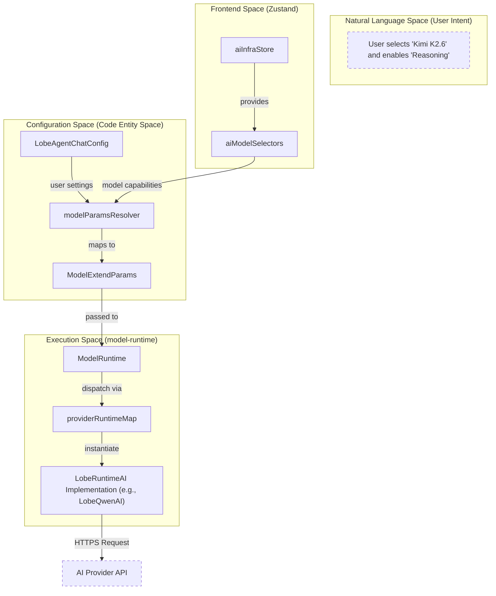

<!-- source: DeepWiki mcp.deepwiki.com · repo lobehub/lobehub · page 3 AI Model Provider Integration · fetched 2026-10-29 -->

# AI Model Provider Integration

Relevant source files

The following files were used as context for generating this wiki page:

- [packages/model-bank/package.json](packages/model-bank/package.json)
- [packages/model-bank/src/aiModels/index.ts](packages/model-bank/src/aiModels/index.ts)
- [packages/model-bank/src/const/modelProvider.ts](packages/model-bank/src/const/modelProvider.ts)
- [packages/model-bank/src/modelProviders/index.test.ts](packages/model-bank/src/modelProviders/index.test.ts)
- [packages/model-bank/src/modelProviders/index.ts](packages/model-bank/src/modelProviders/index.ts)
- [packages/model-runtime/src/core/anthropicCompatibleFactory/handleAnthropicError.ts](packages/model-runtime/src/core/anthropicCompatibleFactory/handleAnthropicError.ts)
- [packages/model-runtime/src/index.ts](packages/model-runtime/src/index.ts)
- [packages/model-runtime/src/runtimeMap.ts](packages/model-runtime/src/runtimeMap.ts)
- [packages/model-runtime/src/types/type.ts](packages/model-runtime/src/types/type.ts)
- [packages/types/src/user/settings/keyVaults.ts](packages/types/src/user/settings/keyVaults.ts)
- [src/routes/(main)/[workspaceSlug]/settings/provider/index.test.tsx](src/routes/(main)/[workspaceSlug]/settings/provider/index.test.tsx)
- [src/routes/(main)/settings/provider/index.tsx](src/routes/(main)/settings/provider/index.tsx)

The AI Model Provider Integration layer is the backbone of LobeHub's multi-model capabilities. It follows a decoupled, two-package architecture designed to separate static model metadata (definitions, pricing, and capabilities) from the execution logic required to interact with various AI provider APIs.

## Architectural Overview

LobeHub separates model concerns into two primary packages:

1.  **`model-bank`**: A registry of static metadata. It defines what models exist, what they can do (vision, tool calling, reasoning), and how much they cost.
2.  **`model-runtime`**: An execution abstraction layer. It provides a unified interface to interact with diverse provider SDKs (OpenAI, Anthropic, Google, etc.) and handles the transformation of LobeHub's internal chat protocol into provider-specific formats.

### Model Integration Pipeline

The following diagram illustrates how a user request flows from the UI through the configuration and execution layers, mapping "Natural Language Space" (User Intent) to "Code Entity Space":

**Chat Execution Flow**

**Sources:** [packages/model-runtime/src/index.ts:1-80](), [packages/model-runtime/src/runtimeMap.ts:87-164](), [packages/types/src/agent/chatConfig.ts:27-201]()

---

## Core Components

### Model Bank and Definitions
The `model-bank` package acts as the "Source of Truth" for model characteristics. It uses TypeScript interfaces like `AIChatModelCard` to define context windows, pricing structures (fixed, tiered, or lookup), and specific abilities like `functionCall`, `vision`, or `reasoning`.

*   **Key Entities**: `AIChatModelCard`, `ModelAbilities`, `Pricing`.
*   **Provider Registries**: Static arrays for providers such as Qwen, Google, and SiliconCloud [packages/model-bank/src/aiModels/index.ts:115-201]().
*   **Pricing Strategies**: Supports `fixed`, `tiered`, and `lookup` strategies to handle complex billing like prompt caching.

For details, see [Model Bank and Definitions](#3.1).

**Sources:** [packages/model-bank/package.json:1-120](), [packages/model-bank/src/aiModels/index.ts:1-207]()

### Model Runtime Layer
The `model-runtime` package abstracts the complexity of different LLM APIs. It defines a standard `ModelRuntime` class that orchestrates requests. It also includes a `RouterRuntime` to handle multi-provider dispatching and fallback logic.

*   **Key Entities**: `ModelRuntime` [packages/model-runtime/src/index.ts:5](), `LobeRuntimeAI` (implemented by classes like `LobeAnthropicAI` [packages/model-runtime/src/index.ts:44]()), error taxonomy utilities [packages/model-runtime/src/index.ts:11-40]().
*   **Capability Detection**: Utilities parse model behaviors and parameters dynamically.

For details, see [Model Runtime Layer](#3.2).

**Sources:** [packages/model-runtime/src/index.ts:1-105]()

### Provider Configuration
Providers are enabled and configured through environment variables and internal mapping tables. The system uses a `providerRuntimeMap` to dispatch requests to the correct implementation.

*   **Dispatch**: The `providerRuntimeMap` maps provider keys to their corresponding implementation classes [packages/model-runtime/src/runtimeMap.ts:87-164]().
*   **Key Handling**: Sensitive credentials like `apiKey`, `baseURL`, and custom authentication parameters are managed via user vaults [packages/types/src/user/settings/keyVaults.ts:1-90]().

For details, see [Provider Configuration](#3.3).

**Sources:** [packages/model-runtime/src/runtimeMap.ts:1-164](), [packages/types/src/user/settings/keyVaults.ts:1-90]()

### Model Localization
To support a global user base, model descriptions and display names are localized. LobeHub uses a structured JSON system where keys follow convention patterns for settings and specific model descriptions.

For details, see [Model Localization](#3.4).

**Sources:** [packages/model-bank/package.json:1-120]()

### Extended Model Parameters
Beyond standard parameters, LobeHub supports "Extended Parameters" like reasoning budgets, thinking levels, and adaptive thinking. These map settings from agent configurations into provider-specific parameters.

*   **Parameters**: Resolved using helpers such as `applyModelExtendParams` [packages/model-runtime/src/index.ts:94-97]() and effective reasoning config helpers [packages/model-runtime/src/index.ts:98-101]().

For details, see [Extended Model Parameters](#3.5).

**Sources:** [packages/model-runtime/src/index.ts:94-102]()

### Image and Video Generation Runtimes
Handling multimodal asset generation via models from providers like Stepfun, Zhipu, and XAI through specific generation pipelines.

For details, see [Image and Video Generation Runtimes](#3.6).

**Sources:** [packages/model-runtime/src/index.ts:1-105]()

---

## Code Entity Mapping

This table bridges high-level system concepts to specific code entities and their locations.

| System Concept | Code Entity | File Path |
| :--- | :--- | :--- |
| **Model Metadata** | `AiFullModelCard` | [packages/model-bank/src/aiModels/index.ts:3]() |
| **Provider Enum** | `ModelProvider` | [packages/model-bank/src/const/modelProvider.ts:1-88]() |
| **Runtime Interface** | `ModelRuntime` | [packages/model-runtime/src/index.ts:5]() |
| **Provider Dispatcher** | `providerRuntimeMap` | [packages/model-runtime/src/runtimeMap.ts:87-164]() |
| **Key Vault Schemas** | `UserKeyVaults` | [packages/types/src/user/settings/keyVaults.ts:88-90]() |
| **Model Parameters** | `applyModelExtendParams` | [packages/model-runtime/src/index.ts:94-97]() |

**Sources:** [packages/model-bank/src/aiModels/index.ts](), [packages/model-bank/src/const/modelProvider.ts](), [packages/model-runtime/src/index.ts](), [packages/model-runtime/src/runtimeMap.ts](), [packages/types/src/user/settings/keyVaults.ts]()

---

