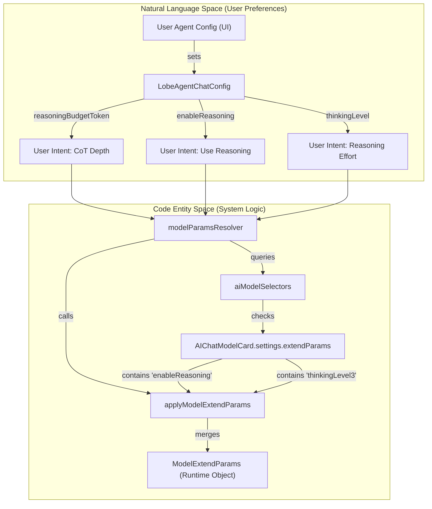
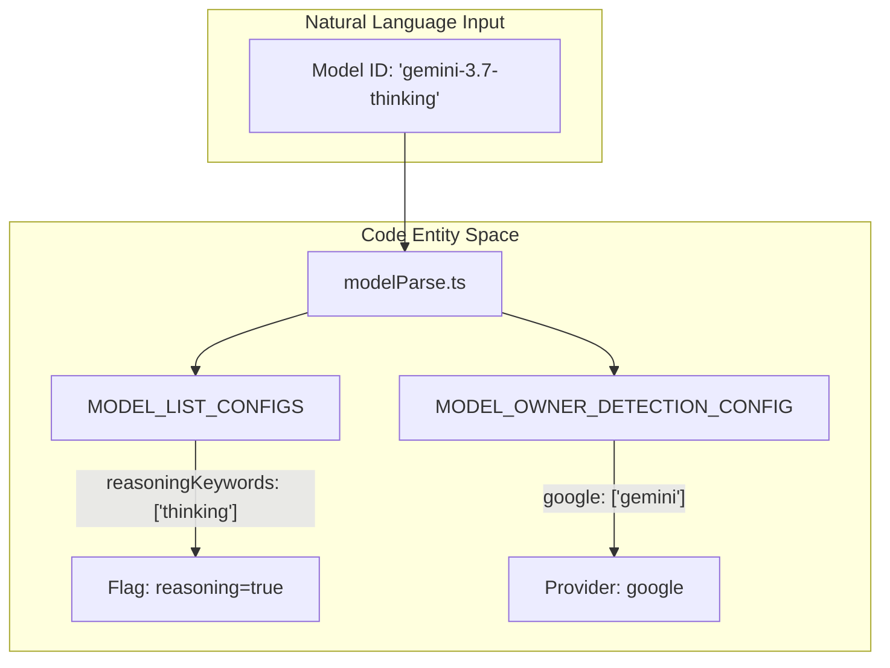

<!-- source: DeepWiki mcp.deepwiki.com · repo lobehub/lobehub · page 3.1 Model Bank and Definitions · fetched 2026-10-29 -->

# Model Bank and Definitions

<details>
<summary>Relevant source files</summary>

The following files were used as context for generating this wiki page:

- [.agents/skills/model-bank-metadata/scripts/apply-cutoffs.ts](.agents/skills/model-bank-metadata/scripts/apply-cutoffs.ts)
- [.agents/skills/model-bank-metadata/scripts/apply-family.ts](.agents/skills/model-bank-metadata/scripts/apply-family.ts)
- [.agents/skills/model-bank-metadata/scripts/extract-model-ids.ts](.agents/skills/model-bank-metadata/scripts/extract-model-ids.ts)
- [apps/server/src/services/agentQuota/__tests__/pricing.test.ts](apps/server/src/services/agentQuota/__tests__/pricing.test.ts)
- [apps/server/src/services/agentQuota/pricing.ts](apps/server/src/services/agentQuota/pricing.ts)
- [locales/en-US/modelProvider.json](locales/en-US/modelProvider.json)
- [locales/zh-CN/modelProvider.json](locales/zh-CN/modelProvider.json)
- [packages/locales/src/default/modelProvider.ts](packages/locales/src/default/modelProvider.ts)
- [packages/locales/src/lobehubOnlineModelDescriptions.test.ts](packages/locales/src/lobehubOnlineModelDescriptions.test.ts)
- [packages/locales/src/lobehubOnlineModelDescriptions.ts](packages/locales/src/lobehubOnlineModelDescriptions.ts)
- [packages/model-bank/src/aiModels/__tests__/index.test.ts](packages/model-bank/src/aiModels/__tests__/index.test.ts)
- [packages/model-bank/src/aiModels/aihubmix.ts](packages/model-bank/src/aiModels/aihubmix.ts)
- [packages/model-bank/src/aiModels/anthropic.ts](packages/model-bank/src/aiModels/anthropic.ts)
- [packages/model-bank/src/aiModels/bedrock.ts](packages/model-bank/src/aiModels/bedrock.ts)
- [packages/model-bank/src/aiModels/cerebras.ts](packages/model-bank/src/aiModels/cerebras.ts)
- [packages/model-bank/src/aiModels/deepseek.ts](packages/model-bank/src/aiModels/deepseek.ts)
- [packages/model-bank/src/aiModels/google/gemini25.ts](packages/model-bank/src/aiModels/google/gemini25.ts)
- [packages/model-bank/src/aiModels/google/index.ts](packages/model-bank/src/aiModels/google/index.ts)
- [packages/model-bank/src/aiModels/groq.ts](packages/model-bank/src/aiModels/groq.ts)
- [packages/model-bank/src/aiModels/infiniai.ts](packages/model-bank/src/aiModels/infiniai.ts)
- [packages/model-bank/src/aiModels/modelscope.ts](packages/model-bank/src/aiModels/modelscope.ts)
- [packages/model-bank/src/aiModels/novita.ts](packages/model-bank/src/aiModels/novita.ts)
- [packages/model-bank/src/aiModels/ollamacloud.ts](packages/model-bank/src/aiModels/ollamacloud.ts)
- [packages/model-bank/src/aiModels/openai.ts](packages/model-bank/src/aiModels/openai.ts)
- [packages/model-bank/src/aiModels/openrouter.ts](packages/model-bank/src/aiModels/openrouter.ts)
- [packages/model-bank/src/aiModels/qwen.ts](packages/model-bank/src/aiModels/qwen.ts)
- [packages/model-bank/src/aiModels/siliconcloud.ts](packages/model-bank/src/aiModels/siliconcloud.ts)
- [packages/model-bank/src/aiModels/vertexai.ts](packages/model-bank/src/aiModels/vertexai.ts)
- [packages/model-bank/src/aiModels/volcengine.ts](packages/model-bank/src/aiModels/volcengine.ts)
- [packages/model-bank/src/aiModels/wenxin.ts](packages/model-bank/src/aiModels/wenxin.ts)
- [packages/model-bank/src/aiModels/xiaomimimo.ts](packages/model-bank/src/aiModels/xiaomimimo.ts)
- [packages/model-bank/src/aiModels/zhipu.ts](packages/model-bank/src/aiModels/zhipu.ts)
- [packages/model-bank/src/modelProviders/xiaomimimo.ts](packages/model-bank/src/modelProviders/xiaomimimo.ts)
- [packages/model-bank/src/types/aiModel.ts](packages/model-bank/src/types/aiModel.ts)
- [packages/model-runtime/src/core/anthropicCompatibleFactory/resolveCacheTTL.ts](packages/model-runtime/src/core/anthropicCompatibleFactory/resolveCacheTTL.ts)
- [packages/model-runtime/src/core/usageConverters/utils/computeChatCost.test.ts](packages/model-runtime/src/core/usageConverters/utils/computeChatCost.test.ts)
- [packages/model-runtime/src/core/usageConverters/utils/computeChatCost.ts](packages/model-runtime/src/core/usageConverters/utils/computeChatCost.ts)
- [packages/model-runtime/src/providers/qwen/index.test.ts](packages/model-runtime/src/providers/qwen/index.test.ts)
- [packages/model-runtime/src/providers/qwen/index.ts](packages/model-runtime/src/providers/qwen/index.ts)
- [packages/model-runtime/src/providers/xiaomimimo/index.test.ts](packages/model-runtime/src/providers/xiaomimimo/index.test.ts)
- [packages/model-runtime/src/providers/xiaomimimo/index.ts](packages/model-runtime/src/providers/xiaomimimo/index.ts)
- [packages/model-runtime/src/providers/zhipu/index.test.ts](packages/model-runtime/src/providers/zhipu/index.test.ts)
- [packages/model-runtime/src/providers/zhipu/index.ts](packages/model-runtime/src/providers/zhipu/index.ts)
- [packages/model-runtime/src/providers/zhipu/modelId.test.ts](packages/model-runtime/src/providers/zhipu/modelId.test.ts)
- [packages/model-runtime/src/providers/zhipu/modelId.ts](packages/model-runtime/src/providers/zhipu/modelId.ts)
- [packages/model-runtime/src/utils/modelExtendParams.test.ts](packages/model-runtime/src/utils/modelExtendParams.test.ts)
- [packages/model-runtime/src/utils/modelExtendParams.ts](packages/model-runtime/src/utils/modelExtendParams.ts)
- [packages/model-runtime/src/utils/modelParse.test.ts](packages/model-runtime/src/utils/modelParse.test.ts)
- [packages/model-runtime/src/utils/modelParse.ts](packages/model-runtime/src/utils/modelParse.ts)
- [packages/types/src/agent/chatConfig.ts](packages/types/src/agent/chatConfig.ts)
- [packages/utils/src/pricing.test.ts](packages/utils/src/pricing.test.ts)
- [packages/utils/src/pricing.ts](packages/utils/src/pricing.ts)
- [src/features/ModelSwitchPanel/components/ControlsForm/ControlsForm.tsx](src/features/ModelSwitchPanel/components/ControlsForm/ControlsForm.tsx)
- [src/features/Settings/provider/features/ModelList/CreateNewModelModal/ExtendParamsSelect.tsx](src/features/Settings/provider/features/ModelList/CreateNewModelModal/ExtendParamsSelect.tsx)
- [src/services/chat/mecha/modelParamsResolver.test.ts](src/services/chat/mecha/modelParamsResolver.test.ts)
- [src/services/chat/mecha/modelParamsResolver.ts](src/services/chat/mecha/modelParamsResolver.ts)

</details>


The `model-bank` package in LobeHub serves as the canonical repository of all supported AI models, defining their metadata, capabilities, pricing details, and provider-specific configurations. This static set of definitions underpins various UI components (such as model selectors) as well as runtime logic for API requests and cost calculations.

## Core Data Structures

The key data structures, types, and enumerations are defined primarily in the file `packages/model-bank/src/types/aiModel.ts`.

### Model Card Types

Models in LobeHub are described through a hierarchy of type interfaces:

- **`AIBaseModelCard`**:  
  This interface contains core metadata fields common to all AI models, including:
  - `id`: unique model identifier string  
  - `displayName`: human-readable model name  
  - `description`: textual description of model capabilities  
  - `contextWindowTokens`: the maximum input context length in tokens  
  - `knowledgeCutoff`: latest knowledge update date (e.g., '2026-06')  
  - Other optional fields (e.g., `family`, `generation`, `enabled`)  
  [[packages/model-bank/src/types/aiModel.ts:251-290]]()

- **`AIChatModelCard`** (extends `AIBaseModelCard`):  
  Augments the base card with specific chat-related attributes:
  - `abilities`: flags representing supported features like function calling or vision  
  - `pricing`: detailed pricing information per unit and strategy  
  - `maxOutput`: maximum output tokens supported  
  - `settings`: additional model settings including extendParams  
  - `type`: model type enum, usually `'chat'` for chat models  
  [[packages/model-bank/src/types/aiModel.ts:331-336]]()

- **`AiModelType`**:  
  An enumerated type covering all AI model categories supported, including:
  - `'chat'`, `'embedding'`, `'tts'` (text-to-speech), `'asr'` (automatic speech recognition),  
  `'image'`, `'video'`, `'text2music'`, `'realtime'`  
  [[packages/model-bank/src/types/aiModel.ts:15-26]]()

### Model Abilities Flags

To describe supported model capabilities, LobeHub uses `ModelAbilities`, which contains boolean flags. These drive UI features and API behavior adaptations:

| Flag            | Description                                      |
|-----------------|------------------------------------------------|
| `functionCall`  | Supports tool use and LLM function calling     |
| `vision`        | Supports image input understanding              |
| `reasoning`     | Supports Chain-of-Thought or advanced reasoning|
| `search`        | Supports built-in web/search integration        |
| `structuredOutput` | Supports JSON or constrained outputs           |
| `audio`         | Supports audio input                             |
| `video`         | Supports video input                             |
| `imageOutput`   | Supports image output                            |

These flags are optional and can be combined per model [[packages/model-bank/src/types/aiModel.ts:45-82]]().

---

## Pricing Structures

LobeHub defines a comprehensive pricing system supporting multiple strategies and granular pricing units for usage accounting and billing.

### Pricing Strategy Types

Pricing for an AI model is specified as an array of `PricingUnit` entries, each describing how a particular usage type is billed. The supported pricing strategies are:

1. **Fixed**:  
   A flat rate per unit usage, e.g., `$10 per million tokens`  
   Used for many providers and models like SiliconCloud models [[packages/model-bank/src/aiModels/siliconcloud.ts:22-27]]().

2. **Tiered**:  
   Rates change depending on usage tiers, e.g.:  
   - For Google Gemini, lower rates apply up to threshold tokens, then higher rates beyond [[packages/model-bank/src/aiModels/google.ts:37-60]]().

3. **Lookup**:  
   Prices depend on lookup parameters such as TTL or range, with a price table, e.g., Qwen's `textInput_cacheWrite` pricing [[packages/model-bank/src/aiModels/qwen.ts:138-162]](), Google cache writes [[packages/model-bank/src/aiModels/google.ts:97-101]]().

### Pricing Units

Pricing units enumerate billable activities and their granularity:

| Unit Name              | Description                        | Unit Type               |
|------------------------|----------------------------------|------------------------|
| `textInput`            | Input tokens                     | `millionTokens` (per 1M)|
| `textOutput`           | Output tokens                    | `millionTokens`          |
| `textInput_cacheRead`  | Input tokens from cache read     | `millionTokens`          |
| `textInput_cacheWrite` | Input tokens for cache writing   | `millionTokens`          |
| `audioInput`           | Audio inputs                    | `millionTokens` or `millionCharacters` |
| `audioOutput`          | Audio output tokens             | `millionTokens` or `millionCharacters` |
| `imageGeneration`      | Image generation requests        | `image`                  |
| `videoGeneration`      | Video generation requests        | `video`                  |

Units may differ depending on model type (chat, image, audio, video) [[packages/model-bank/src/types/aiModel.ts:153-173]]().

---

## Model Settings and Extended Parameters

AI models expose additional settings and extended parameters that influence UI controls and runtime execution logic.

### `AiModelSettings`

This interface encapsulates settings per model card, including:

- `extendParams`: string array of supported extended parameter keys  
- `disabledParams`: strings of parameters disabled for this model  
- `searchImpl`: which method the model uses for search integration ('params', 'embedding', etc.) [[packages/model-bank/src/types/aiModel.ts:292-329]]().

### ExtendParams Usage

`extendParams` represents fine-grained toggles or parameters allowing models to expose advanced capabilities (e.g., custom reasoning effort flags, thinking preservation). These are consumed by UI components and runtime resolvers.

The runtime uses the `modelParamsResolver` module (`src/services/chat/mecha/modelParamsResolver.ts`) to map user-facing config fields (`LobeAgentChatConfig` in packages/types) into provider-specific API parameters based on these extensions [[src/services/chat/mecha/modelParamsResolver.ts:30-47]](), [[packages/types/src/agent/chatConfig.ts:134-142]]().

---

## Model Parameter Transformation Flow

The diagram below depicts how user-configured natural language preferences in `LobeAgentChatConfig` are translated through resolvers and selectors into runtime model parameters leveraged by the model-runtime for request construction:



Here:  
- `LobeAgentChatConfig` is the user-facing configuration model containing flags and tuneables.  
- `modelParamsResolver` examines the AI model card's `extendParams` and current user config to produce the exact parameters used at runtime.  
- `aiModelSelectors` facilitate querying model metadata to inform this translation. 

**Sources:**  
[[src/services/chat/mecha/modelParamsResolver.ts:30-47]](), [[packages/types/src/agent/chatConfig.ts:27-201]](), [[packages/model-bank/src/types/aiModel.ts:301]]()

---

## Per-Provider Model Definitions

Each AI model provider has a dedicated module exporting an array of strongly-typed model cards representing the provider's catalog.

### Notable Providers and Their Model Arrays

| Provider      | Array Name                    | Description/Notes                                    |
|---------------|-------------------------------|-----------------------------------------------------|
| **Qwen**      | `qwenChatModels`               | Detailed, advanced pricing including `lookup` tiers; support for mixed-effort reasoning modes and extended params [[packages/model-bank/src/aiModels/qwen.ts:9-199]](). |
| **Google**    | `geminiChatModels` (in `google` subfolder) | Complex tiered pricing; includes specialized params for reasoning levels, multi-modal models [[packages/model-bank/src/aiModels/google/index.ts:..]](). |
| **SiliconCloud** | `siliconcloudChatModels`    | Includes Meituan's LongCat and Nex-AGI's Nex-N2 models; uses fixed pricing [[packages/model-bank/src/aiModels/siliconcloud.ts:8-60]](). |
| **AIHubMix**  | `aihubmixChatModels`           | Frontier GPT models (GPT-5.5, GPT-6, etc.) with tiered pricing [[packages/model-bank/src/aiModels/aihubmix.ts:4-244]](). |
| **DeepSeek**  | `deepseekChatModels`           | Ultra-large MoE long-context models supporting hybrid thinking, tiers for reasoning effort [[packages/model-bank/src/aiModels/deepseek.ts:...]](). |
| **Anthropic** | `anthropicChatModels`           | Claude brand models with tiered and lookup pricing; special `extendParams` such as `disableContextCaching` [[packages/model-bank/src/aiModels/anthropic.ts:3-179]](). |
| **OpenAI**    | `openaiChatModels`              | GPT-6 Astra and related models, advanced tiered pricing, reasoning and verbosity parameters [[packages/model-bank/src/aiModels/openai.ts:12-242]](). |

These arrays hold concrete static definitions used by LobeHub UI and runtime layers.

### Automatic Capability Detection at Runtime

For dynamically loaded or custom models, `model-runtime` implements a keyword-based detection system (`MODEL_LIST_CONFIGS`) that scans model IDs to assign capabilities like `functionCall` or `vision` based on substring matches. This facilitates partial support for unknown or externally added models [[packages/model-runtime/src/utils/modelParse.ts:31-169]]().

Diagram illustrating runtime model parsing and assignment:



**Sources:**  
[[packages/model-runtime/src/utils/modelParse.ts:31-169]](), [[packages/model-runtime/src/utils/modelParse.ts:172-194]]()

---

## Model Localization

LobeHub supports multi-language localization of model descriptions and provider names via JSON files under `locales/*/models.json` and `locales/*/modelProvider.json`. These files use keys in the format:

```
<providerId>.<modelId>.description
<providerId>.<modelId>.displayName
```

### Localization Highlights

- English locale provides technical descriptions suitable globally [[locales/en-US/models.json]]().  
- Chinese locale includes detailed provider histories and special technical notes [[locales/zh-CN/models.json]]().  
- The system supports popular languages like Japanese, French, Korean, and Arabic (not fully shown here).

The frontend dynamically loads localized descriptions when rendering model selectors, ensuring contextual and regional user experience.

**Sources:**  
[[locales/en-US/models.json]](), [[locales/zh-CN/models.json]](), [[locales/en-US/modelProvider.json]](), [[locales/zh-CN/modelProvider.json]]()

---

# Summary

The `model-bank` package is the definitive static database of all AI models in LobeHub, specifying each model's identity, capabilities, pricing schema, extended parameters, and localized descriptions. It interfaces closely with the `model-runtime` package which uses these definitions combined with runtime heuristics to compose queries and optimize AI interactions.

This page covers:

- Core model card types and ability flags  
- Complex pricing model structures and unit strategies  
- Extended model settings and user-configurable parameters  
- Arrays of per-provider model definitions and examples  
- Dynamic model capability detection in runtime  
- Multi-language model info localization  

Together, these elements provide a full technical foundation for supporting diverse AI providers and models in LobeHub's multi-model agent framework.

---

# File References

- [`packages/model-bank/src/types/aiModel.ts:1-239,251-336`]()  
- [`src/services/chat/mecha/modelParamsResolver.ts:30-47`]()  
- [`packages/types/src/agent/chatConfig.ts:13-199`]()  
- [`packages/model-bank/src/aiModels/qwen.ts:1-199`]()  
- [`packages/model-bank/src/aiModels/google/index.ts` (not fully shown)]()  
- [`packages/model-bank/src/aiModels/siliconcloud.ts:1-150`]()  
- [`packages/model-bank/src/aiModels/aihubmix.ts:1-244`]()  
- [`packages/model-bank/src/aiModels/anthropic.ts:1-179`]()  
- [`packages/model-bank/src/aiModels/openai.ts:1-242`]()  
- [`packages/model-runtime/src/utils/modelParse.ts:1-169,172-194`]()  
- [`locales/en-US/models.json`](not fully shown)  
- [`locales/zh-CN/models.json`](not fully shown)  
- [`locales/en-US/modelProvider.json`](not fully shown)  
- [`locales/zh-CN/modelProvider.json`](not fully shown)

---

