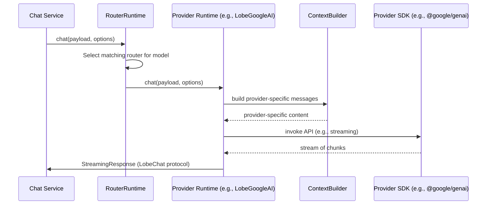

<!-- source: DeepWiki mcp.deepwiki.com · repo lobehub/lobehub · page 3.2 Model Runtime Layer · fetched 2026-10-29 -->

# Model Runtime Layer

<details>
<summary>Relevant source files</summary>

The following files were used as context for generating this wiki page:

- [apps/server/src/modules/AgentRuntime/formatErrorForState.test.ts](apps/server/src/modules/AgentRuntime/formatErrorForState.test.ts)
- [apps/server/src/modules/AgentRuntime/formatErrorForState.ts](apps/server/src/modules/AgentRuntime/formatErrorForState.ts)
- [locales/en-US/modelRuntime.json](locales/en-US/modelRuntime.json)
- [locales/zh-CN/modelRuntime.json](locales/zh-CN/modelRuntime.json)
- [packages/locales/src/default/modelRuntime.ts](packages/locales/src/default/modelRuntime.ts)
- [packages/model-bank/src/aiModels/azure.ts](packages/model-bank/src/aiModels/azure.ts)
- [packages/model-bank/src/aiModels/chatGPT.ts](packages/model-bank/src/aiModels/chatGPT.ts)
- [packages/model-bank/src/aiModels/nebius.ts](packages/model-bank/src/aiModels/nebius.ts)
- [packages/model-bank/src/aiModels/superGrok.ts](packages/model-bank/src/aiModels/superGrok.ts)
- [packages/model-bank/src/aiModels/vercelaigateway.ts](packages/model-bank/src/aiModels/vercelaigateway.ts)
- [packages/model-runtime/src/core/BaseAI.ts](packages/model-runtime/src/core/BaseAI.ts)
- [packages/model-runtime/src/core/ModelRuntime.test.ts](packages/model-runtime/src/core/ModelRuntime.test.ts)
- [packages/model-runtime/src/core/ModelRuntime.ts](packages/model-runtime/src/core/ModelRuntime.ts)
- [packages/model-runtime/src/core/RouterRuntime/createRuntime.test.ts](packages/model-runtime/src/core/RouterRuntime/createRuntime.test.ts)
- [packages/model-runtime/src/core/RouterRuntime/createRuntime.ts](packages/model-runtime/src/core/RouterRuntime/createRuntime.ts)
- [packages/model-runtime/src/core/anthropicCompatibleFactory/generateObject.test.ts](packages/model-runtime/src/core/anthropicCompatibleFactory/generateObject.test.ts)
- [packages/model-runtime/src/core/anthropicCompatibleFactory/generateObject.ts](packages/model-runtime/src/core/anthropicCompatibleFactory/generateObject.ts)
- [packages/model-runtime/src/core/anthropicCompatibleFactory/index.test.ts](packages/model-runtime/src/core/anthropicCompatibleFactory/index.test.ts)
- [packages/model-runtime/src/core/anthropicCompatibleFactory/index.ts](packages/model-runtime/src/core/anthropicCompatibleFactory/index.ts)
- [packages/model-runtime/src/core/anthropicCompatibleFactory/resolveMaxTokens.ts](packages/model-runtime/src/core/anthropicCompatibleFactory/resolveMaxTokens.ts)
- [packages/model-runtime/src/core/anthropicCompatibleFactory/resolveThinkingConfig.test.ts](packages/model-runtime/src/core/anthropicCompatibleFactory/resolveThinkingConfig.test.ts)
- [packages/model-runtime/src/core/anthropicCompatibleFactory/resolveThinkingConfig.ts](packages/model-runtime/src/core/anthropicCompatibleFactory/resolveThinkingConfig.ts)
- [packages/model-runtime/src/core/contextBuilders/anthropic.test.ts](packages/model-runtime/src/core/contextBuilders/anthropic.test.ts)
- [packages/model-runtime/src/core/contextBuilders/anthropic.ts](packages/model-runtime/src/core/contextBuilders/anthropic.ts)
- [packages/model-runtime/src/core/contextBuilders/google.test.ts](packages/model-runtime/src/core/contextBuilders/google.test.ts)
- [packages/model-runtime/src/core/contextBuilders/google.ts](packages/model-runtime/src/core/contextBuilders/google.ts)
- [packages/model-runtime/src/core/contextBuilders/openai.test.ts](packages/model-runtime/src/core/contextBuilders/openai.test.ts)
- [packages/model-runtime/src/core/contextBuilders/openai.ts](packages/model-runtime/src/core/contextBuilders/openai.ts)
- [packages/model-runtime/src/core/openaiCompatibleFactory/createImage.ts](packages/model-runtime/src/core/openaiCompatibleFactory/createImage.ts)
- [packages/model-runtime/src/core/openaiCompatibleFactory/generateObject.test.ts](packages/model-runtime/src/core/openaiCompatibleFactory/generateObject.test.ts)
- [packages/model-runtime/src/core/openaiCompatibleFactory/index.test.ts](packages/model-runtime/src/core/openaiCompatibleFactory/index.test.ts)
- [packages/model-runtime/src/core/openaiCompatibleFactory/index.ts](packages/model-runtime/src/core/openaiCompatibleFactory/index.ts)
- [packages/model-runtime/src/core/parameterResolver.test.ts](packages/model-runtime/src/core/parameterResolver.test.ts)
- [packages/model-runtime/src/core/parameterResolver.ts](packages/model-runtime/src/core/parameterResolver.ts)
- [packages/model-runtime/src/core/usageConverters/index.ts](packages/model-runtime/src/core/usageConverters/index.ts)
- [packages/model-runtime/src/errors/classifier.ts](packages/model-runtime/src/errors/classifier.ts)
- [packages/model-runtime/src/errors/match.test.ts](packages/model-runtime/src/errors/match.test.ts)
- [packages/model-runtime/src/errors/match.ts](packages/model-runtime/src/errors/match.ts)
- [packages/model-runtime/src/errors/patterns.ts](packages/model-runtime/src/errors/patterns.ts)
- [packages/model-runtime/src/errors/refine.test.ts](packages/model-runtime/src/errors/refine.test.ts)
- [packages/model-runtime/src/errors/refine.ts](packages/model-runtime/src/errors/refine.ts)
- [packages/model-runtime/src/errors/specs.ts](packages/model-runtime/src/errors/specs.ts)
- [packages/model-runtime/src/errors/taxonomy.ts](packages/model-runtime/src/errors/taxonomy.ts)
- [packages/model-runtime/src/providerTestUtils.ts](packages/model-runtime/src/providerTestUtils.ts)
- [packages/model-runtime/src/providers/anthropic/index.test.ts](packages/model-runtime/src/providers/anthropic/index.test.ts)
- [packages/model-runtime/src/providers/anthropic/index.ts](packages/model-runtime/src/providers/anthropic/index.ts)
- [packages/model-runtime/src/providers/anthropic/modelId.test.ts](packages/model-runtime/src/providers/anthropic/modelId.test.ts)
- [packages/model-runtime/src/providers/anthropic/modelId.ts](packages/model-runtime/src/providers/anthropic/modelId.ts)
- [packages/model-runtime/src/providers/azureOpenai/index.test.ts](packages/model-runtime/src/providers/azureOpenai/index.test.ts)
- [packages/model-runtime/src/providers/azureOpenai/index.ts](packages/model-runtime/src/providers/azureOpenai/index.ts)
- [packages/model-runtime/src/providers/azureai/index.ts](packages/model-runtime/src/providers/azureai/index.ts)
- [packages/model-runtime/src/providers/bedrock/index.test.ts](packages/model-runtime/src/providers/bedrock/index.test.ts)
- [packages/model-runtime/src/providers/bedrock/index.ts](packages/model-runtime/src/providers/bedrock/index.ts)
- [packages/model-runtime/src/providers/cloudflare/index.test.ts](packages/model-runtime/src/providers/cloudflare/index.test.ts)
- [packages/model-runtime/src/providers/cloudflare/index.ts](packages/model-runtime/src/providers/cloudflare/index.ts)
- [packages/model-runtime/src/providers/deepseek/__tests__/anthropic.test.ts](packages/model-runtime/src/providers/deepseek/__tests__/anthropic.test.ts)
- [packages/model-runtime/src/providers/deepseek/__tests__/generateObject.test.ts](packages/model-runtime/src/providers/deepseek/__tests__/generateObject.test.ts)
- [packages/model-runtime/src/providers/deepseek/__tests__/index.test.ts](packages/model-runtime/src/providers/deepseek/__tests__/index.test.ts)
- [packages/model-runtime/src/providers/deepseek/__tests__/modelFetch.test.ts](packages/model-runtime/src/providers/deepseek/__tests__/modelFetch.test.ts)
- [packages/model-runtime/src/providers/deepseek/__tests__/openaiPayload.test.ts](packages/model-runtime/src/providers/deepseek/__tests__/openaiPayload.test.ts)
- [packages/model-runtime/src/providers/deepseek/chatPayload.test.ts](packages/model-runtime/src/providers/deepseek/chatPayload.test.ts)
- [packages/model-runtime/src/providers/deepseek/chatPayload.ts](packages/model-runtime/src/providers/deepseek/chatPayload.ts)
- [packages/model-runtime/src/providers/deepseek/generateObject.ts](packages/model-runtime/src/providers/deepseek/generateObject.ts)
- [packages/model-runtime/src/providers/deepseek/index.ts](packages/model-runtime/src/providers/deepseek/index.ts)
- [packages/model-runtime/src/providers/deepseek/modelFetch.ts](packages/model-runtime/src/providers/deepseek/modelFetch.ts)
- [packages/model-runtime/src/providers/deepseek/runtimeModels.ts](packages/model-runtime/src/providers/deepseek/runtimeModels.ts)
- [packages/model-runtime/src/providers/google/createImage.test.ts](packages/model-runtime/src/providers/google/createImage.test.ts)
- [packages/model-runtime/src/providers/google/createImage.ts](packages/model-runtime/src/providers/google/createImage.ts)
- [packages/model-runtime/src/providers/google/generateObject.test.ts](packages/model-runtime/src/providers/google/generateObject.test.ts)
- [packages/model-runtime/src/providers/google/generateObject.ts](packages/model-runtime/src/providers/google/generateObject.ts)
- [packages/model-runtime/src/providers/google/index.test.ts](packages/model-runtime/src/providers/google/index.test.ts)
- [packages/model-runtime/src/providers/google/index.ts](packages/model-runtime/src/providers/google/index.ts)
- [packages/model-runtime/src/providers/google/modelId.test.ts](packages/model-runtime/src/providers/google/modelId.test.ts)
- [packages/model-runtime/src/providers/google/modelId.ts](packages/model-runtime/src/providers/google/modelId.ts)
- [packages/model-runtime/src/providers/google/thinkingResolver.test.ts](packages/model-runtime/src/providers/google/thinkingResolver.test.ts)
- [packages/model-runtime/src/providers/google/thinkingResolver.ts](packages/model-runtime/src/providers/google/thinkingResolver.ts)
- [packages/model-runtime/src/providers/openai/index.test.ts](packages/model-runtime/src/providers/openai/index.test.ts)
- [packages/model-runtime/src/providers/openai/index.ts](packages/model-runtime/src/providers/openai/index.ts)
- [packages/model-runtime/src/providers/openai/modelId.test.ts](packages/model-runtime/src/providers/openai/modelId.test.ts)
- [packages/model-runtime/src/providers/openai/modelId.ts](packages/model-runtime/src/providers/openai/modelId.ts)
- [packages/model-runtime/src/providers/openrouter/index.test.ts](packages/model-runtime/src/providers/openrouter/index.test.ts)
- [packages/model-runtime/src/providers/openrouter/index.ts](packages/model-runtime/src/providers/openrouter/index.ts)
- [packages/model-runtime/src/providers/openrouter/type.ts](packages/model-runtime/src/providers/openrouter/type.ts)
- [packages/model-runtime/src/providers/vercelaigateway/index.test.ts](packages/model-runtime/src/providers/vercelaigateway/index.test.ts)
- [packages/model-runtime/src/providers/vercelaigateway/index.ts](packages/model-runtime/src/providers/vercelaigateway/index.ts)
- [packages/model-runtime/src/types/error.ts](packages/model-runtime/src/types/error.ts)
- [packages/model-runtime/src/types/image.ts](packages/model-runtime/src/types/image.ts)
- [packages/model-runtime/src/types/index.ts](packages/model-runtime/src/types/index.ts)
- [packages/model-runtime/src/types/structureOutput.ts](packages/model-runtime/src/types/structureOutput.ts)
- [packages/model-runtime/src/types/video.ts](packages/model-runtime/src/types/video.ts)
- [packages/model-runtime/src/utils/googleErrorParser.test.ts](packages/model-runtime/src/utils/googleErrorParser.test.ts)
- [packages/model-runtime/src/utils/googleErrorParser.ts](packages/model-runtime/src/utils/googleErrorParser.ts)
- [packages/model-runtime/src/utils/handleOpenAIError.test.ts](packages/model-runtime/src/utils/handleOpenAIError.test.ts)
- [packages/model-runtime/src/utils/handleOpenAIError.ts](packages/model-runtime/src/utils/handleOpenAIError.ts)
- [packages/model-runtime/src/utils/isErrorCausedByContentFilter.ts](packages/model-runtime/src/utils/isErrorCausedByContentFilter.ts)
- [packages/model-runtime/src/utils/routeFallback.test.ts](packages/model-runtime/src/utils/routeFallback.test.ts)
- [packages/model-runtime/src/utils/sanitizeError.test.ts](packages/model-runtime/src/utils/sanitizeError.test.ts)
- [packages/model-runtime/src/utils/sanitizeError.ts](packages/model-runtime/src/utils/sanitizeError.ts)
- [packages/types/src/agentRuntime.ts](packages/types/src/agentRuntime.ts)
- [packages/types/src/aiChat.ts](packages/types/src/aiChat.ts)
- [packages/types/src/openai/chat.ts](packages/types/src/openai/chat.ts)
- [packages/utils/src/error.ts](packages/utils/src/error.ts)
- [packages/utils/src/index.ts](packages/utils/src/index.ts)

</details>


The Model Runtime Layer, encapsulated in the `model-runtime` package, provides a unified, extensible, and robust interface for interacting with a variety of AI model providers. It abstracts away the differences and complexities of provider-specific SDKs and API protocols into consistent, high-level asynchronous methods for chat completions, streaming responses, image and video generation, embeddings, speech-to-text, and structured JSON generation.

---

## Overview

The primary goal of the Model Runtime Layer is to enable LobeHub to seamlessly integrate multiple AI model providers (e.g. OpenAI, Google, Anthropic, Bedrock, Moonshot, and custom endpoints) under a consistent runtime interface. This enables the rest of the system to invoke LLM features without worrying about heterogeneous provider details.

Key components and responsibilities include:

- Defining the universal `LobeRuntimeAI` interface implemented by each provider runtime.
- Implementing separate factories for creating OpenAI-compatible and Anthropic-compatible runtimes.
- Concrete provider runtime classes such as `LobeOpenAI`, `LobeGoogleAI`, `LobeAnthropicAI`.
- The `RouterRuntime` which dynamically dispatches calls to the right provider runtime based on model, routing rules, and fallback logic.
- A standardized error taxonomy with `AgentRuntimeErrorType` for consistent error handling.
- Utility functions for parsing and detecting model providers and transforming raw responses to streams.
- Signature scope and channel ID creation for runtime diagnostic isolation.
- Robust support for streaming transformations and reconciling provider differences in streaming protocols.
- Management of extended parameters like reasoning effort and thinking budgets.

This layer powers LobeHub’s multi-provider support and makes it simple to add new AI providers or route calls dynamically.

---

## Core Architecture and Data Flow

The architecture reflects a layered structure where external clients talk to the `RouterRuntime` which acts as a dispatcher, forwarding requests to a concrete provider runtime underlying factory. Provider runtimes implement the `LobeRuntimeAI` interface, encapsulating concrete API calls and protocol conversions.

### Runtime Entity Mapping: Natural Language to Code Entities

```mermaid
graph TD
    subgraph "Interface Layer"
        LRAI["LobeRuntimeAI (Interface)"]
    end

    subgraph "Factory Layer"
        OCF["openaiCompatibleFactory (createOpenAICompatibleRuntime)"]
        ACF["anthropicCompatibleFactory (createAnthropicCompatibleRuntime)"]
    end

    subgraph "Provider Implementations"
        LOpenAI["LobeOpenAI (OpenAI)"]
        LGoogle["LobeGoogleAI (Google Gemini)"]
        LAnthropic["LobeAnthropicAI (Anthropic Claude)"]
        LBedrock["LobeBedrockAI (AWS Bedrock)"]
        LMoonshot["LobeMoonshotAI (Moonshot)"]
    end

    subgraph "Router Layer"
        RR["RouterRuntime"]
        UR["UniformRuntime"]
    end

    LRAI <|.. LOpenAI
    LRAI <|.. LGoogle
    LRAI <|.. LAnthropic
    LRAI <|.. LBedrock
    LRAI <|.. LMoonshot

    OCF --> LOpenAI
    ACF --> LAnthropic

    UR -. implements .-> LRAI

    RR --> UR
```

This diagram maps natural language concepts like "OpenAI compatible runtime" to specific code entities such as `createOpenAICompatibleRuntime` function, and how the `RouterRuntime` composes and dispatches to these runtimes.

### Request Execution Flow



This flow shows the dynamic routing and protocol normalization steps for a chat request, using Google Gemini as an example.

Sources:  
- [packages/model-runtime/src/core/BaseAI.ts:1-21]()  
- [packages/model-runtime/src/core/openaiCompatibleFactory/index.ts:126-150]()  
- [packages/model-runtime/src/core/RouterRuntime/createRuntime.ts:112-124]()  
- [packages/model-runtime/src/providers/google/index.ts:150-191]()  
- [packages/model-runtime/src/core/contextBuilders/google.ts:168-240]()  

---

## Key Components

### 1. LobeRuntimeAI Interface

At the heart of the runtime layer, `LobeRuntimeAI` defines an interface all providers implement. It defines methods such as:

- `chat(payload: ChatStreamPayload, options?: ChatMethodOptions): Promise<Response | any>`
- `models(): Promise<ChatModelCard[]>`
- `embeddings(payload: EmbeddingsPayload): Promise<any>`
- `textToSpeech(payload: TextToSpeechPayload): Promise<any>`
- `createImage(payload: CreateImagePayload, options?: CreateImageMethodOptions): Promise<CreateImageResponse>`
- `createVideo(payload: CreateVideoPayload, options?: CreateVideoMethodOptions): Promise<CreateVideoResult>`
- `generateObject(payload: GenerateObjectPayload, options?: GenerateObjectOptions): Promise<any>`
- `asr(payload: ASRPayload, options?: ASROptions): Promise<ASRResponse>`

This interface allows uniform invocation of any provider implementation without leaking provider-specific details to upper layers.

Source:  
- [packages/model-runtime/src/core/BaseAI.ts:1-21]()  

---

### 2. OpenAI Compatible Factory (`openaiCompatibleFactory`)

The OpenAI compatible factory is a higher-order function (`createOpenAICompatibleRuntime`) that produces runtimes for providers implementing the OpenAI API (chat completions, images, videos, embeddings, etc.) or compatible protocols. Examples include Groq, DeepSeek, Moonshot, TogetherAI.

Key features:

- **Model ID Mapping:** Supports translating logical model names to physical provider model IDs using `modelIdMapping` options.
- **Reasoning Effort Support:** Handles specialized parameters such as `reasoning_effort` (e.g., GPT-o1/o3) and `reasoning_content` to support advanced reasoning-aware models.
- **Diagnostics:** Integrates detailed diagnostic observability capturing provider request, response metadata, headers like `cf-ray` for Cloudflare tracing, and streaming events count.
- **Error Handling:** Detects provider-specific errors such as unsupported `response_format: 'json_schema'` and refines errors into `AgentRuntimeErrorType` codes.
- **Image & Video Generation:** Supports creating images/videos using OpenAI-compatible endpoints via dedicated methods like `createOpenAICompatibleImage` and `createOpenAICompatibleVideo`.
- **Streaming Transform:** Converts streaming and non-streaming API response shapes into the LobeHub SSE protocol.

This factory generates the concrete `LobeOpenAI` class instances.

Source:  
- [packages/model-runtime/src/core/openaiCompatibleFactory/index.ts]()  

---

### 3. Anthropic Compatible Factory (`anthropicCompatibleFactory`)

The Anthropic compatible factory (`createAnthropicCompatibleRuntime`) similarly creates runtimes for providers implementing Anthropic's Message API model, e.g., Claude.

Key features:

- **Custom Payload Builders:** Uses Anthropic-specific message builders (`buildAnthropicMessages`) to convert LobeChat's internal messages into Anthropic-compatible format.
- **Context Caching:** Implements ephemeral cache control to optimize repeated requests.
- **Thinking Budget Support:** Supports Claude 3.7+ thinking capabilities by resolving inclusive `max_tokens` that incorporate the thinking budget.
- **Assistant Prefill Handling:** Strips unsupported assistant prefill fields for certain Claude models.
- **Structured Output Generation:** Provides features to generate structured JSON objects via `createAnthropicGenerateObject`.
- **Diagnostic and Error Observation:** Similar detailed diagnostics and error handling tailored for Anthropic APIs.

Source:  
- [packages/model-runtime/src/core/anthropicCompatibleFactory/index.ts]()  
- [packages/model-runtime/src/core/anthropicCompatibleFactory/generateObject.ts]()  

---

### 4. Provider Implementations

#### a. Google Gemini (`LobeGoogleAI`)

- Implements the `LobeRuntimeAI` interface using Google’s Generative AI SDK (`@google/genai`).
- Converts LobeHub messages into Google's `Content` message parts with `buildGoogleMessages`.
- Utilizes a magic `thoughtSignature` value (`skip_thought_signature_validator`) to bypass Gemini thought signature validation, especially needed for Vertex AI compatibility.
- Supports advanced Gemini thinking configurations with `resolveGoogleThinkingConfig`.
- Handles multimodal inputs by converting `image_url`, `video_url`, and `audio_url` messages to Google-compatible `inlineData` (base64) or `fileData` (external URI) depending on model capabilities.
- Provides methods for structured outputs (`createGoogleGenerateObject`), video creation, and transcription.
- Handles error classifications and diagnostics specific to Google's API model.

Source:  
- [packages/model-runtime/src/providers/google/index.ts]()  
- [packages/model-runtime/src/core/contextBuilders/google.ts]()  

#### b. Anthropic Claude (`LobeAnthropicAI`)

- Wraps Anthropic's official SDK (`@anthropic-ai/sdk`).
- Builds Anthropic-specific message payloads and tools with `buildAnthropicMessages` and `buildAnthropicTools`.
- Includes model-specific handling such as stripping unsupported assistant prefill.
- Leverages the Anthropic-compatible factory for runtime creation.
- Supports streaming and non-streaming variants, error observability, and structured object generation.

Source:  
- [packages/model-runtime/src/providers/anthropic/index.ts]()  
- [packages/model-runtime/src/core/contextBuilders/anthropic.ts]()  

#### c. OpenAI (`LobeOpenAI`)

- Uses the official OpenAI SDK (`openai`).
- Converts messages and response data using the openai-compatible context builders.
- Enhanced support for OpenAI's GPT Pro/Responses API variants with reasoning effort parameters.
- Image & video generation via DALL-E 3 and other openai-compatible paths.
- Supports rich diagnostic capture of requests and responses.

Source:  
- [packages/model-runtime/src/providers/openai/index.ts]()  
- [packages/model-runtime/src/core/contextBuilders/openai.ts]()  

#### d. Bedrock, Moonshot, and others

- Integrations for AWS Bedrock and Moonshot AI follow similar patterns with respective model ID mappings.

Source:  
- [packages/model-runtime/src/providers/bedrock/index.ts]()  

---

### 5. RouterRuntime

`RouterRuntime` is a key dispatcher runtime that multiplexes chat and other calls across multiple backend routers and channels according to configured weights, runtime implementations, and model coverage.

Responsibilities:

- **Dynamic Provider Selection:** Routes requests to the correct runtime implementation based on requested model or routing criteria.
- **Fallback Handling:** If a provider fails or returns a retryable error, `RouterRuntime` falls back to alternate providers in configured priority order.
- **Route Attempt Metadata:** Captures detailed statistics including duration, success, API type, channel id, and option index for observability.
- **Routing Guards:** Enforces runtime rules such as mandating non-empty router arrays, runtime-level options merges, and metadata injection.
- **Development Safety:** In development mode, throws errors if mandatory `trigger` or `user` metadata is missing for `lobehub`-managed runtimes.
- **Request Context Awareness:** Supports passing `RouterRuntimeRequestContext` metadata for enhanced routing decisions (e.g. pricing context).

Source:  
- [packages/model-runtime/src/core/RouterRuntime/createRuntime.ts]()  
- [packages/model-runtime/src/core/RouterRuntime/createRuntime.test.ts]()  
- [packages/types/src/agentRuntime.ts:9-13]()  

---

## Stream Protocol and Transformation

LobeHub defines a custom Server-Sent Events (SSE) streaming protocol optimized for model runtime interactions supporting rich features like reasoning, tool calls, usage metadata, and multimodal grounding.

| Chunk Type         | Description                                     |
|--------------------|------------------------------------------------|
| `text`             | Incremental text output from model               |
| `reasoning`        | Chain-of-thought or meta-cognition segments      |
| `tool_calls`       | Streaming tool call argument and metadata parts  |
| `usage`            | Final usage and token consumption metadata        |
| `grounding`        | Search results, citations, or reference info       |

Transformation highlights:

- OpenAI responses can be streamed using separate `OpenAIStream` or `OpenAIResponsesStream` classes that adapt provider chunk formats to LobeHub's SSE protocol.
- Non-streaming API responses are transformed with `transformResponseAPIToStream` or `transformResponseToStream` utilities converting a complete response into a stream interface.
- Audio input detection and conversion for OpenAI compatible runtimes ensure only base64 WAV or MP3 formats are accepted.
- Anthropic tool messages are normalized to avoid empty tool call content and ensure API compatibility.
- Google runtime converts video and image URLs into base64 representations (inline data) or external URI references conforming to Gemini generation expectations.

Sources:  
- [packages/model-runtime/src/core/openaiCompatibleFactory/index.ts:70-100]()  
- [packages/model-runtime/src/core/openaiCompatibleFactory/nonStreamToStream.ts]()  
- [packages/model-runtime/src/core/contextBuilders/openai.ts]()  
- [packages/model-runtime/src/core/contextBuilders/anthropic.ts]()   

---

## Utilities and Helpers

### Model Parsing and Detection

- `detectModelProvider(modelId: string): string` infers the provider by matching well-known substrings in the model id.
- `isDeepSeekThinkingEligibleModel(model: string)` predicate detects models supporting specialized reasoning fields.
- `getModelPricing(modelId: string, provider: string, context?: ModelPricingContext)` fetches pricing info for a given model optionally scoped to context such as user or plan.

This allows dynamic adaptation of requests to provider capabilities and pricing considerations.

### Error Handling and Taxonomy

- `AgentRuntimeErrorType` enumerates detailed error codes such as:
  - `NoAvailableProvider`
  - `LocationNotSupportError`
  - `ExceededToolLimit`
  - `ConversationParentMissing`
- The `ErrorClassifier` inspects native provider errors and maps them into the surface error taxonomy with uniform handling.
- `isNonRetryableRequestError` identifies errors for which fallback retries should not be attempted (e.g., image decoding errors).
- `handleOpenAIError` tunes OpenAI error messages with classification and fallback policy.

LobeHub uses `AgentRuntimeError` to create rich error objects encapsulating type, cause, retryability, and provider ID.

Source:  
- [packages/types/src/agentRuntime.ts:138-169]()  
- [packages/model-runtime/src/utils/isNonRetryableRequestError.ts:1-20]()  
- [packages/model-runtime/src/core/openaiCompatibleFactory/index.ts:11-16]()  
- [packages/model-runtime/src/errors/specs.ts]()  
- [packages/model-runtime/src/errors/patterns.ts]()  

### Signature Scoping

To secure communications and prevent prompt injections or signature forgeries across heterogeneous runtimes, runtime calls use scoped signatures:

- **Thought Signature**: Represents a unique fingerprint of thought/reasoning generation for a given model and API channel.
- **Channel ID**: Deterministically calculated from channel baseURL and apiKey to scope diagnostics and prevent cross-channel contamination.
- Signature scopes are created and serialized with helpers like `createSignatureScope`, `createSignatureChannelId`, and can differ by provider and API protocol.

This mechanism facilitates safe rerouting and robust diagnostics boundaries.

Sources:  
- [packages/model-runtime/src/utils/signatureScope.ts:1-69]()  
- [packages/model-runtime/src/core/openaiCompatibleFactory/index.test.ts:31-51]()  

---

# Summary

The Model Runtime Layer is the foundational subsystem that unifies LobeHub’s interactions with diverse AI providers under a consistent runtime interface. It features provider-specific factories, implementations, and a dynamic `RouterRuntime` dispatcher allowing multi-channel fallback and adaptive routing. Comprehensive error handling, streaming transformation, model parsing, and signature scoping utilities complement this core.

By encapsulating all provider-specific details into clearly defined runtime implementations, `model-runtime` lays the groundwork for LobeHub’s extensibility and reliability in consumption of myriad AI models.

---

# References

- `LobeRuntimeAI` interface: [packages/model-runtime/src/core/BaseAI.ts:1-21]()  
- `openaiCompatibleFactory`: [packages/model-runtime/src/core/openaiCompatibleFactory/index.ts]()  
- `anthropicCompatibleFactory`: [packages/model-runtime/src/core/anthropicCompatibleFactory/index.ts]()  
- `RouterRuntime` and `createRouterRuntime`: [packages/model-runtime/src/core/RouterRuntime/createRuntime.ts]()  
- `LobeGoogleAI` implementation: [packages/model-runtime/src/providers/google/index.ts]()  
- `LobeAnthropicAI` implementation: [packages/model-runtime/src/providers/anthropic/index.ts]()  
- `LobeOpenAI` implementation: [packages/model-runtime/src/providers/openai/index.ts]()  
- Stream conversion utilities: [packages/model-runtime/src/core/openaiCompatibleFactory/nonStreamToStream.ts]()  
- Error taxonomy enums: [packages/types/src/agentRuntime.ts:138-169]()  
- Signature scope utils: [packages/model-runtime/src/utils/signatureScope.ts:1-69]()

---

