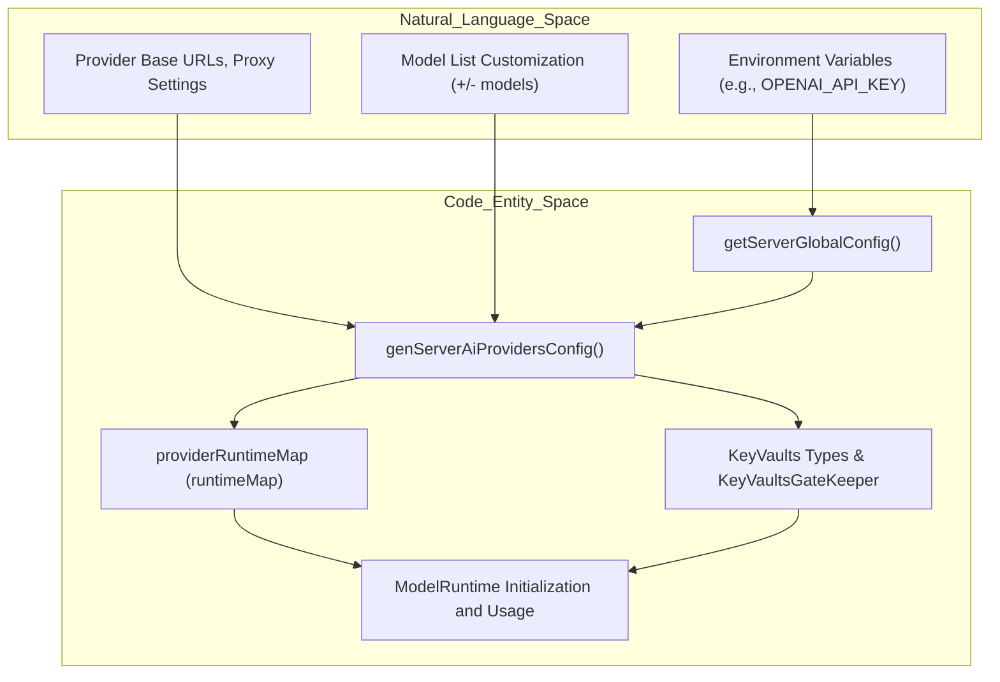
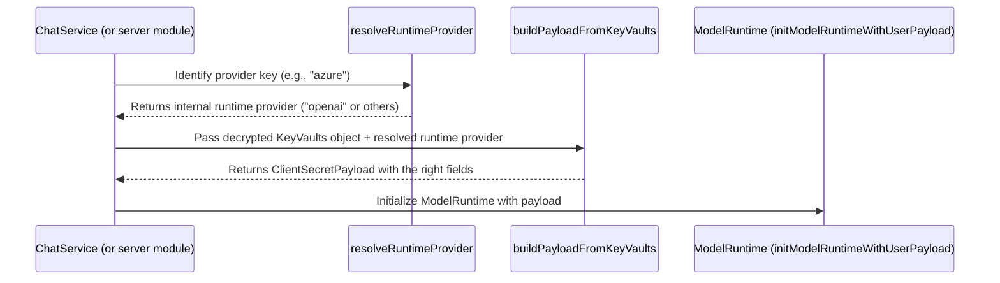
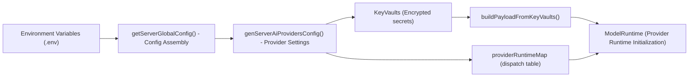

<!-- source: DeepWiki mcp.deepwiki.com · repo lobehub/lobehub · page 3.3 Provider Configuration · fetched 2026-10-29 -->

# Provider Configuration

<details>
<summary>Relevant source files</summary>

The following files were used as context for generating this wiki page:

- [.env.example](.env.example)
- [Dockerfile](Dockerfile)
- [apps/desktop/src/main/modules/heterogeneousAgent/drivers/codex.test.ts](apps/desktop/src/main/modules/heterogeneousAgent/drivers/codex.test.ts)
- [apps/desktop/src/main/modules/heterogeneousAgent/drivers/codex.ts](apps/desktop/src/main/modules/heterogeneousAgent/drivers/codex.ts)
- [apps/desktop/src/main/modules/heterogeneousAgent/drivers/trae.test.ts](apps/desktop/src/main/modules/heterogeneousAgent/drivers/trae.test.ts)
- [apps/desktop/src/main/modules/heterogeneousAgent/drivers/trae.ts](apps/desktop/src/main/modules/heterogeneousAgent/drivers/trae.ts)
- [apps/server/src/globalConfig/genServerAiProviderConfig.test.ts](apps/server/src/globalConfig/genServerAiProviderConfig.test.ts)
- [apps/server/src/globalConfig/genServerAiProviderConfig.ts](apps/server/src/globalConfig/genServerAiProviderConfig.ts)
- [apps/server/src/globalConfig/index.test.ts](apps/server/src/globalConfig/index.test.ts)
- [apps/server/src/modules/ModelRuntime/index.test.ts](apps/server/src/modules/ModelRuntime/index.test.ts)
- [apps/server/src/modules/ModelRuntime/index.ts](apps/server/src/modules/ModelRuntime/index.ts)
- [apps/server/src/routers/lambda/__tests__/aiAgent.serverDefaultCapability.test.ts](apps/server/src/routers/lambda/__tests__/aiAgent.serverDefaultCapability.test.ts)
- [apps/server/src/routers/lambda/__tests__/aiAgent.serverDefaultOperation.test.ts](apps/server/src/routers/lambda/__tests__/aiAgent.serverDefaultOperation.test.ts)
- [docs/self-hosting/advanced/model-list.mdx](docs/self-hosting/advanced/model-list.mdx)
- [docs/self-hosting/advanced/model-list.zh-CN.mdx](docs/self-hosting/advanced/model-list.zh-CN.mdx)
- [docs/self-hosting/environment-variables/model-provider.mdx](docs/self-hosting/environment-variables/model-provider.mdx)
- [docs/self-hosting/environment-variables/model-provider.zh-CN.mdx](docs/self-hosting/environment-variables/model-provider.zh-CN.mdx)
- [packages/heterogeneous-agents/src/index.ts](packages/heterogeneous-agents/src/index.ts)
- [packages/heterogeneous-agents/src/providerBinding/index.ts](packages/heterogeneous-agents/src/providerBinding/index.ts)
- [packages/heterogeneous-agents/src/providerBinding/serverDefault.test.ts](packages/heterogeneous-agents/src/providerBinding/serverDefault.test.ts)
- [packages/heterogeneous-agents/src/providerBinding/serverDefault.ts](packages/heterogeneous-agents/src/providerBinding/serverDefault.ts)
- [packages/heterogeneous-agents/src/spawn/traeAcpSession.test.ts](packages/heterogeneous-agents/src/spawn/traeAcpSession.test.ts)
- [packages/model-bank/src/types/aiModel.test.ts](packages/model-bank/src/types/aiModel.test.ts)
- [packages/model-runtime/src/utils/getFallbackModelProperty.test.ts](packages/model-runtime/src/utils/getFallbackModelProperty.test.ts)
- [packages/model-runtime/src/utils/getFallbackModelProperty.ts](packages/model-runtime/src/utils/getFallbackModelProperty.ts)
- [packages/model-runtime/src/utils/routeFallback.ts](packages/model-runtime/src/utils/routeFallback.ts)
- [packages/openapi/src/middleware/hetero-operation-auth.test.ts](packages/openapi/src/middleware/hetero-operation-auth.test.ts)
- [packages/openapi/src/middleware/hetero-operation-auth.ts](packages/openapi/src/middleware/hetero-operation-auth.ts)
- [packages/openapi/src/routes/anthropic.route.ts](packages/openapi/src/routes/anthropic.route.ts)
- [packages/openapi/src/routes/heterogeneous-relay.route.test.ts](packages/openapi/src/routes/heterogeneous-relay.route.test.ts)
- [packages/openapi/src/routes/openai.route.ts](packages/openapi/src/routes/openai.route.ts)
- [packages/openapi/src/services/heterogeneous-direct.service.test.ts](packages/openapi/src/services/heterogeneous-direct.service.test.ts)
- [packages/openapi/src/services/heterogeneous-direct.service.ts](packages/openapi/src/services/heterogeneous-direct.service.ts)
- [packages/types/src/llm.ts](packages/types/src/llm.ts)
- [packages/utils/src/object.test.ts](packages/utils/src/object.test.ts)
- [src/business/client/services/BusinessGlobalService.ts](src/business/client/services/BusinessGlobalService.ts)
- [src/features/ModelSelect/index.tsx](src/features/ModelSelect/index.tsx)
- [src/features/Settings/provider/(list)/ProviderGrid/index.tsx](src/features/Settings/provider/(list)/ProviderGrid/index.tsx)
- [src/features/Settings/provider/ProviderMenu/index.tsx](src/features/Settings/provider/ProviderMenu/index.tsx)
- [src/features/Settings/provider/detail/default/CustomProviderDetail.tsx](src/features/Settings/provider/detail/default/CustomProviderDetail.tsx)
- [src/layout/GlobalProvider/StoreInitialization.tsx](src/layout/GlobalProvider/StoreInitialization.tsx)
- [src/services/__tests__/_url.test.ts](src/services/__tests__/_url.test.ts)
- [src/services/__tests__/global.test.ts](src/services/__tests__/global.test.ts)
- [src/services/_url.ts](src/services/_url.ts)
- [src/services/global.ts](src/services/global.ts)
- [src/store/aiInfra/slices/aiProvider/__tests__/action.test.ts](src/store/aiInfra/slices/aiProvider/__tests__/action.test.ts)
- [src/store/aiInfra/slices/aiProvider/__tests__/replica.test.ts](src/store/aiInfra/slices/aiProvider/__tests__/replica.test.ts)
- [src/store/aiInfra/slices/aiProvider/__tests__/selectors.test.ts](src/store/aiInfra/slices/aiProvider/__tests__/selectors.test.ts)
- [src/store/aiInfra/slices/aiProvider/action.test.ts](src/store/aiInfra/slices/aiProvider/action.test.ts)
- [src/store/aiInfra/slices/aiProvider/action.ts](src/store/aiInfra/slices/aiProvider/action.ts)
- [src/store/aiInfra/slices/aiProvider/initialState.ts](src/store/aiInfra/slices/aiProvider/initialState.ts)
- [src/store/aiInfra/slices/aiProvider/projection.ts](src/store/aiInfra/slices/aiProvider/projection.ts)
- [src/store/aiInfra/slices/aiProvider/selectors.ts](src/store/aiInfra/slices/aiProvider/selectors.ts)
- [src/utils/server/parseModels.ts](src/utils/server/parseModels.ts)

</details>


LobeHub provides a robust and extensible system to configure AI model providers, bridging deployment-time environment variables with internal runtime logic. This configuration mechanism governs which providers are enabled, their API credentials, model selections, and specialized runtime behaviors, ensuring unified and secure access to a diverse set of AI services.

---

## Configuration Data Flow

The provider configuration originates from environment variables during deployment or from database-stored settings in managed/cloud scenarios. These configurations are assembled into a global server configuration object, which feeds into the AI runtime initialization process. Credentials are mapped and secured via key vault abstractions, and provider-specific classes are instantiated by a runtime dispatch table.

### Natural Language to Code Entity Mapping



This diagram shows how simple deployment environment variables (e.g., `OPENAI_API_KEY`, `ENABLED_OPENAI`) and user customizations flow through server-side config assembly and provider runtime mapping to the instantiated `ModelRuntime` objects that handle actual API calls.

**Sources:**  
[docs/self-hosting/environment-variables/model-provider.mdx:12-16]()  
[packages/model-runtime/src/runtimeMap.ts:85-170]()  
[.env.example:45-199]()  
[apps/server/src/modules/ModelRuntime/index.ts:40-47]()  

---

## Provider Dispatching with `providerRuntimeMap`

At the core of the runtime layer is the `providerRuntimeMap` object (in the `model-runtime` package) that maps formal provider keys to the implementation classes responsible for talking to the provider's API. This mapping facilitates polymorphic behavior for requests against different AI model providers.

| Provider ID         | Runtime Class         | Description                          | Reference File & Lines          |
|---------------------|----------------------|------------------------------------|--------------------------------|
| `openai`            | `LobeOpenAI`         | OpenAI-compatible AI service        | [packages/model-runtime/src/runtimeMap.ts:137]()  |
| `anthropic`         | `LobeAnthropicAI`    | Anthropic AI services               | [packages/model-runtime/src/runtimeMap.ts:92]()   |
| `azure`             | `LobeAzureOpenAI`    | Azure OpenAI interface              | [packages/model-runtime/src/runtimeMap.ts:94]()   |
| `bedrock`           | `LobeBedrockAI`      | AWS Bedrock AI service              | [packages/model-runtime/src/runtimeMap.ts:97]()   |
| `google`            | `LobeGoogleAI`       | Google AI / Vertex AI interface     | [packages/model-runtime/src/runtimeMap.ts:111]()  |
| `deepseek`          | `LobeDeepSeekAI`     | DeepSeek AI provider                | [packages/model-runtime/src/runtimeMap.ts:105]()  |
| `ollama`            | `LobeOllamaAI`       | Ollama local/remote LLM             | [packages/model-runtime/src/runtimeMap.ts:133]()  |
| `lobehub`           | `LobeHubAI`          | Internal LobeHub models             | [packages/model-runtime/src/runtimeMap.ts:122]()  |

The runtimeMap object is keyed by the canonical provider ID strings and each entry provides factory or class reference for a runtime implementation that performs API calls to the provider, implementing the `LobeRuntimeAI` interface.

**Sources:**  
[packages/model-runtime/src/runtimeMap.ts:85-170]()  
[packages/model-runtime/src/index.ts:37-83]()  

---

## Environment Variable Configuration

LobeHub defines a clear naming convention for environment variables that enable and configure model providers. These variables typically support:

1. **Enablement**: `ENABLED_<PROVIDER>` — e.g., `ENABLED_OPENAI=1` to enable OpenAI or `0` to disable. Most providers default to enabled except when explicitly disabled.  
2. **Authentication**: `<PROVIDER>_API_KEY` — API key or token to authenticate requests, required for most providers.  
3. **Connectivity / Proxy**: `<PROVIDER>_PROXY_URL` — Optional proxy/base URL override for provider API endpoints to support custom or regional proxies.  
4. **Model List Customization**: `<PROVIDER>_MODEL_LIST` — Controls which models are visible/enabled in the UI and runtime.  

### Model List Syntax

The model list variable supports a rich syntax to add, remove, rename, and augment models:

- `+modelId` adds a model to the list.  
- `-modelId` hides a model from the list.  
- `-all` removes all default models before adding custom ones.  
- `modelId=displayName` renames the model as displayed.  
- Optionally, angle brackets `<...>` can specify model extension metadata such as token limits or capabilities (e.g., vision support or function calling).

Example:

```
OPENAI_MODEL_LIST = "+qwen-7b-chat,+glm-6b,-gpt-3.5-turbo,gpt-4-turbo=gpt-4o"
```

This config enables models `qwen-7b-chat` and `glm-6b`, disables `gpt-3.5-turbo`, and renames `gpt-4-turbo` to `gpt-4o` in the UI.

**Sources:**  
[docs/self-hosting/environment-variables/model-provider.mdx:58-68]()  
[docs/self-hosting/advanced/model-list.mdx:13-70]()  
[.env.example:45-199]()  

---

## Key Vault and Authentication Payload Handling

Sensitive credentials (such as API keys, tokens, or OAuth secrets) are abstracted into typed "Key Vaults" per provider, managed by the `KeyVaultsGateKeeper` for secure encryption/decryption, and then converted into client secret payloads consumed by the ModelRuntime.

### Server-Side Resolution of Runtime Provider and Payload

1. The runtime provider string used internally is resolved from the provider and optional SDK type (e.g., a custom provider may use the OpenAI runtime via sdkType override). This happens in:

```typescript
resolveRuntimeProvider(provider: string, sdkType?: string): string
```

2. The `buildPayloadFromKeyVaults` function converts the decrypted vault data into a typed `ClientSecretPayload`, respecting provider-specific credential fields.

3. The constructed payload is passed to the ModelRuntime initializer on the server to obtain an initialized instance.

### Auth Payload Resolution Sequence



### Provider-Specific Payload Mapping Highlights

- **AWS Bedrock:** Uses `accessKeyId`, `secretAccessKey`, AWS `region`, `sessionToken`, etc.  
- **Azure OpenAI:** Maps `endpoint` or `baseURL` with `apiKey`.  
- **Cloudflare:** Maps `cloudflareBaseURLOrAccountID` and `apiKey`.  
- **ComfyUI:** Supports various auth types including none/basic/bearer/custom headers.  
- **GitHub Copilot:** Handles both PAT and OAuth token with expiry fields.  
- **SuperGrok:** Uses OAuth token as API key for stateless compatibility.  
- **ChatGPT:** Uses OAuth access token and account ID for client instantiation.

This switch logic is found in `buildPayloadFromKeyVaults(providerKeyVaults, runtimeProvider)` in `apps/server/src/modules/ModelRuntime/index.ts`.

**Sources:**  
[apps/server/src/modules/ModelRuntime/index.ts:71-192]()  
[apps/server/src/modules/ModelRuntime/index.ts:40-47]()  
[.env.example:45-199]()  
[docs/self-hosting/environment-variables/model-provider.zh-CN.mdx:180-240]()  

---

## Summary Diagram: Runtime Provider Configuration Flow



---

## Security and Global Settings

- **Key Encryption:** Environment variable `KEY_VAULTS_SECRET` is used to encrypt sensitive API keys stored in the database securely. This is typically set via the Docker build or deployment configuration [Dockerfile:46-47]().

- **API Key Selection Mode:** LobeHub supports multiple API keys per provider (comma-separated) and uses `API_KEY_SELECT_MODE` environment variable to determine key selection strategy:
  - `random`: Random key chosen per request.  
  - `turn`: Round-robin cycling of keys.  
  Default is `random` if unspecified.

- **System Agents:** The system can configure special built-in agents (such as history compression, query rewriting) with specified model/provider using environment variables like `SYSTEM_AGENT` (not shown directly but part of global server config).

---

# References

| Concept                      | Code Entity / File                                            |
|-----------------------------|---------------------------------------------------------------|
| Environment variables docs   | docs/self-hosting/environment-variables/model-provider.mdx    |
| Provider dispatch table      | packages/model-runtime/src/runtimeMap.ts                      |
| Runtime provider resolution  | apps/server/src/modules/ModelRuntime/index.ts                 |
| Payload builder              | apps/server/src/modules/ModelRuntime/index.ts                 |
| Model list syntax            | docs/self-hosting/advanced/model-list.mdx                     |
| Env var examples             | .env.example                                                  |
| Key vaults and encryption   | Dockerfile (build env KEY_VAULTS_SECRET)                      |

---

This leaf wiki page documents the comprehensive provider configuration mechanism, from deployment environment variables through server-side config assembly, provider dispatching at the runtime layer, to per-provider authentication payload construction and secure key vault handling. This system is critical for enabling and maintaining LobeHub's flexible AI service integrations.

---

