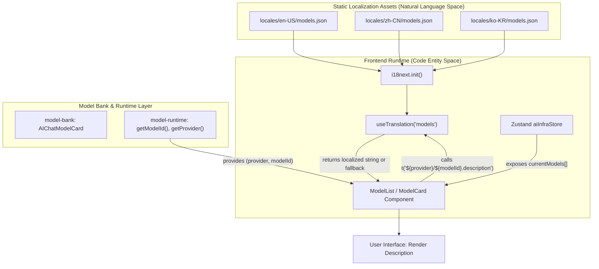
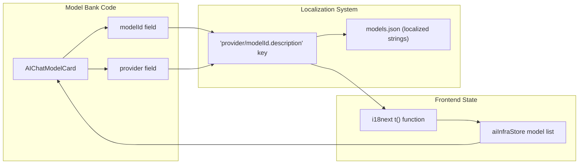

<!-- source: DeepWiki mcp.deepwiki.com · repo lobehub/lobehub · page 3.4 Model Localization · fetched 2026-10-29 -->

# Model Localization

<details>
<summary>Relevant source files</summary>

The following files were used as context for generating this wiki page:

- [locales/ar/models.json](locales/ar/models.json)
- [locales/bg-BG/models.json](locales/bg-BG/models.json)
- [locales/de-DE/models.json](locales/de-DE/models.json)
- [locales/en-US/models.json](locales/en-US/models.json)
- [locales/es-ES/models.json](locales/es-ES/models.json)
- [locales/fa-IR/models.json](locales/fa-IR/models.json)
- [locales/fr-FR/models.json](locales/fr-FR/models.json)
- [locales/it-IT/models.json](locales/it-IT/models.json)
- [locales/ja-JP/models.json](locales/ja-JP/models.json)
- [locales/ko-KR/models.json](locales/ko-KR/models.json)
- [locales/nl-NL/models.json](locales/nl-NL/models.json)
- [locales/pl-PL/models.json](locales/pl-PL/models.json)
- [locales/pt-BR/models.json](locales/pt-BR/models.json)
- [locales/ru-RU/models.json](locales/ru-RU/models.json)
- [locales/tr-TR/models.json](locales/tr-TR/models.json)
- [locales/vi-VN/models.json](locales/vi-VN/models.json)
- [locales/zh-CN/models.json](locales/zh-CN/models.json)
- [locales/zh-TW/models.json](locales/zh-TW/models.json)

</details>


LobeHub implements a comprehensive localization system to provide accurate, multi-language support specifically for AI model descriptions. This enables users worldwide to view detailed, localized textual content about various AI models integrated within the platform.

## Overview

The model localization mechanism relies on locale-specific JSON files located under the `locales/*` directory, primarily `models.json` files, which contain human-readable descriptions of AI models across a variety of providers like OpenAI, Anthropic, Google, DeepSeek, Baichuan, 360, ByteDance, and others.

### Key Naming Convention

Localization entries in `models.json` use a concise key naming standard:

```
provider/model_id.description
```

- **provider**: The vendor or AI provider identifier (e.g., `openai`, `deepseek`, `360`, `01-ai`).
- **model_id**: The internal model identifier used in code (e.g., `gpt-4o`, `deepseek-r1`, `yi-1.5-34b-chat`).
- **description**: A fixed suffix indicating this value is a descriptive string.

Examples:
- `"01-ai/yi-1.5-34b-chat.description"` — A description for 01.AI model with 34B parameters.
- `"360/deepseek-r1.description"` — A description for 360’s DeepSeek-R1 model.

This naming convention ensures predictable and unambiguous lookup of descriptions aligned with the model definition keys managed in the model-bank library.

### Supported Locales

LobeHub currently supports a broad range of locales, each corresponding to a language and region version. Each locale contains a complete set of `models.json` for consistent translation of model descriptions.

Supported locales include but are not limited to:

| Locale Code | Language/Region        | Example Source File                     |
|-------------|-----------------------|---------------------------------------|
| `en-US`     | English (US)          | [locales/en-US/models.json:1-20]()    |
| `zh-CN`     | Chinese (Simplified)  | [locales/zh-CN/models.json:1-64]()    |
| `ko-KR`     | Korean                | [locales/ko-KR/models.json:1-42]()    |
| `it-IT`     | Italian               | [locales/it-IT/models.json:1-19]()    |
| `fr-FR`     | French                | [locales/fr-FR/models.json:1-18]()    |
| `ru-RU`     | Russian               | [locales/ru-RU/models.json:1-18]()    |
| `ar`        | Arabic                | [locales/ar/models.json:1-25]()       |
| `vi-VN`     | Vietnamese            | [locales/vi-VN/models.json:1-20]()    |
| `tr-TR`     | Turkish               | [locales/tr-TR/models.json:1-20]()    |
| `pl-PL`     | Polish                | [locales/pl-PL/models.json:1-19]()    |
| `nl-NL`     | Dutch                 | [locales/nl-NL/models.json:1-18]()    |
| `bg-BG`     | Bulgarian             | [locales/bg-BG/models.json:1-21]()    |
| (and others) |                       |                                       |

The translations are maintained and synchronized via the `lobe-i18n` translation tooling ensuring consistency in keys and up-to-date localized strings.

---

## Runtime Data Flow

At runtime, when an AI model card needs to display a localized description, the system performs this lookup from the localized JSON entries dynamically according to the user interface locale. This is integrated into the frontend’s translation layer.

### Lookup Sequence

1. **Model Identification**: The model runtime exposes `provider` and `modelId` string identifiers (e.g., `openai/gpt-4o`).

2. **Localization Key Construction**: These two strings are concatenated with `".description"` to form the lookup key, for example:
   ```
   "openai/gpt-4o.description"
   ```

3. **Translation Function Call**: The frontend calls the `i18next` library's translation function (via React hook `useTranslation('models')`) to fetch the localized string for this key.

4. **Fallback**: If the current locale lacks a description value, the system falls back to a default locale, often `zh-CN` or `en-US`, ensuring a graceful degradation rather than missing content.

5. **Render**: The description string is injected into UI components such as the model selector, model card details, or settings pages.

### Architecture Diagram — From Natural Language to Code Entity



---

## Implementation Details

### Data Structure of Localization Files

- Each `models.json` file is a plain flat JSON object.
- Keys follow the pattern: `provider/modelId.description`.
- Values are strings describing key attributes of the model, such as parameter counts, training datasets, specialties, and unique capabilities.

Example fragment (English locale):
```json
{
  "01-ai/yi-1.5-34b-chat.description": "01.AI’s latest open-source fine-tuned model with 34B parameters, supporting multiple dialogue scenarios...",
  "360/deepseek-r1.description": "360-deployed DeepSeek-R1 uses large-scale RL in post-training to boost reasoning..."
}
```

Descriptions may vary in length and provide rich contextual information to end users, including references to benchmarks (e.g., `HealthBench`), unique architectural features, or use-case specializations.

### Per-Provider Structured Description Usage

Some models have multiple entries, distinguished by provider-specific naming despite referencing similar core models. This enables displaying unique provider-centric versions or deployment notes.

Examples:

| Key                               | Context & Notes                               |
|-----------------------------------|-----------------------------------------------|
| `360/deepseek-r1.description`     | Describes DeepSeek-R1 as deployed specifically by 360. [locales/en-US/models.json:4]() |
| `deepseek/deepseek-r1.description`| Describes generic DeepSeek-R1 Model. [locales/en-US/models.json:33]() |
| `Baichuan-M2.description`          | Medical-enhanced reasoning model with extensive notes and frequent cross-locale consistency. [locales/en-US/models.json:16-19]() [locales/zh-CN/models.json:16-19]() |

### Lookup in React Components

In the frontend React components such as `ModelList` or `ModelSelectPanel`, the process is:

- Obtain currently available model list from `aiInfraStore`.
- For each model, construct the localization key.
- Use the `useTranslation('models')` hook to render localized model descriptions dynamically in UI.

This decouples core model logic from frontend localization concerns, enabling seamless multi-language support with minimal code changes when new locales or models are added.

---

## Code Entity to Localization Key Mapping

The following diagram illustrates how core code entities connect via keys to their localized descriptions:



---

## Summary

- Model localization relies on a consistent key naming scheme: `"provider/modelId.description"`.
- Localized model descriptions are stored in flat JSON files `locales/*/models.json` scoped by language-region codes.
- Runtime translations happen via `i18next` integrated with React hooks and Zustand state.
- Rich, detailed descriptions provide users with valuable localized insights into AI models.
- Provider-specific keys allow for customized branding or deployment-specific notes.

---

**Sources:**

- [locales/zh-CN/models.json:1-64]()
- [locales/en-US/models.json:1-20]()
- [locales/ko-KR/models.json:1-42]()
- [locales/it-IT/models.json:1-19]()
- [locales/fr-FR/models.json:1-18]()
- [locales/ar/models.json:1-25]()
- [locales/pl-PL/models.json:1-19]()
- [locales/bg-BG/models.json:1-21]()

---

