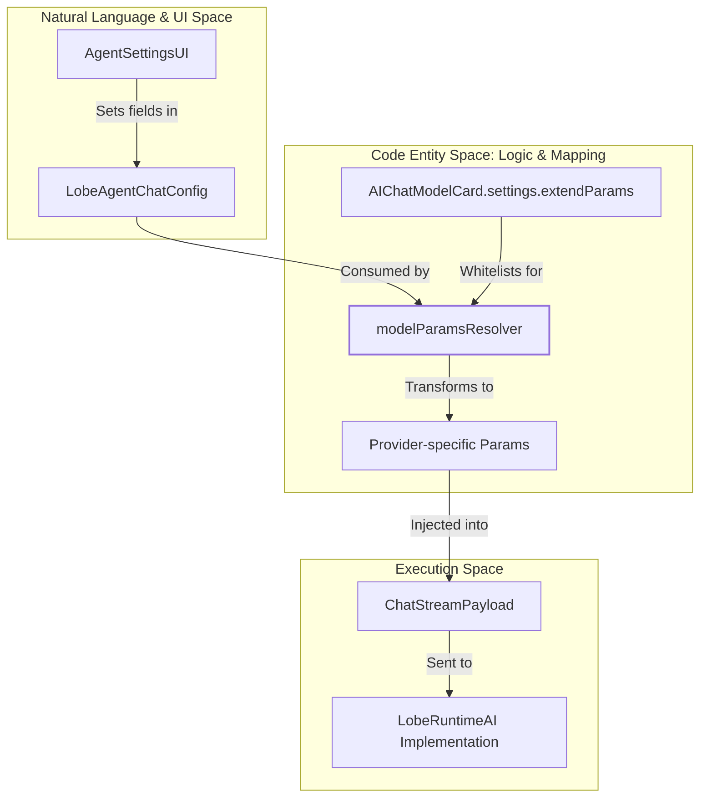
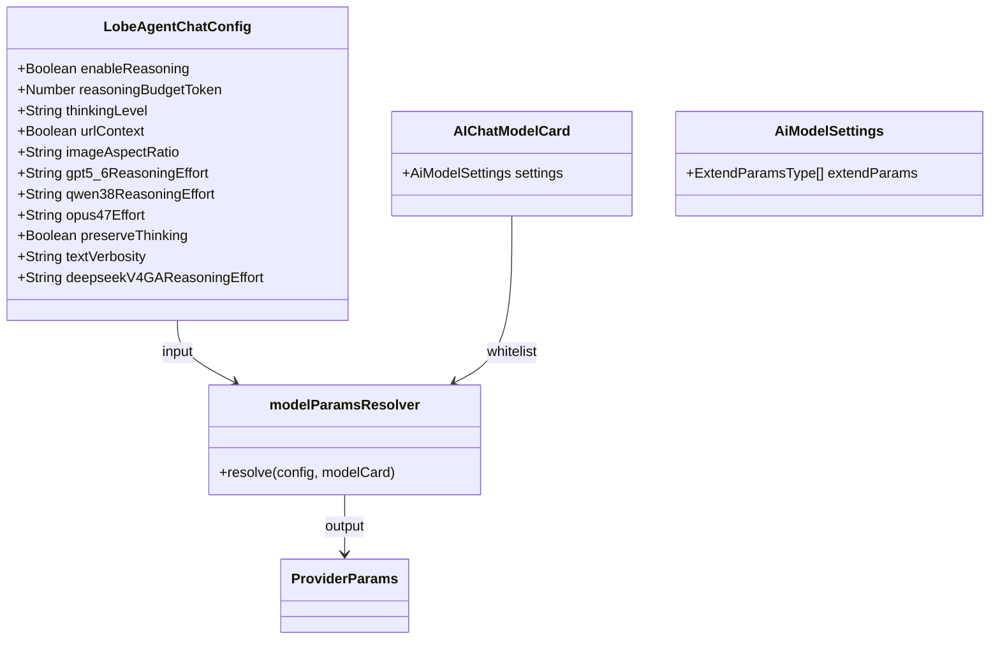

<!-- source: DeepWiki mcp.deepwiki.com · repo lobehub/lobehub · page 3.5 Extended Model Parameters · fetched 2026-10-29 -->

# Extended Model Parameters

<details>
<summary>Relevant source files</summary>

The following files were used as context for generating this wiki page:

- [locales/en-US/modelProvider.json](locales/en-US/modelProvider.json)
- [locales/zh-CN/modelProvider.json](locales/zh-CN/modelProvider.json)
- [packages/heterogeneous-agents/src/spawn/input/buildAgentInput.test.ts](packages/heterogeneous-agents/src/spawn/input/buildAgentInput.test.ts)
- [packages/heterogeneous-agents/src/spawn/input/buildAgentInput.ts](packages/heterogeneous-agents/src/spawn/input/buildAgentInput.ts)
- [packages/locales/src/default/modelProvider.ts](packages/locales/src/default/modelProvider.ts)
- [packages/locales/src/lobehubOnlineModelDescriptions.test.ts](packages/locales/src/lobehubOnlineModelDescriptions.test.ts)
- [packages/locales/src/lobehubOnlineModelDescriptions.ts](packages/locales/src/lobehubOnlineModelDescriptions.ts)
- [packages/model-bank/src/aiModels/deepseek.ts](packages/model-bank/src/aiModels/deepseek.ts)
- [packages/model-bank/src/types/aiModel.ts](packages/model-bank/src/types/aiModel.ts)
- [packages/model-runtime/src/utils/modelExtendParams.test.ts](packages/model-runtime/src/utils/modelExtendParams.test.ts)
- [packages/model-runtime/src/utils/modelExtendParams.ts](packages/model-runtime/src/utils/modelExtendParams.ts)
- [packages/types/src/agent/chatConfig.ts](packages/types/src/agent/chatConfig.ts)
- [src/components/ModelSelect/index.tsx](src/components/ModelSelect/index.tsx)
- [src/features/ChatInput/VoiceMessage/index.tsx](src/features/ChatInput/VoiceMessage/index.tsx)
- [src/features/ChatInput/VoiceMessage/useVoiceMessageCapability.test.ts](src/features/ChatInput/VoiceMessage/useVoiceMessageCapability.test.ts)
- [src/features/ChatInput/VoiceMessage/useVoiceMessageCapability.ts](src/features/ChatInput/VoiceMessage/useVoiceMessageCapability.ts)
- [src/features/ChatInput/hooks/effectiveAgentModePreference.ts](src/features/ChatInput/hooks/effectiveAgentModePreference.ts)
- [src/features/Conversation/ChatInput/voiceMessageCapability.test.ts](src/features/Conversation/ChatInput/voiceMessageCapability.test.ts)
- [src/features/Conversation/ChatInput/voiceMessageCapability.ts](src/features/Conversation/ChatInput/voiceMessageCapability.ts)
- [src/features/ModelSwitchPanel/components/ControlsForm/ControlsForm.tsx](src/features/ModelSwitchPanel/components/ControlsForm/ControlsForm.tsx)
- [src/features/ModelSwitchPanel/components/List/GenerationListItemRenderer.tsx](src/features/ModelSwitchPanel/components/List/GenerationListItemRenderer.tsx)
- [src/features/ModelSwitchPanel/components/List/GenerationMultipleProvidersItem.tsx](src/features/ModelSwitchPanel/components/List/GenerationMultipleProvidersItem.tsx)
- [src/features/ModelSwitchPanel/components/List/ListItemRenderer.tsx](src/features/ModelSwitchPanel/components/List/ListItemRenderer.tsx)
- [src/features/ModelSwitchPanel/components/List/MultipleProvidersModelItem.tsx](src/features/ModelSwitchPanel/components/List/MultipleProvidersModelItem.tsx)
- [src/features/ModelSwitchPanel/components/List/__tests__/MultipleProvidersModelItem.test.tsx](src/features/ModelSwitchPanel/components/List/__tests__/MultipleProvidersModelItem.test.tsx)
- [src/features/ModelSwitchPanel/components/List/index.tsx](src/features/ModelSwitchPanel/components/List/index.tsx)
- [src/features/ModelSwitchPanel/components/ModelDetailPanel.tsx](src/features/ModelSwitchPanel/components/ModelDetailPanel.tsx)
- [src/features/ModelSwitchPanel/components/PanelContent.tsx](src/features/ModelSwitchPanel/components/PanelContent.tsx)
- [src/features/ModelSwitchPanel/const.ts](src/features/ModelSwitchPanel/const.ts)
- [src/features/ModelSwitchPanel/hooks/useBuildListItems.test.ts](src/features/ModelSwitchPanel/hooks/useBuildListItems.test.ts)
- [src/features/ModelSwitchPanel/hooks/useBuildListItems.ts](src/features/ModelSwitchPanel/hooks/useBuildListItems.ts)
- [src/features/ModelSwitchPanel/hooks/usePanelHandlers.test.ts](src/features/ModelSwitchPanel/hooks/usePanelHandlers.test.ts)
- [src/features/ModelSwitchPanel/hooks/usePanelHandlers.ts](src/features/ModelSwitchPanel/hooks/usePanelHandlers.ts)
- [src/features/ModelSwitchPanel/hooks/usePanelWidthConstraints.test.ts](src/features/ModelSwitchPanel/hooks/usePanelWidthConstraints.test.ts)
- [src/features/ModelSwitchPanel/hooks/usePanelWidthConstraints.ts](src/features/ModelSwitchPanel/hooks/usePanelWidthConstraints.ts)
- [src/features/ModelSwitchPanel/index.tsx](src/features/ModelSwitchPanel/index.tsx)
- [src/features/ModelSwitchPanel/styles.ts](src/features/ModelSwitchPanel/styles.ts)
- [src/features/ModelSwitchPanel/types.ts](src/features/ModelSwitchPanel/types.ts)
- [src/features/ModelSwitchPanel/utils.ts](src/features/ModelSwitchPanel/utils.ts)
- [src/features/Settings/provider/features/ModelList/CreateNewModelModal/ExtendParamsSelect.tsx](src/features/Settings/provider/features/ModelList/CreateNewModelModal/ExtendParamsSelect.tsx)
- [src/hooks/useMediaUploadAbility.test.ts](src/hooks/useMediaUploadAbility.test.ts)
- [src/hooks/useMediaUploadAbility.ts](src/hooks/useMediaUploadAbility.ts)
- [src/services/chat/mecha/modelParamsResolver.test.ts](src/services/chat/mecha/modelParamsResolver.test.ts)
- [src/services/chat/mecha/modelParamsResolver.ts](src/services/chat/mecha/modelParamsResolver.ts)

</details>


The Extended Model Parameters system in LobeHub provides a flexible mechanism for handling provider-specific API parameters that fall outside the standard LLM configuration (like temperature or top_p). This system enables advanced features such as reasoning budgets, thinking levels, and specialized image generation settings by mapping high-level user configurations to the specific requirements of various AI model providers.

## Core Architecture

The system is built on three main pillars: static definitions in the `model-bank`, configuration schema in the agent settings, and a resolver service that prepares the final payload for the model runtime.

### Implementation Data Flow

The following diagram illustrates how extended parameters flow from the UI configuration to the final API request.

**Extended Parameters Data Flow**



Sources: [packages/types/src/agent/chatConfig.ts:27-201](), [packages/model-bank/src/types/aiModel.ts:262-270](), [src/services/chat/mecha/modelParamsResolver.ts:1-50]()

---

## ExtendParamsType Enum

The `ExtendParamsType` defines the set of supported extended features that a model can declare support for. These are used as whitelists within a model's definition to ensure that only relevant parameters are passed to the underlying API.

| Parameter Type | Description | Example Models |
| :--- | :--- | :--- |
| `enableReasoning` | Toggles the reasoning/thinking mode of the model. | Kimi K2.6, Qwen3 VL |
| `reasoningBudgetToken` | Sets the maximum tokens allocated for internal reasoning. | DeepSeek V4 Pro, GLM-5.2 |
| `thinkingLevel` | Controls the depth of the "thinking" process (minimal to high). | Gemini 3.5 Flash |
| `urlContext` | Enables the model to directly fetch and process URL content. | Gemini Pro Latest |
| `imageAspectRatio` | Controls the output dimensions for image generation models. | Nano Banana 2 |
| `gpt5_2ReasoningEffort` | OpenAI specific reasoning effort levels. | GPT-5.5, GPT-5.4 |
| `deepseekV4ReasoningEffort` | DeepSeek V4 specific effort modes (None, High, Max). | DeepSeek V4 Pro |
| `qwen38ReasoningEffort` | Qwen3.8 Max hybrid thinking depth. | Qwen3.8 Max |
| `opus47Effort` | Effort level for Claude Opus 4.7 and later. | Claude Fable 5.1, Claude Opus 5 |
| `textVerbosity` | Controls output length/detail level. | GPT-6 Astra, GPT-5.6 Sol |

Sources: [packages/model-bank/src/aiModels/qwen.ts:33-35](), [packages/model-bank/src/aiModels/google.ts:64-68](), [packages/model-bank/src/aiModels/siliconcloud.ts:137-139](), [packages/model-bank/src/aiModels/aihubmix.ts:54-57](), [packages/model-bank/src/aiModels/qwen.ts:98-99](), [packages/model-bank/src/aiModels/anthropic.ts:36-37](), [packages/model-bank/src/aiModels/openai.ts:71-72]()

---

## Model Bank Configuration

Models in the `model-bank` specify their supported extended parameters via the `AiModelSettings.extendParams` property.

### Example: Google Gemini Configuration
Gemini models often support `thinkingLevel` and `urlContext` parameters.

```typescript
// packages/model-bank/src/aiModels/google.ts
{
  id: 'gemini-flash-lite-latest',
  // ...
  settings: {
    disabledParams: ['temperature', 'top_p'],
    extendParams: ['thinkingLevel', 'urlContext'],
    searchImpl: 'params',
    searchProvider: 'google',
  },
}
```
Sources: [packages/model-bank/src/aiModels/google.ts:148-152]()

### Example: OpenAI / GPT Family
Newer GPT models utilize specific reasoning effort and verbosity controls.

```typescript
// packages/model-bank/src/aiModels/openai.ts
{
  id: 'gpt-5.6-sol',
  // ...
  settings: {
    extendParams: ['reasoningMode', 'gpt5_6ReasoningEffort', 'textVerbosity'],
    searchImpl: 'params',
  },
}
```
Sources: [packages/model-bank/src/aiModels/openai.ts:165-167]()

### Example: Anthropic Claude Family
Claude models support `disableContextCaching`, `enableAdaptiveThinking`, and `opus47Effort`.

```typescript
// packages/model-bank/src/aiModels/anthropic.ts
{
  id: 'claude-fable-5',
  // ...
  settings: {
    disabledParams: ['temperature', 'top_p'],
    extendParams: ['disableContextCaching', 'enableAdaptiveThinking', 'opus47Effort'],
    searchImpl: 'params',
  },
}
```
Sources: [packages/model-bank/src/aiModels/anthropic.ts:68-72]()

### Example: Qwen Models
Qwen models support `qwen38ReasoningEffort` and `preserveThinking`.

```typescript
// packages/model-bank/src/aiModels/qwen.ts
{
  id: 'qwen3.8-max-0902',
  // ...
  settings: {
    extendParams: ['qwen38ReasoningEffort', 'preserveThinking'],
    searchImpl: 'params',
  },
}
```
Sources: [packages/model-bank/src/aiModels/qwen.ts:98-100]()

### Example: DeepSeek Models
DeepSeek models support `deepseekV4GAReasoningEffort`.

```typescript
// packages/model-bank/src/aiModels/deepseek.ts
{
  id: 'deepseek-v4-flash',
  // ...
  settings: {
    extendParams: ['deepseekV4GAReasoningEffort'],
  },
}
```
Sources: [packages/model-bank/src/aiModels/deepseek.ts:29-31]()

---

## The Model Params Resolver

The `modelParamsResolver` is the core service responsible for translating the generic `LobeAgentChatConfig` into provider-specific API structures. It acts as a bridge between the frontend's unified configuration and the heterogeneous requirements of different LLM vendors.

### Resolver Logic Mapping

The resolver performs the following transformations:

1.  **Whitelisting**: It checks the `AIChatModelCard` to see which `extendParams` are supported.
2.  **Mapping**: It maps `LobeAgentChatConfig` fields to API keys.

**Resolver Entity Relationship**



Sources: [packages/types/src/agent/chatConfig.ts:27-201](), [packages/model-bank/src/types/aiModel.ts:262-270](), [src/services/chat/mecha/modelParamsResolver.ts:1-50]()

### Key Field Mappings

| Agent Config Field | Resolver Action | API Parameter (Typical) |
| :--- | :--- | :--- |
| `reasoningBudgetToken` | Passes value if model supports it | `max_completion_tokens` or `reasoning_budget` |
| `thinkingLevel` | Maps 'low'/'medium'/'high' to provider specific levels | `thinking_effort` or `thinking_level` |
| `urlContext` | Boolean flag for native web search/grounding | `tools: [{type: 'google_search'}]` |
| `imageAspectRatio` | Passes aspect ratio string | `aspect_ratio` |
| `textVerbosity` | Controls output length/detail level | `text_verbosity` |
| `qwen38ReasoningEffort` | Maps to Qwen's `reasoning_effort` | `reasoning_effort` |
| `opus47Effort` | Maps to Anthropic's `thinking.effort` | `thinking.effort` |
| `preserveThinking` | Boolean flag for Qwen's `preserve_thinking` | `preserve_thinking` |
| `deepseekV4GAReasoningEffort` | Maps to DeepSeek's `reasoning_effort` | `reasoning_effort` |

Sources: [packages/types/src/agent/chatConfig.ts:99-201](), [packages/model-bank/src/aiModels/google.ts:104-109](), [packages/model-bank/src/aiModels/openai.ts:98-101](), [packages/types/src/agent/chatConfig.ts:137-139](), [packages/types/src/agent/chatConfig.ts:128-129](), [packages/types/src/agent/chatConfig.ts:133-135](), [packages/types/src/agent/chatConfig.ts:37]()

---

## Provider-Specific Implementation

Once resolved, these parameters are handled by the `model-runtime` implementations.

### Reasoning and Thinking
For models like DeepSeek or OpenAI o1/o3, the resolver might inject `reasoning_effort` or `max_completion_tokens` into the payload. The runtime factory (e.g., `openaiCompatibleFactory`) then passes these directly to the upstream API. Models such as `gpt-5.6-sol` support `reasoningMode` which can be set to `standard` or `pro`. The `ControlsForm` component [src/features/ModelSwitchPanel/components/ControlsForm/ControlsForm.tsx:24-62]() dynamically renders UI controls for these extended parameters based on the `modelExtendParams` retrieved from the `aiInfraStore` [src/features/ModelSwitchPanel/components/ControlsForm/ControlsForm.tsx:138]().

### Visual and Multimodal
For models like `gemini-3.7-flash`, the resolver handles `urlContext` and `thinkingLevel3`. For image models, it supports specific resolutions and aspect ratios defined in schemas like `gptImage2Schema` or `nanoBanana2LiteParameters`.

### Capability Detection
The `model-runtime` utility `modelParse.ts` provides `MODEL_LIST_CONFIGS` [packages/model-runtime/src/utils/modelParse.ts:31-169]() which uses keywords to automatically detect if a model should support reasoning or vision, even if not explicitly defined in the bank. For example, it detects `reasoningKeywords` like `thinking`, `o1`, or `r1`.

Sources: [packages/model-bank/src/aiModels/google.ts:193-198](), [packages/model-runtime/src/utils/modelParse.ts:31-169](), [packages/model-bank/src/aiModels/openai.ts:165-167](), [packages/model-bank/src/aiModels/aihubmix.ts:1-2](), [src/features/ModelSwitchPanel/components/ControlsForm/ControlsForm.tsx:24-62](), [src/features/ModelSwitchPanel/components/ControlsForm/ControlsForm.tsx:138]()

---

