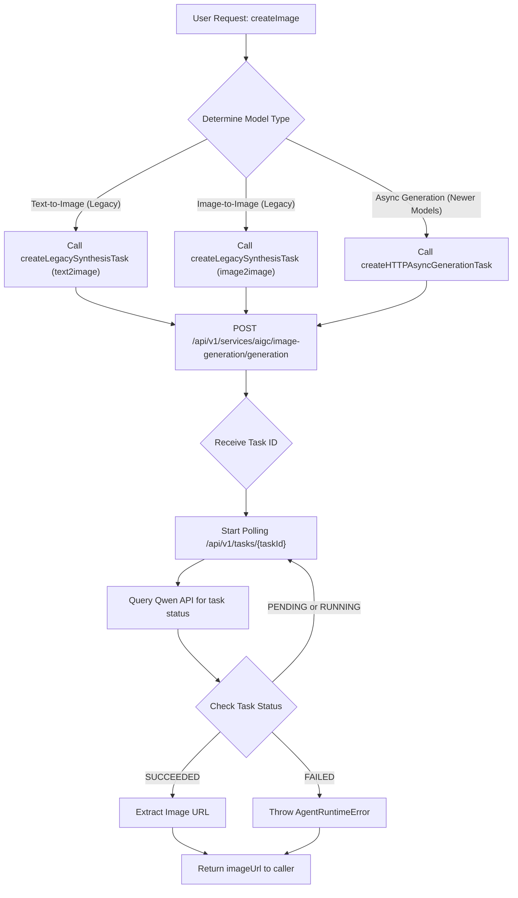
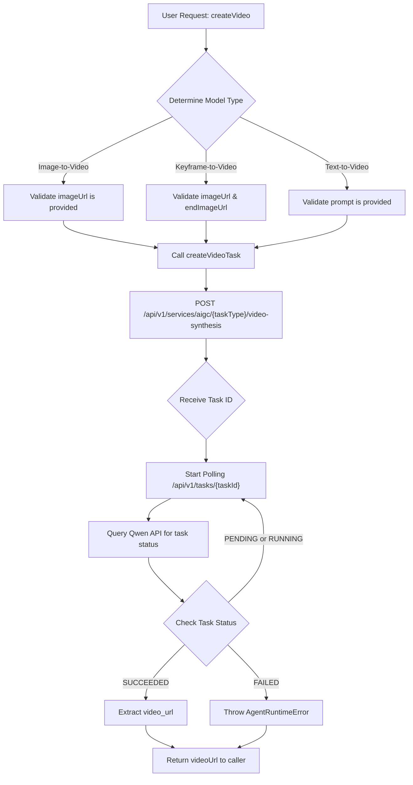
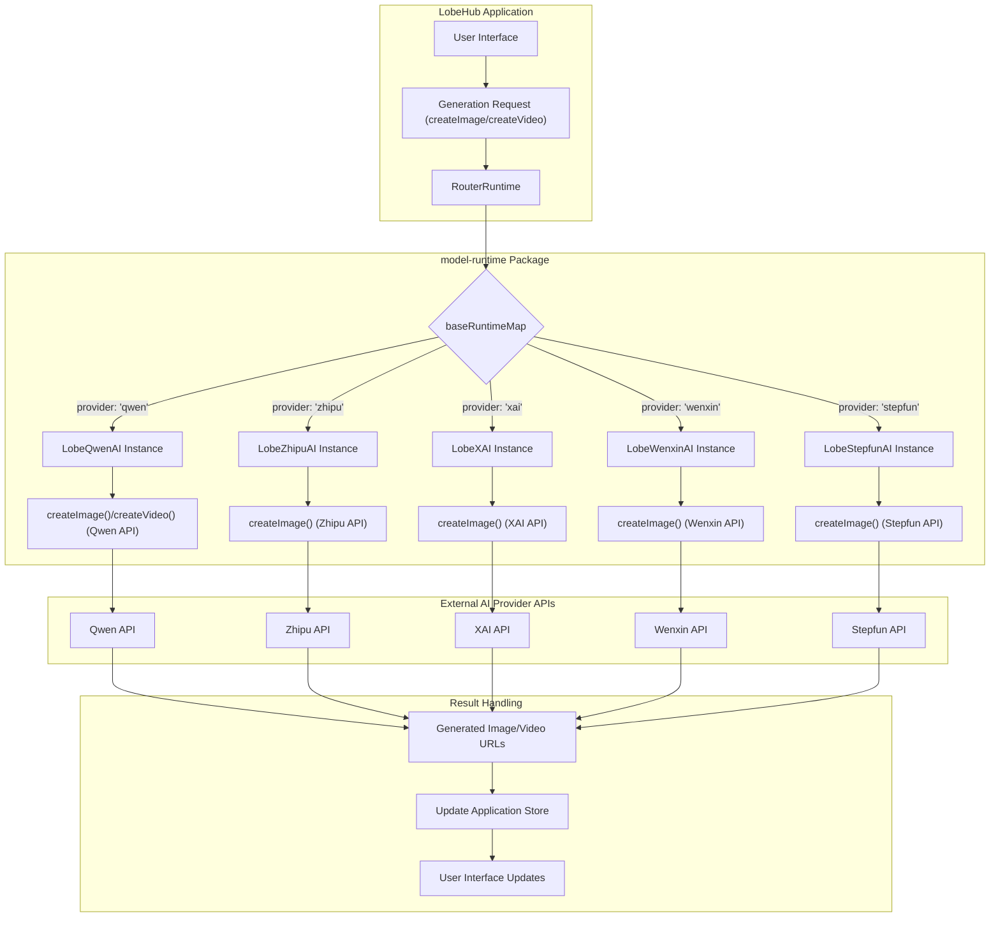

<!-- source: DeepWiki mcp.deepwiki.com · repo lobehub/lobehub · page 3.6 Image and Video Generation Runtimes · fetched 2026-10-29 -->

# Image and Video Generation Runtimes

Relevant source files

The following files were used as context for generating this wiki page:

- [apps/desktop/src/main/services/__tests__/imessageBridgeSrv.test.ts](apps/desktop/src/main/services/__tests__/imessageBridgeSrv.test.ts)
- [apps/desktop/src/main/services/imessageBridgeSrv.ts](apps/desktop/src/main/services/imessageBridgeSrv.ts)
- [apps/server/src/services/search/impls/jina/index.test.ts](apps/server/src/services/search/impls/jina/index.test.ts)
- [packages/agent-runtime/package.json](packages/agent-runtime/package.json)
- [packages/const/package.json](packages/const/package.json)
- [packages/context-engine/package.json](packages/context-engine/package.json)
- [packages/electron-client-ipc/README.md](packages/electron-client-ipc/README.md)
- [packages/electron-client-ipc/package.json](packages/electron-client-ipc/package.json)
- [packages/electron-server-ipc/README.md](packages/electron-server-ipc/README.md)
- [packages/electron-server-ipc/package.json](packages/electron-server-ipc/package.json)
- [packages/electron-server-ipc/src/const.ts](packages/electron-server-ipc/src/const.ts)
- [packages/electron-server-ipc/src/index.ts](packages/electron-server-ipc/src/index.ts)
- [packages/electron-server-ipc/src/ipcClient.test.ts](packages/electron-server-ipc/src/ipcClient.test.ts)
- [packages/electron-server-ipc/src/ipcClient.ts](packages/electron-server-ipc/src/ipcClient.ts)
- [packages/electron-server-ipc/src/ipcServer.ts](packages/electron-server-ipc/src/ipcServer.ts)
- [packages/electron-server-ipc/src/types/index.ts](packages/electron-server-ipc/src/types/index.ts)
- [packages/model-bank/src/aiModels/minimax.ts](packages/model-bank/src/aiModels/minimax.ts)
- [packages/model-bank/src/aiModels/moonshot.ts](packages/model-bank/src/aiModels/moonshot.ts)
- [packages/model-bank/src/aiModels/opencodeCodingPlan.ts](packages/model-bank/src/aiModels/opencodeCodingPlan.ts)
- [packages/model-bank/src/aiModels/opencodeZen.ts](packages/model-bank/src/aiModels/opencodeZen.ts)
- [packages/model-bank/src/modelProviders/comfyui.ts](packages/model-bank/src/modelProviders/comfyui.ts)
- [packages/model-bank/src/modelProviders/moonshot.ts](packages/model-bank/src/modelProviders/moonshot.ts)
- [packages/model-bank/src/modelProviders/opencodeCodingPlan.ts](packages/model-bank/src/modelProviders/opencodeCodingPlan.ts)
- [packages/model-bank/src/modelProviders/opencodeZen.ts](packages/model-bank/src/modelProviders/opencodeZen.ts)
- [packages/model-bank/src/modelProviders/stepfun.ts](packages/model-bank/src/modelProviders/stepfun.ts)
- [packages/model-bank/src/modelProviders/zeroone.ts](packages/model-bank/src/modelProviders/zeroone.ts)
- [packages/model-runtime/package.json](packages/model-runtime/package.json)
- [packages/model-runtime/src/core/RouterRuntime/apiTypes.ts](packages/model-runtime/src/core/RouterRuntime/apiTypes.ts)
- [packages/model-runtime/src/core/RouterRuntime/baseRuntimeMap.ts](packages/model-runtime/src/core/RouterRuntime/baseRuntimeMap.ts)
- [packages/model-runtime/src/errors/classifier.test.ts](packages/model-runtime/src/errors/classifier.test.ts)
- [packages/model-runtime/src/providers/minimax/index.test.ts](packages/model-runtime/src/providers/minimax/index.test.ts)
- [packages/model-runtime/src/providers/minimax/index.ts](packages/model-runtime/src/providers/minimax/index.ts)
- [packages/model-runtime/src/providers/moonshot/index.test.ts](packages/model-runtime/src/providers/moonshot/index.test.ts)
- [packages/model-runtime/src/providers/moonshot/index.ts](packages/model-runtime/src/providers/moonshot/index.ts)
- [packages/model-runtime/src/providers/newapi/index.test.ts](packages/model-runtime/src/providers/newapi/index.test.ts)
- [packages/model-runtime/src/providers/newapi/index.ts](packages/model-runtime/src/providers/newapi/index.ts)
- [packages/model-runtime/src/providers/opencodeCodingPlan/index.test.ts](packages/model-runtime/src/providers/opencodeCodingPlan/index.test.ts)
- [packages/model-runtime/src/providers/opencodeCodingPlan/index.ts](packages/model-runtime/src/providers/opencodeCodingPlan/index.ts)
- [packages/model-runtime/src/providers/opencodeZen/index.ts](packages/model-runtime/src/providers/opencodeZen/index.ts)
- [packages/model-runtime/src/providers/qwen/createImage.test.ts](packages/model-runtime/src/providers/qwen/createImage.test.ts)
- [packages/model-runtime/src/providers/qwen/createImage.ts](packages/model-runtime/src/providers/qwen/createImage.ts)
- [packages/model-runtime/src/providers/qwen/createVideo.ts](packages/model-runtime/src/providers/qwen/createVideo.ts)
- [packages/model-runtime/src/providers/straico/index.test.ts](packages/model-runtime/src/providers/straico/index.test.ts)
- [packages/model-runtime/src/providers/wenxin/createImage.ts](packages/model-runtime/src/providers/wenxin/createImage.ts)
- [packages/model-runtime/src/utils/resolveSafeMaxTokens.test.ts](packages/model-runtime/src/utils/resolveSafeMaxTokens.test.ts)
- [packages/model-runtime/src/utils/resolveSafeMaxTokens.ts](packages/model-runtime/src/utils/resolveSafeMaxTokens.ts)
- [packages/prompts/package.json](packages/prompts/package.json)
- [src/routes/(main)/agent/channel/channelLoader.ts](src/routes/(main)/agent/channel/channelLoader.ts)
- [src/spa/router/channelDataLoader.ts](src/spa/router/channelDataLoader.ts)
- [src/spa/router/channelDataLoader.wiring.test.ts](src/spa/router/channelDataLoader.wiring.test.ts)

This page details the implementation of image and video generation capabilities within LobeHub, focusing on the `createImage` and `createVideo` runtime paths. It covers the integration with various AI providers such as Qwen, XAI, Stepfun, Zhipu, and Wenxin, the image and video model cards and parameters involved, and how these generation features integrate with the application's store and UI.

---

## Image Generation Runtimes

LobeHub supports image generation through multiple AI providers. The core logic handling image generation requests is encapsulated within the `model-runtime` package, primarily through provider-specific `createImage` functions. These functions abstract provider API differences and present a unified interface.

Each `createImage` function receives:
- `CreateImagePayload`: includes the model identifier and generation parameters.
- `CreateImageOptions`: includes API key(s) and base URLs.

They return a `CreateImageResponse` containing the URL(s) of the generated image(s).

### Qwen Image Generation

The Qwen provider implementation is in `packages/model-runtime/src/providers/qwen/createImage.ts`(). It supports both **text-to-image** and **image-to-image** generation modes with asynchronous task management:

#### Supported Models

- **Text-to-Image:**
  - Models matching prefixes like `wan2.(2|5)-t2i-`, `wanx2.(0|1)-t2i-`, `wanx-v1`, `qwen-image(-plus)?`, `stable-diffusion-`, `flux-`
- **Image-to-Image:**
  - Models matching `wan2.(2|5)-i2i-`
- **Models requiring synchronous calls only:**
  - `qwen-image-(edit|max)`, `qwen-image-2.0`, `z-image-turbo`
- **Models requiring input image(s):**
  - `qwen-image-edit`, `wan2.(2|5)-i2i-`, `wan2.6-image`

#### Workflow

1. **Task Creation:**  
   Depending on the model type, Qwen image generation initiates a task using one of two paths:  
   - `createLegacySynthesisTask`: For legacy models using `/text2image` or `/image2image` endpoints.  
   - `createHTTPAsyncGenerationTask`: For newer async models calling `/image-generation/generation`.  

2. **Polling:**  
   For asynchronous tasks, the runtime polls the Qwen `/tasks/{taskId}` endpoint, checking the task status until it is `SUCCEEDED` or `FAILED`.  

3. **Result Extraction:**  
   The function `extractImageUrlFromTaskResult` extracts the generated image URL from task results for return.

#### Base URL Handling

- If the caller provides a `baseURL` option, it is used.
- Otherwise, a default Qwen base URL is applied internally.
- This dynamic baseURL usage is verified in dedicated tests.

#### Qwen Image Generation Flow Diagram

Sources:
- [packages/model-runtime/src/providers/qwen/createImage.ts:11-269]()
- [packages/model-runtime/src/providers/qwen/createImage.test.ts:27-82]()

---

### Zhipu Image Generation

Zhipu provider image generation is implemented in the `createZhipuImage` function inside `packages/model-runtime/src/providers/zhipu/createImage.ts`(). The flow parallels Qwen's:

- Task is created by POSTing to Zhipu's image generation endpoint.
- Asynchronous polling is performed using helper utilities such as `asyncifyPolling`.
- Upon success, the image URL is extracted from the response.

Sources:
- [packages/model-runtime/src/providers/zhipu/createImage.ts]()

---

### Wenxin Image Generation

The Wenxin provider uses Baidu's Wenxin platform for image generation (`packages/model-runtime/src/providers/wenxin/createImage.ts`()).

- Image generation requests are sent to Wenxin's API.
- Polling is managed by `asyncifyPolling` for asynchronous task completion.
- The resulting image URL is returned once generation finishes.

Sources:
- [packages/model-runtime/src/providers/wenxin/createImage.ts]()

---

### XAI and Stepfun Image Generation

While not extensively detailed in code snippets, LobeHub integrates with:

- **XAI** — runtime class: `LobeXAI`
- **Stepfun** — runtime class: `LobeStepfunAI`

They are registered in the `baseRuntimeMap` indicating that they support image generation capabilities. The integration likely follows the general pattern of task creation and asynchronous polling as seen in Qwen.

Sources:
- [packages/model-runtime/src/core/RouterRuntime/baseRuntimeMap.ts:16-39]()

---

## Video Generation Runtimes

Video generation is primarily supported by the Qwen provider in `packages/model-runtime/src/providers/qwen/createVideo.ts`().

### Qwen Video Generation

The Qwen video generation supports different video types:

- **Image-to-Video:** Models with prefixes like `wan2.(2|5)-i2v-`, `wanx2.(0|1)-i2v-`, and keywords like `img2video`, `reference2video`, `i2v`, `it2v`.
- **Keyframe-to-Video:** Models such as `wan2.(2|5)-kf2v-`, `start-end2video`, `kf2v`.
- **Reference-to-Video:** Models like `r2v`.

#### Workflow

1. **Pre-validation:**  
   Validate parameters required by the model type; for example:
   - `imageUrl` must be present for image-to-video.
   - Both `imageUrl` and `endImageUrl` are needed for keyframe-to-video models.

2. **Task Creation:**  
   The `createVideoTask` function constructs the input media array depending on the model prefix and supplied images, then sends a POST request to the video synthesis endpoint.

3. **Polling:**  
   Use the `pollQwenVideoStatus` function, which calls `queryQwenVideoStatus` to poll status until completion or failure.

4. **Result Extraction:**  
   On success, extract the `video_url` from the task response and return.

#### Qwen Video Generation Flow Diagram

Sources:
- [packages/model-runtime/src/providers/qwen/createVideo.ts:29-243]()

---

## Image and Video Model Cards and Parameters

The `model-bank` package provides static metadata definitions for each AI model, including those supporting image and video generation.

- These model cards include properties such as:
  - Model `id`
  - Capabilities (`abilities`: e.g., `image`, `video`)
  - Pricing details
  - Context window size
  - Supported parameters and those to disable or extend

- The `CreateImagePayload` and `CreateVideoPayload` define the request structure:
  - `model`: model ID string
  - `params`: object with model-specific generation parameters like `prompt`, `size`, `aspectRatio`, `seed`, `imageUrl`, `imageUrls`, `endImageUrl`, etc.

- The model runtime layer uses utilities like `resolveParameters` to normalize and validate parameters against model constraints before issuing API calls.

The `moonshotChatModels` from `packages/model-bank/src/aiModels/moonshot.ts` provide advanced chat models that include video and vision capabilities, often with extended parameter support such as reasoning effort toggles.

Sources:
- [packages/model-runtime/src/providers/zhipu/index.ts:97-120]()
- [packages/model-bank/src/aiModels/moonshot.ts:1-128]()

---

## Generation Store and UI Integration

Generated images and videos are persisted and managed via the application's state management system, primarily implemented using Zustand stores.

- The UI components query these stores to display generation results.
- Upon successful generation, the `CreateImageResponse` or `CreateVideoResponse` objects (which contain URLs) are committed to the store.
- This triggers UI updates to show newly created media assets.

API endpoint constants for models and pricing are maintained and used for frontend-backend interactions related to generation tasks.

Sources:
- [src/services/__tests__/_url.test.ts:11-16]()

---

## Runtime Map Integration

The `baseRuntimeMap` in the `model-runtime` package serves as a centralized registry mapping AI provider identifiers to their runtime classes.

Key entries related to image and video generation include:

| Provider ID | Runtime Class      | Supported Generation          |
|-------------|--------------------|------------------------------|
| `qwen`      | `LobeQwenAI`       | Image/video generation        |
| `zhipu`     | `LobeZhipuAI`      | Image generation              |
| `xai`       | `LobeXAI`          | Image generation              |
| `wenxin`   | `LobeWenxinAI`     | Image generation              |
| `stepfun`   | `LobeStepfunAI`    | Image generation              |

These runtime classes implement `createImage` and `createVideo` methods that direct calls to specific provider APIs.

### Architecture Integration Diagram

Sources:
- [packages/model-runtime/src/core/RouterRuntime/baseRuntimeMap.ts:21-40]()
- [packages/model-runtime/src/core/RouterRuntime/apiTypes.ts:3-21]()
- [src/services/__tests__/_url.test.ts:11-16]()

---

# Summary

LobeHub's image and video generation runtimes provide a unified, extensible platform to interact with multiple AI providers exhibiting different API styles and capabilities. Centralized handling allows consistent polling, error management, and parameter resolution.

This system is tightly integrated with model metadata from the model bank, leveraging runtime dispatch via the `baseRuntimeMap`. The generated media outputs are seamlessly integrated into the application's state and surfaced in the UI, enabling advanced multi-model generation features for end-users.

---

# References

- Qwen Image Generation: `packages/model-runtime/src/providers/qwen/createImage.ts` (lines 1-269)
- Qwen Image Generation Tests: `packages/model-runtime/src/providers/qwen/createImage.test.ts` (lines 27-82)
- Qwen Video Generation: `packages/model-runtime/src/providers/qwen/createVideo.ts` (lines 29-243)
- Zhipu Image Generation: `packages/model-runtime/src/providers/zhipu/createImage.ts`
- Wenxin Image Generation: `packages/model-runtime/src/providers/wenxin/createImage.ts`
- Base Runtime Map: `packages/model-runtime/src/core/RouterRuntime/baseRuntimeMap.ts` (lines 21-40)
- Moonshot Model Cards: `packages/model-bank/src/aiModels/moonshot.ts` (lines 1-129)
- Model Parameter Resolution: `packages/model-runtime/src/providers/zhipu/index.ts` (lines 97-120)
- API Endpoint Constants and Testing: `src/services/__tests__/_url.test.ts` (lines 11-16)

Sources:
- packages/model-runtime/src/providers/qwen/createImage.ts
- packages/model-runtime/src/providers/qwen/createImage.test.ts
- packages/model-runtime/src/providers/qwen/createVideo.ts
- packages/model-runtime/src/providers/zhipu/createImage.ts
- packages/model-runtime/src/providers/wenxin/createImage.ts
- packages/model-runtime/src/core/RouterRuntime/baseRuntimeMap.ts
- packages/model-bank/src/aiModels/moonshot.ts
- packages/model-runtime/src/providers/zhipu/index.ts
- src/services/__tests__/_url.test.ts

---

