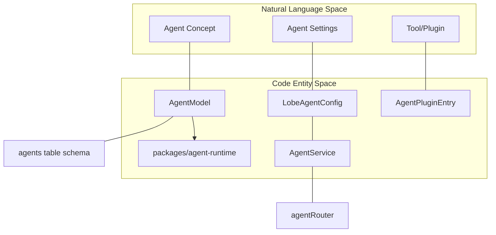
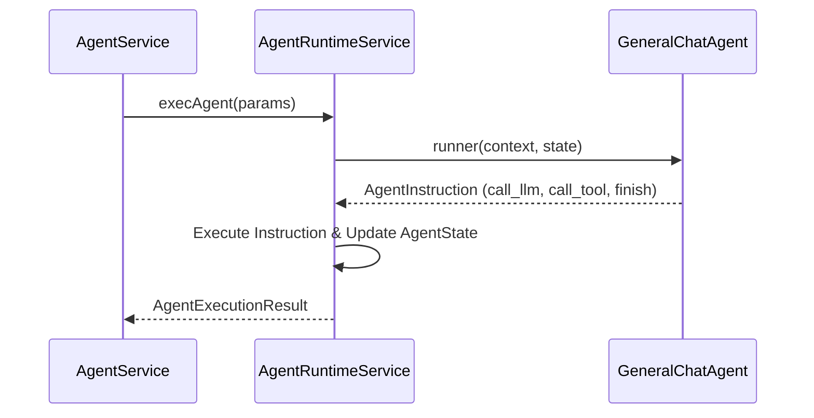

<!-- source: DeepWiki mcp.deepwiki.com · repo lobehub/lobehub · page 4 AI Agent System · fetched 2026-10-29 -->

# AI Agent System

Relevant source files

The following files were used as context for generating this wiki page:

- [apps/server/src/routers/lambda/__tests__/agent.test.ts](apps/server/src/routers/lambda/__tests__/agent.test.ts)
- [apps/server/src/routers/lambda/agent.ts](apps/server/src/routers/lambda/agent.ts)
- [apps/server/src/services/agent/index.test.ts](apps/server/src/services/agent/index.test.ts)
- [apps/server/src/services/agent/index.ts](apps/server/src/services/agent/index.ts)
- [locales/en-US/suggestQuestions.json](locales/en-US/suggestQuestions.json)
- [locales/zh-CN/suggestQuestions.json](locales/zh-CN/suggestQuestions.json)
- [packages/database/src/models/__tests__/agent.test.ts](packages/database/src/models/__tests__/agent.test.ts)
- [packages/database/src/models/agent.ts](packages/database/src/models/agent.ts)
- [packages/database/src/utils/agencyConfigDevices.ts](packages/database/src/utils/agencyConfigDevices.ts)
- [packages/locales/src/default/suggestQuestions.ts](packages/locales/src/default/suggestQuestions.ts)
- [packages/prompts/src/chains/builderSuggestion.test.ts](packages/prompts/src/chains/builderSuggestion.test.ts)
- [packages/prompts/src/chains/builderSuggestion.ts](packages/prompts/src/chains/builderSuggestion.ts)
- [packages/types/src/agent/index.ts](packages/types/src/agent/index.ts)
- [packages/types/src/agent/item.ts](packages/types/src/agent/item.ts)
- [src/features/AgentBuilder/AgentBuilderWelcome.tsx](src/features/AgentBuilder/AgentBuilderWelcome.tsx)
- [src/features/AgentBuilder/SuggestionChips/feedbackStore.test.ts](src/features/AgentBuilder/SuggestionChips/feedbackStore.test.ts)
- [src/features/ChatInput/ControlBar/__tests__/useCommitWorkingDirectory.test.tsx](src/features/ChatInput/ControlBar/__tests__/useCommitWorkingDirectory.test.tsx)
- [src/features/ChatInput/ControlBar/useCommitWorkingDirectory.ts](src/features/ChatInput/ControlBar/useCommitWorkingDirectory.ts)
- [src/features/SuggestQuestions/useRandomQuestions.ts](src/features/SuggestQuestions/useRandomQuestions.ts)
- [src/services/agent.test.ts](src/services/agent.test.ts)
- [src/services/agent.ts](src/services/agent.ts)
- [src/store/agent/slices/agent/action.test.ts](src/store/agent/slices/agent/action.test.ts)
- [src/store/agent/slices/agent/action.ts](src/store/agent/slices/agent/action.ts)
- [src/store/agent/slices/builtin/action.ts](src/store/agent/slices/builtin/action.ts)
- [src/store/agent/slices/builtin/index.ts](src/store/agent/slices/builtin/index.ts)
- [src/store/agent/slices/builtin/initialState.ts](src/store/agent/slices/builtin/initialState.ts)
- [src/store/agent/slices/builtin/projection.ts](src/store/agent/slices/builtin/projection.ts)
- [src/store/agent/slices/builtin/replica.test.ts](src/store/agent/slices/builtin/replica.test.ts)

The AI Agent System in LobeHub defines the core intelligence and execution logic of the platform. It transitions from simple chat interactions to autonomous agentic workflows by combining structured configurations, a robust execution engine, and a multi-step decision loop.

## Overview

In LobeHub, an "Agent" is a specialized configuration of an LLM that includes a system role, a specific model provider, and a set of tools (plugins). The system orchestrates these agents through a Plan-Execute-Observe loop, allowing them to perform complex tasks, call external APIs, and collaborate in groups. The `AiAgentService` [apps/server/src/services/agent/index.ts:1-1]() is the central component managing agent execution, which can be triggered via tRPC, REST API, or scheduled cron jobs [apps/server/src/routers/lambda/agent.ts:168-185]().

For details on how agents are configured, see [Agent Configuration and Builder](#4.1).

### Agent-to-Code Mapping
The following diagram bridges the natural language concept of an "Agent" to the core technical entities within the codebase.

"Agent Entity Mapping"

Sources: [packages/database/src/models/agent.ts:40-45](), [packages/types/src/agent/item.ts:38-126](), [packages/types/src/agent/pluginConfig.ts:1-1](), [apps/server/src/services/agent/index.ts:1-1](), [apps/server/src/routers/lambda/agent.ts:149-150]()

---

## Agent Configuration and Builder
Agents are defined by the `LobeAgentConfig` [packages/types/src/agent/item.ts:38-126]() schema, which aggregates the system prompt (`systemRole`), model parameters, and enabled plugins. The `AgentModel` [packages/database/src/models/agent.ts:25-25]() handles persistence of agent configurations in the `agents` table [packages/database/src/schemas/index.ts](). The **Agent Builder** [src/features/AgentBuilder/AgentBuilderWelcome.tsx:39-40]() provides a natural language interface to generate these configurations automatically, interacting with the `AgentModel` to persist settings. The `AGENT_BUILDER_PROTECTED_FIELDS` [packages/database/src/models/agent.ts:145-154]() prevent the builder from accidentally modifying its own configuration.

For details, see [Agent Configuration and Builder](#4.1).

## Multi-Agent Groups and Collaboration
LobeHub supports sophisticated multi-agent interactions via the `chatGroups` schema [packages/database/src/schemas/index.ts](). The system supports orchestrator/supervisor modes and handles response ordering (sequential vs. parallel) to allow agents to collaborate within specific contexts. The `LobeAgentAgencyConfig` [packages/types/src/agent/agencyConfig.ts:1-1]() defines parameters for executing group agents.

For details, see [Multi-Agent Groups and Collaboration](#4.2).

## Agent Cron Jobs and Scheduling
Agents can be automated using cron expressions. The `agentCronJobs` feature allows for recurring tasks, where the system triggers agent execution at defined intervals, stored in the `agent_cron_jobs` table [packages/database/src/schemas/index.ts](). The `ScheduleAgentRunParams` type defines the parameters for scheduling an agent run.

For details, see [Agent Cron Jobs and Scheduling](#4.3).

## System Agents
Built-in system agents perform background tasks such as `historyCompress` (summarizing long conversations), `queryRewrite` (optimizing RAG searches), and `translation`. These are identified via `BUILTIN_AGENT_SLUGS` [packages/database/src/models/agent.ts:1-1]() and are managed by the `AgentService` [apps/server/src/services/agent/index.ts:1-1](). The `BuiltinAgentSliceActionImpl` [src/store/agent/slices/builtin/action.ts:93-93]() manages the state of these agents in the frontend.

For details, see [System Agents](#4.4).

## Agent Evaluation System
To ensure reliability, the system includes an evaluation framework. It tracks `agentEvals` against datasets using `asyncTasks` to benchmark agent performance and accuracy. The `CompletionLifecycle` plays a role in the evaluation pipeline.

For details, see [Agent Evaluation System](#4.5).

---

## Agent Runtime and Execution Engine
The `AgentRuntimeService` [apps/server/src/services/agent/index.ts:1-1]() in the server layer is the "Engine" that drives the agent's decision loop. It processes `AgentState` and manages the state transition between LLM calls and tool executions. The `CompletionLifecycle` manages the full lifecycle of an agent run.

### Execution Loop Logic
The runtime implements a decision loop that follows a Plan -> Execute pattern:
1.  **Plan**: The `GeneralChatAgent` (the "Brain") decides the next action (e.g., `call_llm`, `call_tool`) based on current `AgentState`.
2.  **Execute**: The `AgentService` [apps/server/src/services/agent/index.ts:1-1]() orchestrates the execution, resolving attachments and tools before dispatching to the runtime. The `execAgentMember` and `execAgentThreadRun` functions handle the execution of individual agent members and thread runs.

"Runtime Execution Flow"

Sources: [apps/server/src/services/agent/index.ts:1-1]()

For details, see [Agent Runtime and Execution Engine](#4.6).

## Agent Tracing and Observability
The `packages/agent-tracing` package provides deep visibility into agent execution. It records `ExecutionSnapshot` objects, allowing developers to view step-by-step traces for debugging agentic runs. The `HeteroTraceRecorder` is used for recording traces of heterogeneous agent runs.

For details, see [Agent Tracing and Observability](#4.7).

## Bot Channels and Platform Integration
Agents can be bridged to external platforms (Telegram, Discord, WeChat, Slack) via the `BotMessageRouter` and `AgentBridgeService`. This layer handles platform-specific context and routes messages. The `AgentShareModel` is used to manage agent sharing.

For details, see [Bot Channels and Platform Integration](#4.8).

## Heterogeneous Agents and Claude Code
LobeHub supports "Heterogeneous Agents," which are external agent processes (like `Claude Code`) bridged into the interface. This is managed by the `HeterogeneousAgentService` and can be executed via a `deviceGateway` for local or remote sandbox environments. The `dispatchHeteroAgent` function handles the dispatching of these agents. The `isHeterogeneousAgentModelId` [packages/database/src/models/agent.ts:4-4]() utility helps identify these agents.

For details, see [Heterogeneous Agents and Claude Code](#4.9).

## Agent Tasks and Task Lifecycle
The Task System manages complex, long-running objectives. It includes `TaskModel` for persistence and `TaskCurrentActivity` for tracking task status. The `acquireTopicStartReservation` function is used to reserve a topic for a task.

For details, see [Agent Tasks and Task Lifecycle](#4.10).

## Verification and Delivery Checks (Verify)
The `Verify` subsystem provides automated quality control. It integrates with agent operations to ensure that generated outputs meet specific criteria (rubrics) before delivery, supporting auto-repair strategies. The `instantiateVerifyPlanOnStart` function is part of this system.

For details, see [Verification and Delivery Checks (Verify)](#4.11).

## Goal Graph System
The Goal Graph feature enables long-horizon planning. The `GoalService` manages the `goalGraph` schema, and the `decideNextMove` logic allows agents to track and execute multi-step goals across multiple runs. The `GoalIdentifier` is used to identify goals.

For details, see [Goal Graph System](#4.12).

## Chaos Engineering (achaos)
Resilience is tested using the `@achaos` packages. This system allows for database mutation rollbacks and process injection to test agent behavior under failure conditions, defined under `.agents/chaos/`. The `AgentOperationModel` is used to track agent operations during chaos experiments.

For details, see [Chaos Engineering (achaos)](#4.13).

---
**Sources:**
- `AgentModel` definition: [packages/database/src/models/agent.ts:25-25]()
- `AgentService` definition: [apps/server/src/services/agent/index.ts:1-1]()
- `AGENT_BUILDER_PROTECTED_FIELDS`: [packages/database/src/models/agent.ts:145-154]()
- `Agent Builder Welcome`: [src/features/AgentBuilder/AgentBuilderWelcome.tsx:39-40]()
- `BUILTIN_AGENT_SLUGS`: [packages/database/src/models/agent.ts:1-1]()
- `BuiltinAgentSliceActionImpl`: [src/store/agent/slices/builtin/action.ts:93-93]()
- `chatGroups` schema: [packages/database/src/schemas/index.ts]()
- `isHeterogeneousAgentModelId`: [packages/database/src/models/agent.ts:4-4]()
- `LobeAgentAgencyConfig`: [packages/types/src/agent/agencyConfig.ts:1-1]()
- `LobeAgentConfig` schema: [packages/types/src/agent/item.ts:38-126]()
- `agentRouter`: [apps/server/src/routers/lambda/agent.ts:149-150]()
- `agentCronJobs`: [packages/database/src/schemas/index.ts]()
- `AgentService` in `agentRouter`: [apps/server/src/routers/lambda/agent.ts:138-138]()
- `AgentModel` in `agentRouter`: [apps/server/src/routers/lambda/agent.ts:138-138]()
- `AgentSliceActionImpl` `mergeAgentConfig`: [src/store/agent/slices/agent/action.ts:92-116]()
- `AgentSliceActionImpl` `updateAgentConfigById`: [src/store/agent/slices/agent/action.ts:40-40]()
- `useCommitWorkingDirectory` `updateAgentConfigById`: [src/features/ChatInput/ControlBar/useCommitWorkingDirectory.ts:108-108]()
- `useCommitWorkingDirectory` `updateAgentRuntimeEnvConfigById`: [src/features/ChatInput/ControlBar/useCommitWorkingDirectory.ts:109-109]()
- `createAgent` service: [src/services/agent.ts:140-147]()
- `createAgentOnly` service: [src/services/agent.ts:173-179]()
- `getAgentConfigById` service: [src/services/agent.ts:210-212]()
- `updateAgentConfig` service: [src/services/agent.ts:220-226]()
- `updateAgentMeta` service: [src/services/agent.ts:234-239]()
- `countAgents` service: [src/services/agent.ts:247-249]()
- `queryAgents` service: [src/services/agent.ts:257-260]()
- `getAgentByMarketIdentifier` service: [src/services/agent.ts:124-126]()
- `getAgentByForkedFromIdentifier` service: [src/services/agent.ts:131-133]()
- `checkByMarketIdentifier` service: [src/services/agent.ts:116-118]()
- `publishAgentToWorkspace` service: [src/services/agent.ts:156-158]()
- `setAgentVisibility` service: [src/services/agent.ts:165-167]()
- `createAgentKnowledgeBase` service: [src/services/agent.ts:183-191]()
- `deleteAgentKnowledgeBase` service: [src/services/agent.ts:194-196]()
- `toggleKnowledgeBase` service: [src/services/agent.ts:198-203]()
- `createAgentFiles` service: [src/services/agent.ts:206-206]()
- `AVAILABLE_AGENTS_CONTEXT_QUERY_LIMIT`: [src/services/agent.ts:7-7]()
- `AgentItem` type: [packages/types/src/agent/item.ts:168-212]()
- `CreateAgentSchema`: [packages/types/src/agent/item.ts:135-163]()
- `AgentRankItem`: [packages/types/src/agent/item.ts:17-25]()
- `DeviceBoundAgentItem`: [packages/types/src/agent/item.ts:28-36]()
- `AgentConfigSyncResult`: [src/store/agent/slices/agent/action.ts:119-124]()
- `BuiltinAgentSyncResult`: [src/store/agent/slices/builtin/action.ts:27-31]()
- `AgentSliceActionImpl` `startStreamingSystemRole`: [src/store/agent/slices/agent/action.test.ts:110-110]()
- `AgentSliceActionImpl` `appendStreamingSystemRole`: [src/store/agent/slices/agent/action.test.ts:111-111]()
- `AgentSliceActionImpl` `finishStreamingSystemRole`: [src/store/agent/slices/agent/action.test.ts:130-130]()
- `AgentSliceActionImpl` `optimisticUpdateAgentConfig`: [src/store/agent/slices/agent/action.test.ts:105-105]()

---

